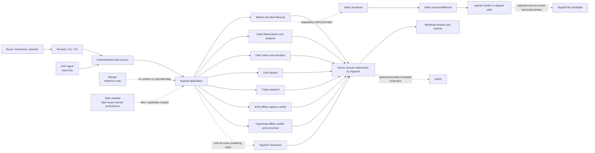
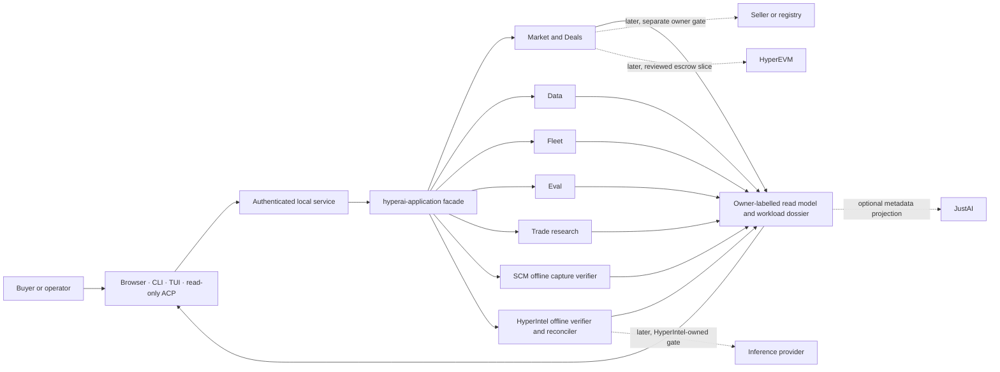
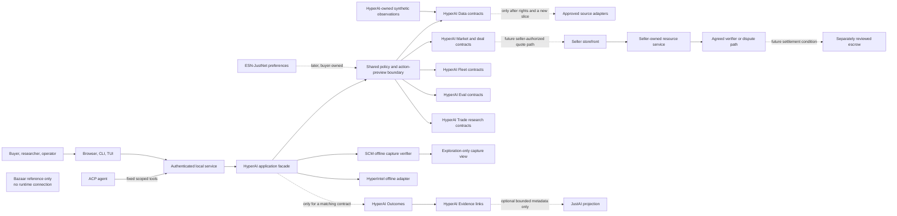

# HyperAI: End-to-End Compute Interface and Integration Plan

Status: active architecture and sequencing plan. The current HyperAI workspace
contains local shell and service clients, synthetic market/deal flows, offline
source adapters, and separate Data, Fleet, Eval, Trade, and ACP workspaces
under their own state slices. This plan ties those capabilities into one
buyer-controlled workload journey while keeping source records, execution,
verification, custody, and settlement with their existing owners. Current
evidence and open gates are tracked in the linked state-slice records and Rust
subplan. This does not authorize Bazaar code or data reuse, provider access,
real-agent execution, SSH or live Fleet operation, paid compute, financial
trading, public publication, or production deployment.

Current stage: the shared local shell, service, application facade, domain
workspaces, offline source verifiers, and synthetic procurement trace are
present. The authenticated HyperIntel reconciliation route and populated
Inference-to-Activity browser flow pass local synthetic qualification. Market
history is now projected to browser Deals, CLI, and TUI from the Market-owned
history API and passes the bounded local client checks. The end-to-end product
remains in local qualification. The session-only Activity page now links
already-loaded Data, Fleet, Eval, and Trade results back to their owner
workspaces under
[`hyperai.bazaar.interface.session_activity_owner_links.v1`](state-slices.md#hyperai-bazaar-interface-session_activity_owner_linksv1).
Align the remaining client workflows around the same owner references and
policy outcomes; finish workflow-level accessibility and platform/client
qualification; then add any live read, action, settlement, or projection only
under its own owner-approved contract and state slice. Exact evidence and
open gates remain in the phase table and linked packets below.

## End-to-end refactor plan

This is the execution order for making the existing HyperAI desk the single
user-facing interface for the connected compute, research, and operations
workspaces. “Connect everything” means that users can navigate owner-backed
records and capabilities from one product surface; it does not mean merging
their runtimes, databases, credentials, or decision authority. Reuse the
current HyperAI shell, authenticated local service, application facade, and
domain modules. Do not rebuild their completed synthetic workflows.

| Stage | Work | Exit condition |
|---|---|---|
| 1. Close the shared interface seam | Inventory each local route and tool by owner, schema, authentication, effect, and supported client. Compare service registration, browser, CLI, TUI, and the narrower read-only ACP/MCP capability. Add compatibility checks for any material drift before choosing a route manifest or typed client. | Existing paths and schemas remain compatible; qualified clients preserve record IDs, digests, stage meanings, denials, and failure states. ACP remains read-only. |
| 2. Finish the synthetic buyer journey | Use the existing market-owned workload intent and trace to connect source-labelled supply, advisory observations, seller quote preview, buyer approval, mock fulfillment, verifier/disposition, and receipt. Exercise stale, missing, denied, conflicting, failed, duplicate, and inconclusive cases across the clients. | One reproducible local journey is traceable through owner references. Observations never become offers, approval, correctness, or payment authority; mock execution and disposition are labeled as such. |
| 3. Make the workspaces feel like one product | Keep Work, Research, and Operate navigation; link Market, Data, Inference, Fleet, Eval, Trade, SCM, and Activity through typed owner references. Use a shared visual hierarchy for source/freshness, comparable supply tables, deal timelines, provenance inspection, and action previews. | Task-based review shows that users can find source and freshness, compare compatible supply, and follow the deal without confusing observation, approval, execution, verification, and settlement. Qualify keyboard, assistive technology, responsive layouts, zoom, contrast, reduced motion, and recovery states for declared targets. |
| 4. Add read adapters one owner at a time | Preserve SCM's caller-supplied offline capture and HyperIntel's caller-selected offline verification/reconciliation. Any live registry, market-data, or provider read gets its own versioned adapter and source-specific rights, schema, freshness, retention, identity, and network policy. | Each adapter has a separate named state slice and owner approval. Unknown or stale data stays visible and cannot silently enter deal eligibility. Bazaar remains reference-only until exact code and data rights are established. |
| 5. Add actions and settlement last | Only after the local lifecycle and failure/recovery behavior are stable, consider seller negotiation/fulfillment, HyperIntel-owned routing, live Fleet, paid Eval, or compute escrow. Keep JustAI metadata projection and ESN-JustNet buyer preferences optional and separately owned. | Each action has its own contract, budgets, credential custody, confirmation, cancellation/recovery, and operator authority. HyperEVM escrow requires exact asset/verifier/dispute rules, contract review, and separately authorized testnet writes. Production, public projections, paid execution, and financial Trade remain separate gates. |

**Next implementation milestone:** complete Stage 1's route/auth/effect
inventory and compatibility checks, then qualify Stage 2 across the existing
clients. Stage 3 is part of the same local release candidate, not a reason to
add a new runtime. The remaining Data worker and platform qualifications stay
tracked by the [Rust subplan](compute-bazaar-rust-port-subplan.md); this
sequence does not mark those gates complete.

### Composition contract and refactor invariants

Use the existing path as the integration spine:

```text
Browser / CLI / TUI / scoped ACP or MCP
    -> authenticated HyperAI local service
    -> hyperai-application task workflow or read projection
    -> owner module or source-specific adapter
```

| Layer | Owns | Refactor rule |
|---|---|---|
| Clients | Navigation, task views, local drafts, accessible previews | Render the shared application results. Do not call providers or source repositories directly, carry credentials, infer record relationships, or authorize an owner action. |
| Local service | Local transport, authentication, session/CSRF policy, request limits, and route-to-application dispatch | Keep transport and access checks here. It is not a marketplace, universal record store, or substitute for a domain owner's action policy. |
| `hyperai-application` | Task-shaped composition, versioned connection inventory, normalized interface errors, and read-only cross-owner projections | Give clients one useful seam for a buyer/operator task. Delegate record validation and action decisions to the owner. Avoid pass-through methods that only rename another module's call. |
| Domain modules | Market deal records; Data catalog and query contracts; Fleet plans and simulator; Eval run contracts; Trade research | Keep schemas, state transitions, and evidence meaning with the owning module. The procurement `WorkloadTraceV1` remains read-only and procurement-scoped; do not infer a general workload identity. |
| Source adapters | Source-specific translation and verification, including the existing SCM capture and HyperIntel offline adapters | Preserve each source's schema, identity, trust basis, freshness, failure, and rights. Keep adapters with their owning domain where practical; add a separate crate only when a concrete second implementation or dependency/lifecycle need justifies that seam. |
| Persistence and Activity | Each owner's records and retention policy; current Activity is a session view | Link owner records by typed reference and digest. Do not copy them into a universal deal/evidence ledger. Keep Activity explicitly incomplete until owner-backed durable events exist. |

A source-level route/auth/effect and client-call-site first pass is recorded
in the [route inventory](compute-bazaar-route-auth-effect-inventory-v1.md).
The separate [cross-client dossier](compute-bazaar-cross-client-dossier-v1.md)
rolls up workflow coverage and preserves the known inconclusive TUI/ACP
attempts without merging their evidence scopes.
It covers 50 literal API routes and the separate 15-route MCP/ACP capability
allowlist, and confirms that CLI, TUI, browser, and MCP/ACP do not expose the
same route set. The exact source registration comparison, 34 browser-interface
JavaScript tests, and locked/offline Rust tests for the HyperAI local stack and
clients passed for their stated scopes. Three existing browser/install tests
were ignored because their staged binary/browser prerequisites were absent.
This does not map every typed request/response schema and stable failure code
or prove the full route/client matrix. Keep Stage 1 open for those mappings
and complete denied, stale-digest, unsupported-schema, and error-parity checks.
Preserve current routes and schemas while adding compatibility coverage. Only
introduce a generated manifest or shared typed client if this review finds
concrete drift that two or more clients can stop duplicating; do not add an
integration bus or a generic adapter crate by default.

The buyer journey keeps these records distinct: registry listing and advisory
market observation; seller quote; buyer approval; seller-owned fulfillment
and usage; verifier or dispute decision; and settlement event. A signature
attributes a statement but does not prove correct computation or metering.
Price/availability analysis never grants offer eligibility or payment
authority. HyperIntel routing, JustAI's optional bounded metadata projection,
ESN buyer preferences, HyperAI Outcomes/HIP-4 resolution, and seller
fulfillment remain with their named owners and separate gates. JustAI does not
provide compute execution, payment authority, or an active custody service in
this integration plan. Composed Platform may later serve
as an isolated qualification harness for a pinned adapter or transformation;
it is not this product's runtime or production reviewer, and its dirty
checkout is not an import source.

**What “beautiful” means here:** the interface makes the next buyer or
operator decision clear while keeping source, freshness, ownership, permission,
uncertainty, and consequences visible. Use a concise summary, a task-specific
workspace, and a provenance/context view; use timelines for lifecycle records,
tables for comparison, and charts only with an accessible text equivalent.
Visual polish does not imply trust, correctness, availability, or settlement.
The measurable design tasks and accessibility criteria remain in the
[experience quality bar](#experience-quality-bar) and
[cross-product acceptance criteria](#cross-product-acceptance-criteria).

## Program roadmap at a glance

Treat this as a HyperAI product refactor that composes capabilities, not a
wholesale merge of Bazaar, Simple Compute Market, HyperIntel, or JustAI. The
existing HyperAI service and application facade are the integration spine;
each domain remains authoritative for its records, runtime, credentials,
verification, custody, and actions. The detailed phase table and linked
packets below own implementation status and proof requirements.

### Composition map

One HyperAI workspace connects the buyer journey to research and operations.
Clients share the authenticated local service and application facade; the
facade delegates to owner-specific domains and offline adapters. Workload and
Activity views join those results by typed references and digests, while
authoritative records remain with their owners.



Solid paths describe the local composition and offline inputs available for
qualification. The Bazaar path is a design reference only; it provides no
runtime or data. Other dashed paths are future, separately gated connections.
Market observations remain advisory, HyperIntel does not route or execute, an
outcome link applies only to a matching claim, and a local mock disposition is
not a payment event. The detailed deal data flow below owns the quote,
fulfillment, verifier, and settlement record contracts.

| Step | Deliverable | Exit condition |
|---|---|---|
| 1. Preserve and label the layers | Keep the MIT Simple Compute Market workspace independently owned; use only its pinned offline capture path first. Keep HyperIntel to its committed, offline verification and reconciliation adapters. Treat Bazaar as reference-only until rights for exact code, data, dependencies, and assets are established. Keep JustAI, ESN-JustNet, Outcomes, and HyperEVM optional and within their own charters and contracts. | Every connection has a named owner, pin or source identity, maturity label, and explicit nonclaims. No Bazaar material is copied on unresolved rights. |
| 2. Make HyperAI the coherent surface | Use one authenticated local service and `hyperai-application` facade for browser, CLI, TUI, and read-only ACP. Present Work, Research, and Operate around user tasks, with a connection inventory, provenance inspector, permission model, and shared failure vocabulary. | Clients read the same typed owner references and policy outcomes. No second service, universal ledger, or permission-bypassing connector bus is introduced. |
| 3. Finish the buyer-controlled local journey | Qualify one synthetic workload from intent and constraints through source-labelled comparison, seller quote, digest-bound approval, mock fulfillment, separate evaluation/verifier/dispute records, and portable receipt. Keep unknown, stale, denied, failed, duplicate, conflicting, and inconclusive outcomes distinct. | The exact synthetic path and its negative cases are traceable through owner-held records. Mock execution and disposition are never described as real work, correctness, or payment. |
| 4. Link neighboring workspaces by owner reference | **Market history projection is implemented and locally qualified** for browser Deals, CLI, and TUI under [`hyperai.compute_market.local_history_clients.v1`](state-slices.md#hyperai-compute_market-local_history_clientsv1). The [`local_history_pagination`](state-slices.md#hyperai-compute_market-local_history_paginationv1) slice qualifies two-row service traversal after restart and browser Deals Load more. The follow-up [`local_history_client_pagination`](state-slices.md#hyperai-compute_market-local_history_client_paginationv1) qualifies two-page authenticated CLI traversal and TUI cursor handling; [`interactive TUI pagination`](state-slices.md#hyperai-bazaar-desk_runtime_tui_market_history_interactive_paginationv1) now qualifies the installed TUI's authenticated second-page service flow on macOS arm64. The session-only Activity page links already-loaded Data, Fleet, Eval, and Trade results to their owner workspaces under [`hyperai.bazaar.interface.session_activity_owner_links.v1`](state-slices.md#hyperai-bazaar-interface-session_activity_owner_linksv1). Do not attach an independent Eval run to a deal automatically. | CLI traversal passed against the two fixed synthetic records; the installed TUI displayed both service-generated pages with exact cursor and page-digest verification and no third request. The Activity links passed one local synthetic Chrome workflow, including exact owner digests, source labels, focus return, and no re-fetch on navigation. Other TUI platforms and broad accessibility remain unverified. Broader durable/cross-client links must preserve source, schema, digest, time, freshness, trust basis, and claim ceiling; missing links remain visible. |
| 5. Make the experience consistent and usable | Qualify the shared journey across browser, CLI, TUI, and read-only ACP; finish task-based usability, keyboard and assistive technology, responsive layout, contrast, zoom, reduced motion, and recovery-state work. | Users can identify source and freshness, compare asking prices with advisory analysis, and follow quote-to-receipt without confusing observation, approval, execution, verification, or settlement. Record task completion and misinterpretation evidence. |
| 6. Add live connections one at a time | For each requested source or action, create an owner-specific contract and state slice covering rights, endpoint/schema, identity and credential custody, freshness, retention, permissions, budgets, retries, revocation, recovery, and stop conditions. Start read-only; authorize writes separately. | The exact adapter passes its own local and authorized external gates. A connection never inherits another owner's approval or expands from read to action. |
| 7. Evaluate settlement and release last | Only after local deal, fulfillment, verifier, timeout, dispute, and reconciliation contracts are complete, review a specific HyperEVM escrow/asset/verifier configuration. Keep JustAI metadata projection optional and outside payment authority; keep HIP-3/financial Trade and production separate. | Independent contract review and exact testnet authorization precede any testnet write. Paid execution, public release, mainnet, custody, and production each require separate named authority. |

The first completion target is Step 5 for the bounded local synthetic journey;
Steps 6 and 7 are later product decisions, not prerequisites or implied
permissions. Bazaar design concepts may inform independently authored HyperAI
modules, but Bazaar code and data remain excluded while their exact rights are
unresolved. See the [connection model](#what-one-hyperai-interface-means),
[workload trace contract](#shared-integration-contract), and
[detailed phase gates](#phased-implementation-and-exit-gates) for the owning
specifications.

Stale quote keyboard-focus follow-up (2026-10-02): the fixed HTTP 409 recovery
message remains visible and keyboard focus returns to its status with a
visible focus indicator. The single browser attempt was `INCONCLUSIVE` because
Chromium exposed the node as role `status` with an empty computed accessible
name; it emitted no final route/request summary. Runner cleanup completed.
The focus packet is closed and will not be retried. A separate local packet
targets the accessible-name mapping without changing request or action
authority: see the [accessible-name packet](compute-bazaar-market-conflict-accessible-name-packet.md)
and [state slice](state-slices.md#hyperai-bazaar-interface-market_conflict_accessible_namev1).

Accessible-name follow-up (2026-10-02): WAI-ARIA author naming is applied to
the polite stale-quote status with the same normalized fixed text shown on
screen. Chromium computed the intended role/name, preserved visible keyboard
focus, and the local synthetic run observed exactly one comparison read and
one stale quote-preview POST, with zero approvals, completions, or other
writes. The 33 route checks, reduced-motion checks across three viewports, and
disposable-run cleanup passed. This is `INTERNAL_PASS` for that same-host
browser path, not broad screen-reader or cross-platform accessibility
qualification. Details are in the [accessible-name packet](compute-bazaar-market-conflict-accessible-name-packet.md)
and [state slice](state-slices.md#hyperai-bazaar-interface-market_conflict_accessible_namev1).

Supply-to-quote progress (2026-10-01): the buyer's displayed synthetic market
comparison now binds to the existing seller quote preview through one
versioned application response used by the authenticated local service,
browser, CLI, TUI, and read-only MCP V6/ACP v1 path. Focused Rust and interface
checks, root `lint:fast`, root `verify:contracts`, import verification, pinned
formatting, and diff hygiene passed. The one browser run failed earlier in
the general 720-by-500 Deals viewport check because the document overflowed
horizontally; it never reached the new quote action. The run was cleaned up,
so the feature path was unverified at that point. The subsequent diagnostics
and final passing browser attempt are recorded below under the
[boundary assertion packet](compute-bazaar-interface-quote-boundary-assertion-v1.md)
and [state slice](state-slices.md#hyperai-bazaar-interface-quote_boundary_assertionv1).
See also the [original supply-to-quote packet](compute-bazaar-supply-to-quote-packet.md).
No Bazaar source or data was imported.

Terminal quote-lifecycle progress (2026-10-01): the buyer-controlled local
synthetic quote now advances through preview, explicit approval, and mock
completion in the browser, CLI, and TUI using the same authenticated owner
routes and digest bindings. The CLI and TUI implementation passed the focused
root suite and `lint:fast`; the TUI and CLI each have local integration
coverage for stale-digest rejection and effect boundaries. ACP/MCP remain
read-only by design. This is `INTERNAL_PASS` for the tested local synthetic
flows only. It does not qualify installed clients, native platforms, broad
accessibility/usability, real fulfillment, or payment. See the
[terminal lifecycle packet](compute-bazaar-terminal-quote-lifecycle-packet.md)
and [state slice](state-slices.md#hyperai-bazaar-terminal_quote_lifecyclev1).

Installed CLI continuation (2026-10-02): the source-installed `hyperai` binary
passed the synthetic compare-to-quote-to-approval-to-receipt lifecycle using
its disposable loopback service. Stale preview/deal digests were rejected;
the exact quote and deal digests were preserved in the completion receipt.
This is `INTERNAL_PASS` for one installed macOS arm64 path. Installed TUI,
native platform, broad accessibility, real fulfillment, and payment claims
remain outside this result. See the
[installed lifecycle packet](compute-bazaar-installed-quote-lifecycle-packet.md).

Deals overflow diagnostic (2026-10-01): a fresh one-run packet added bounded
element-box reporting and reproduced the 720-by-500 overflow at 852 CSS
pixels of document scroll width. No ordinary rendered element box extended
past the viewport, so the cause remains `INCONCLUSIVE`; the quote action was
not reached. The runner and its temporary home were cleaned. A new packet is
required to inspect internal scroll widths and pseudo-element geometry, then
authorize a narrow CSS repair and one post-fix browser run. See the
[diagnostic packet](compute-bazaar-interface-deals-overflow-diagnostic-v1.md)
and [state slice](state-slices.md#hyperai-bazaar-interface-deals_overflow_diagnosticv1).
The expanded diagnostic isolated a hidden digest-description span that the
`.trace-summary span` rule had made visible; the selector now excludes
`[hidden]`, and root `lint:fast` plus import checks passed. The one authorized
post-change browser attempt failed during page evaluation with an invalid
JavaScript token before reporting a route result. The layout fix and quote
flow therefore remain unverified, and the browser allowance is consumed. A
fresh packet must diagnose that harness failure before another browser run;
see the [repair packet](compute-bazaar-interface-deals-overflow-repair-v1.md)
and [state slice](state-slices.md#hyperai-bazaar-interface-deals_overflow_repairv1).
The next exact slice adds only content-free evaluator call-site and parser
location reporting, then allows one local browser attempt; see the
[page-evaluation diagnostic](compute-bazaar-interface-page-evaluation-diagnostic-v1.md)
and [state slice](state-slices.md#hyperai-bazaar-interface-page_evaluation_diagnosticv1).
That run located the fault in the quote-preview expression at page column
1329; static parsing confirmed an unintended terminal double quote. The
following run passed the 720-by-500 Deals check and reached quote review, then
exposed a case-sensitive harness assertion. The one-expression correction and
final passing run are recorded below.
That exact case-normalization slice is recorded in the
[boundary assertion packet](compute-bazaar-interface-quote-boundary-assertion-v1.md)
and [state slice](state-slices.md#hyperai-bazaar-interface-quote_boundary_assertionv1).
Final browser qualification (2026-10-01): the case-normalized assertion
passed. The exact local run passed 33 workspace routes at desktop, 720px, and
mobile widths, 33 reduced-motion route checks, the selected-offer quote
preview and its digest bindings, and the 390px contained offers-table scroll.
The approval action remained separate and unused; cleanup closed both local
listeners and removed the temporary home. This is `INTERNAL_PASS` for that
synthetic browser path only. Broader accessibility/client parity, native
platform support, source rights, and all live operations remain open. See the
[assertion packet](compute-bazaar-interface-quote-boundary-assertion-v1.md)
and [state slice](state-slices.md#hyperai-bazaar-interface-quote_boundary_assertionv1).

Connection-inventory progress (2026-10-01):
`hyperai.bazaar.connection_inventory.v1` now gives the application one static,
versioned list of owners, recorded revisions, modes, descriptive surfaces, and
next gates. The browser, CLI, and TUI consume the authenticated local endpoint;
the legacy status response stays compatible. Bazaar remains reference-only
with no exposed surfaces until exact reuse rights are documented. Focused Rust
tests, interface tests, import verification, and offline root lint passed. The
optional headless browser command reached its route and layout assertions but
exited `INCONCLUSIVE` during Chrome helper cleanup; it is not counted as a
passed browser gate. See the [connection inventory packet](compute-bazaar-connection-inventory-packet.md)
and [state slice](state-slices.md#hyperai-bazaar-connection_inventoryv1).

Connection workspace links (2026-10-01): the inventory cards and detail list
now offer an **Open workspace** control only for renderer-allowlisted local
synthetic or offline caller-selected surfaces. The control uses the existing
page-navigation handler and a fixed route map; reference-only Bazaar and
disconnected/planned entries remain informational. Focused interface tests
and offline root lint pass for this renderer contract. The follow-up local
browser check reached Inference by pointer and Market by Tab/Enter, with focus
observed on each destination heading; restricted entries remained
informational. This is `INTERNAL_PASS` for those exact controls in one local
browser session, not a general accessibility or platform result. See the
[workspace-links packet](compute-bazaar-connection-workspace-links-packet.md),
[browser packet](compute-bazaar-interface-connection-workspace-browser-packet.md),
and [browser state slice](state-slices.md#hyperai-bazaar-interface-connection_workspace_browserv1).

The 2026-09-30 keyboard cancellation workflow exercised a pending synthetic
ACP prompt through cancellation and disconnect, but both runner identities
remain `INCONCLUSIVE` because Chrome Crashpad cleanup was not confirmed by the
runner. The interaction evidence does not close broader ACP accessibility or
client-policy parity; see the [v2 packet](compute-bazaar-interface-acp-cancel-keyboard-v2-packet.md).

The 2026-10-01 v3 cancellation continuation remains `INCONCLUSIVE`: its final
cleanup check found the exact Chrome Crashpad helper in the runner's process
group, and the error prevented workflow assertions from being retained. The
helper was terminated after the run and its disposable root removed. Do not
repeat v3; any further harness diagnosis needs a fresh state slice. See the
[v3 packet](compute-bazaar-interface-acp-cancel-keyboard-v3-packet.md).

The 2026-10-01 v4 process-list continuation also remains `INCONCLUSIVE`: the
runner reported browser group `5830` or service PID `5525` active and emitted
no workflow report. Both scopes were absent during later read-only checks, and
the disposable root was removed. Do not repeat v4. Its root-lint run separately
failed once with `HomeBusy` in the storage restore test. See the
[v4 packet](compute-bazaar-interface-acp-cancel-keyboard-v4-packet.md).

The 2026-10-01 v5 cancellation continuation is also closed `INCONCLUSIVE`.
The one process-state-aware run exited during cleanup without emitting its
workflow report; later exact-ID checks found neither recorded scope, but the
runner did not retain command/profile identity. The exact temporary root was
preserved. The packet's aggregate source-tree digest was not independently
reproduced during evidence closure, although all individually frozen input
hashes match. Do not repeat v5. See the [v5 packet](compute-bazaar-interface-acp-cancel-keyboard-v5-packet.md)
and [state slice](state-slices.md#hyperai-bazaar-interface-acp_cancel_keyboardv5).

The follow-up `hyperai.bazaar.interface.browser_process_state_diagnostic.v1`
adds fixed PID/PGID/state parsing, reports final runner-owned browser member
states, and treats a defunct-only group as execution-empty. Its four synthetic
parser cases and local root fast/contract gates passed without launching a
browser or service. This does not diagnose v4 or change its `INCONCLUSIVE`
result; the full-suite `HomeBusy` failure is still unresolved. See the
[diagnostic packet](compute-bazaar-interface-cleanup-diagnostic-packet.md).

## Refactor brief

Deliver one HyperAI workspace where a buyer or operator can follow a compute
workload from supply discovery to an evidence-linked disposition. Reuse the
HyperAI shell, local service, application facade, and existing domain modules;
do not start a parallel Bazaar runtime or rebuild completed local workflows.
The interface is the composition and navigation layer. Each connected system
continues to own its records, credentials, execution, verification, custody,
and settlement.

| Source or domain | Role in the composed product | First integration | Later gate |
|---|---|---|---|
| Simple Compute Market | Buyer-selected registry, seller storefront, quote negotiation, seller-owned fulfillment | Keep the pinned MIT workspace separate; use the existing caller-selected offline capture verifier and exploration view | Live registry or seller calls need exact source contracts, credentials, network policy, owner authorization, and a new state slice |
| The Compute Bazaar | Reference for market observations, availability analysis, fleet operations, evaluation, and Trade research | Independently authored HyperAI Data, Fleet, Eval, and Trade modules use synthetic inputs | Code, data, fixtures, dependencies, and assets remain excluded until rights are verified for the exact pinned material |
| HyperIntel | Inference-native offer verification, routing, authenticated execution lineage, replay, and reconciliation | Preserve the existing offline caller-selected verification and reconciliation adapters | Routing, provider calls, and paid execution stay in HyperIntel-owned contracts and require separate authorization |
| JustAI | Provenance, disclosure, recovery references, and bounded evidence projections | No dependency in the first walkthrough | Any projection is optional, metadata-only, and owner-approved; it grants no execution, payment, or custody authority |
| HyperAI Outcomes | Resolution for compatible, discrete objective claims | Link only when the claim and evidence satisfy the existing outcome contract | Never turn a generic compute deal into an outcome or HIP-4 record by default |
| ESN-JustNet | Potential buyer-owned preferences, consent, spend limits, and revocation | Outside the first integration | Add only as a separately approved preference adapter; it does not duplicate HyperIntel routing or execution |
| HyperEVM | Candidate compute escrow and settlement-event source | No chain connection in the first walkthrough | Local deal and failure paths, exact asset and verifier rules, review, and a separately authorized testnet-write slice come first |

The end-to-end product path is:

1. Describe a workload, data handling rules, deadline, acceptance checks, and
   spend cap.
2. Compare eligible supply with source, timestamp, freshness, and trust basis
   visible; keep asking prices and market analysis advisory.
3. Review a seller-owned quote bound to the workload and request digests.
4. Preview and approve that exact quote under buyer policy; any changed digest
   requires a new approval.
5. Dispatch only through the system that owns the selected execution path.
   The first walkthrough uses mock fulfillment and synthetic usage.
6. Review evaluation, verifier or dispute disposition, and settlement as
   separate claims and records.
7. Export a portable receipt that links owner-held records and their digests;
   keep private workload inputs and outputs out of public projections.

### End-to-end refactor sequence

Treat this as one HyperAI product journey built on existing owner-specific
contracts. The waves below describe delivery order, not inherited permission;
the detailed phase table and each named state slice remain authoritative.

| Wave | Current position (2026-10-02) | HyperAI result | Integration boundary and exit condition |
|---|---|---|---|
| 1. Shared interface | The loopback service, application facade, browser shell, CLI, TUI, read-only ACP, connection inventory, and allowlisted workspace links exist. Focused connection and route checks pass; broad usability, accessibility, native-platform, and client-policy parity remain open. | One browser-first workspace with common navigation, provenance, Activity references, policy outcomes, and action previews. Every client uses the same owner contracts through the facade. | Finish the exact service/client, compatibility, storage, platform, and ACP/TUI gates in the [Phase 1 packet](compute-bazaar-phase-1-contract-packet.md). Show the same record identity, connection mode, and denial/error meaning in each qualified client. |
| 2. Supply and Data | HyperAI-owned synthetic catalog/query and comparison paths exist. Simple Compute Market remains a separate MIT workspace; the adapter verifies only caller-selected offline captures. The broader Data worker phase is still `NOT_ASSIGNED`. | Compare eligible HyperAI offers beside advisory observations and separately verified captures. Show source, units, time, digest, freshness, and missingness at the point of comparison. | Follow the local-only [Phase 2 packet](compute-bazaar-phase-2-data-packet.md). Keep observations and SCM captures out of deal eligibility unless an owner contract explicitly binds them. Do not copy Bazaar code, schemas, data, fixtures, dependencies, or assets while exact rights remain unresolved. |
| 3. Buyer journey | The market-owned `WorkloadIntentV1` and read-only `WorkloadTraceV1` compose synthetic supply, quote, approval, mock fulfillment, disposition, and receipt. The displayed supply comparison is digest-bound to the existing quote preview across service, browser, CLI, TUI, and MCP V6/ACP v1. After fixing the 720-by-500 Deals overflow and case-normalized assertion in fresh slices, the final synthetic browser qualification passed 33 routes at desktop, 720px, and mobile widths, 33 reduced-motion route checks, the selected-offer quote and digest bindings, and contained offers-table scrolling at 390px. A separate keyboard-driven lifecycle slice then approved the selected offer, completed mock fulfillment, and verified the receipt digest; exactly three allowed POSTs succeeded and no other writes occurred. The stale-comparison browser path returned HTTP 409 with `MARKET_SUPPLY_COMPARISON_CHANGED`, cleared quote preview, and made no approval/completion request. The error boundary maps that code to fixed actionable polite live-region copy and ignores body-supplied text; browser tests captured status/code only. User comprehension is unmeasured. | Let a buyer follow one workload from constraints and supply comparison through exact quote approval, mock execution, evidence review, and receipt in one dossier. | Reuse the [workload-trace packet](compute-bazaar-workload-trace-packet.md) and existing V1 records. Continue by qualifying changed quote, stale/missing, denied, failed, duplicate, and inconclusive outcomes across clients. Keep MCP/ACP read-only and give no new client action authority through parity work. Mock completion remains explicitly distinct from real execution or payment. |
| 4. Inference and evidence | Caller-selected HyperIntel bundle verification and execution-lineage reconciliation are wired through offline adapters and local service/browser paths. HyperIntel routing and provider execution remain outside HyperAI's adapter. | Link inference evidence and reconciliation reports into the dossier with source digests, caller trust inputs, verification basis, and nonclaims. | Keep verification source-owned under the existing [HyperIntel adapter](compute-bazaar-hyperintel-reconciliation-packet.md), [service](compute-bazaar-hyperintel-service-roundtrip-packet.md), and [browser](compute-bazaar-hyperintel-browser-roundtrip-packet.md) packets. Do not add routing, provider calls, or a shared ledger. |
| 5. Operator and evaluation workspaces | Fleet inventory/simulation, fixed-fixture Eval, and synthetic Trade research surfaces exist locally; their broader platform and usability qualification is tracked separately. | Connect Data, Fleet, Eval, and Trade to the same navigation and provenance model, with explicit links back to the workload dossier where owner-backed references exist. | Follow the [Rust subplan](compute-bazaar-rust-port-subplan.md): Fleet remains read-only or simulated, Eval remains within its authorized fixtures, and Trade remains non-financial. Interface integration grants no remote operation, paid evaluation, or tradable action. |
| 6. Experience and client parity | The visual/interaction direction and several focused browser and TUI checks exist. Workflow-wide assistive-technology, cross-browser, responsive, and equivalent-client evidence is incomplete. | Make the interface calm and legible: clear connection badges, a dense but comparable supply table, chronological deal timeline, provenance inspector, and action previews that explain consequences before confirmation. | Measure the three buyer tasks in the [experience quality bar](#experience-quality-bar). Qualify keyboard, screen reader, contrast, reduced motion, zoom, responsive layouts, and loading/empty/stale/denied/failed/inconclusive states. A polished screen alone does not close the integration gate. |
| 7. Owner-approved connections | No live Bazaar, registry, seller, provider, Fleet, JustAI, or ESN connection is enabled by this plan. | Add a bounded live read or projection only when a named owner, source/rights basis, versioned adapter, data policy, and user need are established. | Qualify every adapter in its own state slice, with its own identity, credentials, network rules, freshness, retention, failure, retry, revocation, and recovery behavior. JustAI remains optional metadata-only; ESN-JustNet remains an optional buyer-owned preference surface. Neither can grant execution, custody, or payment authority. |
| 8. Actions and settlement | The local deal path uses mock fulfillment and disposition. No seller call, paid execution, remote Fleet operation, escrow, chain indexer, or production deployment is enabled. | Add owner-owned actions only after the local buyer journey and its failure/recovery behavior are qualified. Assess compute escrow only after deal, fulfillment, verifier, dispute, timeout, and receipt contracts are stable. | Each exact action needs its own operator authorization, budget, credentials, cancellation/recovery path, and proof gates. HyperEVM testnet writes, paid execution, mainnet, publication, and production remain separate later approvals. |

**Execution priority:** finish the local composition and cross-client proof
before adding connections. The next product milestone is not another standalone
workspace: it is a qualified buyer path where supply comparison opens the
market-owned workload dossier, each linked record opens its owner workspace,
and every client reports the same stage and policy outcome. Keep Bazaar-derived
workflows independently implemented over HyperAI-owned synthetic data until
the exact source rights change; do not wait for a rights decision to complete
that local product path.

The first coherent product milestone is the local synthetic workload journey in
one HyperAI workspace, with its source records and permissions visible from
discovery through mock disposition. A value may be linked across workspaces,
but its owning contract remains the authority for that value. The polished
interface is accepted by task completion and comprehension evidence across the
whole path, including keyboard and assistive-technology use, responsive
layouts, and stale, denied, failed, missing, and inconclusive states; visual
consistency alone is not an integration result.

The bounded procurement trace now uses a versioned `WorkloadIntentV1` owned by
`hyperai-market`, with immutable revisions, a canonical digest, and an explicit
binding to the existing buyer request. The synthetic trace is implemented
through the shared application facade and local clients. This decision covers
the procurement path only; a general identity for non-market workloads remains
open. Existing V1 market records remain unchanged. See the
[workload-trace packet](compute-bazaar-workload-trace-packet.md) for the exact
contract and evidence.

The polished experience is accepted when a user can identify who supplied a
value, distinguish observation from authorization and result, trace the deal
without losing record ownership, and understand an action's target, cost or
resource cap, data scope, effect, expiry, cleanup, and approver before
confirming it. Visual hierarchy, color, and motion may aid navigation; they do
not encode trust, correctness, or settlement by themselves. Detailed module
contracts and exit criteria remain in the sections below and in the linked
owner plans.

HyperAI is the product and user-facing interface. The Compute Bazaar is a
design reference for selected market-data, fleet, evaluation, and research
workflows; it is not a second product runtime or a codebase to merge. The goal
is one coherent HyperAI workload journey over owner-specific records,
contracts, and permissions.

The consolidated Rust implementation plan for the Bazaar-inspired Data,
Fleet, Eval, and Trade workspaces and their shared CLI/TUI/local-service
surfaces, followed by the separately gated ACP integration, is in
[`compute-bazaar-rust-port-subplan.md`](compute-bazaar-rust-port-subplan.md).
It treats the existing shell, market lifecycle, offline adapters, SCM Data
explorer, and Activity records as completed foundations and does not authorize
their reimplementation.

Phase 2 is now scoped as a HyperAI-owned, synthetic-only local catalog and
bounded read-only query surface, with shared service, CLI, TUI, and browser
contracts in [`compute-bazaar-phase-2-data-packet.md`](compute-bazaar-phase-2-data-packet.md).
The existing verified SCM capture explorer remains a separate in-memory path.
No Bazaar code or data is imported, and no non-synthetic source is connected.
Browser query and model/view actions announce status and restore focus after
page updates; definition fields remain available for correction after a
failed action. The TUI Data workspace now edits, clears, cancels, and submits
a bounded SQL draft through the same authenticated local query route, keeping
the query and result session-only; its exact local evidence is recorded under
[`hyperai.bazaar.data_tui_query_input.v1`](state-slices.md#hyperai-bazaar-data_tui_query_inputv1).
Overall Phase 2 remains `NOT_ASSIGNED` while broader parser, accessibility,
platform, and reproduction gates remain open.
Phase 3A adds a source-bound, in-memory Bronze/Silver/Gold view over the same
HyperAI synthetic snapshot through the shared facade, authenticated local API,
and Data workspace. It preserves unknown availability and does not turn data
into market authority; source-specific adapters remain rights-gated.
The detailed Rust subplan tracks local Data, Fleet, Eval, Trade, and shared ACP
surfaces with separate evidence. The ACP implementation slice is accepted;
its synthetic-peer protocol, cancellation, output-limit, and process-cleanup
tests pass, and the scoped privacy/storage subgate now records `INTERNAL_PASS`
for synthetic prompt/tool/stderr canaries and fresh-home persistence checks.
The latest local browser case also preserves the shared stable validation code
for a rejected ACP profile without displaying the submitted path. Full
accessibility, cross-client policy parity, and clean second-host reproduction
remain open. These local surfaces grant no external-agent, provider,
fleet-operation, settlement, publication, or deployment authority.

State slice: `hyperai.bazaar_interface_plan.v1`.

Source basis: the Bazaar README and architecture guide at the source pin
recorded in [`provenance.md`](provenance.md), currently kept under the ignored
`references/the-compute-bazaar-main/` path. The reference describes a Terminal
over Data, Fleet, Eval, and Trade, with a CLI, local service, and ACP agent
surface. No root license was recorded for the pinned Bazaar source. Treat its
code, schemas, datasets, benchmark fixtures, and visual assets as reference
material until reuse rights are established. This plan does not copy them.
The ignored local directory currently contains a root `LICENSE` file, but has
no nested Git metadata to bind that file to the recorded source pin. The
pinned commit's root `LICENSE` path is absent, as recorded in provenance; do
not use the unversioned local file as evidence of rights for the pinned source.

Related plans: the [compute-market refactor plan](compute-market-refactor-plan.md)
defines the local marketplace slice and its settlement boundaries. This plan
adds the wider user-interface and product-composition direction without
changing those contracts or authority gates. The proposed market-universe,
provider-coverage, and conditional Desk-fork work is specified in the
[Compute Market Explorer PRD](compute-market-explorer-prd.md); that PRD does not
change the separate Bazaar reference-only boundary or authorize a source fork.

Plan ownership is deliberately split so the implementation has one clear home
for each contract:

- This plan owns the HyperAI product composition, shared interface contracts,
  cross-workspace views, design acceptance, and integration order.
- The [compute-market refactor plan](compute-market-refactor-plan.md) owns
  buyer constraints, quotes, deals, fulfillment receipts, verifier/dispute
  records, and escrow/settlement gates.
- The [Rust compute desk subplan](compute-bazaar-rust-port-subplan.md) owns
  the Data, Fleet, Eval, and Trade local workspaces and their shared service,
  CLI, TUI, and ACP integration details.
- The phase packets own exact local implementation boundaries and proof gates;
  `docs/state-slices.md` and `docs/provenance.md` remain authoritative for
  authorization and imported-source identity.

## Execution order at a glance

Keep the delivery sequence focused on one coherent HyperAI workload journey.
The detailed phase table below and the linked owner plans retain the contract
and validation details; this sequence is the program-level order:

1. **Use the local foundation.** Reuse the existing HyperAI facade, loopback
   service, browser shell, CLI, TUI, local Data/Fleet/Eval/Trade modules, and
   read-only ACP. Continue their recorded accessibility,
   client-policy-parity, clean-reproduction, and platform-qualification work
   from the [Rust compute-desk subplan](compute-bazaar-rust-port-subplan.md)
   alongside the synthetic integration. Do not create a second service or
   rebuild completed workflows; an open qualification gate does not by itself
   block lower-risk local work.
   The CLI and TUI now expose the same local synthetic Fleet inventory,
   fixture-only doctor, and digest-bound advisory preview through the shared
   service under `hyperai.bazaar.fleet_preview_clients.v1`. This closes a
   narrow client-wiring gap; it does not qualify the cross-module workload
   trace or broader client-policy parity.
2. **Qualify the synthetic workload trace.** The local procurement trace
   already links the market-owned intent and buyer request to synthetic supply,
   quote, approval, mock fulfillment, verifier/disposition, and receipt through
   the shared application facade. Fixed seller-attributed failure and
   inconclusive mock-verifier previews pass their local served-route and
   browser-switch paths. Fixed missing, conflicting, and denied Data-status
   previews also pass a served-browser path, without reading Data or claiming
   real source conditions. The duplicate-disposition preview confirms the
   existing mock ledger's same-deal replay refusal without creating a second
   receipt. Actual owner-backed Data reads now cover `not_seeded`, `bound`,
   `denied`, `missing`, `conflicting`, and recovery to `bound` for one local
   synthetic snapshot through the served trace. The fixed status previews
   remain no-read presentation fixtures. The signed seller-failure report and
   fixed owner-authenticated failure preview are also implemented and served
   in the browser; they establish only a synthetic seller-attributed report.
   The client-parity slice now exposes that same fixed preview through an
   opt-in CLI flag, `f`/`r` TUI controls, and an append-only MCP V3 tool backed
   by one exact scoped GET route. Focused tests and the packaged ACP/MCP path
   check projection parity, the V3 tool list, and owner-route denial.
   The follow-on inconclusive-preview client-parity slice adds the opt-in CLI
   flag, TUI `i` key, one read-only scoped GET alias, and append-only MCP V4
   tool for the existing fixed mock-verifier/dispute-hold projection. Focused
   API/MCP tests compare it with the unchanged owner response; the ACP fixture
   exercises the alias under its scoped capability and confirms owner/write
   denial. The TUI wraps narrower panes and states that no actual verifier
   decision, dispute, funds hold, or payment authorization occurred. ACP
   remains protocol v1 and MCP V1/V2/V3 arrays remain unchanged.
   Eval is a separate synthetic workspace; no evaluation is run for this
   trace.
3. **Make every client tell the same story.** Browser, CLI, and TUI expose the
   same record references, lifecycle stages, policy outcomes, and digest-bound
   action previews. ACP remains read-only. Finish screen-reader, cross-browser,
   contrast, zoom, responsive, and failure-state qualification; assess task
   completion and state misinterpretation, not visual polish alone.
4. **Add connections one owner at a time.** Preserve the existing offline
   Simple Compute Market capture and HyperIntel verification/reconciliation
   paths. Add live reads only after exact reuse rights, schemas, units,
   freshness, retention, identity, and network policy are frozen. Add
   seller, routing, Fleet, or paid Eval actions only under separate owner
   contracts, budgets, operator authorization, and named state slices. The
   Compute Bazaar remains reference-only while its pinned code and data rights
   are unresolved.
5. **Keep settlement and projections optional and last.** Qualify local deal,
   fulfillment, verifier, timeout, and dispute behavior before assessing a
   compute escrow. Any testnet write needs its own exact target, review, and
   operator authorization; production and paid execution need separate
   authority. JustAI evidence and ESN-JustNet preferences are optional,
   owner-approved projections, while Trade stays research-only.

The bounded synthetic procurement trace, owner-backed local Data reads, signed
seller-failure record, and fixed served browser preview are implemented. The
seller-failure projection is now available through the opt-in CLI path, TUI
controls, and MCP V3. The fixed inconclusive mock projection is available
through its opt-in CLI flag, TUI selector, scoped GET alias, and MCP V4. The
CLI default, ACP protocol v1, MCP V1/V2/V3 arrays, owner route, and successful
trace remain compatible. Both client-parity slices are `INTERNAL_PASS` only
for their bounded local synthetic scopes; their reviewers are
`NOT_REQUESTED` and reproductions are `NOT_REPRODUCED`. The end-to-end interface
milestone remains open because broad browser and cross-client behavior,
accessibility, and policy-parity checks remain. The preview does not execute a
workload or establish why real work stopped, whether work ran, or any refund or
payment entitlement. This local milestone does not depend on Bazaar reuse,
JustAI, ESN-JustNet, an external provider, or settlement. General workload
identity outside procurement remains a separate product decision; it does not
block completion of the bounded trace.

## Product decision

Make **HyperAI** the single user-facing product for discovering compute,
understanding market conditions, procuring resources, operating authorized
workloads, evaluating agents, and reviewing evidence. Refactor the Bazaar
experience into HyperAI-owned surfaces, then connect those surfaces through
versioned adapters to the existing product workspaces.

The first customer wedge is repeatable batch inference and evaluation across
owner-opted local hardware, datacenter capacity, and hosted AI services. The
buyer describes a workload, data boundary, deadline, budget, and acceptance
checks; HyperAI compares only eligible routes against that workload and
reports fully loaded cost per customer-accepted result. The product goal is
lower, more predictable cost while the buyer keeps control of placement,
privacy, and spend. See the [compute-market wedge plan](compute-market-wedge-master-plan.md)
for the customer and measurement strategy.

The end-to-end user journey is:

1. Describe the job and its acceptance checks, data rules, deadline, and spend
   cap.
2. Discover and compare source-attributed supply and advisory market context;
   keep missing values and stale observations visible.
3. Review a seller-owned quote and the exact job/quote digests, then approve
   that specific deal under buyer policy.
4. Dispatch only through the system that owns the selected execution path;
   record usage, completion, failure, and customer evaluation as separate
   statements.
5. Follow the deal through verifier or dispute decisions and export a portable
   receipt linking the records, provenance, costs, and evaluation evidence.

The first connected walkthrough stays local, synthetic, and mock-only. Its
success measure is that one user can follow that whole journey in one HyperAI
workspace without losing record ownership, source, freshness, permission, or
uncertainty. Later adapters join the same journey only after their own rights,
contract, and authority gates close.

The end-to-end acceptance target is one traceable workload lifecycle across
the shared HyperAI application facade: job intent, eligible supply, source and
market context, seller quote, buyer approval, execution reference, usage and
completion statements, customer evaluation, verifier or dispute result, and a
portable receipt. The first vertical slice represents execution and
disposition with explicit local mocks. Every client must show the same
underlying record identities and stage meanings; a connection may add evidence
to the trace but may not silently promote an observation into authorization,
completion, correctness, or settlement.

The interface is a composition layer. It gives a user one navigation model,
one clear view of permissions and activity, and a consistent way to move from
an observation to a proposed action and then to an authorized result. It does
not become the source of truth for provider offers, seller quotes, job
execution, outcome resolution, evidence custody, or payment.

## HyperAI end-to-end interface refactor blueprint

The refactor turns the existing HyperAI shell into the single buyer and
operator workspace across the current local domains. It connects owner-held
records and capabilities through the authenticated local service and
application facade. It does not combine product runtimes or create a second
ledger. Keep the current HyperAI shell, service, facade, Market/Deals,
Data/Fleet/Eval/Trade workspaces, and offline SCM/HyperIntel adapters as the
starting implementation; the [Rust subplan](compute-bazaar-rust-port-subplan.md)
owns their detailed implementation status and proof gates.

### Wiring map



The facade returns typed owner references and read models for the interface;
it does not copy source payloads into a universal store. Cross-workspace links
require an explicit owner-backed identity or digest binding. Each action goes
back through the owning module's policy and a digest-bound preview. Browser
state, local ACP context, market observations, model output, and source
signatures cannot authorize execution or settlement. Do not add a generic
event bus or connector abstraction that flattens different owners' trust,
freshness, failure, and permission rules.

### Integration-spine audit (2026-10-02)

The current product is already wired through one local integration spine:
`hyperai-local-service` serves the browser shell and authenticated `/api/v1`
routes; route handlers delegate to `hyperai-application`; the facade composes
Market, Data, Fleet, Eval, Trade, and the bounded offline SCM/HyperIntel
adapters. The CLI and TUI call that same loopback service. ACP starts the
bundled read-only MCP bridge, which reaches the service through a separate,
scoped agent-tool capability. The bridge's narrower capability is intentional
and must not be widened to make client parity look simpler.

The remaining wiring risk is contract drift between clients, not a second
runtime. The local service declares routes in `crates/hyperai-local-service/src/server.rs`;
the agent route and method allowlist is separately declared in
`crates/hyperai-local-service/src/route_policy.rs` and the MCP tool handlers
and names live in `crates/hyperai-mcp/src/lib.rs` and
`crates/hyperai-acp/src/tools.rs`. Browser paths are called from
`apps/hyperai-interface/app.js`; CLI request helpers and several direct Market
calls are in `crates/outcomes-cli/src/lib.rs`; TUI paths and request handling
are in `crates/hyperai-tui/src/lib.rs`. The clients share server-owned JSON
contracts, but there is no single route/schema manifest or common typed local
HTTP client for this interface. Existing route, compatibility, and focused
client tests cover bounded slices; they do not yet establish complete
cross-client route, schema, and policy parity.

Resolve this seam before adding more clients or live adapters:

1. Inventory every `/api/v1` route by owner, method, response schema,
   authentication class, effect class (read, preview, local mutation), and
   supported client. Keep ordinary browser/CLI/TUI access distinct from the
   read-only ACP/MCP allowlist.
2. Add compatibility checks for that inventory against service registration,
   agent allowlisting, and each client surface. Include unknown, denied,
   stale-digest, and unsupported-schema outcomes for any action path.
3. Only if the inventory shows material drift, choose between a checked-in
   machine-readable route/schema contract and a small typed Rust service
   client for CLI/TUI/MCP. Preserve the browser's same-origin session and
   CSRF behavior, ACP's scoped capability, and all existing JSON schemas.
   Do not add a generated-client toolchain or new crate by default.
4. Requalify the install entrypoints (`hyperai`, `hsai`, `hyperai-ui`, and
   `hyperai-mcp`) and the same synthetic buyer journey across browser, CLI,
   TUI, and read-only ACP before calling the interface end to end.

This is a local compatibility and usability workstream only. It does not
authorize API changes, live source access, provider calls, agent execution,
remote Fleet operations, paid evaluation, settlement, publication, or Bazaar
source/data reuse. The cross-client acceptance target remains the same owner
records, digests, claim ceilings, and denial meanings in every qualified
client, with no new authority granted by the interface.

| Connected layer | HyperAI interface responsibility | First-stage connection | Later boundary |
|---|---|---|---|
| Simple Compute Market | Let buyers explore registry and seller roles and inspect a verified source capture | Keep the MIT workspace separate; use the caller-selected offline capture verifier and explorer | Registry fetch, negotiation, and seller fulfillment require exact contracts, rights, credentials, network rules, and a new state slice |
| The Compute Bazaar | Inform market-observation, Fleet, Eval, and research workflows | Use independently authored HyperAI modules and synthetic inputs | The pinned Bazaar source has no verified root license; do not copy its code, schemas, fixtures, data, dependencies, or visual assets |
| HyperIntel | Show inference-specific offer verification and execution-lineage evidence | Use the pinned offline verification and reconciliation adapters | Routing and provider execution remain HyperIntel-owned and separately authorized |
| HyperAI Market, Data, Fleet, Eval, Trade | Provide direct workspaces and explicit links when records are bound | Use current local contracts, synthetic fixtures, and read-only/simulated paths | Each action stays with its domain owner; no inference from a related record alone |
| HyperAI Outcomes | Link a compatible, explicit objective-resolution record | No default mapping for a compute deal | Require a contract-level match; keep HIP-4 and resolution semantics out of general market records |
| JustAI and ESN-JustNet | Show optional receipt metadata or buyer preferences only after explicit owner and user consent | No first-walkthrough dependency | Separate disclosure, custody, retention, revocation, preference, and charter gates; grant no execution or payment authority |
| HyperEVM | Show a future escrow and settlement candidate | Local mock disposition only | Exact deal binding, verifier/dispute/timeout policy, contract review, target chain and asset identity, and separately authorized testnet writes |

### Delivery order

1. **Keep the current foundation and freeze boundaries.** Use the existing
   authenticated local service, shared application facade, browser shell,
   CLI, TUI, ACP, and domain modules. Resolve questions about Bazaar reuse
   rights by excluding its pinned source and assets; independently authored
   code and synthetic data remain available for local work.
2. **Make records navigable across the product.** Finish the shared
   connection descriptors, source record references, claim ceilings, and
   Activity links in the application facade. Start from the implemented
   procurement `WorkloadTraceV1`; do not introduce a general workload ID or
   duplicate ledger without a separate contract.
3. **Complete one local vertical journey.** A user defines constraints,
   compares source-labelled synthetic supply and advisory observations,
   reviews a seller quote, approves the exact digest, follows mock
   fulfillment and verifier/disposition records, and exports or verifies a
   receipt. Keep missing, stale, denied, conflicting, failed, duplicate, and
   inconclusive states visible. No provider call, real seller contact, or
   payment is part of this path.
4. **Bring the neighboring workspaces into that journey.** Link Data,
   Inference, Fleet, Eval, Evidence, Trade, and Activity only through
   owner-backed references. The workload dossier is a read-only view; users
   enter a domain workspace to propose or confirm an action. Show Fleet as
   virtual/simulated, Trade as research, Eval as fixture-bound, and
   HyperIntel as offline verification until a separate capability is
   authorized.
5. **Qualify one experience across clients and devices.** Browser, CLI, TUI,
   and read-only ACP must agree on record identity, stage meaning, denial,
   and error. Finish task-based usability, keyboard and assistive-technology,
   responsive, zoom, contrast, reduced-motion, stale/disconnected, and
   recovery checks. An open external-review gate does not prevent this bounded
   local work.
6. **Add live connections only by owner.** For each adapter, freeze its
   schema, source pin and rights, identity, freshness, retention, failure,
   retry, permission, budget, and recovery behavior; qualify it in a new
   state slice. Seller negotiation, HyperIntel routing, remote Fleet,
   provider evaluation, JustAI/ESN projections, and settlement are independent
   additions rather than one broad connector rollout.
7. **Put settlement and production last.** Complete local timeout, dispute,
   cancellation, idempotency, receipt, and reconciliation behavior first.
   Review the exact HyperEVM escrow and verifier assumptions before any
   separately authorized testnet write. Paid execution, mainnet, public
   publication, and production each require their own operational authority.

### Experience quality bar

“Beautiful” means the interface makes the next decision easier while making
ownership and uncertainty easier to see. Preserve the current HyperAI visual
language and refine it around three reading levels: a concise workspace
summary, the task-specific table or lifecycle, and a provenance/context
inspector with owner, source, timestamp, freshness, digest, trust basis,
claim ceiling, and permission. Use tables for comparisons, timelines for
deals, and charts only when they add information beyond an equivalent
accessible text or table view. Do not use color or motion to imply trust,
correctness, freshness, or payment.

Run the first design review against three buyer tasks: identify the source and
freshness of an offer; compare supply without confusing asking price with
market analysis; and follow one deal from quote preview to mock disposition.
Record task completion, time, and source/authority misunderstandings as the
baseline, then set explicit pass thresholds in the implementation packet.
The existing [interface design direction](#interface-design-direction) and
[cross-product acceptance criteria](#cross-product-acceptance-criteria)
remain the detailed design and quality source of truth.

### End-to-end finish line

- A user can enter from Overview, Market, or a source record and follow one
  synthetic workload through quote, exact approval, mock execution, evidence,
  disposition, and receipt without losing source identity or ownership.
- Every displayed relationship is backed by a typed record binding; unknown,
  stale, missing, denied, conflicting, failed, and inconclusive values remain
  distinct and visible.
- Browser, CLI, TUI, and ACP expose equivalent records and policy outcomes;
  ACP stays read-only unless a later exact capability is independently
  authorized.
- Every side-effecting path previews actor, target, data scope, cost/resource
  cap, expiry, effects, recovery, and approver before the owner module
  confirms it.
- The main journey works with keyboard and assistive technology across the
  supported responsive layouts, and users can tell observation, approval,
  execution, verification, and settlement apart.
- Live providers, seller fulfillment, remote Fleet, public projections,
  escrow, and production remain outside the finished local milestone until
  their separate owner and authority gates close.

## Remaining critical path

The refactor target is one HyperAI product experience over owner-specific
modules. “End to end” means a user can follow a workload across those modules;
it does not mean importing the Bazaar codebase or combining the modules' data,
credentials, runtimes, or authority. The Bazaar remains a design reference
until the exact reuse rights for code, data, and assets are established.

The starting point is the HyperAI work already present: the local service and
application facade; synthetic Market and staged Deal flow; Data catalog and
SCM capture explorer; offline HyperIntel verification and reconciliation;
synthetic Fleet and Eval; research-only Trade; and the read-only ACP surface.
Keep these contracts and their existing proof records. The bounded buyer-owned
workload identity and read-only trace across owner-held records are already
implemented for the synthetic procurement path; do not reopen or generalize
that decision as part of this refactor. The [Rust compute desk
subplan](compute-bazaar-rust-port-subplan.md) is the source of truth for
implementation status and remaining local gates; this plan composes those
capabilities and does not propose rebuilding them. Remaining work is to
qualify one coherent experience across clients, complete usability and
accessibility evidence, and add owner-approved connections only when their
separate contracts and authority gates are ready. A general identity for
non-market workflows remains an open product decision.

### Workload-identity decision for the local procurement trace

For the accepted local synthetic procurement trace, `hyperai-market` owns a
versioned buyer `WorkloadIntentV1`, following the plan recommendation and the
user's direction to continue the subplan. This is a bounded implementation
choice, not a general identity decision for every HyperAI workload. The
existing market module already owns buyer requests, seller quotes, approved
deals, fulfillment, and local receipts. A separate workload crate remains an
option only if Product later chooses a generic cross-product identity.

The intent should contain an opaque stable `workload_id`, an immutable
`revision`, the prior revision digest when present, a digest of the job
specification and acceptance contract, owner-labelled data references by
record ID and digest, deadline, data-handling constraints, and creation time.
The canonical `intent_digest` binds the schema version and every intent field
under a workload-specific digest domain. It contains no prompt, private input,
output, credential, or raw trace. A changed specification creates a new
revision and digest; it never mutates an approved revision. Cancellation is
an append-only record bound to the intent ID and digest, actor, and reason
class.

Keep procurement constraints in the existing `BuyerRequestV1`. Add a new,
versioned binding record that connects the intent ID/digest to the request
ID/digest. A quote preview and approval then bind that request digest, the
offer digest, the exact seller quote digest, the spend cap, and expiry. Do not
edit existing V1 record schemas: legacy records keep their owner IDs and can
appear in a trace only through explicit, provenance-labelled references. The
application facade builds a read-only projection; it stores no duplicate
source payload and makes no claim that another owner endorsed a link.

The implementation uses only HyperAI-authored synthetic intents, local
service records, and mock fulfillment. It does not persist private job data,
call sellers/providers, run a model, operate a fleet, move funds, or enable
settlement. Those actions retain their existing owner and authority gates.
The exact local schema and compatibility behavior are frozen in the
[workload trace packet](compute-bazaar-workload-trace-packet.md) and its named
[state slice](state-slices.md#hyperai-bazaar-workload_trace_syntheticv1).

The broader identity owner for non-market HyperAI workflows remains open and
requires a separate product decision and state slice.

The decision table below tracks the general shared-identity question and its
scope outside the bounded synthetic procurement packet.

| Step | Current position | Work to complete | Exit condition |
|---|---|---|---|
| 1. Resolve the shared workload identity | The procurement path has a bounded `hyperai-market` identity decision under `hyperai.bazaar.workload_trace_synthetic.v1`; general non-market workload identity remains open. Existing V1 request, quote, deal, execution, Eval, and receipt records keep their own identities. | Keep the bounded procurement decision frozen. Decide whether non-market workflows need a shared intent; only if they do, define its owner, stable ID/digest rules, privacy fields, revision/cancellation rules, and compatibility mapping to owner-held records. | Keep existing V1 records unchanged. The bounded procurement trace does not claim one durable identity across every HyperAI workflow. |
| 2. Prove the composed local journey | `WorkloadTraceV1` composes the synthetic intent/request, offer, quote, approved deal, mock fulfillment, verifier/disposition, and receipt. The owner route, default CLI, TUI, and read-only ACP/MCP expose the success trace; an opt-in CLI flag, TUI controls, and MCP V3 expose the fixed signed seller-failure projection under the passing local client-parity slice. The browser path covers local Data seeding, verified digest binding, stale-input failure clearing, seller-failure and inconclusive previews, fixed no-read Data-status previews, duplicate-disposition replay refusal, and actual owner-backed Data outcomes (`not_seeded`, `bound`, `denied`, `missing`, `conflicting`, and recovery to `bound`) for one local synthetic snapshot. The application verifier binds each intent data reference to the same owner/schema/record ID in the trace and requires exact digests for bound or stale references; focused tests cover unresolved Data statuses, inconclusive/dispute-hold and replay states, narrow TUI rendering, CLI default compatibility, and the packaged V3 MCP tool path. | The local browser now covers failed model/view previews and stale model/view confirmation clearing after query changes. Broaden keyboard and assistive-technology coverage and finish cross-browser/client-policy parity. Keep SCM capture in its source-attributed exploration view. | The fixed unresolved Data previews remain presentation fixtures: they perform no source reads and prove no actual missingness, conflict, or access decision. The actual Data statuses reflect only the local manifest and file state for one synthetic snapshot. The duplicate-disposition preview shows only the existing mock ledger's exact retry refusal; it creates no second receipt, durable ledger entry, or payment. The failure preview proves neither actual execution nor payment entitlement; the inconclusive preview proves no real dispute or funds hold. Broader client parity and other rendered states still need evidence. All unknown and negative cases remain explicit. No external system is contacted. Current evidence and remaining limits are in the [workload trace packet](compute-bazaar-workload-trace-packet.md), [Data read packet](compute-bazaar-workload-trace-data-read-packet.md), [Data-status preview packet](compute-bazaar-workload-data-status-packet.md), [duplicate-disposition packet](compute-bazaar-workload-duplicate-disposition-packet.md), [seller-failure state slice](state-slices.md#hyperai-bazaar-workload_trace_seller_failure_servedv1), [client-parity packet](compute-bazaar-workload-trace-seller-failure-clients-packet.md), [inconclusive-preview packet](compute-bazaar-workload-inconclusive-packet.md), and [synthetic trace state slice](state-slices.md#hyperai-bazaar-workload_trace_syntheticv1). |
| 3. Finish the HyperAI experience | The browser shell and shared clients are present; full usability, accessibility, and client-policy parity remain open. | Give the existing shell one visual system and shared interaction vocabulary: focused workspaces, source/freshness inspector, chronological deal timeline, clear connection modes, readable dense comparison tables, and action previews that expose actor, target, cost/data scope, effect, expiry, and approver. | Task-based usability and keyboard, screen-reader, contrast, reduced-motion, zoom, responsive, loading, empty, stale, disconnected, denied, failed, and inconclusive checks pass for the chosen browser/WebView target. These checks qualify the tested surface, not external authority. |
| 4. Add read connections one owner at a time | SCM capture verification/exploration and HyperIntel offline verification/reconciliation are bounded offline paths. Bazaar has no runtime adapter; live registry and provider reads are disabled. | Keep SCM offline capture verification separate from any future live registry reader. Add external market observations only after rights, schema/units, freshness, retention, and provenance are defined. Keep HyperIntel offline verification distinct from its routing and execution contracts. | Each read adapter has a versioned source-specific contract and a new state slice. Unknown source fields remain opaque; source observations cannot silently become eligible offers, seller quotes, execution proof, or payment authority. |
| 5. Add action connections only when needed | No seller, provider, HyperIntel router, remote Fleet, or paid Eval action is enabled through this interface. | If separately authorized, add seller quote/negotiation, HyperIntel routing, remote Fleet operations, or paid model evaluation through the owner's own contract and policy. Each confirmation binds an unchanged preview and exact target; each action has caps, expiry, idempotency, cancellation, and recovery behavior. | Owner identity, credential custody, data preview, budgets, denial behavior, incident/cleanup path, and exact operator authorization are frozen for that adapter and action. One connector's approval does not authorize another. |
| 6. Keep settlement and projections last and optional | Local mock disposition exists. HyperEVM escrow, chain indexing, JustAI projection, and ESN-JustNet connection are not enabled. Trade remains research-only. | Mature local deal and failure contracts first. Then assess a compute-specific escrow and event indexer separately from HyperAI Outcomes. Consider JustAI metadata or ESN-JustNet preference projections only with each owner's approval. Keep Trade as research unless a distinct financial product is approved. | Escrow has exact asset/contract and verifier rules, independent review where required, and a separately authorized testnet slice before any testnet write. Production, paid execution, mainnet, public projection, and tradable products each require their own production authority. |

The design goal is a calm, polished operator workspace: dense when comparing
supply, chronological when following a deal, and explicit when showing
provenance or requesting an action. Color and animation never carry trust or
settlement meaning by themselves. The detailed [phase and exit-gate table](#phased-implementation-and-exit-gates),
[system-connection matrix](#system-connections), and owner-specific packets
remain authoritative for exact contracts, validation evidence, and limits.

Compact viewport foundation (2026-10-01): the shared CSS shell now sizes its
navigation to the dynamic viewport, respects mobile safe areas, and lets the
existing sidebar scroll within its fixed bounds on short screens. This is a
bounded layout improvement, not browser/device or assistive-technology
qualification; the rest of Stage 3 remains open. See the
[compact viewport packet](compute-bazaar-interface-compact-viewport-navigation-packet.md)
and [state slice](state-slices.md#hyperai-bazaar-interface-compact_viewport_navigationv1).

Interface stitching follow-up (2026-10-01): the read-only workload dossier
now links known Data, Eval, Fleet, Market, and Trade records to their existing
HyperAI workspace pages. It renders only the matching state in the already
loaded static connection inventory, labels that state as non-live metadata,
and says when an entry is unavailable or unpublished. At the time of this
follow-up, the static inventory did not yet contain a Data entry. Navigation
does not fetch owner records or trigger a module action. This local
presentation change does not close browser denied-state parity or broaden
the source, execution, payment, or production gates; see
[`hyperai.bazaar.workload_trace_owner_workspace_navigation.v1`](state-slices.md#hyperai-bazaar-workload_trace_owner_workspace_navigationv1).

Data workspace inventory follow-up (2026-10-01): the static
`hyperai.interface.status.v1` inventory now appends a `data` capability entry
describing HyperAI's local manifest-verified JSON/Parquet workspace and
bounded read-only query path. The Workload Trace uses that entry for its
existing Data link and labels it as static workspace metadata, not a catalog
or health probe. The status schema and earlier inventory entries remain
unchanged; the trace still carries the actual owner-backed Data reference
state separately. Focused local tests and their limits are recorded in the
[workload trace packet](compute-bazaar-workload-trace-packet.md) and
[`hyperai.bazaar.interface_status_data_workspace.v1`](state-slices.md#hyperai-bazaar-interface_status_data_workspacev1).

Workload Trace semantic HTML follow-up (2026-10-01): both empty and populated
trace panels now name their heading, and the workload/revision/digest summary
uses definition-list markup. Reference statuses, static inventory, source
digests, and the claim ceiling are exposed as meaningful text instead of
author-provided labels on generic elements. The full trace/source digests are
available through hidden `aria-describedby` references while their abbreviated
visual forms are excluded from the accessibility tree. The renderer-only
finding, served Chromium qualification, and claim limits are recorded in the
[workload trace packet](compute-bazaar-workload-trace-packet.md) and the
[`hyperai.bazaar.workload_trace_digest_ax_exposure.v1`](state-slices.md#hyperai-bazaar-workload_trace_digest_ax_exposurev1)
slice.

### Workload Trace served keyboard qualification (2026-10-01)

The opt-in `verify:interface:workload-trace-browser` mode skips the all-route
matrix and exercises only the locally served Deals trace. Google Chrome
`154.0.8037.92` exposed the named trace region, description-list semantics,
full trace/source digest descriptions, and hidden visual abbreviations. Tab
and Enter activated the seller-failure, inconclusive, and successful-return
previews, with visible focus on each control and each restored heading. The
run observed 20 local GET requests, including four expected Workload Trace
requests with HTTP 200, and no writes. This is `INTERNAL_PASS` for this exact
synthetic local flow. Operating-system screen-reader output and other browsers
remain unverified; reviewer status is `NOT_REQUESTED` and reproduction is
`NOT_REPRODUCED`. See the [packet](compute-bazaar-workload-trace-packet.md) and
the [state-slice record](state-slices.md#hyperai-bazaar-workload_trace_digest_ax_exposurev1).

Current-source readability review (2026-09-27): on HyperAI
`dcf41e31aa1f98438a6f8ec6cb253801e26dc0aa` plus the existing dirty worktree,
an inventory of `apps/hyperai-interface/app.css`
(`52a34558e3e1aa6eac20fd52a4c61ddd1163e8c9a30efd642cc2189bef6ffcf1`)
found 148 explicit `font-size` declarations below 10 px, including labels and
supporting copy. A local CSS follow-up now applies the design targets of 13 px
body copy, 12 px controls, 10 px metadata, and 11 px digest text. An isolated
Chrome 153.0.8010.53 run rendered all 11 workspaces at 320, 390, 768, and 1440
CSS px; all 44 cases met the computed text floors and had no document-level
horizontal overflow, console errors, JavaScript exceptions, or non-local page
requests. The isolated browser allowed loopback only. Exact source, build, and
run details are in
[`hyperai.bazaar_interface.readability.v1`](state-slices.md#hyperai-bazaar_interface-readabilityv1).
This closes the narrow typography/reflow case only. 200% zoom, contrast,
keyboard completion, and assistive-technology acceptance remain open; it does
not establish full design acceptance.

“Connect everything” means that users can follow the lifecycle across these
systems while each system retains its own records, runtime, and authority:

- **The Compute Bazaar** supplies design direction for market research, data
  exploration, fleet operations, and agent evaluation. Its price and
  availability outputs remain advisory. Research and paper scenarios may use
  versioned HyperAI data; tradable Trade contracts remain a separate future
  financial product.
- **Simple Compute Market** supplies the buyer, registry, seller storefront,
  negotiation, and seller-owned fulfillment patterns. Seller pricing and
  fulfillment remain seller-owned; a HyperAI screen does not make HyperAI the
  seller or seller operator.
- **HyperIntel** supplies inference-native offer policy, routing, authenticated
  execution lineage, replay, and receipt reconciliation. HyperAI links to its
  contracts through an adapter; it does not reimplement routing or absorb its
  execution authority.
- **HyperAI outcomes** supplies frozen computational claims, evidence
  validation, disputes, finality, and settlement preparation. A compute-market
  delivery receipt is not an outcome proof. Use the outcome protocol only for
  claims that satisfy its existing verifier and evidence contracts.
- **JustAI** may later receive a bounded metadata-only evidence projection.
  Its evidence and custody packages do not run jobs, store private market
  payloads, or move funds. HyperAI is the separate product boundary for the
  broad compute market; this plan does not treat that market as a JustAI
  capability or infer authority from the monorepo connection.
- **ESN-JustNet** may later provide a buyer-owned consent, preference, budget,
  revocation, and portable-receipt surface. Its current offline candidate is
  not a runtime dependency for the first interface.
- **Composed Platform** may later qualify pinned adapters in isolation. It is
  not the product runtime or a production reviewer.

JustAI's charter prohibits general capability scaling, and its current status
keeps model execution, provider calls, paid execution, live trading, corpus
acquisition, and external actions closed. The initial HyperAI market therefore
does not call JustAI or depend on its runtime. Any later one-way evidence
projection first needs an explicit JustAI owner decision that the exact use is
compatible with its charter and roadmap, plus the disclosure, evidence,
custody, retention, revocation, and reviewer gates. A defensive-compute use
case must additionally meet the roadmap's written-authorization, allowlist,
sandbox, fixed-budget, independent-review, kill-switch, rollback, and
auditable-expiry requirements. The projection remains optional metadata; it
cannot become a deal ledger, private-payload store, execution authority, or
payment path. See the [JustAI charter](../products/justai/docs/charter.md),
[current status](../products/justai/docs/claims/status.md), and
[roadmap](../products/justai/docs/roadmap.md).

## What “one HyperAI interface” means

HyperAI is the user-facing workspace and composition layer for this journey.
It gives the user one navigation model, one workload-to-receipt path, one
provenance and permission vocabulary, and consistent action previews across
the browser, CLI, TUI, and read-only ACP client. Each client calls the shared
HyperAI application facade; the facade delegates to the contract owner through
a narrow adapter or module interface. Cross-workspace links carry the source,
record identity, and digest so a user can move between views without turning
the interface into a second ledger.

“Connected” has explicit maturity levels:

| Connection mode | Meaning in the HyperAI interface | Current examples |
|---|---|---|
| **HyperAI local** | HyperAI-owned contracts operate on local synthetic records. | Market and deal walkthrough, Data catalog and queries, Fleet simulator, fixed Eval fixtures, Trade research, shared local clients. |
| **Offline source record** | A user-selected record or capture is checked by its source-owned contract; trust inputs and nonclaims stay visible. | Simple Compute Market listing captures and HyperIntel evidence bundles or execution lineage. |
| **Reference only** | The product may learn workflow and information architecture from a source, but does not load its code or data. | The Compute Bazaar while code and data rights remain unresolved. |
| **Separately authorized adapter** | A named owner-approved adapter may make a bounded live read or action under its own policy, budget, and state slice. | Live registries, seller negotiation, HyperIntel routing, remote Fleet work, paid evaluation, or escrow. |
| **Optional projection** | A one-way, bounded record reference may be shared after both product owners approve its exact disclosure and retention contract. | JustAI evidence metadata; later ESN-JustNet buyer preferences and revocation. |

These modes must be visible in the connection inventory and at the point of
use. “Local,” “offline verified,” “reference only,” “not connected,” and
“requires separate authorization” are different states. A shared screen does
not imply shared credentials, stores, execution, settlement, or trust roots.
The source-specific limits and next gates are owned by the
[System connections](#system-connections) table.

### First run: install, launch, connect

The first-run experience should take a user from a local HyperAI install to a
clear view of what is available, without silently contacting or enrolling any
other system:

1. **Install and launch HyperAI locally.** Reuse the existing installer,
   service, browser, CLI, and TUI entry points. Report the installed version,
   local service state, and local data location. Startup performs no provider,
   registry, Bazaar, JustAI, chain, or agent calls. The current installed path
   is locally qualified on macOS 26.6.1 arm64 only; signing, release
   packaging, and the full native platform matrix remain open.
2. **Orient the user.** Open the shared workspace with a concise system
   inventory grouped by `local`, `offline input required`, `reference only`,
   `not connected`, or `separate authorization required`. Distinguish a
   descriptive inventory entry from a live health or readiness check.
3. **Select a connection deliberately.** Before adding an adapter, show its
   owner, source revision, purpose, requested fields, read/write capabilities,
   data retention, endpoint, identity location, and revocation path. Default
   to read-only. Keep credentials in the owner service or operating-system
   credential store, never in the browser renderer, URLs, logs, or ACP
   context. A live adapter stays unavailable until its exact owner, rights,
   policy, and state-slice gates are satisfied.
4. **Use sources in context.** Let the buyer choose a registry or offline
   capture for a task. Display source, owner, schema, digest, observation
   time, freshness, trust basis, and unknown fields next to each value. Keep
   market analysis advisory and seller quotes distinct from both listings
   and payment authority.
5. **Make connection loss legible.** Show denied, stale, unavailable,
   revoked, unsupported, and disconnected states explicitly. Do not silently
   fall back to another seller or source, widen a capability, or replay an
   action. Preserve the user's local work and allow safe inspection of
   already-held references without suggesting that the source is current.
6. **Keep clients consistent.** Browser, CLI, and TUI use the same facade
   results and policy outcomes. ACP starts read-only, receives only its
   negotiated allowlist, and cannot configure credentials or confirm an
   external action.

The connection screen is a control surface for user-owned choices, not a
global “connected” switch or integration bus. The initial inventory describes
the local modules, offline SCM and HyperIntel inputs, and the Bazaar
reference-only boundary. It does not probe services or create credentials.
Any later live connector adds its own explicit setup, validation, revocation,
failure, and recovery contract.

### Shared integration contract

All clients use the same authenticated local service and application facade.
The facade coordinates owner-specific ports; it does not become a universal
data store, integration bus, or permission bypass. Use these shared record
shapes as the integration vocabulary, then freeze exact versioned schemas in
the implementation packet for each slice:

| Shared shape | Minimum information | Ownership rule |
|---|---|---|
| Connection descriptor | System and owner identity, pinned revision when applicable, connection mode, exposed capability IDs, connection status, and the next blocked gate | No credentials, private keys, custody roots, or implied trust are exposed to the renderer or agent. A successful connection check does not make a capability authorized. |
| Source record reference | Owning system, domain and schema version, record identity, content digest, source revision, observation/event time, validation result, freshness state, trust basis, and claim ceiling | Keep source payloads and authoritative state with the owner. HyperAI links to them and stores only the minimum HyperAI-owned records its contracts require. |
| Action preview | Actor, owner capability, target, input/specification digest, quote digest when relevant, data scope, amount/resource cap, expiry, expected effects, cleanup or rollback, and required approver | The server recomputes policy and the preview digest at confirmation. Browser or ACP state cannot authorize an action; confirmation is a separate request bound to the unchanged preview. |
| Lifecycle link | HyperAI deal or workload identity plus references to owner-held quote, execution, usage, evaluation, verifier/dispute, and settlement records | This is a read model over owner records, not a second ledger. Missing, stale, conflicting, or unavailable links stay explicit. |
| Activity item | Source owner, event or record reference, digest, event time, durability class, and any disclosure limit | Label session-local results as incomplete. A durable timeline requires owner-backed events and each owner's retention/deletion rules. |

The bounded local procurement trace has a workload identity: `hyperai-market`
owns the implemented, versioned `WorkloadIntentV1` and
`WorkloadRequestBindingV1`, and the application facade exposes a read-only
trace over owner-held references. This supports that procurement journey; it
does not establish one identity across Data, Fleet, Eval, or other non-market
workflows. A general cross-product identity remains an open product decision.
Preserve existing V1 market records and schemas; any broader identity or
compatibility mapping needs its own contract and state slice. The facade must
not copy source payloads or become a second ledger.

Browser, CLI, TUI, and ACP must receive the same typed results and policy
decisions from the facade. ACP remains read-only in the initial composition;
it may explain or draft an action preview but cannot confirm it. Source-specific
adapters preserve each owner's authentication, freshness, replay, and failure
semantics instead of flattening them into one generic “connected” state.

## User-facing model

Use one HyperAI shell with focused workspaces rather than presenting a
collection of unrelated products. A user should always be able to tell which
system supplied a value, whether it is an observation or an authorized
decision, and what will happen before an action is confirmed.

Organize primary navigation around the user's work, not the names of upstream
repositories:

- **Work:** Overview, Market, Workload dossier, Evidence, and Activity.
- **Research:** Data, Eval, and Trade.
- **Operate:** Fleet, Connections, and Agents & Access.

Keep a source's identity and ownership visible in the provenance inspector and
record view. A user can still open a domain workspace directly, while the
Workload dossier links to it only when an owner-backed reference exists. This
gives the product one front door without making source systems appear to be
one merged runtime or one shared trust domain.

| HyperAI surface | Primary job | Initial boundary |
|---|---|---|
| Overview | Show current work, source freshness, unresolved decisions, and pending approvals | Read-only summaries; never invent a global readiness score from missing data |
| Market | Compare offers, registry provenance, price observations, and availability | Separate seller asking prices, modeled indices, and executed fills; observations do not authorize payment |
| Deals | Review constraints, negotiate a seller quote, freeze the buyer-approved deal, and follow delivery | Start with local synthetic deals and read-only adapters; no live seller or payment action by default |
| Data | Explore market histories and source coverage through named queries and visualizations | Read-only, source-labelled results; unknown and stale inputs remain visible |
| Inference | Inspect eligible inference offers and HyperIntel execution lineage | Keep HyperIntel routing and provider calls behind its existing contracts and a later approved adapter |
| Fleet | Inspect owned or procured resources, health, workloads, and operator actions | Start read-only; launch, SSH, execute, and terminate each require a separate operation gate |
| Eval | Inspect fixed benchmark tasks and controlled agent comparisons | Private fixtures and scorers remain protected; evaluations cannot promote their own candidate |
| Evidence | Review deal receipts, verifier decisions, outcome links, and disclosure status | Preserve the distinction between seller attribution, verifier evidence, outcome resolution, and settlement |
| Agents and access | Connect an ACP agent to the same permitted views and command proposals | Read access first; action-specific permission and user confirmation before any external effect |
| Activity and permissions | Review local synthetic quote stages and current verified-source results now; later, review cross-module events, connected sources, access grants, revocations, and pending approvals | The session view links quote-stage digests and summarizes SCM/HyperIntel records by source without storing a shared history; audit and permission controls need their own owner-backed records |
| Trade | Research and paper scenarios over versioned compute-price and availability data | Non-authoritative model outputs only; no live order, position, oracle publication, tradable contract, escrow, or settlement. Any financial product needs its own plan and approval. |

### Journey-first navigation and workload dossier

Keep the existing workspaces, but connect them through one buyer journey:

1. **Discover** in Market and Data. Compare eligible offers separately from
   advisory price and availability observations; keep caller-selected SCM
   captures in their exploration view.
2. **Procure** in Deals. Bind the buyer's constraints and approved quote to
   the procurement-owned `WorkloadIntentV1`; show the local synthetic path as
   a mock until a separately authorized seller connection exists.
3. **Run** through the execution owner. Initially show only offline
   HyperIntel verification/reconciliation and Fleet simulation. A missing
   execution connection is a visible state, never a simulated success.
4. **Evaluate** in Eval. Keep evaluation records under the Eval contract and
   link them to a workload only when an owner-backed record explicitly binds
   the relevant identities and digests. A catalog entry or score alone is not
   evidence that the workload ran correctly.
5. **Review evidence** in Evidence and Activity. Link the deal, execution,
   evaluation, verifier/dispute, and settlement records by owner and digest;
   leave unavailable, stale, conflicting, denied, and inconclusive stages
   explicit.

The first cross-workspace view is a read-only dossier over the existing
procurement `WorkloadTraceV1`, not a new general-purpose workload identity or
shared ledger. It shows each source record's owner, identity, digest when
available, relationship to the procurement trace, connection mode, and claim
ceiling. It links users to the workspace that owns each record. Quote approval,
execution, evaluation, fleet operations, and settlement remain actions in
their owning workflows with their own previews and authorization checks; the
dossier itself cannot perform them. Data, Fleet, Trade, and Agents & Access
remain useful as direct workspaces, with contextual links back to the dossier
where a valid owner-backed reference exists.

This is a navigation and read-model decision only. The current procurement
identity stays bounded to `hyperai-market`; linking a future non-market
workload, HyperIntel execution, Eval report, JustAI projection, or settlement
record requires the owning contract to expose an explicit compatible
reference. Until then, show the stage as unlinked or unavailable rather than
guessing from matching names, timestamps, or model output.

The initial product is buyer/operator-facing. Seller onboarding and offer
publication remain in seller-owned systems until a separately scoped seller
product and identity model is approved.

## Bazaar capability mapping

“Refactor Bazaar into HyperAI” means independently implementing the useful
workflows behind HyperAI-owned contracts and clients. It does not mean
renaming or copying the Bazaar repository. The Bazaar checkout remains an
ignored reference while source and data rights are unresolved.

| Bazaar pattern | HyperAI-owned home | First useful integration | Later gate |
|---|---|---|---|
| Market observations, availability, and price analysis | `hyperai-data` and the Data workspace | HyperAI-authored synthetic catalog, bounded queries, source-labelled derivations; no Bazaar feed is loaded | Rights-cleared source, field/unit mapping, freshness and retention contract, ingestion authorization |
| GPU fleet inventory and operations | `hyperai-fleet` and the Fleet workspace | Fixed synthetic inventory, read-only views, exact action previews, volatile simulator | Owner identity and consent, credential custody, target allowlist, per-operation authorization, cleanup and recovery proof |
| Agent evaluations | `hyperai-eval` and the Eval workspace | Frozen local fixture comparisons with protected scorer inputs and explicit claim limits | Separately authorized model/provider execution, data rights, full harness freeze, held-out protection, independent review where required |
| Compute Trade research | `hyperai-trade` and the Trade workspace | Versioned synthetic series, sensitivity and paper scenarios | Rights-cleared observations and separately reviewed methodology; any oracle, order, position, or contract is a distinct financial product |
| Terminal and agent access | HyperAI CLI, TUI, ACP, and shared local service | All clients call the same application facade; ACP gets a fixed read-only tool set and local synthetic peer | Complete accessibility and privacy qualification; Windows ACP process ownership is implemented behind a default-off feature and has compile/static checks only, so native lifecycle tests remain required before Windows enablement; any write capability requires its own action-specific policy and authorization |

The marketplace lifecycle is a separate HyperAI domain: `hyperai-market`
owns buyer constraints, deal records, and local mock receipts, while the
Simple Compute Market adapter verifies caller-selected offline listing
captures. A live registry or seller storefront integration remains separately
gated. HyperIntel remains the owner of inference routing and execution;
JustAI, ESN-JustNet, and the outcome protocol remain optional, contract-bound
connections described in [System connections](#system-connections).

## Target architecture



The interface calls an application facade. The facade applies identity,
permission, budget, and confirmation rules before delegating to module-owned
contracts. Adapters translate bounded inputs and outputs; they do not bypass a
module's owning policy or write directly into another module's store. The
diagram shows intended composition, not currently enabled live connections:
SCM is an offline exploration path, HyperIntel is offline verification and
reconciliation, Data currently uses HyperAI-owned synthetic observations, and
the Bazaar has no runtime adapter. Seller calls, remote fulfillment, escrow,
and projections remain later, separately authorized capabilities.

### Deal data and authority flow

This target flow shows record ownership from discovery through settlement.
Arrows describe intended contract handoffs, not currently enabled connections.

```mermaid
flowchart LR
  Buyer[Buyer or operator] --> UI[HyperAI interface]
  ACP[ACP agent] -. scoped reads and proposals .-> App[HyperAI application facade]
  UI --> App
  App --> Policy[Policy and action preview]

  Observations[HyperAI synthetic observations now;<br/>rights-cleared sources only later] --> Data[HyperAI Data]
  Data --> Analysis[Versioned price and availability analysis]
  SCM[SCM signed listing capture] --> SCMView[Offline verification and<br/>exploration-only view]
  SyntheticOffers[HyperAI synthetic offers] --> Market[HyperAI Market and deal contracts]
  Analysis -. advisory context only .-> Review[Buyer comparison and review]
  Market --> Review
  Review -. buyer-authorized quote request<br/>future seller adapter .-> Storefront[Seller storefront]
  Storefront -. seller-authenticated quote .-> Review
  Review -->|buyer confirms exact quote and job digest| Deal[HyperAI compute deal]

  Deal -->|offchain work reference| Fulfillment[Seller-owned resource service]
  Fulfillment -->|usage and completion statements| Verifier[Agreed verifier or dispute path]
  Buyer -. separately authorized funding .-> Escrow[HyperEVM escrow candidate]
  Deal -->|deal digest and frozen terms| Escrow
  Verifier -->|release, tranche, refund, or hold decision| Escrow
  Escrow --> Indexer[Read-only chain event indexer]
  Indexer --> Finality[Event and finality reconciliation]
  Finality --> Receipt[Settlement receipt linked to deal]

  Deal -. qualifying objective claim only .-> Outcomes[HyperAI Outcomes adapter]
  Receipt --> Evidence[HyperAI Evidence view]
  Outcomes --> Evidence
  HInput[Caller-selected HyperIntel bundle or lineage] --> HAdapter[HyperAI adapter invoking pinned HyperIntel contracts]
  HAdapter --> Inference[Inference and Evidence views]
  Evidence -. bounded metadata projection, later .-> JustAI[JustAI]
  ESN[ESN-JustNet buyer preferences] -. later, buyer-owned .-> Policy
  Bazaar[Bazaar design reference only;<br/>no code or data connection]
```



Keep the signed registry listing, advisory analysis, seller-authenticated
quote, buyer authorization, fulfillment statement, verifier decision, and
settlement event as separate records with source-specific digests. A seller or
provider signature attributes a statement; it does not prove correct work or
metering. A verifier or dispute authority is a trust assumption that must be
named in the frozen deal. HyperIntel's offline verifier/reconciler does not
call its router or a provider. The settlement receipt is derived from
reconciled chain events and linked to the deal; the event indexer does not
decide whether work was correct. JustAI receives only an explicitly approved
bounded projection, never the private fulfillment payload or payment
authority. When a durable settlement record is introduced, append chain-event
observations and reorg/supersession corrections as new records; do not rewrite
prior receipt bytes. Mark settlement final only under the configured
chain-specific finality policy. A transaction submission or UI state is not a
settlement event. The SCM capture view is intentionally outside the deal
selection path; a future catalog-to-deal bridge needs its own contract and
state slice. See the [compute-market refactor plan](compute-market-refactor-plan.md)
for the versioned deal/receipt records and escrow gates.

### Proposed code boundaries

These are the current and intended code boundaries. HyperAI now has a local
browser shell and application facade, Data, Fleet, Eval, and Trade modules, a
local service, CLI/TUI surfaces, an ACP client, and offline SCM and HyperIntel
adapters under separate state slices. Those local and offline implementations
do not constitute a live Bazaar runtime or a wholesale upstream port. The Rust
subplan records their exact status and proof gates. Rights-cleared source
ingestion, live registry access, seller negotiation, HyperIntel routing,
provider execution, remote Fleet operations, paid evaluation, and settlement
remain separate future slices:

- `apps/hyperai-interface/`: HyperAI navigation, workspace composition,
  accessible task views, local drafts, and user-visible action previews. It
  consumes the local service contract and contains no source credentials or
  provider-specific client.
- `crates/hyperai-local-service/`: authenticated local transport, request
  validation, route policy, and dispatch into the application facade. Keep
  owner-specific decisions in their domain modules.
- `crates/hyperai-application/`: deepen task-shaped buyer/operator workflows
  and read projections across the existing modules. Keep this as a
  composition seam, not a universal database, policy bypass, or pass-through
  wrapper around every domain function.
- Existing `crates/hyperai-market/`, `crates/hyperai-data/`,
  `crates/hyperai-fleet/`, `crates/hyperai-eval/`, and
  `crates/hyperai-trade/` retain their domain contracts and state ownership.
- `crates/hyperai-scm-adapter/` and `crates/hyperintel-adapter/` remain
  source-specific offline adapters. Add a new adapter beside its owning
  domain or in a focused crate only when a real integration and lifecycle
  requires it; do not introduce `crates/hyperai-adapters/` as a generic
  connector bus.
- `crates/outcomes-*`, `products/hyperintel/`, `products/justai/`, and
  `products/simple-compute-market/` retain their present ownership and build
  graphs. The ignored Bazaar checkout remains reference-only while exact
  source and data rights are unresolved.

The existing `ConnectionInventoryV1` is descriptive product metadata, not a
live connector registry, health probe, or permission grant. Keep adapter
identity and connection mode visible without erasing source-specific trust,
freshness, retention, or permission semantics.

Recommended implementation starting point: deepen the existing HyperAI local
browser shell, authenticated Rust service, and application facade as the first
integrated user surface. Do not create a second runtime while joining the
current modules. Keep browser versus packaged desktop as an explicit product
decision; resolve it with task-based usability and a rights-clean packaging
spike before fixing platform dependencies. The Bazaar's Tauri, local-service,
DataFusion, Arrow, Perspective, terminal, and ACP choices are useful
architecture references, not a license to copy code or a requirement to
retain its process layout. Keep arbitrary shell access separate from the
agent tool surface.

Where a connected system remains a separate workspace, prefer a narrow
versioned JSON or HTTP contract with explicit read/write capabilities. Do not
make the root Rust workspace absorb nested workspaces or make the UI depend on
provider-specific SDKs. Keep provider credentials, signing keys, and custody
roots out of the renderer and out of agent context.

### First interface implementation

`hyperai.bazaar_interface.shell.v1` provides a HyperAI-owned navigation shell,
an explicit connection inventory, and one local synthetic Market-to-Deal-to-
Evidence path. Launch it with:

```sh
corepack pnpm run interface:local
```

The shell uses a browser renderer served by a Rust process bound to
`127.0.0.1`, with no third-party frontend dependency. It calls only
`crates/hyperai-application/`, which calls the existing `hyperai-market`
contracts. The API exposes connection inventory, an in-memory synthetic
catalog-to-mock-settlement demo, offline receipt verification, and the
separately sliced quote-preview, quote-approval, and quote-completion routes.
The primary Deals
journey returns an exact synthetic buyer request and seller quote first; its
separate approval request carries only the complete preview digest, which the
market module recomputes before creating a deterministic fixture-key
signature. After that approval, another separate action submits both the
preview and deal digests; the market module checks them before it creates the
fixture seller receipt, mock verifier decision, and mock disposition. The
fixed simulated clock and synthetic keys are shown in the UI. This demonstrates
staged contract structure, not a real buyer signature, purchase authorization,
seller fulfillment, independent verifier, or payment. The full mock-lifecycle
route remains a clearly labeled walkthrough. Neither path writes an artifact.
Seller asking prices, advisory observations, buyer approval, seller-reported
completion, local verifier decision, and mock disposition remain separate in
the UI.

HyperIntel bundle verification is separately scoped by
`hyperai.bazaar_interface.hyperintel_offline_bundle.v1`. The Inference surface
accepts a user-selected V1–V4 market-evidence input and a separate
caller-controlled public-key registry as raw JSON text, then invokes
HyperIntel's own offline verifier. A recursive check rejects duplicate keys
before the source-owned typed parsers run. A 150 KB combined input limit keeps
JSON transport escaping below the loopback host's 1 MiB request cap. It
returns compact bundle metadata, assumptions, nonclaims, and verification
scope. It does not call a provider or consume the bundle's non-authoritative
settlement intent. This uses selected verifier crates from the exact local
HyperIntel source pin; it does not change or absorb HyperIntel's build
workspace.

Execution-lineage reconciliation is a separate
`hyperai.bazaar_interface.hyperintel_reconciliation.v1` slice. The user
selects a complete versioned execution, route, replay, journal, and public-key
input; the adapter calls HyperIntel's source-owned pure-data reconciler and
re-verifies its report. The same 150 KB combined-input cap applies. Because
the lineage can carry prompt and output stream text, the interface requires
synthetic or otherwise explicitly authorized non-sensitive data, discards
selected file references after the request, and returns only record
identities and counts. It does not read HyperIntel stores, open SQLite, route
or execute inference, or establish independent metering, correct computation,
payment, or settlement. Runtime/API and browser behavior remain unexercised for
this slice.

The execution input's root schema is
`hyperintel.receipt-reconciliation-input.v1`; its fields are `admission`,
`routing`, `replay_transition`, `signed_policy`, `journal_start`,
`journal_terminal`, and `execution`. The routing object carries its evaluation
time, service, provider snapshot, signed offers, buyer policy, assurance sets
and blobs, and typed reliability artifacts. The `execution` field follows
HyperIntel's tagged completed/incomplete local-outcome contract. The separate
trust document uses `trusted_verification_keys`, the same caller-controlled
key-registry shape as offline bundle verification. Both documents are
duplicate-key checked before typed parsing; source-owned verification rejects
inconsistent digests, signatures, replay lineage, journals, streams, receipts,
metering, or settlement intent.

The Market surface has a separate
`hyperai.bazaar_interface.scm_offline_capture.v1` read-only import. A caller
assembles the source buyer request envelope and query body with the registry
HTTP status, signed response headers, and original response-body text in the
versioned `hyperai.simple-compute-market.listings-capture.v1` envelope, then
supplies buyer and registry public-key pins. The local Rust adapter verifies
both source v2 signatures and strictly parses the original body; it opens no
registry URL and does not use the source Python workspace at runtime. The
Market UI shows registry-attributed listing data in an exploration panel that
never feeds offer selection or deal approval. The source response signature
does not bind the query-body hash, the 300-second check is only authentication
skew, and the verifier has no replay store. A green result therefore does not
establish listing freshness, seller identity, capacity, fulfillment, correct
computation, or payment. Source-generated EIP-191 and Ed25519 vectors at the
SCM source pin exercise the cross-language signature contract locally.

The Data surface has a separate
`hyperai.bazaar_interface.scm_domain_views.v1` explorer over that already
verified capture. It searches and filters listing ID, status, and raw source
fields in browser memory; recognized SCM resource shapes receive bounded
summaries, while token, malformed, and unknown shapes remain opaque with the
complete source listing available for inspection. Listing timestamps are
shown as supplied and freshness remains unknown. The capture and query are not
joined to synthetic observations, offers, deal approval, or settlement.

Overview, Deals, Inference, Fleet, Eval, Evidence, Agents, and Activity still
contain synthetic views or integration maps where no owned adapter exists.
Bazaar remains reference-only. Simple Compute Market's caller-supplied signed
listing captures can be verified and explored offline, but its registry and
seller services are not called. JustAI is not called. Fleet operations,
evaluation runs, agent tools, evidence publication, seller negotiation, live
settlement, and Trade actions are not exposed. The Tauri decision remains open
pending workflow, packaging, and accessibility evidence. See the state-slice
records for source pins, adapter limits, and local proof gates.

## Integration contracts and evidence labels

Every adapter response should retain the original domain record and expose a
small envelope with source identity, source revision, schema version,
observation time, content digest, validation status, freshness state, and
claim ceiling. If a source cannot provide a field, show it as unknown; never
fill it with a default that implies zero, availability, success, or trust.

Keep these states visibly distinct throughout navigation, tables, charts,
notifications, and agent tool responses:

1. **Observed** — a source reported a value at a named time.
2. **Signature checked** — bytes verify under a stated key; identity and
   correctness claims depend on separate trust policy.
3. **Advisory analysis** — a model, index, or query summarizes observations.
4. **Seller quote** — seller-owned terms with their own digest and expiry.
5. **Buyer authorized** — the buyer approved the exact quote and job digest
   under a stated cap.
6. **Seller reported complete** — a signed fulfillment receipt attributes a
   statement to a seller; it does not prove correct computation.
7. **Verifier decision** — the named verifier or dispute process returned a
   decision bound to the agreed evidence.
8. **Settlement observed** — a chain event or authoritative settlement receipt
   reconciles to the deal. A UI status, local mock, or submitted transaction is
   not a settlement event.

Do not collapse these into one green "verified" badge. Show the actor,
evidence, timestamp, freshness, and remaining uncertainty at the point the user
makes a decision.

### System connections

| Boundary owner | Record flow across HyperAI | Current mode and next gate |
|---|---|---|
| **Simple Compute Market registry** | Registry-signed listing capture enters HyperAI Market; the source listing and caller-selected trust pins remain identifiable. | Current: offline v2 capture verification and an in-memory explorer. No registry URL is called and caller pins are not HyperAI-governed trust. Next: a separate live-read slice for endpoint allowlists, authority/key rotation, query and response bounds, replay/freshness semantics, retention, and network policy. |
| **Simple Compute Market seller storefront and resource service** | A buyer-authorized request may receive a seller-authenticated quote; a later frozen deal references seller-owned off-chain fulfillment and usage/completion records. | Current: only synthetic quote review and mock completion. No seller is contacted and no resource is provisioned. A live write adapter needs an origin and data preview, quote-expiry/change checks, buyer re-approval on digest changes, cancellation/replay behavior, and a distinct authorization slice. |
| **The Compute Bazaar** | Rights-cleared or synthetic market observations may enter HyperAI Data with source, unit, time, revision, and transformation provenance; reproducible analyses remain advisory. | Current: local design reference only; no Bazaar source code or data is imported or queried. Exact code/data/asset rights and an observation contract must precede reuse or ingestion. Independently authored synthetic work can continue. |
| **HyperIntel** | Caller-selected evidence bundle or execution lineage enters the HyperAI adapter; the pinned source verifier/reconciler returns a bounded identity report to Inference and session Activity. | Current: offline V1–V4 verification and reconciliation adapters; caller supplies trust. No store, router, provider, key-resolution, execution, or settlement call. Keep HyperIntel routing and execution with its owner; any live adapter requires its own contract and authority slice. The uncommitted catalog candidate is not imported. |
| **HyperAI Outcomes** | A frozen compute-deal claim may be mapped to an existing outcome record only when its objective claim and evidence satisfy the outcome protocol; the result may be linked in Evidence. | Optional. The compute market keeps its own deal, verifier, and dispute state when no exact mapping exists. The bridge must not widen claims, alter finality, or silently authorize market escrow. |
| **HyperEVM escrow and event indexer** | HyperEVM is the intended EVM escrow rail for eventual paid compute deals; a read-only indexer reconciles settlement events into a receipt linked to the frozen deal. | Current: local mock disposition only; no contract, wallet, RPC, or chain event is configured. Alkahest is an evaluation candidate, not a confirmed HyperEVM deployment. Confirm compatible deployment or select a dedicated reviewed contract, exact asset, verifier, and finality policy before a separately authorized testnet-write slice. Mainnet and paid operations need separate production authority. |
| **JustAI** | An optional, one-way projection may publish only explicitly approved receipt metadata or disclosure claims. | Current: not called. First require JustAI owner confirmation of charter/roadmap compatibility, then separate disclosure, custodian, retention/deletion, revocation, and reviewer gates. No restricted evidence, private payload, market ledger, job execution, or payment authority crosses this boundary. |
| **ESN-JustNet** | Later buyer-owned preferences, consent, spend caps, revocation, and portable receipt references may inform HyperAI's policy preview. | Current: no runtime connection. Start with its offline/local contract only after an owner-approved slice; do not duplicate HyperIntel routing or execution policy. |
| **ACP agent** | The agent reads the same bounded application queries as the UI and submits action proposals through the HyperAI facade. | Current: local ACP v1 session and synthetic peer use a fixed read-only MCP tool set through the shared facade. Protocol, cancellation, size-limit, and process-group tests pass on macOS arm64 and in the Linux/amd64 container. The Linux test now treats `/proc` zombie states as exited; the old PID-existence check observed a terminated descendant reparented to container PID 1. This proves no live descendant in the test, not zombie reaping when HyperAI itself runs as PID 1; container operation needs a reaping init or separately scoped supervisor. No third-party agent, model/provider call, direct database, seller, fleet, wallet, or chain access. Remaining: full accessibility qualification, UI/CLI/TUI policy-parity review, and clean second-host reproduction. Any future write capability requires server-side policy parity, exact preview binding, and its own action-specific authorization. |
| **Composed Platform** | A pinned adapter or transformation may be exercised in an isolated qualification harness. | Optional future qualification only. It is not called by the runtime, does not own records, and is not described as an independent production reviewer. |

### Cross-workspace composition seams

The shared interface is complete only when it helps a buyer follow and compare
records across the owning modules. These are read-model and client-consistency
workstreams; they do not create a second deal ledger, promote advisory data to
offers, or move an operation into the interface layer.

| Workstream | Owning modules | Planned deliverable | Exit gate |
|---|---|---|---|
| Buyer supply comparison | `hyperai-data`, `hyperai-trade`, `hyperai-market`, and source-specific adapters | A workload-specific comparison view that places eligible offers beside advisory price/availability context while retaining source, units, timestamps, freshness, and the reason a route is eligible or unknown. Trade research remains context and never changes offer eligibility. The first local synthetic slice is specified in the [buyer supply comparison packet](compute-bazaar-buyer-supply-comparison-packet.md). | Synthetic and offline-capture examples show that an observation cannot become an offer or quote by display, sorting, filtering, or agent access. Any live source stays behind its own rights, identity, and authorization slice. |
| Workload-to-receipt trace | `hyperai-application` plus Market, Fleet, Eval, Inference, Outcomes, and Evidence owners | After the workload-identity decision closes, expose a read-only trace from the versioned buyer intent and its digest through owner-held supply, quote, approval, execution, evaluation, verifier/dispute, and receipt references. | Freeze the intent owner and compatibility mapping first. Every link resolves to its owning module; missing, stale, conflicting, and inconclusive records remain explicit. The trace cannot approve, execute, settle, or rewrite linked records. |
| Client capability parity | `hyperai-application`, local service, browser, CLI, TUI, and ACP | One capability inventory and action vocabulary used by every client, with reads, previews, confirmations, and owner-gated operations visibly distinguished. | For each exposed operation, client-parity evidence shows the same backend policy decision and digest-bound preview. ACP can propose only what its server-side capability grant permits and cannot confirm its own proposal. |
| Activity and durable history | Each record owner, `hyperai-application`, and the Activity workspace | Keep the current session view explicitly session-local; later add a paginated read projection over owner-backed events and references, with retention, deletion, and revocation semantics. | The projection links records without copying payloads or becoming a new ledger. Durable writes follow the owning repository and append-only audit/outbox rules in [ADR 0002](adr/0002-persistence-and-events.md); no owner-backed event source means the UI must say history is incomplete. |

Sequence these after the common application/service contract and before claiming
the cross-product acceptance target. First prove comparison and trace behavior
with synthetic records; then verify browser, CLI, TUI, and ACP capability
parity; only then consider durable Activity or separately authorized adapters.
These workstreams refine interface phases 1–6 and do not add permission to
contact a live registry, seller, provider, agent, fleet, reviewer, wallet, or
chain.

### First complete proof: synthetic workload to receipt

The first integrated local acceptance path is one buyer journey through the
existing HyperAI shell and application facade. Keep it fully local and
deterministic:

1. The buyer describes a synthetic batch workload, data constraints, deadline,
   acceptance checks, and spend cap. After the workload-identity decision is
   frozen, HyperAI records the versioned intent and digest without storing
   private inputs; the procurement request remains a separate record bound to
   that intent.
2. Market and Data show fixed synthetic offers alongside separately labelled
   advisory price/availability observations. If the user opens an offline
   Simple Compute Market capture, keep it in its source-owned exploration view;
   it cannot become an offer or enter deal selection. Explain eligibility,
   unknowns, source, units, and freshness for every candidate.
3. The user reviews a synthetic seller quote and a preview bound to the exact
   workload and quote digests. A separate confirmation creates only the
   deterministic local mock approval; changing either digest invalidates it.
4. The user explicitly advances the mock fulfillment step. HyperAI records the
   synthetic execution reference, seller-reported completion, Eval suite
   catalog context explicitly marked as not run for this workload, mock
   verifier/dispute disposition, and receipt as separate owner-labelled
   records. The Eval workspace can run its fixed local suite separately; that
   result is not included in this workload trace or attributed to the mock
   deal. No model, seller, provider, fleet, or chain is contacted.
5. Evidence and Activity trace the record identities and digests back to their
   owners. Offline HyperIntel reports may be linked only when independently
   selected and verified; they do not attest that the synthetic deal executed
   or that the computation was correct. The receipt remains a local mock, not
   a payment receipt or outcome proof.

The exit gate is one successful walkthrough plus changed-digest, stale or
missing observation, denied action, mock fulfillment failure, inconclusive
verifier, and duplicate-disposition cases. Browser, CLI, and TUI must return
the same record identities, lifecycle stages, and policy results through the
shared facade. ACP remains read-only and cannot confirm a proposal. Usability
checks record task completion, time, and state-misinterpretation errors for
source/freshness discovery, supply comparison, and quote-to-receipt tracking.
The interface must make local/mock state, source ownership, uncertainty, and
the next required authority explicit at each step. Passing this gate proves
only the synthetic local journey; it does not authorize a live integration.

### Open decision register

The owners below are required roles, not named approvers; listing a role does
not record its approval. Close a decision with a dated owner, the exact scope,
supporting evidence, and a new state-slice record before enabling the affected
capability.

| Decision | Owner role(s) | Evidence required to close | Default while open |
|---|---|---|---|
| General workload identity outside procurement | HyperAI product owner, with Market, Data, Fleet, Eval, and HyperIntel owners for their reference fields | Decide whether non-market workflows need a shared identity; if so, freeze its owner, fields, digest and revision rules, cancellation/privacy behavior, and explicit mapping to owner-held records without widening current claims. | Keep the implemented `hyperai-market` procurement identity bounded to its current trace. Preserve existing records and schemas; do not describe their IDs as one shared identity or claim a durable cross-workspace event history. |
| Desktop Tauri/WebView versus browser-first shell | HyperAI product owner and operator representatives | Workflow fit, packaging/update model, threat review, accessibility results, and a reproducible local install spike. Resolve before choosing a release shell. | Keep the current loopback browser shell for local synthetic work; make no desktop packaging or public-hosting claim. |
| Bazaar code, asset, dataset, and derived-data rights | Relevant rights holder and HyperAI product owner | Written basis for the exact source files, assets, datasets, transformations, and redistribution or retention use. Close before each proposed reuse or ingestion. | Use independently authored code and synthetic data; keep the Bazaar checkout ignored and reference-only. |
| Durable Data storage, retention, and deletion | HyperAI Data owner and privacy/custody owner | Field classification, source rights, retention and deletion schedule, local data-root permissions, backup/restore, migration, and query/resource limits. Close before persistence or a Data lake is enabled. | Keep current imported results in memory; do not persist market payloads or promise durable history. |
| Live registry reads and trust-root operations | Registry operator, HyperAI network operator, and buyer-key custodian | Exact URL allowlist, signed protocol conformance, authority/key-rotation procedure, buyer read identity, query/body/timeout limits, redirect/TLS rules, replay/freshness policy, retention, and revocation behavior. Close before any registry request. | Verify only user-selected offline captures under visibly caller-supplied pins. |
| Seller negotiation and buyer authorization | Buyer/product owner, buyer signer custodian, and participating seller | Storefront origin and data preview, seller identity and quote contract, buyer signer custody/delegation, spend cap, expiry, changed-quote invalidation, idempotency, cancellation, and failure behavior. Close before contacting a seller or approving a live deal. | Keep synthetic quote review and mock completion; no seller request, wallet, or real signing key. |
| Verifier and dispute authority | Buyer and seller for the deal, plus the named verifier/dispute operator | Frozen objective rules, verifier identity and key purpose, evidence inputs, inconclusive/contradictory handling, timeout/refund path, appeal or dispute authority, and the trust assumption disclosed to both parties. Close before treating a verifier result as a settlement condition. | Use only the explicitly labelled local mock; missing evidence remains unresolved. |
| HyperIntel runtime integration | HyperIntel owner and HyperAI product owner | Versioned adapter contract, routing/execution ownership, privacy and retention, caller or service identity, budgets, failures, and an exact authorization for any runtime call. Close before service-backed routing or provider execution. | Keep the pinned offline verifier/reconciler only; no router, store, key resolution, or provider call. |
| HyperEVM escrow, asset, and event finality | HyperAI market/contract owner, chain operator, and independent contract reviewer | Exact deployed contract bytes and address, chain and asset identity/balances, verifier configuration, conservation/replay/timeout/dispute invariants, pause/recovery behavior, event reorg/finality policy, and independent review. A testnet write additionally needs a separate exact operator authorization. | Keep local mock dispositions only; no wallet, RPC, testnet write, or mainnet path. |
| JustAI evidence and ESN preference projections | JustAI owner for JustAI; ESN owner and buyer for ESN | JustAI charter/roadmap compatibility, field allowlist, disclosure, custody, retention/deletion, revocation, and reviewer rules; ESN schema, buyer consent, spend-limit semantics, and revocation behavior. Close each projection separately. | Do not call either system; neither projection is required for a compute deal or settlement. |
| ACP agent permissions | HyperAI security/authorization owner and agent-tool owner | Capability allowlist, read/action separation, server-side policy parity with UI, exact preview and confirmation binding, audit references, cancellation, and adversarial tool-boundary checks. Close before exposing ACP beyond read-only inspection. | Keep agents out of the runtime or read-only through the shared facade; no direct credentials or side-effecting tools. |
| Production release and financialized Trade | Product owner, deployment operator, legal/security owners, and required independent reviewer | Exact release/target binding, rights, budgets, key custody, incident/recovery plans, legal and market-operator design, oracle methodology/manipulation controls for Trade, and separate deployment authorization. | No paid execution, mainnet, production release, tradable index, order, or financial position. |

### Simple Compute Market registry adapter boundary

The pinned Simple Compute Market source provides a concrete registry contract.
HyperAI implements offline verification of caller-provided signed captures
and a read-only explorer over the authenticated page; it does not implement a
live registry client or call SCM services. Keep its three market roles
distinct in the composition:

1. **Registry discovery** returns paginated listing observations. A buyer reads
   through the source `RegistryClient`, which signs the request and verifies
   the response against the configured registry-authority principal. A future
   HyperAI adapter must preserve that verification result and the exact
   registry authority; a successful HTTP response or publisher principal by
   itself is not enough.
2. **Listing interpretation** is selected by the source domain contract. The
   registry's `offer_resource` is a domain payload, not a universal compute
   shape. The VM domain's `ComputeResource` includes fields such as GPU model,
   count, SLA, region, and optional host details. The bare-metal domain has a
   separate `bare_metal.v1` schema. Unknown domain or schema versions remain
   opaque and are not silently coerced into HyperAI GPU offers.
3. **Storefront negotiation and fulfillment** happen at the seller's
   `storefront_url` under seller-owned policy. The registry is not the seller,
   and a discovered listing is not an invitation for HyperAI to contact or
   operate the seller. Negotiation needs its own user-visible preview and
   state slice; resource provisioning and fulfillment remain seller-owned.

The v2 registry response signature binds the method, operation, resource,
request ID, response timestamp, status, and canonical response-body hash under
the registry authority key. It does **not** include the request-body hash. The
buyer request signature binds the buyer's query, and the response request ID
correlates the two envelopes, but those signatures alone do not prove that a
registry applied the exact query represented in the capture. That remains a
trust assumption about the pinned registry implementation and must be visible
in provenance and nonclaims. Do not label a signed response as a
cryptographically proven execution of its query.

The source `RegistryClient` signs GET query input as sorted decoded
`(key, value)` pairs, with a normalized `If-Match` value when supplied. Its
`GET /listings` request is signed as operation `listing.list` and resource
`listings`; keep the initial conformance target to this read. Its
v2 response envelope signs `arkhai.market-response-signature.v2`, role,
principal scheme and identifier, method, operation, resource, request ID,
timestamp, HTTP status, and lowercase SHA-256 of RFC 8785 canonical JSON (or
the empty-body hash). The source verifier accepts only a response timestamp
within 300 seconds of verification time. This is an authentication skew
limit, not proof that each listing is fresh. Listing `created_at` / `updated_at`,
capture time, and any separately justified freshness window remain distinct.
`If-Match` checks the filter-spec ETag; it does not establish listing freshness.
The source response verifier has no response replay store. Matching the
response request ID prevents pairing it with a different request context, but
submitting the same still-fresh signed capture again can verify again. The
offline importer must not claim replay resistance; any later persisted or
deal-admissible observation needs a separately specified deduplication and
retention policy.

The pinned source supports EIP-191 and Ed25519 identities, with a trust set of
one identity or two identities during key rotation. An adapter must fail
closed for unsupported schemes, wrong authority, wrong request context,
timestamp skew, canonical-body mismatch, or invalid proof. Preserve the exact
raw response bytes until duplicate-key validation has completed, then
canonicalize and verify; ordinary JSON parsing may collapse duplicate object
keys before signature checking. Use the pinned source client at the recorded
source revision or a separately reviewed protocol-compatible client. Do not
re-create an unsigned read path.

Keep the source client's Python build graph independent from HyperAI's Rust
workspace. The read-adapter design review must choose between a packaged,
versioned bridge that uses the source client and a HyperAI-owned compatible
client proven against the source protocol contract. A bridge may return a
normalized read model only alongside the source envelope, authority identity,
schema/domain version, query identity, and verification result. Do not make
the browser call the registry directly, import nested package source across
workspace boundaries, or let a bridge turn seller negotiations into reads.

#### Phase 2 implementation packet

Implement read-only registry integration in two distinct local gates before
opening any live endpoint:

1. **Protocol conformance and offline import.** Define a versioned capture
   containing the authenticated buyer request envelope, its normalized query
   body, response status and signed headers, and the raw response body. Verify
   both envelopes against explicit caller-supplied buyer and registry pins;
   enforce the source's one-to-two-key rotation set; reject duplicate JSON
   keys before JCS canonicalization; and retain the original domain payload
   when it is unknown. The capture result must display both identities,
   schemes, request ID, query digest, response timestamp, response-body digest,
   schema/domain version, and the query-application trust assumption. Caller
   pins are visibly caller-controlled and are not HyperAI-governed trust.
2. **Read-only live adapter.** Only after the local capture contract is
   conformance-checked against the pinned source implementation, add an
   operator-configured registry URL allowlist and buyer signer integration.
   Keep the same verifier and typed result model as the offline importer.
   There is no registry URL, buyer signing key, or registry authority pin
   configured in the current local shell, so this step has not started.

The first offline-import view is exploration-only. It does not feed the
synthetic offer selector, quote flow, buyer approval, or deal receipt. A later
catalog-to-deal slice must define how buyer-selected registry pins, key
rotation, query provenance, seller identity, and source listing freshness
become admissible inputs. Keep `offer_resource`, settlement options, demands,
and token values source-shaped; do not infer a universal GPU schema or USD
price. Unknown versions remain visible as opaque records.

The local conformance gate must use synthetic vectors generated from the
pinned source implementation for both EIP-191 and Ed25519, plus negative
vectors for changed body, header/context mismatch, wrong authority, mismatched
request ID, expired timestamp, duplicate JSON keys, malformed proof, and
changed query. It must also show that a duplicate still-fresh signed capture
can verify again, so no replay-resistance claim is made.
It must demonstrate the protocol's nonclaim: changing the captured query while
keeping a valid response envelope is not detected by the response signature,
because the v2 response does not sign the query-body hash. A future local
service test may use a loopback-only registry stub; it must make no external
request. This plan does not authorize provider, registry, seller, or wallet
access.

Do not normalize `TokenResource.amount` to USD from its symbol. It is an
integer token-base-unit amount that may be `null` for a hidden reserve; token
metadata carries a contract address, decimals, and optional chain ID. Any
fiat comparison requires a separately sourced and labelled conversion
observation. Settlement options, accepted escrows, demands, oracle addresses,
and resource-specific fields remain source-owned opaque records until a
versioned adapter explicitly maps them.

Before enabling even read-only network access, a new named state slice must
record the registry URL allowlist, pinned authority identity and rotation
procedure, buyer read identity or scoped read key custody, query bounds and
timeouts, redirect behavior, response-size limit, filter-spec version, data
retention, and failure/revocation behavior. A caller-supplied offline snapshot
can be used earlier only if it retains the signed source envelope and makes
signature verification status explicit. Unverified snapshots can support
exploration only; they cannot enter offer selection, buyer approval, or a deal.

Negotiation is a later, separate write-capability slice. It must show the
source listing, exact storefront origin, buyer constraints, requested terms,
data sent, spend cap, and expiry before any request. A quote must return as a
seller-authenticated record and be rechecked against the still-current buyer
constraints. The local synthetic contract is not evidence that the source
client's negotiation and settlement contracts have been bridged.

## End-to-end buyer and operator flows

### Discover and procure compute

1. The user chooses resource, region, duration, privacy requirements, and a
   maximum spend. HyperAI records the buyer's constraints without widening
   them during search.
2. Buyer-selected registry adapters return source-labelled signed offers.
   HyperAI validates their structure and signatures and displays source,
   freshness, units, and unknown fields.
3. Bazaar observations and modeled indices appear in a separate analysis
   panel, with method, inputs, timestamp, and limitations. They do not change
   offer eligibility, quote terms, or escrow release rules.
4. HyperAI presents candidate offers and a seller-operated negotiation path.
   Each seller quote is checked against the buyer's current cap and expiry.
5. Before authorization, a deal review shows the exact seller, offer and quote
   digests, specification digest, amount cap, expiry, milestones, verifier,
   dispute path, and data-handling terms.
6. A user explicitly approves the exact deal. Any material change invalidates
   that approval and requires a new review.
7. Fulfillment stays with the seller-owned resource service. HyperAI records
   linked usage and completion receipts and keeps private inputs and outputs
   encrypted offchain.
8. The agreed verifier or dispute process evaluates only the frozen rules.
   Missing or conflicting evidence stays unresolved or inconclusive.
9. A separately approved settlement adapter acts only after its own policy and
   authority gates. HyperAI links the resulting event to the deal receipt.

### Inspect and operate a fleet

1. Import or inspect an existing user-owned allocation in read-only mode.
2. Show hardware identity, health, telemetry time, workload status, and the
   owner of each credential. Do not display or forward secret material.
3. For later authorized operations, create an intent with exact target,
   command, time limit, budget, and expected effects. Run a read-only preflight
   before confirmation.
4. Require a named operator to approve the exact intent; bind the execution
   result and cleanup status to an audit receipt. An ACP agent may draft and
   inspect an intent but cannot approve its own action.

### Evaluate an agent or capability

1. Freeze task set, data/corpus identity, model and full harness configuration,
   tools, memory, context assembly, retries, budget, runtime, and authority
   policy.
2. Separate proposer, evaluator, red-team, replicator, governor, and operator
   roles. Keep private fixtures and answer keys inaccessible to the candidate.
3. Set baseline, control, target metric, direction, smallest meaningful effect,
   variance sources, paired design where appropriate, repeat count, stopping
   rule, and full cost boundary before runs.
4. Start with cheap hermetic checks, confirm representativeness locally, then
   use held-out or external checks only under their own data and execution
   authorization.
5. Report rejected, unknown, inconclusive, and missing results explicitly.
   Evaluation eligibility is separate from routing or deployment promotion.

## Interface design direction

Build one legible research and operations desk around the current HyperAI
shell's forest, warm-neutral, and lime tokens. Keep that palette as a starting
point, then measure contrast in every state. Use red and amber for actual
failure and caution; do not use a green badge or animated pulse to imply that a
signature proves correctness, that an observation is fresh, or that funds
settled. Every state must have text and an icon or label so color is never its
only signal.

Use three stable regions on wide screens: workspace navigation, a task-focused
canvas, and a provenance/context inspector. The inspector carries source,
schema, observed time, freshness, exact digest, trust basis, claim ceiling, and
the relevant permission or approval. At narrow widths, collapse navigation
into the existing accessible menu and move the inspector into an explicit
disclosure or drawer with managed focus; do not squeeze dense tables until
values become unreadable.

Give each workspace a visual form suited to its task:

- **Market and Data:** comparison tables with explicit units, source and
  freshness columns, stable sorting, and a selected-row detail view. Keep
  asking prices and modeled observations in separately labelled columns.
- **Deals:** a chronological lifecycle with distinct quote, buyer approval,
  seller report, verifier decision, and settlement records. Pin the frozen
  quote/specification digest and action preview beside the stage that uses it.
- **Inference and Evidence:** show the source-owned report first, then its
  schema, digest, trust basis, assumptions, and nonclaims. Keep result identity
  separate from execution authority and outcome resolution.
- **Fleet and Eval:** use inventory and benchmark comparison layouts with
  explicit owner, time, resource, budget, and evaluation context; do not style
  a proposed action like a completed operation or a local score like a
  deployment decision.
- **Activity:** label the current view as session-local until an owner-backed
  durable event store exists. Do not present latest-result cards as a complete
  audit history.

Keep cards for distinct decisions or summaries; use tables for comparisons,
timelines for lifecycle state, and charts only when a time series or
distribution adds information. Pair every essential chart with an equivalent
table or text summary that exposes units, source coverage, freshness, and
missing ranges. Use a readable sans face for prose and a monospace face for
identifiers, prices, units, digests, and timestamps. At normal zoom, target at
least 13 px for body copy, 12 px for controls, 10 px for metadata labels, and
11 px for digest text; full identifiers must wrap or open in a keyboard
accessible detail view rather than becoming irrecoverably truncated.

Use motion only to explain navigation or a state transition. Respect reduced
motion, preserve filters and unsaved local work when a source disconnects, and
provide complete empty, loading, stale, disconnected, permission-denied,
failed, and inconclusive states. Make action previews explicit about actor,
target, cost cap, data touched, expected effects, rollback or cleanup, and the
role that must approve. Agents may draft a preview but cannot approve their
own action.

Design acceptance covers keyboard-only operation, visible focus, screen
readers, contrast, 200% zoom, and responsive checks at narrow, tablet, and
desktop widths in the selected browser/WebView target. Verify the full
source-to-decision path and failure states, not just the Overview screen.

## Phased implementation and exit gates

Each implementation phase requires a new named state slice describing files,
allowed effects, data limits, claim ceiling, nonclaims, stop conditions, and
proof gates. This plan creates no source-code or external-operation
authorization.

| Phase | Scope | Deliverable | Exit gate |
|---|---|---|---|
| 0. Product and rights freeze | HyperAI product boundary, target users, Bazaar source pin, code/data/dependency rights, data classification, app threat model, and integration ownership | Approved module map, source-rights ledger, user journeys, and action/permission matrix | Every reused source, visual asset, dataset, and dependency has a documented basis. If rights are unresolved, use independently written code and synthetic data only. Pick desktop-first versus web-first from user workflows and a recorded spike. |
| 1. HyperAI shell and design system | A coherent visual and interaction language for navigation, module registry, identity context, provenance inspector, action preview, and Activity across browser, CLI, TUI, and ACP | Reuse and deepen the current shell and shared facade; synthetic fixtures only, with no external adapters | Test three user tasks: identify an observation's source and freshness; compare supply without confusing asking price with analysis; and follow a deal from quote preview through mock disposition. Record completion, time, and state-misinterpretation errors as a baseline. Cover keyboard, assistive technology, reduced motion, contrast, narrow layouts, and all empty/loading/stale/error/denied states. |
| 2. Market and Data, read-only | Synthetic market observations, rights-cleared exports, and the implemented Simple Compute Market offline-capture verifier before any live read | Typed source envelope, bounded domain-aware listing summaries, in-memory search and filters, source timestamps with freshness left unknown, and non-executable market analysis | Verify request and response envelopes under explicit pins for both source schemes; strictly parse raw JSON; expose caller trust and query-application assumptions; preserve the original listing, token base units, hidden prices, and opaque domain fields; keep listing freshness separate from response-authentication skew and filter-spec ETag. Search and filters cannot mutate captures or feed deal approval. Live access requires its own URL, identity, credential, retention, and network-policy slice. |
| 3. Deals and seller negotiation | Buyer workload intent, procurement constraints, quote review, deal freeze, and approval receipts | The bounded `WorkloadIntentV1` and request binding, staged local quote review, digest-bound approval, and separate mock-fulfillment receipt are implemented. Preserve existing V1 records and continue qualifying their transitions. Any live seller negotiation remains a later, seller-authorized adapter. | Show the exact intent, request, quote, simulated clock, source labels, caps, expiry, and preview digest before approval; reject changed digests; require a separate action before mock fulfillment; bind the receipt to the same deal; keep synthetic keys and no-funds boundary visible. Separately qualify seller identity, quote expiry/change, replay, cancellation, and policy denial before any seller adapter. No payment or real workload. |
| 4. Inference and evidence | HyperIntel's offline V1–V4 market-evidence verification plus caller-selected execution-lineage reconciliation; optional existing outcome evidence where its contracts apply | Cross-linked inference and evidence workspaces with visible caller trust, schema, report digests, source-owned verification, assumptions, and nonclaims | HyperIntel routing remains owner-controlled. The V4 bundle verifier has a successful local UI/browser path. The synthetic adapter, authenticated service, and populated browser round trips pass under the [adapter](compute-bazaar-hyperintel-reconciliation-packet.md), [service](compute-bazaar-hyperintel-service-roundtrip-packet.md), and [browser](compute-bazaar-hyperintel-browser-roundtrip-packet.md) packets. Native file-picker, screen-reader, cross-browser, platform, and separate-host checks remain open. A provider signature cannot become correctness proof; a compute delivery receipt cannot silently become an outcome. |
| 5. Fleet operations | Read-only inventory and health first; then exact intents and operation preflights | Fleet workspace, permission-scoped action proposals, operator confirmations, and audit records | No SSH, launch, workload, termination, or provider call until a separate exact test-operation slice and operator authorization exists. Test outages, credential denial, timeouts, cleanup, and uncertain completion. |
| 6. Agents and Eval | ACP adapter, agent tool permissions, controlled evaluation views | Agents can inspect the same permitted records and propose bounded actions; Eval reports frozen comparisons | Adversarial tool-access tests, held-out fixture isolation, complete harness records, repeat/stopping/cost accounting, and rollback gates pass. Agent output cannot approve or promote itself. |
| 7. Optional governance projections | JustAI metadata projection and later ESN consent/preferences | One-way receipt reference and buyer-owned preference adapter | The JustAI owner first records charter/roadmap compatibility for the exact projection; satisfy disclosure, privacy, custody, retention, revocation, and reviewer gates in a separate state slice. Do not route broad compute-market authority through JustAI. ESN consent/preferences remain buyer-owned and separate from HyperIntel routing and execution. |
| 8. Trade research and paper scenarios | Rights-cleared or synthetic series from the Data workspace | Versioned methodology, reproducible paper scenarios, coverage and sensitivity views | Preserve source, units, time basis, revisions, missingness, concentration, and method identity. Label results as model outputs; no executable signal, oracle publication, order, position, financial contract, escrow, or settlement. The [Rust port subplan](compute-bazaar-rust-port-subplan.md) owns detailed Data/Trade contracts. |
| 9. HyperEVM testnet escrow candidate | Compute-market escrow evaluation after local deal, fulfillment, verifier, and dispute contracts | Frozen testnet candidate, verifier configuration, exact asset identity, and deal/event reconciliation | Prove lifecycle and failure invariants locally first. Verify target-chain deployment and asset behavior, freeze exact contract bytes and packet, obtain required independent contract review, and separately authorize any exact testnet write. No mainnet, paid compute, or production inference follows from this phase. Detailed records and gates live in the [compute-market refactor plan](compute-market-refactor-plan.md). |
| 10. Production and live financial products | Paid execution, production deployment, mainnet settlement, or tradable Trade | Exact release and operational authorization packet | Require protected keys, budgets, incident/recovery controls, exact release binding, independent review where required, and separate `PRODUCTION_AUTHORIZED` authority. Tradable Trade additionally needs its own oracle, methodology, manipulation, liquidity, legal, loss/dispute, and market-operator plan. |

The phase numbers describe work sequencing, not one permission chain. Phase 7's
JustAI and ESN projections are optional and never prerequisites for compute
settlement. The outcome-protocol bridge is also optional: compute deals keep
their own verifier and dispute rules unless an exact completion claim maps to
the existing outcome contract. Phases 8–10 must not turn observations or
paper scenarios into deal eligibility or payment authority. The compute-market
plan remains authoritative for deal, escrow, and settlement records; this
interface plan does not authorize a testnet write.

### Detailed-plan ownership and phase crosswalk

The phases above sequence HyperAI workspaces. The linked implementation plans
use independent numbering and own their domain contracts; the number of an
interface phase never substitutes for a named state slice or an authority
decision.

| Interface phase | Detailed-plan owner | Dependency and boundary |
|---|---|---|
| 0. Product and rights | [Compute-market plan](compute-market-refactor-plan.md), Phase 0; [Rust port subplan](compute-bazaar-rust-port-subplan.md), Phase 0 | Freeze the product boundary, source pins, rights and no-copy rules once. Bazaar rights block copying or ingestion, not independently authored work with synthetic data. |
| 1. Shell and design system | This plan; Rust port subplan, Phase 1 | Reuse the existing HyperAI shell and loopback host. The subplan hardens the shared service and adds CLI/TUI clients; it must not create a second service. The desktop/WebView choice remains subject to the recorded workflow and packaging spike. |
| 2. Market and Data | Compute-market plan, Phase 2; Rust port subplan, Phases 2–3 | Keep signed SCM capture verification and its explorer separate from the proposed owned Data catalog, query engine, and derived datasets. Data observations do not become deal-admissible offers without a market contract. |
| 3. Deals | Compute-market plan, Phases 1, 1a, 3–4 | Reuse the implemented local market contracts and receipt recovery. Add buyer review, seller negotiation, and fulfillment through their named slices; the interface phase does not enable seller calls or real workloads. |
| 4. Inference and Evidence | HyperIntel offline-bundle and reconciliation slices; compute-market plan, Phase 5 only for the optional outcome bridge | HyperIntel verification remains caller-selected and offline in the current adapter. The outcome bridge applies only to an exact qualifying claim and is not a prerequisite for compute-market settlement. |
| 5. Fleet | Rust port subplan, Phases 4–5 | Build local read-only inventory and simulator before any live fleet adapter. No SSH, provisioning, or workload action follows from an interface milestone. |
| 6. Agents and Eval | Rust port subplan, Phases 6 and 8 | Freeze and qualify local evaluation separately from ACP. ACP uses the same facade and permissions as the UI; neither an agent nor its score authorizes its own action or promotion. |
| 7. Optional governance projections | Compute-market plan, Phase 7 for JustAI; separate owner slice for ESN-JustNet | These projections remain optional and outside the payment path. JustAI charter compatibility and its disclosure/custody/reviewer gates precede any projection. |
| 8. Trade research | Rust port subplan, Phase 7 | Depends on the versioned Data inputs and method lineage. The deliverable is read-only research and paper scenarios, not financial orders or an oracle. |
| 9. HyperEVM testnet escrow | Compute-market plan, Phase 6 | Depends on local deal, fulfillment, verifier, timeout, and dispute behavior. Exact contract/asset review and independent contract review precede any separately authorized testnet write. |
| 10. Production and live financial products | Compute-market plan, Phase 8; Rust port subplan, Phase 9 | Requires exact operational and deployment authority for each adapter and target. Mainnet, paid execution, and financialized Trade do not inherit testnet, local, or research approval. |

Apply the dependency order inside these plans: the shared application/service
contract precedes new clients; local Data precedes derived Trade scenarios;
local market and failure-path contracts precede escrow qualification; Fleet
simulation precedes remote operations; and Eval qualification precedes any
authorized provider/model evaluation. Phase 7 governance projections are
optional, and outcome mapping is conditional on the existing outcome contract.
Each implementation transition still requires its own current state-slice
record and proof gates.

### Phase 4 synthetic reconciliation qualification

The adapter-level serialized-lineage fixture gap is closed under
[`hyperai.bazaar.interface.synthetic_hyperintel_reconciliation.v1`](state-slices.md#hyperai-bazaar-interface-synthetic_hyperintel_reconciliationv1).
Root-owned test support builds a complete
`hyperintel.receipt-reconciliation-input.v1` document in memory from the
pinned HyperIntel V4 fixture, source-owned typed records, deterministic
test-only identities, in-memory replay and journal components, and a scripted
synthetic provider. The locked/offline integration accepted one completed
lineage, checked the identity-only report and absence of synthetic stream
content, and rejected a changed routing evaluation time. Pinned formatting,
focused strict Clippy, root lint, and HyperIntel provenance verification
passed. Exact fixture digests, commands, assurance, and the preserved JustAI
import-inventory mismatch are in the [qualification
packet](compute-bazaar-hyperintel-reconciliation-packet.md).

The service round trip now passes through the real same-origin authenticated
route: unauthenticated access is denied, the session cookie and CSRF token
admit one request, the report digest recomputes, and the response and
disposable service home contain no stream payload. The populated browser
round trip uses in-memory File API objects, sends exactly one loopback POST,
shows the completed identity-only report in Inference, carries the same digest
and claim ceiling into the HyperIntel Activity card, and returns to Inference
without exposing the stream canary in DOM or browser storage. The 390 px
Activity and Inference views have no horizontal overflow. Focused route and
browser checks, the offline UI build, pinned formatting, strict Clippy, and
full root lint passed. The import check passes the recorded Simple Compute
Market and HyperIntel snapshots; its existing JustAI inventory mismatch
remains explicit. These slices are `INTERNAL_PASS` only for their exact local
synthetic paths. They do not qualify native file selection, assistive
technology, cross-browser or cross-platform behavior, independent review,
source truth, correct computation, provider operation, payment, or settlement.
No serialized lineage, trust document, private key, or report is written to
disk; the local service and browser roots are disposable. Provider access,
real stores, network access, settlement, and external review remain separately
gated.

Trade is not a shortcut for compute settlement. Do not ship a tradable compute
price or availability contract before the data methodology, oracle, operator,
manipulation controls, legal basis, and loss/dispute paths have a separate
approved product plan.

## Cross-product acceptance criteria

The integrated HyperAI interface is ready for the next review when:

1. a user can trace one synthetic workload intent and offer from source and
   freshness through buyer constraints, quote, approved deal, seller receipt,
   verifier decision, and mock disposition without losing the identity or
   ownership of those separate records;
2. a read-only adapter outage does not trigger a provider, seller, or payment
   retry and never turns missing data into zero or success;
3. every side-effecting control shows its exact target, cost, data scope,
   authorizing role, and required confirmation before execution;
4. UI and ACP paths enforce the same backend permission and policy checks;
5. inference routing, outcome resolution, market settlement, fleet execution,
   and evidence custody remain owned by their current domain systems;
6. design acceptance covers keyboard operation, assistive technology,
   responsive layouts, reduced motion, provenance legibility, and all major
   failure states;
7. agent evaluations bind exact model/harness/tool/data identities, controls,
   budgets, repeat/stopping rules, and nonclaims, with holdouts protected;
8. root and nested workspace checks report their scope separately, with
   exact source pins and rights status attached to the release candidate; and
9. user testing confirms that the common navigation, provenance inspector,
   lifecycle timeline, and action preview make the connected product easier to
   follow without hiding which owner controls each record or action.

## Assurance and unresolved decisions

- This document remains the architecture and delivery plan. The local shell,
  synthetic market flow, staged quote review, HyperIntel offline verifier and
  reconciliation adapter,
  Simple Compute Market capture verifier, and SCM Data explorer have focused
  local checks under separate state slices. Quote review exercises a
  digest-bound staged preview, synthetic-key approval, and a separate
  digest-bound mock-completion action; it is not live negotiation or buyer
  authorization. The quote-flow loopback API smoke passes preview, approval,
  completion, receipt verification, and changed-digest rejection; a desktop
  browser smoke exercises the staged lifecycle and Activity fallback. Narrow
  screen and broader accessibility review remain open. The Data explorer
  check covers source-signed synthetic compute,
  opaque, empty, and hostile-text captures, search/reset
  behavior, original payload inspection, a bounded deterministic 48-listing
  render fuzz sweep, and a 390 px no-horizontal-overflow view. It is not live
  registry integration, a full accessibility review, or validation of the
  complete roadmap. Cross-module Activity has loopback and in-process render
  smokes for a fresh SCM capture, HyperIntel V4 bundle, and quote preview. The
  running browser verified a pinned synthetic HyperIntel V4 fixture and a
  freshly signed SCM capture, showed both exact digests and caveats in Activity,
  and followed their source links back to Inference and Market. The SCM record
  also opened its source-labelled Data explorer. Activity, Market, and Data
  paths had no document-level horizontal overflow at 390 px. Mobile navigation
  now resets its accessible name when a page selection closes the menu, and
  Escape restores focus to the toggle. Execution-reconciliation output,
  screen-reader, full keyboard-only, reduced-motion, and broader viewport review
  remain open.
- Bazaar is recorded at `d1809e5cfa843c087ebc4de9f00561bf0be67d55` in existing
  provenance, but its ignored local checkout is a reference copy and is not
  made a tracked dependency here. No current tree digest for Bazaar is claimed.
- The first shell slice has focused compilation, static, loopback API, and
  desktop browser checks only. It does not claim full-roadmap `INTERNAL_PASS`,
  source rights, independent review, provider correctness, or production
  readiness.
- External review status is `NOT_REQUESTED`; independent reproducibility is
  `NOT_REPRODUCED`. Code/data reuse rights for the Bazaar source and datasets
  remain unresolved.
- First reuse-specific gate: a product-owner and rights decision for the exact
  Bazaar code, UI assets, market data, and benchmark material proposed for
  reuse. Until then, independently authored HyperAI work may continue with
  synthetic data and source-attributed design references; no Bazaar source or
  asset may enter the build. Fleet operation, provider execution, real spend,
  tradable Trade, public disclosure, and deployment each require later exact
  state slices and their own authorization. Research-only Trade scenarios
  remain non-authoritative.

### Desktop workspace keyboard route check (2026-09-25)

Under `hyperai.bazaar_interface.workspace_keyboard_routes.v1`, a local browser
check activated all 11 top-level workspaces with Enter at a 1280 px desktop
viewport. Each route rendered the expected heading, moved focus to the
workspace root, and had no document-level horizontal overflow; browser
console errors were empty. The check used the pinned Rust 1.93.1 local service
with a disposable synthetic home and invoked only same-origin read requests.
It does not qualify in-page keyboard workflows, screen readers, reduced-motion
behavior, cross-browser support, or narrow/tablet layouts. The exact source
and browser claim limits are in [`docs/state-slices.md`](state-slices.md).

### Decorative navigation names (2026-09-27)

Under `hyperai.bazaar_interface.decorative_nav_names.v1`, the ten primary
navigation symbols remain visible but no longer contribute to their
accessible names. The local browser accessibility tree reports the text
labels alone, and the active route retains its `aria-current="page"` state.
This is a bounded naming improvement; it does not qualify other controls,
screen-reader operation, full keyboard navigation, or overall accessibility.
The exact check and claim ceiling are in [`docs/state-slices.md`](state-slices.md).

### Synthetic workflow keyboard qualification (2026-09-27)

Under `hyperai.bazaar_interface.keyboard_workflows.v1`, the local browser
completed the synthetic quote-to-mock-deal path, bounded Data query, Fleet
advisory preview, synthetic Eval run, paper Trade comparison, and a local ACP
fixture session. Result updates restored focus to their status or result
heading. The ACP disconnect control was corrected to send the empty JSON body
required by the existing local-service route; route, schema, permission, and
service policy did not change. This `INTERNAL_PASS` covers only the listed
local keyboard paths. Screen-reader operation, all controls and failure
states, client-policy parity, cross-browser behavior, and general accessibility
remain open. Full evidence and digests are in [`docs/state-slices.md`](state-slices.md).

### All-route browser tree and keyboard qualification (2026-09-27)

Under `hyperai.bazaar_interface.accessibility_all_routes.v1`, a fresh local
`hyperai-ui` build exposed all eleven workspaces to a browser accessibility-
tree and keyboard sweep. Each route had one named primary heading and named
buttons; focus traversal had no trap. The mobile menu opened, selected a
route, closed with Escape, and restored focus. A narrow Trade view reflowed
without visible horizontal clipping, and a desktop focus indicator was
visible. The existing reduced-motion rule was inspected without emulating an
OS preference. The bounded result is `INTERNAL_PASS`; it does not qualify
screen-reader operation, every control or failure state, cross-browser use,
policy parity, native platform support, independent review, or production.
The exact build, asset digests, focus-target counts, cleanup, and claim ceiling
are recorded in [`docs/state-slices.md`](state-slices.md).

### Headless route and layout follow-up (2026-09-29)

Under `hyperai.bazaar.interface.headless_browser_layout.v1`, the interface
passed 33 same-host headless Chrome checks across all eleven workspaces at
desktop, 200%-equivalent, and mobile CSS viewports. Route headings, active
navigation, visible heading focus, named controls, and no horizontal overflow
matched throughout. A self-contained favicon removed the missing-icon request,
and focusing the page heading keeps the focus indicator on the destination.
Screenshots were inspected and deleted; the test-owned home, profile, and
processes were cleaned up, while the existing local service was preserved.

The scope is `INTERNAL_PASS` for the empty local shell only. This does not
replace screen-reader or physical-keyboard checks, populated workflows,
contrast review, cross-browser/platform qualification, or client-policy
parity. Root lint, pinned Rust formatting, and whitespace checks passed; the
known JustAI import-inventory mismatch remains unresolved. See the
[`headless browser layout packet`](compute-bazaar-interface-browser-packet.md)
for exact digests, runtime versions, cleanup evidence, and limits.

### Solid-surface text contrast follow-up (2026-09-29)

Under `hyperai.bazaar.interface.solid_text_contrast.v1`, the optional
headless-Chrome audit measured 2,350 visible text samples across the same 33
route/viewport combinations and found zero failures of WCAG 2.2 SC 1.4.3 on
computed solid-color backgrounds. Secondary foreground colors were darkened
without changing layout or type scale. The final minimum was 4.6663:1; 201
gradient/image-background samples remain `review_required`, outside the
automated result. Root lint and the route/focus/no-overflow checks passed.

This is `INTERNAL_PASS` for the measured empty shell only. It does not establish
full WCAG conformance or cover complex backgrounds, non-text contrast,
populated/error states, assistive technology, or platform parity. The known
JustAI import-inventory mismatch is unchanged. See the
[`solid-surface text contrast packet`](compute-bazaar-interface-contrast-packet.md)
for exact results and claim limits.

Current-source requalification (2026-09-29) reran the 33-route browser matrix
and reduced-motion checks across 19,404 computed-style entries. All 2,350
solid-background text samples passed the WCAG 2.2 SC 1.4.3 thresholds, with a
minimum of 4.6663:1; 201 gradient/image samples still require manual review.
Representative empty-shell views were inspected and no visual correction was
warranted. The measured interface source and binary digests are recorded in
the browser and contrast packets. This is `INTERNAL_PASS` for those local
checks only; it does not close the populated-workflow, assistive-technology,
cross-client policy, native-platform, clean-reproduction, independent-review,
or release gates.

### Workload Trace owner-backed Data status (2026-09-28)

The local Phase 2 Data projection now feeds the existing Workload Trace from
one verified Data-owner read. The buyer intent receives the exact snapshot
digest only when the owner reports `bound`; `not_seeded`, `missing`,
`conflicting`, `denied`, and `unavailable` remain explicit digest-free trace
statuses. The existing route and V1 schemas remain intact. The fixed status
preview still performs no Data read and remains labelled separately.

Focused Data, application, and local-service tests passed. A disposable
loopback browser walkthrough verified unseeded, bound, denied, missing,
conflicting, and recovered-bound states, with no browser console errors or
horizontal overflow at 390 px and 1280 px widths. This is `INTERNAL_PASS` for
the exact local synthetic path only. See the [read packet](compute-bazaar-workload-trace-data-read-packet.md)
and [state slice](state-slices.md#hyperai-bazaar-workload_trace_data_read_servedv1).
Broader Phase 2 accessibility, client-policy parity, native-platform
qualification, clean second-host reproduction, independent review where
required, and all external-source rights/authority gates remain separate.

### Populated Data view keyboard continuation (2026-09-30)

The opt-in local browser workflow now qualifies keyboard correction after a
view preview rejects invalid columns: it retains the value, focuses accessible
feedback, previews the corrected view, and confirms a digest-bound save. This
is `INTERNAL_PASS` for one synthetic same-host headless-Chrome path only. It
does not establish complete keyboard or screen-reader accessibility,
cross-browser/platform behavior, or overall Phase 2 acceptance. See the
[keyboard packet](compute-bazaar-interface-data-keyboard-browser-packet.md)
and its [state slice](state-slices.md#hyperai-bazaar-interface-data_keyboard_view_browserv1).

### Complete Data workflow keyboard continuation v2 (2026-09-30)

The full synthetic Data journey now has a passing same-host headless-Chrome
keyboard run, from workspace navigation through query-model and view saves.
It includes focused result access, keyboard presentation selection, retained
validation feedback, and digest-bound confirmation. The earlier v1 harness
failure is retained as `INCONCLUSIVE`; v2 is `INTERNAL_PASS` for its exact
workflow. This does not establish physical-keyboard or screen-reader
accessibility, cross-browser/platform behavior, or Phase 2 acceptance. See the
[v2 packet](compute-bazaar-interface-data-full-keyboard-v2-packet.md) and
[state slice](state-slices.md#hyperai-bazaar-interface-data_full_keyboard_journeyv2).
The implementation and initial execution record passed the full offline root
lint. Final gate-result addenda were documentation-only and passed
`git diff --check` and local Markdown-link validation. The Simple Compute
Market and HyperIntel pins matched; the known JustAI 177-versus-176 inventory
mismatch remains unchanged.

### Full Data keyboard accessible-name evidence (2026-09-30)

The first computed-name pass (v3) stopped when Chromium exposed the CSS-rendered
name `MODEL NAME`; its complete journey remains `INCONCLUSIVE`. The v4
continuation preserves raw browser AX names, requires exact roles, and
normalizes only Unicode composition, whitespace runs, and ASCII letter case.
It passed all 13 frozen role/name rows and the complete same-host synthetic
keyboard query/model/view workflow. The root offline lint and source import
preservation checks also passed for the recorded scope, except for the
pre-existing JustAI 177-versus-176 inventory mismatch. Assurance is
`INTERNAL_PASS`; reviewer status is `NOT_REQUESTED`, reproduction is
`NOT_REPRODUCED`, and Phase 2 remains `NOT_ASSIGNED`. This is not screen-reader,
physical-keyboard, cross-browser/platform, independent-review, or production
evidence. See the [v3 stop packet](compute-bazaar-interface-data-full-keyboard-ax-v3-packet.md),
[v4 packet](compute-bazaar-interface-data-full-keyboard-ax-v4-packet.md), and
[v4 state slice](state-slices.md#hyperai-bazaar-interface-data_full_keyboard_ax_semantic_namesv1).

### ACP keyboard and computed-accessibility continuation (2026-09-30)

The existing Agents & access flow now has one exact, same-host Chrome
keyboard/AX qualification. V1's runner-binding failure and v2's Chrome
154.0.8037.92 versus 154.0.8037.58 mismatch are preserved as `INCONCLUSIVE`.
V3 froze and checked Chrome 154.0.8037.92 before startup; it passed 12
computed role/name expectations, keyboard navigation and focus restoration,
the fixed local ACP fixture response, and the three allowed HTTP 200 ACP POSTs.
The root lint gate passed. Simple Compute Market and HyperIntel import pins
matched; the existing JustAI 177/176 mismatch remains. The result is
`INTERNAL_PASS` for this browser path only. It does not close Phase 8
accessibility or client-policy parity, nor establish screen-reader,
physical-keyboard, cross-browser/platform, separate-host, independent-review,
rights, or release readiness. See the [v1](compute-bazaar-interface-acp-keyboard-ax-packet.md),
[v2](compute-bazaar-interface-acp-keyboard-ax-v2-packet.md), [v3
packet](compute-bazaar-interface-acp-keyboard-ax-v3-packet.md), and [state
slice](state-slices.md#hyperai-bazaar-interface-acp_keyboard_ax_fixturev3).

### Buyer supply comparison implementation (2026-10-01)

The first cross-client buyer supply comparison is implemented under
`hyperai.bazaar.buyer_supply_comparison.v1`: one digest-bound local synthetic
projection is consumed by the browser, authenticated service, CLI, TUI, and
append-only MCP V5; ACP remains protocol V1 while advertising that read-only
V5 set. Local `lint:fast` passed, and `verify:contracts` reported 203 passed,
1 ignored, 0 failed. Current import verification passed for Simple Compute
Market, HyperIntel, and JustAI. This is `INTERNAL_PASS` for the checked local
synthetic contracts and projections only. At implementation close, the browser
qualification was not run because cleanup around the then-recorded port 4317
state was inconclusive. A later fixed-fixture browser-only continuation
passed; see the [browser qualification packet](compute-bazaar-interface-market-supply-browser-packet.md).
Reviewer
status is `NOT_REQUESTED`, reproduction is `NOT_REPRODUCED`; source rights,
live integrations, paid work, settlement, and production remain gated. The
[packet](compute-bazaar-buyer-supply-comparison-packet.md) records exact scope,
checks, custody, and limitations.

### Shared-shell keyboard qualification status (2026-10-02)

The Work / Research / Operate route-navigation keyboard check is still open.
The original one-shot failed before browser assertions because macOS `lsof`
was missing from the runner's `PATH`. Its path-recovery continuation preserved
the assertions and failed at the first Overview keyboard transition although
the Overview route, heading, and visible heading focus were already present.
Both execution identities are consumed. The local offline build and syntax
check passed; the behavior remains `INCONCLUSIVE`, with no `lint:fast` or
import run after the browser failure. The local binary and temporary-toolchain
cleanup checks passed, and the pre-existing Oct 1 browser temp directory was
preserved because its ownership is unresolved. Do not infer overall
accessibility or platform support from the existing task-navigation design.
Further qualification needs a new packet that diagnoses the transition wait
without relaxing the frozen route assertions. See the [v1 packet](compute-bazaar-interface-task-navigation-keyboard-v1-packet.md),
[path-recovery packet](compute-bazaar-interface-task-navigation-keyboard-path-recovery-v1-packet.md),
and [state slice](state-slices.md#hyperai-bazaar-interface-task_navigation_keyboard_path_recoveryv1).

## Task-navigation heading-contract result (2026-10-02)

Source diagnosis found that the previous Overview wait used the button name
`Overview` as its expected H1 even though the rendered heading is
`Compute, with context.`. The fresh heading-contract packet changed only this
runner expectation. Its one-shot same-host synthetic browser workflow passed
all 11 route-name/heading checks, keyboard focus, mobile
open/select/Escape/focus restoration, and 300 same-origin GET requests with no
writes. The offline service build, `lint:fast`, and import verification passed.
The existing UI binary remained byte-identical; runner processes, listeners,
and generated browser state were removed. Assurance is `INTERNAL_PASS` only
for this local scope. Reviewer status is `NOT_REQUESTED`; reproduction is
`NOT_REPRODUCED`. This does not establish broad accessibility, other
platforms, live integrations, or production readiness. Phase 2 Data remains
`NOT_ASSIGNED`. See the
[heading-contract packet](compute-bazaar-interface-task-navigation-heading-contract-v1-packet.md)
and [state slice](state-slices.md#hyperai-bazaar-interface-task_navigation_keyboard_heading_contractv1).

## Reference documents

- [`docs/compute-market-refactor-plan.md`](compute-market-refactor-plan.md)
- [`docs/compute-market-architecture.md`](compute-market-architecture.md)
- [`docs/provenance.md`](provenance.md)
- [`docs/state-slices.md`](state-slices.md)
- [`references/the-compute-bazaar-main/README.md`](../references/the-compute-bazaar-main/README.md)
- [`references/the-compute-bazaar-main/docs/architecture.md`](../references/the-compute-bazaar-main/docs/architecture.md)
