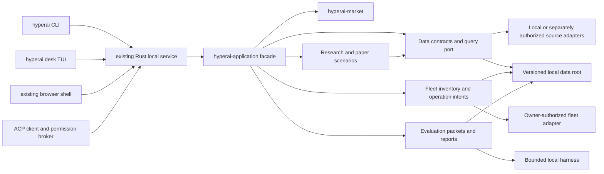

# HyperAI Compute Desk: Rust Port Subplan

Windows-target HyperIntel adapter check (2026-10-02): the frozen one-shot
offline `cargo check --lib --target x86_64-pc-windows-msvc` exited 101 while
`libsqlite3-sys` compiled bundled SQLite C code. The macOS host lacked the
Windows `stdlib.h` headers required by the cross-target C build, so the result
is `INCONCLUSIVE` for adapter type-checking and provides no Windows support
claim. The packet was not retried. A fresh native Windows build/lifecycle slice
is required; see the [check packet](compute-bazaar-windows-hyperintel-adapter-check-packet.md)
and [state record](state-slices.md#hyperai-bazaar-windows_hyperintel_adapter_crosscheckv1).

Current-source root Rust reproduction (2026-10-01): under
[`hyperai.bazaar.rust_port_workspace_reproduction.v18`](state-slices.md#hyperai-bazaar-rust_port_workspace_reproductionv18),
the corrected pinned-toolchain preflight and locked offline all-features
workspace tests passed: 82 test-result groups, 441 passed, 0 failed, and 10
ignored. Source and full Git-status identities matched before and after; all
three imported trees verified. Assurance is `REPRODUCED_LOCAL` for this exact
Rust manifest in same-owner Docker Desktop Linux/amd64 emulation. It does not
qualify native platforms, browser/accessibility behavior, separate-host
reproduction, or overall Phase 2, which remains `NOT_ASSIGNED`. The earlier
v17 shell preflight failure remains separately recorded as `INCONCLUSIVE`.

Focused native Apple Silicon Phase 1 run (2026-10-01): the accepted
`hyperai.bazaar.desk_runtime.v1` suites passed on macOS 26.6.1 arm64 with
pinned Rust/Cargo 1.93.1: service/API/storage 11 tests, CLI compatibility 14
passed with 2 staged-binary cases ignored, TUI restoration 10 tests, plus PTY
resize, Ctrl+C, panic-unwind, and terminal restoration. Import verification
passed after the run. This is `INTERNAL_PASS` for the exact current-host local
synthetic/loopback checks, not full Phase 1 platform qualification; macOS 14,
Intel macOS, native Windows, native Ubuntu, clean second-host reproduction,
and release readiness remain open. See the [Phase 1 packet](compute-bazaar-phase-1-contract-packet.md#focused-native-apple-silicon-phase-1-run-2026-10-01)
and [`desk_runtime` state slice](state-slices.md#hyperai-bazaar-desk_runtimev1).

Current installed ACP V6 continuation (2026-10-01): the installed source
integration passed after its stale test expectation was aligned from V5 to
the already-implemented V6 read-only tool list. This changed one test
assertion only; the packaged installed service and MCP sidecar completed
one fixed synthetic session, capability revocation, and cleanup. The
installed TUI PTY resize/Ctrl+C/restoration check also passed. Assurance is
`INTERNAL_PASS` for this exact local path; it adds no platform, third-party
agent, live-provider, or production claim. See the [Phase 8 packet](compute-bazaar-phase-8-acp-packet.md#current-source-installed-v6-tool-list-alignment-2026-10-01)
and [state slice](state-slices.md#hyperai-bazaar-local_install_acp_tool_list_v6v1).
Buyer supply-to-quote integration (2026-10-01): under
[`hyperai.bazaar.supply_to_quote.v1`](state-slices.md#hyperai-bazaar-supply_to_quotev1),
the selected offer in the fixed supply comparison is now bound to its
existing synthetic quote preview through the shared market/application
contract. The authenticated service, CLI, TUI, browser action, MCP V6 tool,
and ACP v1 advertised tool set use the same digest. Focused Rust tests, root
`lint:fast`, root `verify:contracts`, import verification, pinned formatting,
and diff hygiene passed. Assurance is `INTERNAL_PASS` for those local
synthetic checks; reviewer status is `NOT_REQUESTED`, reproduction is
`NOT_REPRODUCED`. The first browser attempt failed at the general 720-by-500
Deals overflow check before the quote interaction ran. Follow-up slices
diagnosed and fixed the layout and case-normalized browser assertion. The final
browser qualification passed 33 workspace routes at desktop, 720px, and mobile
widths, 33 reduced-motion route checks, the selected-offer quote preview and
digest bindings, and contained offers-table scrolling at 390px. The approval
action remained unused. This is `INTERNAL_PASS` for that synthetic browser
path only; it does not authorize seller/provider access, execution, settlement,
Bazaar source/data reuse, or production operation. See the
[implementation packet](compute-bazaar-supply-to-quote-packet.md),
[browser assertion packet](compute-bazaar-interface-quote-boundary-assertion-v1.md),
and [browser state slice](state-slices.md#hyperai-bazaar-interface-quote_boundary_assertionv1).

Interactive buyer lifecycle browser continuation (2026-10-01): the fresh
`hyperai.bazaar.interface.supply_quote_lifecycle_browser.v1` slice passed from
the selected offer through a keyboard-activated synthetic approval, mock
completion, and receipt. The preview digest bound the approval and completion;
the deal digest matched in completion; there were exactly three allowed
successful local writes and zero other writes. The browser also passed 33
routes at desktop, 720px, and mobile, 33 reduced-motion checks, computed
accessible names/visible focus at each action, and conclusive cleanup. This
is `INTERNAL_PASS` for that same-host synthetic path only; no real fulfillment
or funds movement occurred. See the
[lifecycle packet](compute-bazaar-supply-quote-lifecycle-browser-packet.md).

Installed buyer quote lifecycle continuation (2026-10-02): the exact locked,
offline source-install integration passed `1/1` on Darwin arm64 after invoking
the installed `hyperai` binary through compare, quote preview, exact-digest
approval, and mock completion. Stale preview and deal digests returned their
stable error codes. The receipt bound both digests and retained its synthetic
no-network/no-funds boundary. The same run passed installed compatibility,
service lifecycle, TUI PTY, and synthetic ACP/MCP checks with disposable state
and loopback port 0. `lint:fast` and diff hygiene passed. Assurance is
`INTERNAL_PASS` for the installed local synthetic CLI path only; reviewer
status is `NOT_REQUESTED`, reproduction is `NOT_REPRODUCED`. Native platforms,
real fulfillment/payment, rights, accessibility, and release qualification
remain open. See the [packet](compute-bazaar-installed-quote-lifecycle-packet.md)
and [state slice](state-slices.md#hyperai-bazaar-desk_runtime_installed_quote_lifecyclev1).

Installed TUI receipt-layout qualification (2026-10-02): the one frozen,
locked offline source-install integration passed `1/1` on Darwin arm64 after
the receipt digest moved to its own row. The installed screen exposed the
completion marker, receipt heading, exact digest, and synthetic effect
boundary. Resize checks at 48x10 and 100x30 passed; Ctrl+C exited cleanly and
restored terminal/cursor state. The synthetic ACP permission probe exercised
the denied trace path, restored fixture permissions, and completed the
remaining assertions. The disposable home was removed and no test-owned
process or PTY temporary directory remained. Assurance is `INTERNAL_PASS` for
this installed local synthetic path only; reviewer status is `NOT_REQUESTED`,
reproduction is `NOT_REPRODUCED`. Native platforms, physical-key and assistive
technology accessibility, real fulfillment/payment, and release qualification
remain open. See the [qualification packet](compute-bazaar-installed-tui-receipt-layout-packet.md)
and [state slice](state-slices.md#hyperai-bazaar-desk_runtime-installed_tui_receipt_layout_v1).

Stale supply-comparison browser continuation (2026-10-01): the exact local
stale-digest request returned HTTP 409, left the UI on Market, cleared quote
preview state, and made no approval or completion request. The service's
typed-error mapping is source-verified; the browser retained status, not the
error response body. All 33 routes, 33 reduced-motion checks, and cleanup
passed. This is `INTERNAL_PASS` for the same-host synthetic fail-closed path;
the displayed error remains generic, with actionable copy and user
comprehension unqualified. See the [stale-quote packet](compute-bazaar-interface-stale-quote-browser-packet.md)
and [state slice](state-slices.md#hyperai-bazaar-interface-stale_supply_quote_browserv1).

Conflict recovery copy continuation (2026-10-01): the fixed
`MARKET_SUPPLY_COMPARISON_CHANGED` code now maps to a reload-and-retry message;
unknown codes and upstream message fields retain the generic safe fallback.
The browser harness observed HTTP 409 and the validated error code without
retaining the raw response body, then confirmed the exact polite live-region
copy, no approval/completion writes, responsive route checks, and cleanup.
Focused tests, root lint/contract gates, and imported-source checks passed.
This is `INTERNAL_PASS` for the local synthetic mapping and browser path only;
user comprehension and other clients remain unqualified. See the [recovery
copy packet](compute-bazaar-market-conflict-recovery-copy-packet.md) and
[state slice](state-slices.md#hyperai-bazaar-interface-market_conflict_recovery_copyv1).

Keyboard focus restoration continuation (2026-10-02): focused interface
tests, `lint:fast`, `verify:contracts`, import verification, syntax, and diff
hygiene passed. The one browser run confirmed the fixed stale-comparison
status, retained focus, `:focus-visible`, visible outline, and no quote-preview
UI state. It exited `INCONCLUSIVE` because Chromium computed an empty
accessible name for the `status` node; the runner emitted no final aggregate
route/request report. Cleanup completed with no runner-owned process or
disposable browser root remaining. Do not retry this packet. A new
[`market conflict accessible-name slice`](compute-bazaar-market-conflict-accessible-name-packet.md)
targets that single accessibility contract under its own freeze and browser
allowance; no market/API authority changes.

Market conflict accessible-name continuation (2026-10-02): under
`hyperai.bazaar.interface.market_conflict_accessible_name.v1`, the status now
has an author-provided accessible name equal to the fixed, normalized visible
copy. The one Chrome run passed computed role/name, retained visible keyboard
focus, 33 route checks and reduced-motion checks across three viewports, and
cleanup. Request evidence was one comparison GET (200), one stale quote-preview
POST (409 with the expected code), no approval/completion requests, and zero
other writes. Focused tests, root fast/contracts, import verification, syntax,
and diff hygiene passed; one configured database-backed contract remained
ignored. This is `INTERNAL_PASS` for the local synthetic path only. See the
[accessible-name packet](compute-bazaar-market-conflict-accessible-name-packet.md)
and [state slice](state-slices.md#hyperai-bazaar-interface-market_conflict_accessible_namev1).

Data worker platform disposition (2026-10-01): the new
[platform decision state slice](state-slices.md#hyperai-bazaar-data_worker_platform_decisionv1)
selects native Linux cgroup v2 as the first qualification candidate, Windows
Job Objects as a follow-on candidate, and keeps bounded worker mode
unavailable on macOS. No platform is qualified; existing local Data query
behavior is unchanged. This decision changes no runtime or dependency. See
the [platform decision packet](compute-bazaar-data-worker-platform-decision-v1.md).

Connection-inventory integration slice (2026-10-01): under
`hyperai.bazaar.connection_inventory.v1`, one application-owned static
catalog now feeds the compatible status projection and authenticated
`/api/v1/connections` endpoint. Browser, CLI, and TUI read that catalog; no
Bazaar source or data was imported, and the Bazaar descriptor has no exposed
surface while exact reuse rights remain unresolved. Focused Rust/interface
tests, import verification, and offline root lint passed. The optional browser
runner exited `INCONCLUSIVE` during Chrome helper cleanup after reaching its
route/layout assertions. This closes only the local metadata seam; Phase 1
native platforms, full client/accessibility parity, independent review, and
all live operation gates remain open. See the [connection inventory packet](compute-bazaar-connection-inventory-packet.md)
and [state slice](state-slices.md#hyperai-bazaar-connection_inventoryv1).

Connection workspace links (2026-10-01): the browser inventory now emits
fixed `data-page` controls for allowlisted local/offline modules with declared
surfaces. Reference-only, disconnected, planned, and unknown entries remain
descriptive. The focused 29-test interface suite and offline root lint pass;
the follow-up browser check passed pointer navigation to Inference and
Tab/Enter navigation to Market, with focus observed on each page heading.
This `INTERNAL_PASS` covers only those local controls in one browser session;
it does not add connectivity or authority. See the
[workspace-links packet](compute-bazaar-connection-workspace-links-packet.md)
and [browser packet](compute-bazaar-interface-connection-workspace-browser-packet.md),
plus the [browser state slice](state-slices.md#hyperai-bazaar-interface-connection_workspace_browserv1).

Installed buyer supply-comparison ACP/MCP integration (2026-10-01): under
[`hyperai.bazaar.buyer_supply_comparison_acp_digest_parity.v1`](state-slices.md#hyperai-bazaar-buyer_supply_comparison_acp_digest_parityv1),
the fixed synthetic peer decodes the pinned MCP text representation and
validates the V5 schema, selected offer, and comparison digest. The packaged
CLI/MCP integration asserts that digest equals the authenticated owner API
digest. The exact ignored offline integration passed (`1 passed, 0 failed`);
offline workspace build, fast lint, contract verification (203 passed, 1
ignored, 0 failed), pinned formatting, and imported-source digest checks also
passed. Assurance is `INTERNAL_PASS` for the local installed synthetic path;
reviewer status is `NOT_REQUESTED`, and reproduction is `NOT_REPRODUCED`.
External ACP peers, cross-platform operation, clean reproduction, live supply,
execution correctness, payment entitlement, and production readiness remain
unverified. The unrelated Data worker Phase 2 remains `NOT_ASSIGNED`; this
continuation does not qualify or authorize it.

Data worker platform candidate (2026-10-01): the local Docker Desktop
Linux/aarch64 VM exposed cgroup v2 `memory.max`; a no-network 128 MiB
container killed a synthetic 512 MiB child while its parent survived and read
`oom_kill=1`. The `linux/amd64` helper ran under emulation. This is
`INTERNAL_PASS` for that container boundary only; it does not establish native
macOS/Linux or Windows support, a HyperAI worker, or a Docker product
dependency. Phase 2 remains `NOT_ASSIGNED` pending a separate platform/worker
architecture decision. See the [probe packet](compute-bazaar-data-docker-cgroup-probe-v1.md)
and [state slice](state-slices.md#hyperai-bazaar-data_docker_cgroup_probev1).

Phase 2 macOS worker feasibility status (2026-10-01): the instrumented
Virtualization.framework start again returned generic `VZErrorDomain` code
`1` immediately after an exact one-vCPU/1-GiB/no-network configuration passed
validation. The disk/kernel/initrd hashes remained unchanged. A bounded
framework log window correlated the request to a Virtualization XPC service
that ran for 84 ms and exited 0, but neither it nor the empty guest serial log
identified a cause. The attempt and diagnostics are recorded as
`INCONCLUSIVE` in the [instrumented start packet](compute-bazaar-data-macos-guest-start-instrumented-v1.md),
[daemon-window packet](compute-bazaar-data-macos-virtualizationd-window-v1.md),
and [framework-window packet](compute-bazaar-data-macos-virtualization-subsystem-window-v1.md).
Stop unchanged VM retries. A changed configuration needs current source-based
research, a fresh exact packet, and explicit user authorization. Phase 2
remains `NOT_ASSIGNED`; no Data worker isolation or macOS support claim is
established.

macOS Data worker resource-gate refinement (2026-10-01): the v3 native
`RLIMIT_AS` probe records a 445,746,020,352-byte virtual-size baseline, a
limit 64 MiB above that baseline, and refusal of one 128 MiB allocation. Its
raw `ru_maxrss` value does not establish an RSS cap or DataFusion worker
budget. `RLIMIT_AS` is therefore not selected as the macOS worker memory
enforcement mechanism; a separate native spike must identify an alternative
and prove limit enforcement, cancellation, cleanup, crash recovery, and
combined service-plus-worker capacity. No runtime behavior changed, and the
macOS bounded-worker mode remains unqualified. See the [Phase 2 packet](compute-bazaar-phase-2-data-packet.md#process-isolation-design-gate)
and [design state slice](state-slices.md#hyperai-bazaar-data_query_process_isolation_designv1).

Data query worker IPC contract (2026-10-01): the new
[`hyperai.bazaar.data_worker_ipc_contract_design.v1`](state-slices.md#hyperai-bazaar-data_worker_ipc_contract_designv1)
packet defines a candidate transport-neutral frame, digest-bound single
snapshot handoff, one-query worker lifecycle, bounded complete result, stable
error mapping, and future proof gates. This is `PLANNING_ONLY`; it changes no
runtime or public API. Platform transports, process containment, native
resource enforcement, and combined capacity remain unselected and unqualified.
No macOS VM retry is authorized by the packet.

macOS `RLIMIT_DATA` candidate probe (2026-10-01): under
`hyperai.bazaar.data_macos_rlimit_data_probe.v1`, the one helper compile passed
and the one execution stopped at the first child's `setrlimit` with `EINVAL`
(errno 22, child/helper exit 72). No allocation case ran. The temporary helper
and binary were removed, and all three imported source trees matched their
digests before and after. Current public XNU source returns `EINVAL` when the
new data limit is below current usage; that is plausible here, but the helper
did not record the baseline. Assurance is `INCONCLUSIVE`; reviewer status is
`NOT_REQUESTED`, and reproduction is `NOT_REPRODUCED`. No memory bound is
established. No retry is allowed under this slice. A fresh design slice must
select and specify the next macOS mechanism. Phase 2 and native macOS worker
qualification remain open. See the [probe packet](compute-bazaar-data-macos-rlimit-data-probe-v1.md)
and [state-slice record](state-slices.md#hyperai-bazaar-data_macos_rlimit_data_probev1).

macOS Virtualization host preflight (2026-10-01): under
`hyperai.bazaar.data_macos_virtualization_preflight.v1`, a Swift 6.4.0 helper
ad-hoc-signed with only `com.apple.security.virtualization` passed strict
signature verification. On macOS 26.6.1 arm64, the helper reported
`VZVirtualMachine.isSupported == true` and validated a no-device, one-vCPU,
512-MiB placeholder Linux configuration. It did not instantiate or start a
VM; no guest image, dataset, or network was used. Assurance is `INTERNAL_PASS`
for this host/entitlement/configuration preflight only, with reviewer status
`NOT_REQUESTED` and reproduction `NOT_REPRODUCED`. Temporary helper bytes
were removed after hashing. This does not establish distribution signing,
guest boot, cgroup or DataFusion enforcement, lifecycle recovery, capacity,
or platform support. Phase 2 remains `NOT_ASSIGNED`; the next gate is a
rights-checked, digest-pinned arm64 Linux guest packet with fixed resource,
IPC, cancellation/OOM/crash/cleanup, and host-plus-guest capacity criteria.
See the [preflight packet](compute-bazaar-data-macos-virtualization-preflight-v1.md)
and [state-slice record](state-slices.md#hyperai-bazaar-data_macos_virtualization_preflightv1).

macOS guest source and format check (2026-10-01): under
`hyperai.bazaar.data_macos_guest_source_check.v1`, the official Ubuntu
20260927 arm64 snapshot, GPG signer fingerprint, checksum method, internal
use/redistribution limits, Apple's RAW/ASIF disk requirement, and available
local verification/ext4 tools were recorded. The bootable Ubuntu `.img` is
QCOW2, which Apple cannot attach directly. Building RAW from the signed root
filesystem archive may avoid `qemu-img`, but bootable kernel/initramfs/root
composition remains unproven. The date-specific path does not freeze bytes;
the signed SHA256 digest must be verified in a fresh slice. No image, key, or
checksum was downloaded. Assurance is `PLANNING_ONLY` for the
source/rights/format review; the ready guest path is `INCONCLUSIVE`. Reviewer
status is `NOT_REQUESTED`, and reproduction is `NOT_APPLICABLE`. Phase 2
remains `NOT_ASSIGNED`; acquisition, conversion, and VM launch need a new
exact packet. See the [source-check
packet](compute-bazaar-data-macos-guest-source-check-v1.md) and [state-slice
record](state-slices.md#hyperai-bazaar-data_macos_guest_source_checkv1).

macOS guest image construction (2026-10-01):
`hyperai.bazaar.data_macos_guest_image_construction.v1` authenticated the
Ubuntu arm64 archive and inspected its member list, but its only RAW build
attempt failed on `/var/lib/snapd/void` permissions. No candidate was exported;
the slice is closed `INCONCLUSIVE`. The separate
`hyperai.bazaar.data_macos_guest_image_continuation.v1` completed `INTERNAL_PASS`
for local ext4 construction and read-only inspection, with the exact archive
digest and image custody recorded in its packet. It does not establish boot:
the root archive contains no kernel/initramfs. Neither slice permits VM
launch. See the [v1 failure record](compute-bazaar-data-macos-guest-image-construction-v1.md)
and [continuation packet](compute-bazaar-data-macos-guest-image-continuation-v1.md).
Phase 2 remains `NOT_ASSIGNED`; guest lifecycle, cgroup/resource enforcement,
no-network IPC, failure recovery, cleanup, and host-plus-guest capacity remain
open. The separate
`hyperai.bazaar.data_macos_guest_boot_inputs.v1` completed `INTERNAL_PASS` for
authenticating the same-dated arm64 kernel/initrd inputs; it still does not
authorize VM launch. The next gate is a fresh exact local boot packet. See the
[boot-input packet](compute-bazaar-data-macos-guest-boot-inputs-v1.md) and
[state-slice record](state-slices.md#hyperai-bazaar-data_macos_guest_boot_inputsv1).

JustAI imported-tree reconciliation (2026-10-01):
`hyperai.bazaar.justai_import_generated_lock_reconciliation.v1` removed the
generated extra `products/justai/pnpm-lock.yaml`, which is absent from the
selected JustAI source commit and checkout. The source import manifest already
recorded the matching 176-file tree; `python3 scripts/verify_imports.py` now
passes for Simple Compute Market, HyperIntel, and JustAI. This clears only the
local import-inventory discrepancy. JustAI/HyperIntel redistribution rights,
Phase 1 native platforms, overall Phase 2 qualification, and other authority
gates remain open. See the [state-slice record](state-slices.md#hyperai-bazaar-justai_import_generated_lock_reconciliationv1).

Phase 2 accepted-SQL planning continuation (2026-10-01): the exact 216-case
positive grammar corpus now also passes the production schema-only DataFusion
physical-plan preflight after validation. The test reads no dataset and
changes no query policy. The focused test passed 1/1, `hyperai-data
--all-targets` passed 61/61, and offline root `corepack pnpm run lint`
exited 0. Import verification preserved the known JustAI mismatch (177
observed files versus 176 recorded); Simple Compute Market and HyperIntel
match their pins. This advances only that finite validator-to-planner gate;
Phase 2 remains `NOT_ASSIGNED`, and broader planner/resource/accessibility,
native-platform, rights, and independent-review gates remain open. See the
[Phase 2 evidence](compute-bazaar-phase-2-data-packet.md#supported-sql-grammar-schema-plan-continuation-2026-10-01)
and [state-slice record](state-slices.md#hyperai-bazaar-data_sql_grammar_plannerv1).

Phase 2 macOS guest boot packet (2026-10-01):
`hyperai.bazaar.data_macos_guest_boot.v1` bound the authenticated Ubuntu
arm64 kernel/initrd and RAW image to one local VM attempt, but its single Swift
helper compile failed before configuration validation or VM start. The slice
is closed `INCONCLUSIVE`; the compile diagnostics, source digest, and cleanup
are recorded in the [boot packet](compute-bazaar-data-macos-guest-boot-v1.md)
and [state-slice record](state-slices.md#hyperai-bazaar-data_macos_guest_bootv1).
Any further boot attempt requires a fresh continuation packet. Overall Phase 2
remains `NOT_ASSIGNED`; no guest boot, DataFusion isolation, hostile-code
safety, recovery, capacity, or macOS product-support claim follows.

Phase 2 macOS guest boot continuation (2026-10-01): the first packet's sole
helper compile failed before VM validation/start and was closed
`INCONCLUSIVE`. The fresh
`hyperai.bazaar.data_macos_guest_boot_continuation.v1` compiled and signed the
corrected helper, and configuration validation passed. Its single VM start
call returned `VZErrorDomain` code `1` (`VZErrorInternal`) before guest output.
The disk hash is
unchanged, the helper exited, and no guest boot or stop callback was observed.
The slice is closed `INCONCLUSIVE`; another start requires a fresh diagnostic
packet and authorization. Overall Phase 2 remains `NOT_ASSIGNED`. See the
[continuation packet](compute-bazaar-data-macos-guest-boot-continuation-v1.md)
and [state-slice record](state-slices.md#hyperai-bazaar-data_macos_guest_boot_continuationv1).

Phase 2 macOS guest-start diagnostic (2026-10-01): the one local VM start
returned generic `VZErrorInternal` before guest output. The read-only
`hyperai.bazaar.data_macos_guest_start_diagnostic.v1` slice permits one
narrowly filtered macOS host-log query only; it permits no helper or VM
rerun. It found DiskImages2's RAW image user-data message (error 45), but no
log linked that message to the start failure. The exact query-window end was
not captured, so the diagnostic is `INCONCLUSIVE`; the cause remains unknown.
Another VM start requires a fresh packet and explicit authorization. Overall
Phase 2 remains `NOT_ASSIGNED`. See the
[diagnostic packet](compute-bazaar-data-macos-guest-start-diagnostic-v1.md)
and [state-slice record](state-slices.md#hyperai-bazaar-data_macos_guest_start_diagnosticv1).

Phase 2 manifest and resource follow-up (2026-09-30): under
`hyperai.bazaar.data_manifest_row_count_binding.v1`, manifests now bind
`row_count` to non-empty NDJSON records or Parquet metadata, with mismatch
regressions for both formats. The authenticated 1,000-row / 15,990,000-byte
synthetic API query returned all rows in 336 ms with a 6,632-byte response;
this candidate did not exhaust the configured 64 MiB DataFusion pool. Focused
Data tests passed 61 cases, the full Data API suite passed 7, and offline root
`pnpm run lint` passed. A current-source Linux/amd64 container reproduction
then passed 425 tests across 82 groups with 0 failures and 10 ignored under
`REPRODUCED_LOCAL`; it is same-owner emulation, not independent review or a
separate-host run. The source and fixture digests, toolchain, transient
validation failures, import-verification mismatch, and reproduction record are in the
[Data packet](compute-bazaar-phase-2-data-packet.md#manifest-row-count-binding-and-authenticated-1000-row-pool-candidate-2026-09-30)
and [state slice](state-slices.md#hyperai-bazaar-data_manifest_row_count_bindingv1),
with the exact workspace reproduction in the [v16 packet](compute-bazaar-rust-workspace-reproduction-packet.md#current-source-continuation-v16-2026-09-30)
and [reproduction state slice](state-slices.md#hyperai-bazaar-rust_port_workspace_reproductionv16).
Assurance is `INTERNAL_PASS` for these local synthetic contracts only;
reviewer status is `NOT_REQUESTED` and reproduction is `NOT_REPRODUCED`.
Overall Phase 2 remains `NOT_ASSIGNED`; process-memory isolation, source
rights, native-platform/accessibility qualification, separate-host
reproduction, and independent review remain open.

HyperIntel browser round-trip revalidation (2026-09-30): the current-tree
offline UI build and populated synthetic Inference-to-Activity journey passed
under `hyperai.bazaar.interface.synthetic_hyperintel_browser_roundtrip.v1`
using Chrome `154.0.8037.92`. One setup attempt hit a stale Chromium launcher;
the direct installed browser path passed 1/1. This reconfirms only the bounded
same-host local interface flow and does not close Phase 2. The exact command,
source hashes, and retained setup failure are in the
[round-trip packet](compute-bazaar-hyperintel-browser-roundtrip-packet.md#current-tree-revalidation-2026-09-30).

Phase 3A populated Data derivation browser proof (2026-09-30): under
`hyperai.bazaar.data_transform_browser.v1`, the existing served UI workflow
now asserts that the Bronze/Silver/Gold pipeline is rendered and tied to the
query's snapshot digest. Chrome `154.0.8037.92` passed 33 route/viewport
checks and the synthetic release route returned HTTP 200 on all three reads.
The locked/offline Data, application, and local-service suites passed 120
tests; root offline `pnpm run lint` passed. The bounded local Phase 3A
contracts are `INTERNAL_PASS`, with reviewer `NOT_REQUESTED` and
reproduction `NOT_REPRODUCED`. Overall Phase 2 remains `NOT_ASSIGNED`; native
platform, full accessibility, separate-host reproduction, and independent
review remain open. See the [Phase 3A packet](compute-bazaar-phase-3-synthetic-transform-packet.md#current-local-qualification-addendum-2026-09-30)
and [state slice](state-slices.md#hyperai-bazaar-data_transform_browserv1).

Phase 2 grammar-directed SQL sweep (2026-09-30): under
`hyperai.bazaar.data_sql_grammar_fuzz.v1`, the local validator now receives
4,096 fixed-seed supported and 4,096 parse-valid unsupported generated
statements without retaining a corpus. The focused test and final offline root
`pnpm run lint` pass; the final root Data groups passed 60 tests. This is
`INTERNAL_PASS` for the tested parser/validator scope only. It does not close
exhaustive SQL review, DataFusion resource isolation, accessibility, native
platforms, clean separate-host reproduction, or independent review. Phase 2
remains `NOT_ASSIGNED`. SCM and HyperIntel import inventories match; the
preserved JustAI inventory mismatch remains 177 observed files versus 176
recorded. See the [Phase 2 Data packet](compute-bazaar-phase-2-data-packet.md#fixed-seed-grammar-sql-sweep-2026-09-30)
and [state-slice record](state-slices.md#hyperai-bazaar-data_sql_grammar_fuzzv1).

Phase 2 structured SQL corpus result (2026-09-30): under
`hyperai.bazaar.data_sql_grammar_corpus.v1`, the test-only deterministic
validator corpus passed 216 supported combinations and 11 parser-valid
negative statements. The focused test passed 1 case, and locked/offline
`hyperai-data --all-targets` passed 59 tests. The root offline `pnpm run lint`
also passed, including formatting, strict Clippy, workspace contract tests,
and all-feature tests. Environment-gated browser, sidecar, and Docker tests
remained ignored. Simple Compute Market and HyperIntel import inventories
matched; the preserved JustAI mismatch remains 177 observed files versus 176
recorded. It changed no production query policy, performed no planning or data
access, and added no dependency. This finite structured corpus is not exhaustive
grammar fuzzing. The exact scope and remaining proof gates are recorded in the
[Phase 2 Data packet](compute-bazaar-phase-2-data-packet.md#structured-sql-grammar-corpus-2026-09-30)
and [state-slice record](state-slices.md#hyperai-bazaar-data_sql_grammar_corpusv1).

Phase 2 bounded default-pool probe (2026-09-30): a test-only authenticated
loopback diagnostic is authorized under
`hyperai.bazaar.data_default_pool_api_probe.v1`. The first 1,000-row candidate
was rejected before query execution because the current synthetic manifest
contract fixes `row_count` at three. The probe now uses three distinct keys in
a 15,990,000-byte synthetic JSON snapshot and a compact aggregate query, so
the manifest, input, result-row count, and serialized output remain within
their contracts. A fast 413 before the two-second deadline would support a
narrow inference of DataFusion pool exhaustion; a successful query means this
candidate did not exhaust it. No configuration changes are part of the
probe. The exact three-row candidate passed in 297.392125 ms with a 642-byte
HTTP response and 51 result bytes under the 64 MiB pool. It did not exhaust
the pool, so that gate remains open. Process memory isolation, grammar-aware
fuzzing, accessibility and native platform qualification, clean separate-host
reproduction, and independent review also remain open. Phase 2 remains
`NOT_ASSIGNED`. See the
[Phase 2 Data packet](compute-bazaar-phase-2-data-packet.md#default-pool-authenticated-api-probe-2026-09-30)
and [state-slice record](state-slices.md#hyperai-bazaar-data_default_pool_api_probev1).

Root-gate continuation (2026-09-30): the first offline `pnpm run lint` run
passed interface, installer, formatting, strict Clippy, and workspace
contract checks, then stopped when the ACP synthetic-peer test observed
`Connection reset by peer (os error 54)`. Under
`hyperai.bazaar.acp.synthetic_http_body_drain.v1`, the test fixture now reads
the complete bounded POST body before closing the connection. The focused
normal-parallel target passed 9/9, and the final offline root
`pnpm run lint` exited 0 through interface and installer checks, formatting,
strict Clippy, contract tests, all-feature workspace tests, and doc tests.
Environment-gated tests remained ignored. The passing fixture is host-local
evidence and does not prove the exact cause of all prior resets. See the [ACP
packet](compute-bazaar-acp-test-isolation-packet.md#loopback-request-body-drain-2026-09-30)
and [state slice](state-slices.md#hyperai-bazaar-acp-synthetic_http_body_drainv1).

Bounded SQL red-team review (2026-09-30): under
`hyperai.bazaar.data_sql_redteam_review.v1`, a docs-only source review found no
confirmed query path to an arbitrary table, external source, SQL write, or
partial successful response in the pinned local Data path. The reviewed path
validates one `SELECT` over the registered `dataset`, performs schema-only
DataFusion planning before snapshot capture, and applies row, execution,
memory-pool, and complete-response limits. This is `INTERNAL_PASS` for the
reviewed source and fixed test corpus only; it is not exhaustive SQL safety or
a process-memory guarantee. No code or tests changed or ran for this review.
Reviewer status is `NOT_REQUESTED`, review reproducibility is
`NOT_REPRODUCED`, and overall Phase 2 remains `NOT_ASSIGNED`. Grammar-aware
fuzzing, default-pool exhaustion through the API, process-level isolation,
accessibility and native platform qualification, separate-host reproduction,
and independent review remain open. See the [Phase 2 packet](compute-bazaar-phase-2-data-packet.md#bounded-sql-red-team-review-2026-09-30)
and [state-slice record](state-slices.md#hyperai-bazaar-data_sql_redteam_reviewv1).

Phase 2 complete-response limit (2026-09-30): `hyperai-data` now enforces the
256 KiB ceiling against the complete compact JSON `QueryResultV1` response,
including both CSV rows and CSV text. The exact boundary regression and the
authenticated HTTP 413 mapping passed in the locked/offline Data (58 tests)
and local-service Data API (6 tests) suites. Root offline `pnpm run lint`
passed. This is `INTERNAL_PASS` for the exact synthetic response-limit
contract; reviewer status is `NOT_REQUESTED`, reproducibility is
`NOT_REPRODUCED`, and overall Phase 2 remains `NOT_ASSIGNED`. Simple Compute
Market and HyperIntel imports match; the preserved JustAI inventory mismatch
remains 177 observed files versus 176 recorded. See the [Phase 2 packet](compute-bazaar-phase-2-data-packet.md#complete-serialized-response-byte-limit-2026-09-30)
and [state-slice record](state-slices.md#hyperai-bazaar-data_serialized_response_limitv1).

Current-source root Rust workspace reproduction (2026-09-30): under
`hyperai.bazaar.rust_port_workspace_reproduction.v15`, the pinned
Linux/amd64 Rust 1.93.1 container ran
`cargo test --locked --offline --workspace --all-features` with network
disabled and a read-only source mount. All 82 test-result groups completed:
421 passed, 0 failed, and 10 ignored. The exact 286-file / 4,288,313-byte
source manifest SHA-256 is
`12a19f482385845cafab9826e2426f524e259edcb9bee659a294571f0ad18d1d`; it
matched before and after. Assurance is `REPRODUCED_LOCAL` for that manifest
and command in same-owner Linux/amd64 emulation; reviewer status is
`NOT_REQUESTED`. The Simple Compute Market and HyperIntel import manifests
match; the preserved JustAI mismatch remains 177 observed files versus 176
recorded. Overall Phase 2 remains `NOT_ASSIGNED`, and this does not qualify
native platforms, browser/accessibility behavior, independent review, or
production. See the [workspace reproduction packet](compute-bazaar-rust-workspace-reproduction-packet.md#current-source-continuation-v15-2026-09-30)
and [state-slice record](state-slices.md#hyperai-bazaar-rust_port_workspace_reproductionv15).

Phase 2 schema-only planner preflight evidence (2026-09-30): the current
implementation rejects the fixed parsed `Expr::InUnnest` form before dataset
snapshot access. Locked/offline `hyperai-data --all-targets` passed 56 tests;
the focused authenticated API regression passed 1 test and kept an absent
data root untouched. `CARGO_NET_OFFLINE=true corepack pnpm run lint` exited 0
through formatting, strict Clippy, contract tests, full workspace tests, and
doc tests. Import preservation matched Simple Compute Market and HyperIntel;
the pre-existing JustAI 177-observed/176-recorded mismatch remains. Assurance
is `INTERNAL_PASS` for this exact synthetic path only; reviewer status is
`NOT_REQUESTED`, reproduction is `NOT_REPRODUCED`, and overall Phase 2 remains
`NOT_ASSIGNED`. Exact hashes and limits are in the [state-slice record](state-slices.md#hyperai-bazaar-data_query_plan_preflightv1).

Phase 2 planner compatibility continuation (2026-09-30): a fresh named slice,
`hyperai.bazaar.data_query_plan_preflight.v1`, now scopes a DataFusion
logical/physical planning pass against a schema-only empty table before
verified dataset snapshot capture. The pinned `GenericDialect` accepts
`Expr::InUnnest`, which DataFusion 52.5.0 does not plan. The local synthetic
path must return the stable unsupported-query result before reading dataset
bytes while preserving normal JSON/Parquet queries and the existing resource
limits. The slice and proof gates are recorded in the [Phase 2 packet](compute-bazaar-phase-2-data-packet.md#schema-only-datafusion-planning-preflight-2026-09-30)
and [state-slice record](state-slices.md#hyperai-bazaar-data_query_plan_preflightv1).
No DataFusion feature, dependency, source adapter, or external authority is
added; overall Phase 2 remains `NOT_ASSIGNED`.

The preflight exposed a schema mismatch in the legacy memory-stress fixture:
its two fields were not part of the production schema digest attached by its
manifest. The new state slice `hyperai.bazaar.data_query_capacity_schema_alignment.v1`
authorizes a test-only correction that retains the exact 12,039,000-byte
fixture and 1,000 distinct grouping keys while using the six-column declared
schema. Old fixture hashes and RSS observations stay historical; publish a
new RSS value only after a fresh measurement tied to the corrected fixture.
See the [Phase 2 data packet](compute-bazaar-phase-2-data-packet.md#memory-capacity-fixture-schema-alignment-2026-09-30)
and [state-slice record](state-slices.md#hyperai-bazaar-data_query_capacity_schema_alignmentv1).

Execution result (2026-09-30): under
`hyperai.bazaar.data_query_capacity_schema_alignment.v1`, the 12,039,000-byte
schema-aligned fixture (1,000 distinct keys; SHA-256
`541516e964efa456f7b836c3495e61303da5ea9fe2b531737455aca1e4cde81b`) passed
the 1 MiB rejection and 64 MiB public-query tests. Locked/offline
`hyperai-data --all-targets` passed 54 tests, the focused authenticated API
test passed, and `CARGO_NET_OFFLINE=true corepack pnpm run lint` exited 0.
One fresh `/usr/bin/time -l` run measured 124,256,256 bytes maximum resident
set size for the exact test binary; binary SHA-256 is
`10c181fa258647aa72bef07010cf5a6f5cb8e60af8226c69688d8b8cb47dbd08`.
Import verification still reports the known JustAI mismatch (177 files
observed, 176 recorded); Simple Compute Market and HyperIntel match their
manifests. Assurance is `INTERNAL_PASS` for this bounded local synthetic
scope, reviewer status is `NOT_REQUESTED`, reproducibility is
`NOT_REPRODUCED`, and overall Phase 2 remains `NOT_ASSIGNED`.

The test-only Data continuation, `hyperai.bazaar.data_sql_select_into_pre_storage_test.v1`,
now verifies the existing `Select.into` guard before query storage access and
confirms the authenticated API leaves its unseeded data root absent. Locked,
offline Data tests passed 56 cases, the focused API case passed, and the full
root `pnpm run lint` gate passed. The import check retained the known JustAI
mismatch (177 observed files versus 176 recorded); Simple Compute Market and
HyperIntel matched. This changes no production behavior; overall Phase 2
remains `NOT_ASSIGNED`. See the [Phase 2 packet](compute-bazaar-phase-2-data-packet.md#select-into-pre-storage-regression-coverage-2026-09-30)
and [state-slice record](state-slices.md#hyperai-bazaar-data_sql_select_into_pre_storage_testv1).

Current-source root Rust workspace check (2026-09-30): under
`hyperai.bazaar.rust_port_workspace_reproduction.v14`,
`cargo test --locked --offline --workspace --all-features` exited 0 in the
pinned Linux/amd64 Rust 1.93.1 container: 82 result groups, 405 passed, 0
failed, 10 ignored. This is `INTERNAL_PASS` for that local run;
reviewer status is `NOT_REQUESTED` and reproduction is `NOT_REPRODUCED`.
Post-run source and HyperIntel digests matched; Simple Compute Market matched
its import manifest, while the preserved JustAI mismatch remains 177 observed
files versus 176 recorded. Overall Phase 2 remains `NOT_ASSIGNED`. This does
not qualify native Linux, browser/accessibility, independent review, or
production. See the [workspace reproduction packet](compute-bazaar-rust-workspace-reproduction-packet.md#v14-execution-result-2026-09-30-internal_pass)
and [state-slice record](state-slices.md#hyperai-bazaar-rust_port_workspace_reproductionv14).

Phase 2 interactive TUI query continuation (2026-09-30): under
`hyperai.bazaar.data_tui_query_input.v1`, the Data workspace now supports a
bounded editable SQL draft, run, clear, and cancel through the existing
authenticated local Data route. The focused TUI suite passed 12 unit tests
and 10 terminal-restore integration tests, including a temporary-service
round trip against a seeded HyperAI synthetic snapshot. The full offline root
`lint` gate passed with pinned Rust/Cargo 1.93.1. This is `INTERNAL_PASS` for
the exact macOS local interactive-query path. A focused Linux/amd64
same-owner container reproduction is now recorded separately below; reviewer
status is `NOT_REQUESTED`, and overall Phase 2 remains `NOT_ASSIGNED`. The
broader parser, accessibility, native-platform, source-rights, and production
gates remain open. Port 4317 was not contacted. See the [Phase 2 Data
packet](compute-bazaar-phase-2-data-packet.md#interactive-tui-query-input-2026-09-30)
and [implementation state slice](state-slices.md#hyperai-bazaar-data_tui_query_inputv1).

Phase 2 TUI focused Linux reproduction v2 (2026-09-30): under
`hyperai.bazaar.data_tui_query_input_reproduction.v2`, the locked/offline
`cargo test --locked --offline -p hyperai-tui --all-targets` command passed
12 unit and 10 terminal-restoration tests, with 0 failures, in pinned Rust/Cargo
1.93.1 on Linux/amd64 emulation. The exact 286-file source manifest, HyperIntel
import, and full Git-status digests matched before and after. The log, staged
source, and container were removed; Simple Compute Market matched its import,
and the preserved JustAI inventory mismatch remained 177 files versus 176.
Assurance is `REPRODUCED_LOCAL` for this exact test and manifest only;
reviewer status is `NOT_REQUESTED`. This does not establish native Linux or
full Phase 2 acceptance. See the [reproduction packet](compute-bazaar-rust-workspace-reproduction-packet.md#focused-interactive-tui-data-reproduction-v2-2026-09-30-reproduced_local)
and [state slice](state-slices.md#hyperai-bazaar-data_tui_query_input_reproductionv2).

Phase 2 TUI focused Linux reproduction v1 (2026-09-30): under
`hyperai.bazaar.data_tui_query_input_reproduction.v1`, the focused TUI Cargo
command exited 101 before tests because the container's `/tmp` tmpfs was
`noexec`; the compiled `proc-macro2` build script could not launch. The
current 286-file source, HyperIntel import, and Git-status digests matched
before and after; the source stage, log, and container were removed. Assurance
is `INCONCLUSIVE` for this environment attempt, reviewer status is
`NOT_REQUESTED`, reproduction remains `NOT_REPRODUCED`, and Phase 2 remains
`NOT_ASSIGNED`. The v2 continuation then passed the exact TUI package suite
with `/tmp` explicitly executable; its bounded result is recorded above and
in the [reproduction packet](compute-bazaar-rust-workspace-reproduction-packet.md#focused-interactive-tui-data-reproduction-v2-2026-09-30-reproduced_local)
and [state slice](state-slices.md#hyperai-bazaar-data_tui_query_input_reproductionv2).

Phase 2 focused Linux Data-package diagnostic (2026-09-30): v1 under
`hyperai.bazaar.data_output_size_linux_focused_diagnostic.v1` exited 101
before tests because the container started in `/`; the full error and cleanup
are recorded in the reproduction packet. The fresh v2 slice set `/workspace`
as the working directory and passed the locked/offline all-target Data package
suite: four groups, 51 passed, 0 failed, 0 ignored, 0 measured, and 0 filtered.
Assurance is `INTERNAL_PASS` for that exact local package command only;
reviewer status is `NOT_REQUESTED`, and reproduction is `NOT_REPRODUCED`.
The source, HyperIntel import, and Git-status digests matched before and after;
the container was removed. The preserved JustAI mismatch remains 177 observed
files versus 176 recorded. Overall Phase 2 remains `NOT_ASSIGNED`, and v13's
full-workspace result remains `INCONCLUSIVE`. See the [reproduction
packet](compute-bazaar-rust-workspace-reproduction-packet.md#focused-data-package-diagnostic-v2-2026-09-30)
and [state-slice record](state-slices.md#hyperai-bazaar-data_output_size_linux_focused_diagnosticv2).

Phase 2 serialized-result bound continuation (2026-09-30): under
`hyperai.bazaar.data_output_size_preflight.v1`, the JSON/CSV query collector
now counts encoded cell sizes incrementally and rejects an over-limit row
before retaining it. The focused locked/offline Data suite passed 51 tests;
pinned formatting and `CARGO_NET_OFFLINE=true corepack pnpm run lint` passed.
Simple Compute Market and HyperIntel import inventories match. The preserved
JustAI inventory still has 177 observed files versus 176 recorded; no imported
tree changed. Assurance is `INTERNAL_PASS` for exact output-size accounting
and row-retention behavior in the tested cases. Reviewer status is
`NOT_REQUESTED`, reproduction is `NOT_REPRODUCED`. No CPU or whole-process
memory bound is claimed, and Phase 2 remains `NOT_ASSIGNED`. See the [Data
packet](compute-bazaar-phase-2-data-packet.md#incremental-serialized-result-size-preflight-2026-09-30)
and [state-slice record](state-slices.md#hyperai-bazaar-data_output_size_preflightv1).

Synthetic HyperIntel reconciliation adapter qualification (2026-09-29):
under `hyperai.bazaar.interface.synthetic_hyperintel_reconciliation.v1`, the
locked/offline adapter integration passed for one completed synthetic
lineage and one changed-routing-time rejection. Pinned formatting, focused
strict Clippy, `corepack pnpm run lint`, and the Simple Compute Market and
HyperIntel import checks passed. The standalone import verifier still reports
the preserved JustAI inventory mismatch (177 files observed versus 176
documented); no JustAI files changed. This is `INTERNAL_PASS` for the local
adapter contract only; reviewer status is `NOT_REQUESTED`, reproduction is
`NOT_REPRODUCED`, and the authenticated service/browser flow remains open.
See the [reconciliation packet](compute-bazaar-hyperintel-reconciliation-packet.md)
and [state-slice record](state-slices.md#hyperai-bazaar-interface-synthetic_hyperintel_reconciliationv1).

Authenticated service and populated browser continuation (2026-09-29): the
synthetic lineage now passes the same-origin authenticated reconciliation
route and the actual Inference-to-Activity browser flow using in-memory File
API objects. Focused API and browser checks passed, the offline interface
binary built, and `corepack pnpm run lint` passed. Simple Compute Market and
HyperIntel imports pass; the preserved JustAI inventory reports 177 observed
files versus 176 recorded. This is `INTERNAL_PASS` for those exact local
synthetic paths; reviewer status is `NOT_REQUESTED`, reproduction is
`NOT_REPRODUCED`. Native picker, accessibility, cross-browser/platform,
separate-host, source-truth, execution-correctness, payment, and settlement
claims remain open. See the [service packet](compute-bazaar-hyperintel-service-roundtrip-packet.md),
[browser packet](compute-bazaar-hyperintel-browser-roundtrip-packet.md), and
their named [state slices](state-slices.md).

Installed TUI resize continuation (2026-09-29): the geometry-strengthened
installed macOS arm64 PTY check passed at 48x10 and 100x30, including viewport
shrink/expansion, Ctrl+C terminal restoration, and cleanup. Root lint and
pinned formatting passed. This is `INTERNAL_PASS` for the exact local PTY path;
physical terminal behavior, assistive technology, native platform coverage,
and separate-environment reproduction remain open. See the [resize
packet](compute-bazaar-installed-tui-resize-packet.md) and its [state
slice](state-slices.md#hyperai-bazaar-desk_runtime_installed_tui_resizev1).

Synthetic ACP test-isolation continuation (2026-09-29): after the same
default-parallel test failure occurred twice, a test-local mutex serialized
only the nine synthetic-peer test bodies. The target passed under the normal
test harness and root `corepack pnpm run lint` exited 0. This is
`INTERNAL_PASS` for the local serialized test target only; the original
OS-level cause remains unknown. See the [ACP isolation
packet](compute-bazaar-acp-test-isolation-packet.md) and its [state
slice](state-slices.md#hyperai-bazaar-acp-synthetic_peer_test_isolationv1).

Root Rust workspace reproduction (2026-09-28): a clean, network-disabled
Linux/amd64 container using the pinned Rust/Cargo 1.93.1 image passed
`cargo test --locked --offline --workspace --all-features` (79 suites, 372
passed, 0 failed, 9 ignored). These totals remain `INTERNAL_PASS` evidence
for the recorded local command execution. A source-scope correction found
that its manifest omitted imported HyperIntel path crates and compile-time
inputs outside `crates/`, so the exact-source `REPRODUCED_LOCAL` claim is
withdrawn. The
source manifest and full Git status digests matched before and after, the
container was removed, and the pre-existing service on port 4317 remained
running. The complete JavaScript/browser suite, native platform behavior,
accessibility, and clean separate-host reproduction remain open. Exact image,
source and output digests, custody, and limits are in the
[workspace reproduction packet](compute-bazaar-rust-workspace-reproduction-packet.md)
and [state-slice record](state-slices.md#hyperai-bazaar-rust_port_workspace_reproductionv1).

Current-source Rust workspace reproduction v2 (2026-09-29): that Rust source
manifest passed the same locked, offline, all-feature workspace
test command in a disposable network-disabled Linux/amd64 container: 79
suites, 377 passed, 0 failed, 9 ignored. These totals remain `INTERNAL_PASS`
evidence for the recorded local command execution. Its source manifest omitted
imported HyperIntel path crates and external compile-time inputs, so treat the
result as `INTERNAL_PASS`, not exact-source `REPRODUCED_LOCAL`. It does not
establish native Linux,
separate-host, JavaScript/browser, accessibility, independent-review, or
production qualification. Source and Git-status digests matched before and
after, the container was removed, and the local service on port 4317 remained
running. Exact environment, output digest, custody, and limits are recorded in
the [current-source reproduction packet](compute-bazaar-rust-workspace-reproduction-packet.md#current-source-continuation-2026-09-29)
and [`hyperai.bazaar.rust_port_workspace_reproduction.v2`](state-slices.md#hyperai-bazaar-rust_port_workspace_reproductionv2).

Current-source Rust workspace reproduction v3 (2026-09-29): after the
generic SQL AST-field rejection change, the exact 107-file Rust manifest
(2,263,812 bytes; SHA-256
`d6b5dc6cdea7f89d79c24dd18508e438baee395c8cc43376e04f42b3fa782a35`) passed
`cargo test --locked --offline --workspace --all-features` in the frozen
network-disabled Linux/amd64 container. It ran 79 test-result groups: 380
passed, 0 failed, and 9 ignored. These totals remain `INTERNAL_PASS` evidence
for the recorded local command execution. Its source manifest omitted imported
HyperIntel path crates and external compile-time inputs, so it is not
exact-source `REPRODUCED_LOCAL`. The
pre/post source and Git-status digests matched; the container was removed and
PID 85094 remained on port 4317. This includes the new Data parser regressions
but does not reproduce the JavaScript/browser suite, establish native OS
support, or close accessibility, independent-review, separate-host, source
rights, or production gates. See the [v3 reproduction packet](compute-bazaar-rust-workspace-reproduction-packet.md#current-source-continuation-v3-2026-09-29)
and [`hyperai.bazaar.rust_port_workspace_reproduction.v3`](state-slices.md#hyperai-bazaar-rust_port_workspace_reproductionv3).

Current-source Rust workspace reproduction v4 (2026-09-29): after the Data
table-alias, parametric-function, and authenticated API parity changes, the
exact 107-file Rust manifest (2,282,056 bytes;
`d81a57b9431ab50cee09263913faec3402200cd6bbd3bd4062e95855d718f088`) passed
`cargo test --locked --offline --workspace --all-features` in the frozen
network-disabled Linux/amd64 container: 79 test-result groups, 387 passed, 0
failed, 9 ignored. These totals remain `INTERNAL_PASS` evidence for the
recorded local command execution. Its source manifest omitted imported
HyperIntel path crates and external compile-time inputs, so it is not
exact-source `REPRODUCED_LOCAL`. It does not establish native
platform, JavaScript/browser, accessibility, independent-review,
separate-host, source-rights, or production qualification. The pre/post source
and Git-status digests matched, the container was removed, and PID 85094
remained on port 4317. Exact toolchain, output digest, custody, and limitations
are in the [v4 reproduction packet](compute-bazaar-rust-workspace-reproduction-packet.md#current-source-continuation-v4-2026-09-29)
and [`hyperai.bazaar.rust_port_workspace_reproduction.v4`](state-slices.md#hyperai-bazaar-rust_port_workspace_reproductionv4).

Installed CLI lifecycle continuation (2026-09-29): the exact ignored offline
source-install integration now covers public lifecycle commands on the
installed `hyperai` binary (`--version`, `init`, `doctor`, `service start`,
`service status`, `connect`, and `service stop`) before the existing synthetic
ACP/MCP flow. The test, root lint, pinned Rust formatting, and diff hygiene
passed on macOS 26.6.1 arm64 with Rust 1.93.1. This is `INTERNAL_PASS` for
that local installed path only. Reviewer status is `NOT_REQUESTED` and
reproduction is `NOT_REPRODUCED`; no native platform or release claim follows.
The standalone import verifier still reports an unresolved JustAI-only extra
`products/justai/pnpm-lock.yaml`; SCM and HyperIntel pass. Details and exact
claim ceiling are in the [installed lifecycle packet](compute-bazaar-installed-cli-lifecycle-packet.md)
and [state-slice record](state-slices.md#hyperai-bazaar-desk_runtime_installed_cli_lifecyclev1).

Installed compatibility-entrypoint continuation (2026-09-29): the offline
source-install integration now checks identical installed `hyperai`/`hsai`
version and synthetic market-demo output, then launches installed
`hyperai-ui` and proves the installed primary CLI can connect to and stop that
same service instance. The focused test, root lint, pinned formatting, and
scoped hygiene passed on macOS 26.6.1 arm64 with Rust 1.93.1. This is
`INTERNAL_PASS` for these installed local entrypoints only; reviewer status
is `NOT_REQUESTED`, and reproduction is `NOT_REPRODUCED`. Native platform and
release qualification remain open. SCM and HyperIntel import checks pass; the
unresolved JustAI extra lockfile remains preserved. See the
[compatibility entrypoints packet](compute-bazaar-installed-compat-entrypoints-packet.md)
and [state-slice record](state-slices.md#hyperai-bazaar-desk_runtime_installed_compat_entrypointsv1).

Installed ACP Workload Trace denied-state follow-up (2026-09-28): on the
current Darwin arm64 host with pinned Rust 1.93.1, the exact ignored
source-install integration passed after directly observing
`PermissionDenied` on the fixed synthetic Data file. The owner route, scoped
ACP route, and installed MCP sidecar returned the same denied projection,
without a Data digest or buyer-intent Data reference. Its follow-on conflict
control now checks the current HTTP 200/`conflicting` trace contract; this
corrected a stale test-only HTTP 409 expectation without changing product
behavior. The offline workspace-bin build, exact integration, full root lint,
pinned import verification, and hygiene checks passed. This is
`INTERNAL_PASS` for one local Unix condition. Full ACP and client parity,
accessibility, other-platform behavior, clean second-host reproduction,
independent review, and production authorization remain open. See the [denied
parity packet](compute-bazaar-workload-trace-acp-denied-parity-packet.md), the
[conflict contract packet](compute-bazaar-workload-trace-acp-conflict-contract-packet.md),
and their named [state-slice records](state-slices.md).

Workload Trace denied-state parity follow-up (2026-09-28): on this macOS Unix
host, direct reads of the temporarily permission-restricted synthetic Data
file returned `PermissionDenied`. The authenticated owner route, CLI JSON, and
MCP structured projection matched for `denied`; the TUI rendered `denied`
without a Data digest and retained its claim limits. The three focused tests
and final `corepack pnpm run lint` passed; pinned import and hygiene checks
passed. This is `INTERNAL_PASS` for this host and synthetic condition only.
Other-platform permission behavior, complete client-policy parity,
accessibility, and separate-host reproduction remain open. See the [denied
state packet](compute-bazaar-workload-trace-client-denied-parity-packet.md)
and [state-slice record](state-slices.md#hyperai-bazaar-workload_trace_client_denied_parityv1).

Workload Trace client projection parity follow-up (2026-09-28): under
`hyperai.bazaar.workload_trace_client_projection_parity.v1`, the authenticated
owner route and CLI JSON match exactly for `not_seeded` and `bound`; the MCP
projection matches the owner route for `bound` and retains its existing
digest-free `conflicting` case; and the TUI displays the owner-backed `bound`
status, digest prefix, and claim limits. The three focused tests passed 1/1,
and `corepack pnpm run lint`, pinned import verification, formatting, and diff
hygiene passed. This is `INTERNAL_PASS` for those states and client seams only.
Complete client-policy parity, accessibility, native platform qualification,
and separate-host reproduction remain open. Bazaar data, live Fleet, paid Eval,
and financial Trade remain outside this slice. Exact scope, source digests,
custody, and limitations are in the
[client parity packet](compute-bazaar-workload-trace-client-parity-packet.md)
and [state-slice record](state-slices.md#hyperai-bazaar-workload_trace_client_projection_parityv1).

Workload Trace failure-state parity follow-up (2026-09-28): the authenticated
owner route, CLI JSON, and MCP structured output now match exactly for actual
synthetic `conflicting` and `missing` Data states. The TUI displays both
statuses with no Data digest and retains the existing synthetic-only claim
limits. All three focused tests and the full root lint passed; pinned import
verification and diff hygiene passed. This is `INTERNAL_PASS` for those two
states and local clients only. Denied-state parity, full browser/CLI/TUI/ACP
policy parity, accessibility, platform qualification, and separate-host
reproduction remain open. See the
[failure-state parity packet](compute-bazaar-workload-trace-client-failure-parity-packet.md)
and [state-slice record](state-slices.md#hyperai-bazaar-workload_trace_client_failure_parityv1).

Workload Trace headless DOM probe (2026-09-28): Chrome 153.0.8010.53 timed
out before DOM capture and emitted a Google Cloud Messaging registration
response despite the background-networking flag. The optional harness was
removed after that exceeded the slice's no-network boundary. No browser
acceptance claim is added; any retry requires runtime-enforced network
isolation and a new named slice. See the
[`hyperai.bazaar.workload_trace_dom_contract.v1` record](state-slices.md#hyperai-bazaar-workload_trace_dom_contractv1).

Workload Trace isolated browser DOM follow-up (2026-09-28): under the new
`hyperai.bazaar.workload_trace_browser_dom_private_ipc.v1` slice, Chrome
153.0.8010.53 on macOS 26.6.1 arm64 passed 16 DOM assertions against the
production renderer and fixed synthetic missing, conflicting, denied, stale,
failed, inconclusive, and dispute-hold states. A generated Seatbelt profile
denied all IP networking and permitted Unix-domain IPC only under a disposable
temporary root; the preflight confirmed IPv4/IPv6 loopback TCP/UDP and IP bind
denials plus denial outside that root. The 18,035-byte DOM output SHA-256 is
`5617800ffefcd5a1672d278c643352ef207b0f7dfa554d5264d38ba0f4636282`.
Chrome exited within the deadline and no probe-owned process remained. This is
`INTERNAL_PASS` for isolated renderer DOM semantics and socket-policy
preflight; it does not exercise the served route, API error paths, visual
layout, accessibility tree, or client-policy parity. Exact fixture, profile,
stderr, source digests, and limitations are in the [Workload Trace packet](compute-bazaar-workload-trace-packet.md)
and [state-slice record](state-slices.md#hyperai-bazaar-workload_trace_browser_dom_private_ipcv1).

Phase 1 physical filesystem-full follow-up (2026-09-28): the focused storage
test filled a bounded 32 MiB Linux `tmpfs` to actual `ENOSPC`; SQLite returned
`SQLITE_FULL` (13), with no partial row and schema version 1 intact. It passed
twice in fresh network-disabled Linux/amd64 containers, with the second run
reusing the compiled target. The full root lint and three pinned import checks
passed. This is `INTERNAL_PASS` for the emulated Linux tmpfs path only; it
does not qualify native Linux or other filesystems. See the
[Phase 1 packet](compute-bazaar-phase-1-contract-packet.md#physical-tmpfs-exhaustion-check--2026-09-28)
and [`hyperai.bazaar.desk_runtime.physical_enospc.v1`](state-slices.md#hyperai-bazaar-desk_runtime_physical_enospcv1).

Phase 1 physical `ENOSPC` recovery follow-up (2026-09-28): after the failed
metadata insert, the test now removes its filler file and proves that a new
metadata insert/read succeeds while the rejected key remains absent and schema
version 1 remains intact. The exact test passed twice in fresh network-disabled
Linux/amd64 containers using the same-host compiled target on the second run.
This is `INTERNAL_PASS` for recovery from this bounded tmpfs allocation failure
only; native-platform behavior and power-loss recovery remain open. Exact
digests and limits are in the [Phase 1 packet](compute-bazaar-phase-1-contract-packet.md#physical-tmpfs-recovery-check--2026-09-28)
and [`physical_enospc` slice](state-slices.md#hyperai-bazaar-desk_runtime_physical_enospcv1).

Phase 1 restore-under-`ENOSPC` follow-up (2026-09-28): an 8,540,160-byte
synthetic manual backup was restored with only 2 MiB free on a 32 MiB Linux
`tmpfs`, forcing `SQLITE_FULL`. The API reported `outcome_unknown=true`;
after freeing space and reopening the database, the pre-restore row, schema,
backup bytes, and safety snapshot remained intact. The focused ignored test
passed twice in fresh network-disabled Linux/amd64 containers, and the root
lint, pinned Rust formatting, and import verification passed. This is
`INTERNAL_PASS` for persisted-state preservation on this emulated tmpfs path;
the uncertainty reported at the API error boundary remains explicit. See the
[Phase 1 packet](compute-bazaar-phase-1-contract-packet.md#physical-tmpfs-restore-exhaustion-check--2026-09-28)
and the [`restore_enospc_rollback` slice](state-slices.md).

Workload Trace render contract follow-up (2026-09-28): the trace renderer is
now isolated from the interface bootstrap, with Node contract cases for
unresolved references, failed and inconclusive statuses, missing digests,
safe error fallback, and escaped source-controlled text. Nine focused
interface tests and the full root lint passed; the three pinned import
inventories and `git diff --check` passed. This is `INTERNAL_PASS` for tested
HTML fragments only; no browser exercised the failure scenarios. Browser
coverage, broader accessibility and client parity remain open. Details and
claim ceiling are recorded in the [Workload Trace packet](compute-bazaar-workload-trace-packet.md)
and [`hyperai.bazaar.workload_trace_view_contract.v1`](state-slices.md#hyperai-bazaar-workload_trace_view_contractv1).

Workload Trace provenance disclosure follow-up (2026-09-28): the existing
browser trace now uses semantic owner headings and source lists, exposes each
record's schema, link basis, and claim ceiling in a keyboard-operable
disclosure, and labels compact digests with their full values. The rebuilt
local UI served the same `app.js` and `app.css` bytes as the workspace. At
1280×900 and 390×844, the 15 synthetic references fit without horizontal
overflow; Enter opened a disclosure and retained focus, computed metadata text
was at least 10 px, and browser console errors were empty. Root lint and
JavaScript syntax checks passed. This is `INTERNAL_PASS` for that local
presentation only. Missing/conflicting/denied Data and other browser failure
states, screen-reader and cross-browser acceptance, broader client-policy
parity, native platforms, independent review, source rights, and release gates
remain open. Scope, digests, assurance, and cleanup are in
[`hyperai.bazaar.workload_trace_provenance_details.v1`](state-slices.md#hyperai-bazaar-workload_trace_provenance_detailsv1).

Phase 1 SQLite failure follow-up (2026-09-28): a focused storage regression
test now confirms that a SQLite page-budget limit returns `SQLITE_FULL`
without inserting partial metadata or changing the schema version. The focused
test and full root lint passed under pinned Rust 1.93.1 on the current working
tree. This is `INTERNAL_PASS` for that local failure path only; it does not
cover physical filesystem exhaustion, other operating systems, or the complete
Phase 1 storage/platform matrix. Reviewer status is `NOT_REQUESTED`. The later
clean-container storage suite includes this test; its reproduction status is
recorded below. See the [Phase 1 contract packet](compute-bazaar-phase-1-contract-packet.md)
and [`hyperai.bazaar.desk_runtime.v1` state slice](state-slices.md#hyperai-bazaar-desk_runtimev1).

Phase 1 storage/CLI/TUI Linux reproduction follow-up (2026-09-28): a fresh
locked, offline `linux/amd64` container passed the local-service storage
integration suite (9), CLI compatibility suite (12 passed, 2 pre-existing
staged-binary cases ignored), and TUI terminal-restoration suite (7). The
source inventory is 273 files / 3,786,091 bytes, SHA-256
`ef8cf5c78e8ea0060470eb4b7670d7a8e906db3b41681eab31640d0ce8322228`; test
output SHA-256 is
`af6837d6dedde8e479432ddaa499996b085f6b19642a403890630a74d840e8e9`. This is
`REPRODUCED_LOCAL` for those exact suites only, using same-host Docker
emulation on Apple Silicon. A broader container `--all-targets` attempt hit a
linker memory limit and remains `INCONCLUSIVE`; native platform qualification,
physical `ENOSPC`, broader Phase 1 parity/accessibility, independent review,
and release gates remain open. The [Phase 1 packet](compute-bazaar-phase-1-contract-packet.md)
and [`desk_runtime` state slice](state-slices.md#hyperai-bazaar-desk_runtimev1)
record the exact source, lockfile, image, command and output identities.

Phase 1 macOS PTY Ctrl+C follow-up (2026-09-28): the current-source desk
exited cleanly after a Ctrl+C key byte while running in raw mode. The captured
terminal settings returned to baseline, and the transcript contained alternate
screen exit and cursor restoration. The repeatable local command is
`corepack pnpm run verify:tui-ctrl-c`; its retained POSIX harness is
digest-bound in the [Phase 1 packet](compute-bazaar-phase-1-contract-packet.md).
This is `INTERNAL_PASS` for the disposable macOS arm64 PTY path only; physical
keyboard input, panic-abort or forced termination, other-platform, and
complete Phase 1 qualification remain open. A separate exact live-session
panic-unwind path has since passed on macOS arm64 under
`hyperai.bazaar.desk_tui.live_panic_cleanup.v1`; see its evidence below.
Assurance details are in the
[`hyperai.bazaar.desk_runtime.v1` state slice](state-slices.md#hyperai-bazaar-desk_runtimev1).

Current-source Workload Trace TUI reproduction follow-up (2026-09-28): the
locked offline `hyperai-tui --all-targets --all-features` package suite passed
in a fresh network-disabled Linux/amd64 container (11 passed, 0 failed, 0
ignored). This is `REPRODUCED_LOCAL` for the exact 267-file manifest and
package command only; it is same-host Apple Silicon emulation, not native
Linux or a separate-host result. The exact input and output digests, custody,
and claim ceiling are in the [Workload Trace packet](compute-bazaar-workload-trace-packet.md)
and [state-slice record](state-slices.md#hyperai-bazaar-workload_trace_syntheticv1).
Accessibility, full client-policy parity, native-platform qualification,
independent review, and release gates remain open.

Workload Trace service/CLI projection parity follow-up (2026-09-28): the
scoped-agent and owner-authenticated service routes now have an exact JSON
equality assertion, and a disposable authenticated loopback integration test
confirms `hyperai market trace --data-root` returns the same complete
projection as the service route for the same empty local Data root. A TUI
integration test also fetches the authenticated owner route in a disposable
home and checks that the existing renderer preserves its identity, digest,
mock outcome, and claim limits. All three focused tests and the full root
`corepack pnpm run lint` passed; all three pinned import inventories verified.
This is `INTERNAL_PASS` for those exact route/CLI/TUI projection paths only.
The served interface now loads the renderer, shows the Data-bound trace, and
clears it after a changed-input rejection; an MCP adapter test preserves the
owner-route status and validated error code. The packaged synthetic
ACP/MCP changed-input error and fixed prompt summary are now qualified under
[`hyperai.bazaar.workload_trace_acp_error.v1`](state-slices.md#hyperai-bazaar-workload_trace_acp_errorv1).
General ACP prompt behavior, client-policy parity, accessibility, and
native-platform gates remain open.
See the [Workload Trace packet](compute-bazaar-workload-trace-packet.md),
[service/CLI/TUI parity evidence](state-slices.md#workload-trace-service-cli-and-tui-projection-parity--2026-09-28),
[served renderer evidence](state-slices.md#hyperai-bazaar-workload_trace_served_rendererv1),
and [failure-parity evidence](state-slices.md#hyperai-bazaar-workload_trace_failure_parityv1).

Fresh-home Workload Trace follow-up (2026-09-28): an empty disposable home
now has service, CLI, and TUI assertions that Data remains `not_seeded`, has
no source digest, and is absent from the workload intent's Data references.
The served Deals view displayed that same state with no console errors. All
three focused tests, root `corepack pnpm run lint`, and the three-source import
inventory check passed. Assurance is `INTERNAL_PASS` for this exact unseeded
Data path; missing/conflicting/denied records, failed fulfillment,
inconclusive browser verification, duplicate disposition, full accessibility,
and general client-policy parity remain open. See the [fresh-home evidence](state-slices.md#workload-trace-fresh-home-unseeded-data-parity--2026-09-28).

Mock verifier-rejection follow-up (2026-09-28): the existing market contract's
`Rejected` mock verdict maps to `RefundToBuyer`. Focused application, TUI, and
dependency-free browser-renderer tests preserve the rejected verdict, refund
disposition, and their non-claim labels. This is not failed fulfillment:
`FulfillmentReceiptV1` remains a seller-signed completion and metering receipt
without a failure status. A separate versioned market-contract decision is
needed before HyperAI can represent failed fulfillment. Root
`corepack pnpm run lint`, the three-source import check, and `git diff --check`
passed. The rendered browser route still exercises only its fixed successful
verifier fixture. See the [mock rejection/refund evidence](state-slices.md#workload-trace-mock-verifier-rejection-and-refund--2026-09-28).

Current-source install-to-ACP follow-up (2026-09-28): the locked offline
workspace-bin build and exact ignored source-install integration passed on the
current macOS arm64 tree. Its first rerun exposed a stale test-only trace
status assertion (`mock_only`); the synthetic peer now checks the typed
mock-verdict and mock-disposition statuses emitted by the application
contract. Root `corepack pnpm run lint` passed after the correction. This is
`INTERNAL_PASS` for the local installed synthetic ACP/MCP path; Windows runtime
qualification, broader accessibility and policy parity, independent review,
clean separate-host reproduction, and release gates remain open. Evidence is
in [`hyperai.bazaar.local_install_acp_bundle.v1`](state-slices.md#hyperai-bazaar-local_install_acp_bundlev1)
and [`hyperai.bazaar.acp_fixture_trace_contract.v1`](state-slices.md#hyperai-bazaar-acp_fixture_trace_contractv1).

Current-source Workload Trace ACP error follow-up (2026-09-28): the locked
offline workspace-bin build, the ignored packaged source-install ACP/MCP
integration, and full root `corepack pnpm run lint` passed. The fixture
validated both an unchanged synthetic trace and a one-byte-changed snapshot
failure; the owner route returned generic HTTP 409/`CONFLICT`, the scoped MCP
sidecar retained status/code only, the ACP prompt event carried the fixed
summary, and disconnect revoked the capability. All pinned import inventories
passed. Assurance is `INTERNAL_PASS` for this exact installed local fixture;
reviewer status is `NOT_REQUESTED` and reproducibility is `NOT_REPRODUCED`.
Broader ACP prompt/client behavior, accessibility, Windows runtime support,
independent review, and release gates remain open. See the [Workload Trace
packet](compute-bazaar-workload-trace-packet.md#packaged-acpmcp-error-propagation-follow-up--2026-09-28)
and [`hyperai.bazaar.workload_trace_acp_error.v1`](state-slices.md#hyperai-bazaar-workload_trace_acp_errorv1).

Phase 2 Data Rust reproduction follow-up (2026-09-27):
`hyperai.bazaar.data_local.v1` now has `REPRODUCED_LOCAL` evidence for the
focused `hyperai-data`, application, service, CLI, and TUI package suite in a
fresh, network-disabled Docker target. The current 268-file source manifest
passed with 95 tests, 0 failures, and 2 ignored across 22 test binaries.
The run is same-owner `linux/amd64` emulation on Apple Silicon and covers the
Rust package command only; Phase 2 root/browser gates, the separate-host
Eval/Trade reproductions, broader ACP accessibility and client-policy parity,
independent review, and release gates remain open. Exact input, toolchain,
failed bootstrap receipts, output digest, and cleanup are recorded in the
[Phase 2 packet](compute-bazaar-phase-2-data-packet.md) and
[state-slice record](state-slices.md#hyperai-bazaar-data_localv1).

Phase 2 Data/local-service test rerun (2026-09-28): the pinned offline
`hyperai-data` and `hyperai-local-service` package suites passed 65 tests
across 12 non-empty test binaries on revision
`dcf41e31aa1f98438a6f8ec6cb253801e26dc0aa` plus the existing uncommitted
working tree. This rerun covers the package tests only; it did not create a
frozen source manifest or reproduce the full root/browser procedure. Its
reproduction status is `NOT_REPRODUCED`, reviewer status is `NOT_REQUESTED`,
and overall Data-slice assurance remains `NOT_ASSIGNED`. Bounded adversarial
review, process-memory qualification, full accessibility, and the remaining
Phase 2 gates remain open. See the [Phase 2 packet](compute-bazaar-phase-2-data-packet.md#focused-data-and-local-service-test-follow-up-2026-09-28)
and [state-slice record](state-slices.md#hyperai-bazaar-data_localv1).
Source review also records an untested boundary: pre/post file hashing does
not hold an immutable snapshot against a hostile same-user writer during the
DataFusion scan. This is outside the current local synthetic claim; addressing
it would require a separately named design and state slice.

Rust port reproduction follow-up (2026-09-27): the exact frozen 269-file
root-owned source snapshot prepared for reproduction passed the locked offline
14-package Linux/amd64 suite in a fresh container target (189 passed, 0 failed,
1 ignored), followed
by a workspace-bin build and the ignored synthetic ACP sidecar integration
(1 passed). This is `REPRODUCED_LOCAL` for that frozen input set and those
commands only; the Docker Desktop container ran under Apple Silicon emulation.
The manifest and output digests, source identity, custody, and cleanup are in
[`hyperai.bazaar.rust_port_clean_reproduction.v1`](state-slices.md#hyperai-bazaar-rust-port-clean-reproductionv1).
This updates the reproduction status for the 269-file input only; historical
270-file runs remain separate evidence. Full Eval/Trade packet reproduction,
broader ACP keyboard and assistive accessibility, UI/CLI/TUI/ACP policy parity,
native-platform qualification, independent review, and release gates remain
open. Reviewer status is `NOT_REQUESTED`; no external agent, provider, seller,
Fleet, wallet, chain, or funds operation was used.

Current-source container follow-up (2026-09-27): the 268-file source snapshot
including the updated browser asset passed the locked offline 14-package
Linux/amd64 suite (189 passed, 0 failed, 1 ignored across 35 test binaries)
and workspace-bin build. A separate four-job clean-container continuation on
the same manifest passed the packaged synthetic ACP-sidecar test (1 passed,
0 failed, 8 filtered out). These are `REPRODUCED_LOCAL` for those exact
commands and this source manifest only. The earlier one-job sidecar attempt
remains `INCONCLUSIVE`; it exceeded its 30-minute stop bound by about five
seconds and emitted no test result. Source manifest, output hashes, import
pins, custody, and cleanup are recorded in
[`hyperai.bazaar.rust_port_current_source_reproduction.v1`](state-slices.md#hyperai-bazaar-rust-port-current-source-reproductionv1)
and [`hyperai.bazaar.rust_port_current_acp_sidecar_reproduction.v1`](state-slices.md#hyperai-bazaar-rust-port-current-acp-sidecar-reproductionv1).
This does not close the clean second-host Eval/Trade packet gates, broader
accessibility, cross-client policy parity, native-platform qualification,
independent review, or release authority.

ACP browser focus follow-up (2026-09-27): the Agents & Access workspace now
preserves keyboard focus through the local ACP connect, prompt, and disconnect
rerenders and announces in-progress actions. The rebuilt local UI binary served
the exact workspace `app.js` digest
`616cfa968aba7cfc58693f87c3dba426be62054f520095fd8c9aec5f4d7b67af`; the
binary digest was
`212fe8073f4443c8fda2ca69497cf4e843167e1570b945e417b14494d2a08f35`. A local
browser run with the HyperAI synthetic peer confirmed heading, prompt-field,
and reconnect-heading focus targets and displayed the fixed synthetic peer
response. `corepack pnpm run lint` and the browser JavaScript syntax check
passed. This is `INTERNAL_PASS` for the tested local interaction only. Full
assistive-technology acceptance, reduced-motion checks, error and pending
state coverage, policy parity, and release gates remain open. Details are in
[`hyperai.bazaar.acp.v1`](state-slices.md#hyperai-bazaar-acpv1).

ACP browser error-code follow-up (2026-09-27): the local browser now preserves
the shared stable error code for a rejected profile while keeping the service
message generic and omitting the submitted path. A disposable profile with a
relative executable was rejected as `AGENT_PROFILE_INVALID`; focus returned to
the connect heading and no agent process was started. Current `app.js` SHA-256
is `d495e77587e681dd66e734a3553bd121e4228bd4d9b7b84d046528d650ab9bf9`.
`corepack pnpm run lint`, `node --check`, and the three focused browser
error-envelope tests pass. This is `INTERNAL_PASS` for the local validation
case only. Full accessibility, cross-client policy parity, platform
qualification, clean reproduction of the changed browser bundle, external
review, and release gates remain open. See
[`hyperai.bazaar.acp.v1`](state-slices.md#hyperai-bazaar-acpv1).

Navigation accessible-name follow-up (2026-09-27):
`hyperai.bazaar_interface.decorative_nav_names.v1` marks the ten visible
primary-navigation glyphs decorative. The updated `index.html` was rebuilt
into the local UI service and its served bytes matched workspace SHA-256
`d953114f3a2e205ed853b78bea7ce28567cc235453295024c17032dcbd207c6f`. The
Codex in-app browser accessibility tree exposed the ten text labels without
their glyphs; activating Market retained `aria-current="page"`, visible icon
text, and focus on the workspace root. This is `INTERNAL_PASS` for that
navigation-name case only. It does not close broad ACP accessibility,
cross-client policy parity, responsive/zoom acceptance, clean second-host
reproduction, independent review, or release gates. See the
[state-slice record](state-slices.md#hyperai-bazaar-interface-decorative_nav_namesv1).

Client error-surface follow-up (2026-09-27):
`hyperai.bazaar.client_error_surface_parity.v1` records `INTERNAL_PASS` for
one matched synthetic Data-query denial across the browser, CLI, TUI, MCP, and
packaged ACP-sidecar paths. The workspace-bin build and four focused Rust
checks passed. The browser first returned the allowed three-row query, then
cleared that result when the denied query produced HTTP 422 and
`DATA_QUERY_REJECTED`; its status region retained focus and used the fixed
generic message. Served `app.js` and `error-envelope.js` digests matched their
workspace files. The disposable synthetic home and local service were removed.
This closes only the named presentation case. Full client-policy parity,
accessibility, clean second-environment reproduction, native target
qualification, and release gates remain open. Bazaar source/data rights and all
external provider, seller, Fleet, paid Eval, financial Trade, settlement, and
production authority remain closed. Exact commands, digests, custody, and
claim limits are in the [state-slice record](state-slices.md#hyperai-bazaar-client_error_surface_parityv1).

Phase 1 dependency follow-up (2026-09-26): the targeted offline lockfile review
resolved the two yanked transitive entries to `chacha20 0.10.2` and
`spin 0.9.9`; the package-scoped test result and lockfile comparison are in
[`hyperai.bazaar_rust_port_dependency_yank_review.v1`](state-slices.md#hyperai-bazaar-rust-port-dependency-yank-reviewv1).
This closes that dependency-review item only. Platform qualification, clean
reproduction, and the other Phase 1 gates remain open.

Current-source TUI workflow follow-up (2026-09-27): a 60-by-160 pseudo-terminal
run completed the synthetic Data query, Fleet attach simulation, fixed Eval
fixture comparison, and Trade series/scenario/paper-replay path through the
current-source desk binary and shared local service. The TUI exited cleanly
and restored terminal state. A separate 32-by-112 pseudo-terminal run navigated
all 11 workspace views with `j`/`k` wraparound and restored the same terminal
state. Exact binary/transcript digests, cleanup, and limits are in
[`hyperai.bazaar.desk_runtime.v1`](state-slices.md#hyperai-bazaar-desk_runtimev1).
This current-host smoke does not close full client-policy parity, accessibility,
native-platform qualification, clean reproduction, or release gates.

Fleet client follow-up (2026-09-27): `hyperai.bazaar.fleet_preview_clients.v1`
now exposes the existing synthetic inventory, fixture-only doctor, and
digest-bound advisory preview in the CLI and TUI. The locked offline
`outcomes-cli` and `hyperai-tui` all-target suite passed (48 passed, 0 failed,
1 ignored), and the pinned workspace binary built. A 160-by-50 tmux-backed
current-host TUI run selected Fleet and invoked the `v` preview key; the view
showed the digest, `not_authorized`, the advisory-only boundary, and the
preview key path. A before/after read confirmed the simulator snapshot stayed
identical. Binary and screen digests and cleanup are recorded in the
[Fleet client state slice](state-slices.md#hyperai-bazaar-fleet_preview_clientsv1).
This closes only the local synthetic Fleet client path. Full UI/CLI/TUI/ACP
policy parity, accessibility, cross-platform qualification, clean
reproduction, independent review, and live Fleet authority remain open.

ACP Fleet preview follow-up (2026-09-27): the packaged synthetic ACP/MCP
integration now calls the existing read-only Fleet preview tool through the
profile-issued capability, matches its digest to the owner route, and proves
that preview leaves simulator state unchanged. The explicitly run ignored
integration and the `outcomes-cli`, `hyperai-acp`, and `hyperai-mcp` package
suite pass locally. This closes one Fleet preview parity case only; full
UI/CLI/TUI/ACP policy parity remains open. Exact scope, binary digests, test
commands, custody, and claim ceiling are in the
[Fleet ACP state slice](state-slices.md#hyperai-bazaar-fleet_preview_acpv1).

Fleet preview route/CLI/ACP follow-up (2026-09-27): the same packaged-service
integration now invokes `fleet preview` through the CLI and compares its
version, fixed target and operation, status, authority, effect boundary, and
digest with the owner route; the ACP/MCP fixture reports that same digest. The
simulator JSON value is equal before and after both calls, and capability
revocation and sidecar cleanup still pass. The focused package suite and the
explicit ignored Unix integration pass under `INTERNAL_PASS` for this one
synthetic parity case. This qualification covers the owner-route/CLI/ACP
surfaces; the browser/TUI extension is recorded below. Broad cross-client
policy parity, independent review, and clean reproduction remain open. Exact
evidence and limits are recorded in the
[route/CLI/ACP parity state slice](state-slices.md#hyperai-bazaar-fleet_preview_cli_acp_parityv1).

Fleet preview browser/TUI follow-up (2026-09-27): the browser, CLI, TUI, and
owner service returned the same digest for `fixture-node-atlas` / `launch`:
`c629f88308388c0f59fdb5807dfa39c93f2457783a7176833991b9b5ad310356`. All
surfaces showed the preview-ready status, `not_authorized`, and the
advisory-only effect boundary. The TUI starts on `attach`, so the qualification
explicitly changed its intent to `launch` before comparing; its initial
attach digest was for a different request. The simulator snapshot was
byte-identical before and after preview. This earns `INTERNAL_PASS` for that
single local synthetic request, not full client-policy parity. Exact binary,
host, digest, cleanup, claim ceiling, and assurance details are in the
[browser/TUI Fleet preview state slice](state-slices.md#hyperai-bazaar-fleet_preview_browser_tui_parityv1).
Broad deny/error parity, accessibility, cross-platform qualification, clean
reproduction, independent review, and release authority remain open.

Install-to-ACP follow-up (2026-09-27): the Phase 1 source install now places
`hyperai`, `hsai`, `hyperai-ui`, and `hyperai-mcp` together under a required
explicit root. Its ignored offline integration runs the installed host, uses
the sibling MCP helper to connect the HyperAI synthetic peer, verifies the
fixed tool set and Fleet preview digest, then checks revocation and cleanup.
The fixture remains test-only. The check passed locally under
`INTERNAL_PASS`; platform breadth, clean reproduction, third-party agent
behavior, signing, and release gates remain open. Exact evidence and the
non-goals are in the
[install bundle state slice](state-slices.md#hyperai-bazaar-local_install_acp_bundlev1).

Status: staged delivery plan. Phase 1 local implementation is recorded under
the accepted `hyperai.bazaar.desk_runtime.v1` state slice. Phase 2 local,
synthetic-only implementation is present under
`hyperai.bazaar.data_local.v1` and its [Data contract packet](compute-bazaar-phase-2-data-packet.md).
Phase 3A synthetic derivation is implemented under
`hyperai.bazaar.data_transform_synthetic.v1` and its
[synthetic derivation packet](compute-bazaar-phase-3-synthetic-transform-packet.md).
Phase 4 Fleet inventory and preflight is implemented under
`hyperai.bazaar.fleet_readonly.v1` and its
[Fleet packet](compute-bazaar-phase-4-fleet-readonly-packet.md). It uses fixed
HyperAI-authored synthetic fixtures only; imported inventory and live Fleet
access remain separately gated. The focused Fleet/application/service tests,
root lint, JavaScript syntax check, diff hygiene, and desktop/mobile browser
checks passed. Assurance remains `NOT_ASSIGNED` because bounded adversarial
review and clean reproduction remain open. The `hyperai.bazaar.fleet_preview_clients.v1`
extension now exposes the same inventory, fixture doctor, and non-executable
preview through CLI and TUI clients; its focused all-target suite and current-
host TUI path have `INTERNAL_PASS` for that local contract. This does not add
a live Fleet adapter or assign assurance to the broader Fleet read-only slice.
Phase 2 also has interactive
desktop/mobile browser evidence plus bounded parser, output-ceiling, and
DataFusion memory-pool tests. The same synthetic high-cardinality aggregation
fails closed under a test-selected 1 MiB pool and returns all rows under the
configured 64 MiB pool. Three measured 64 MiB test-process peaks were about
90.4 MiB RSS; the pool is not an OS-level process-memory cap. Complete
allocation accounting and a production memory bound remain unproven. Its
assurance remains `NOT_ASSIGNED` while full accessibility, adversarial review,
and reproduction checks remain open. A 2026-09-25 focused browser follow-up
adds query running/completion/failure announcements with focus restoration and
clears prior results after a failed query; full keyboard and assistive
accessibility remain open. A 2026-09-28 browser follow-up adds named,
keyboard-focusable Data table regions, captions, scoped column headers, and
saved-model action names. At 320 and 390 px, table contents scroll within the
page without document overflow, and keyboard focus/ArrowRight scrolling was
observed at 390 px. Screen-reader, cross-browser, broader responsive, and full
keyboard acceptance remain open. Phase 5's volatile Fleet simulator is
implemented and its root, browser, syntax, and diff gates passed; its assurance
remains `NOT_ASSIGNED` pending bounded adversarial review and clean reproduction.
Phase 6 Local Eval is implemented under its own local-only packet and state
slice, with `INTERNAL_PASS` for bounded local checks; clean second-host
reproduction remains its phase-exit gate. Phase 7 Trade research now has its
own accepted local-only packet and state slice; implementation has been added
through the shared facade, service, CLI, TUI, and browser. The packet records
`INTERNAL_PASS` for bounded local proof; clean second-host reproduction remains
the Phase 7 exit gate. Phase 8 ACP is scoped in the
[Phase 8 contract packet](compute-bazaar-phase-8-acp-packet.md), and its
`hyperai.bazaar.acp.v1` implementation slice is accepted. On the current
macOS arm64 host, the scoped package suite, strict Clippy, formatting, and ACP
feature-tree checks pass. Synthetic-peer tests cover v1 negotiation, wrong
version, malformed and batched frames, cancellation, stdout/stderr limits,
stalled close, and owned process-tree cleanup; the dependency feature tree
contains no ACP v2 or native MCP-over-ACP feature. The privacy/storage
subgate now has `INTERNAL_PASS` on the working tree based at
`dcf41e31aa1f98438a6f8ec6cb253801e26dc0aa`: local synthetic prompt, tool
raw-input/output, and stderr canaries are absent from snapshots/errors; the
fresh-home API check finds no prompt/session table or metadata rows and no
local log files; confirmed disconnect clears the manager-held event buffer.
The focused ACP and local-service API tests, strict Clippy, and formatting
pass. A Linux/amd64 diagnostic found that the old process-cleanup test treated
an exited child in `/proc` state `Z` as running after the no-init container's
PID 1 inherited it. The test now treats `Z` and `X` as exited and passes in the
Linux container; this does not prove orphan reaping if HyperAI itself runs as
PID 1, so such a container needs a reaping init or separately scoped
supervisor. A current-source browser smoke used a temporary local home; the served
`app.js` digest matched the workspace file. Agents & Access rendered at 375px,
768px, and 1440px without horizontal overflow, moved focus to the page root
through navigation, exposed labels on the profile controls, and allowed keyboard
traversal to Review and connect. At 375px, opening the mobile nav moved focus to
the selected route; Escape restored focus to the toggle, and route selection
closed the sidebar and focused the page root. A follow-up served the exact
workspace `app.js` digest `c36c252d4e73ebf6d9214c3c3539b169d6b9d63e5e9c1719c295661ba5805c27`
and exercised a HyperAI synthetic ACP profile through connect, one fixed
synthetic prompt response, and confirmed disconnect. This found and fixed a
bodyless-POST content-type mismatch: the service requires JSON content type on
all POST requests, and the shared browser request helper now supplies it.
The focused service API tests cover both the rejected headerless request and
accepted empty-JSON disconnect. A new local API-parity test proves that the
owner Fleet operation-preview route and its ACP read-only alias return the
same JSON for one synthetic launch preview, including `not_authorized` and
the advisory-only effect boundary; it also confirms that the agent-tool route
does not expose Fleet simulation transitions. This is one route-level check,
not complete UI/CLI/TUI/ACP policy parity. The scoped agent-tool capability is
now limited to ten fixed method/path pairs: GET for Data catalog, Fleet
inventory/doctor, Eval catalog/reports, and Trade catalog/one-segment series;
POST for Data query, Fleet operation preview, and Trade scenario. A service
unit test exercises all ten pairs and rejects wrong methods, Fleet transitions,
owner routes, malformed series paths, and unknown routes; owner-bearer behavior
is unchanged. A disposable-service integration now confirms that the
service-issued session capability reaches the synthetic ACP peer, permits the
Data catalog, denies an owner-only Fleet route, and is revoked before
disconnect returns. The explicit test requires workspace binaries staged with
`cargo build --workspace --bins`; it launches the packaged MCP sidecar, checks
the ten-tool stdio allowlist, invokes the synthetic Data catalog, and checks
that the tool is denied after capability revocation. A bounded browser check
now emulates reduced motion for the mobile navigation on one current-source
Brave build and viewport; full assistive-technology operation and broader
reduced-motion coverage across workspaces remain open, along with complete
session-status coverage, equivalent cross-client deny/error behavior, and
clean second-host reproduction. The CLI compatibility suite
(7 tests) and TUI terminal suite (6 tests) pass, but they do not compare
equivalent deny/error cases across all client surfaces. A 2026-09-25 TUI
error-envelope subcheck adds two unit tests for stable status/code/message
preservation, fallback behavior, bounded fields, and control-character
removal; the offline pinned-toolchain TUI suite passes 3 unit tests, 6
integration tests, and doctests with strict all-target Clippy and package
formatting. This closes only local TUI envelope interpretation, not the
cross-client deny/error parity gate. A second local check shows the owner Data
query and its ACP alias return the same rejected-query status and JSON
envelope; the real CLI command preserves the stable rejection code, and MCP
forwards only status/code while dropping the service message. A browser
Data-query denial follow-up now shows the stable code, HTTP status, and generic
message, clears the previous result, and omits the query text from the error.
The same rejected query through the CLI returns exit 6 and the same stable
code/message. At that point, TUI and MCP had not yet exercised the same live
service error; the follow-up below closes their local-service adapter paths.
A 2026-09-25 TUI/MCP actual-service subcheck starts the HyperAI local service
on IPv4 loopback with an isolated temporary home. TUI's `checked_response`
preserves status, code, and generic message from the synthetic disallowed-
function query's actual HTTP 422 response. MCP's `McpApi::query` receives the
same error through the read-only agent route and retains status/code only,
without the service message or query text. The MCP test uses the temporary
owner bearer; it does not run the ACP profile connection that issues the
narrower per-session capability. The offline pinned-toolchain package suite
passes 7 MCP unit tests, 4 TUI unit tests, 6 TUI terminal integration tests,
and doctests; strict all-target Clippy and package formatting pass. This closes
local-service error mapping through both adapters; full interactive
browser/CLI/TUI/ACP parity and MCP capability-lifecycle integration remain
open. Assurance remains `NOT_ASSIGNED`; reviewer status is `NOT_REQUESTED`;
reproduction remains `NOT_REPRODUCED`.
A 2026-09-25 rejected-query follow-up extends the profile-issued capability
check through the actual packaged MCP sidecar: the fixed synthetic rejected
query returns HTTP 422 with `DATA_QUERY_REJECTED`, without echoing SQL or the
capability. The focused ACP/CLI tests, workspace binary build, explicitly run
ignored service integration, and root `lint:fast` pass. This covers one
normalized local error case through ACP. Full interactive client-policy
parity, accessibility, and clean second-host reproduction remain open; the
root `verify:contracts` failure recorded below was resolved on 2026-09-26
under `hyperai.outcomes.schema_workspace_feature_parity.v1`.
The 2026-09-25 interface follow-up gives the workspace root a dynamic heading
label, confines live announcements to status regions, and corrects the
Agents & Access heading outline. Its bounded browser pass found no unnamed
focusable controls across the 11 workspaces and no horizontal overflow in the
Agents & Access and Data views at 375px, 768px, and 1440px. The focused local
service all-target suite passed 24 tests after this UI change; full
assistive-technology acceptance and clean reproduction remain open.
ACP supervision retains Unix process groups and now has an optional Windows
Job Object implementation behind the default-off `windows-acp` feature. A
locked MSVC target cross-check covers the Windows crate and test targets, but
does not execute them; native Windows lifecycle qualification remains open,
and product configuration does not enable the feature. Unsupported targets
and Windows builds without that feature fail closed as
`ACP_PLATFORM_UNSUPPORTED`. The 2026-09-25 root
`corepack pnpm run lint` rerun passed `lint:fast` (workspace formatting and
strict all-target Clippy), then failed during `verify:contracts` in the dirty
`outcomes-domain` generated-fixture consistency check, specifically
`outcomes-domain::fixtures::tests::contract_generated_assets_match_typed_sources`
at `crates/outcomes-domain/src/fixtures.rs:251`; root `verify:full` was
skipped at that time. This is historical evidence from 2026-09-25, not the
current gate status. The current Data slice's focused `hyperai-data` (20 tests),
local service `data_api` (4 tests), and `lint:fast` gates pass. Those focused
checks did not address the root fixture mismatch; it was resolved separately
in the follow-up below. Local
synthetic-peer qualification does not authorize a real agent, provider call,
or data disclosure. No provider, remote Fleet, spend, publication, trading, or
deployment authority is granted.

Root contract-gate follow-up (2026-09-26): workspace-wide Cargo feature
unification from the pinned ACP SDK enables `serde_json/preserve_order`, which
changes JSON object-key order in generated schemas and pretty-printed claim
fixtures. `outcomes-domain` now strictly parses those noncanonical JSON files
and compares RFC 8785 canonical values; the canonical claim fixture remains
byte-exact. The focused standalone fixture test, `corepack pnpm run
verify:contracts`, and the full `corepack pnpm run lint` gate pass on the
current working tree. `lint` includes formatting, strict workspace Clippy,
contract tests, and the all-features workspace suite. Opt-in PostgreSQL,
Docker, and ACP sidecar tests remained ignored because their local dependencies
were not selected. The schemas and claim fixtures remain unchanged. This is
`INTERNAL_PASS` for the local root validation only; reviewer status is
`NOT_REQUESTED`, reproducibility is `NOT_REPRODUCED`, and platform,
accessibility, client-parity, and release gates remain open.

The 2026-09-25 current-host sweep is recorded under
[`hyperai.bazaar_rust_port_current_host_validation.v1`](state-slices.md).
All-target offline tests passed across the 14 listed compute-desk and adapter
packages (177 tests); pinned workspace `lint:fast`, explicit package Clippy,
formatting, and browser-shell JavaScript syntax checks passed. The source
manifest digest is
`5a11ba5982ec7e10279e1f0790c3b976a379cd55165071c61a743fc0265c31e3`. This is
current-host evidence only. A supplemental Linux/amd64 container run passed
the same 14-package selection: 187 passed, 0 failed, and 1 ignored. Its
270-file build/test-input digest is
`5b13e723110353b871797a4c028d18086bdbb40ee9ce5bacb3ce69707fafad50`, and its
command-output digest is
`588ef37656deeb346707f6fa6ee1718ad9f607d06ae87240ab71910c87df4d0b`. The
container used Debian 12 under Docker Desktop Rosetta emulation on Apple
Silicon, so it does not qualify native Ubuntu or native x86_64 hardware. Full
details and the ignored test are in the
[current-host validation record](state-slices.md). A supplemental
`x86_64-apple-darwin` run on the same source inventory also passed 187 tests
with 0 failures and 1 ignored. That target ran on macOS 26.6.1 arm64 under
Rosetta using the existing workspace target directory; it does not qualify
native Intel hardware. Its command-output digest is
`28f1ba2a9492ee300aec02cdd68256bc0985e4315425b0b07b39058984925dac`. Overall
assurance remains unassigned; reproduction of this exact 270-file suite
remains `NOT_REPRODUCED`; the root full-lint failure above was resolved by the
2026-09-26 root contract-gate follow-up; and
accessibility, client policy parity, second-environment, platform, and release
gates remain open.

The previously ignored packaged ACP-sidecar integration also passed when
explicitly run for `x86_64-apple-darwin` (1 passed, 0 failed, 8 filtered out)
under Rosetta on the macOS arm64 host. This adds target-specific local evidence
for capability issuance, the packaged MCP allowlist, synthetic Data access,
Fleet denial, revocation, and sidecar exit; it does not qualify native Intel or
clean second-environment reproduction. Exact commands and artifact digests are
in the [current-host validation record](state-slices.md).

On 2026-09-26, the same 270-file inventory was copied into a separate
read-only source snapshot and the 14-package Linux/amd64 suite passed again in
a fresh container target (187 passed, 0 failed, 1 ignored). The ignored
profile-issued ACP sidecar integration also passed explicitly in that
container (1 passed). Docker Desktop ran `linux/amd64` under Rosetta; the
earlier run does not record its `--init` setting, so the exact suite remains
`NOT_REPRODUCED`. These results add local target-specific evidence only. Full
Eval/Trade packet reproduction, ACP accessibility and client parity, native
platform coverage, and release gates remain open.

The root monorepo orchestration also passed offline on 2026-09-26:
`CARGO_NET_OFFLINE=true UV_OFFLINE=true corepack pnpm run verify:monorepo`
completed the root and nested workspace gates with the pinned import digests
unchanged. A fresh `corepack pnpm run verify:imports` check still matches those
digests. The exact counts, JustAI downstream-provenance limitation, custody,
and claim ceiling are recorded under
[`hyperai-monorepo-foundation-v1`](state-slices.md#hyperai-monorepo-foundation-v1).
This does not close the clean second-environment, native-platform, accessibility,
client-policy-parity, rights, or release gates above.

The `hyperai.bazaar.client_error_parity.v1` follow-up passed its local gates on
2026-09-27. The shared Rust error-envelope decoder now lives in
`hyperai-application`, so the service, CLI, TUI, and MCP adapter consume one
versioned contract without making the clients depend on the server crate. The
browser loads a matching decoder before `app.js`; it displays a fixed generic
message and ignores response-body text. Focused offline Rust checks passed 81
tests with 0 failures and 1 ignored packaged-sidecar test. The Node decoder
suite passed 3 tests and both browser scripts pass `node --check`. Root
`corepack pnpm run lint` passed formatting, strict all-target Clippy, contract
tests, and the all-features suite. An isolated browser smoke rendered Overview
and Data, and the local `/error-envelope.js` response matched its source digest.
This is `INTERNAL_PASS` for local error-envelope decoding only; reviewer status
is `NOT_REQUESTED` and clean second-environment reproducibility is
`NOT_REPRODUCED`. Broader UI/CLI/TUI/ACP policy parity, accessibility,
platform qualification, and release gates remain open. Only HyperAI-authored
synthetic requests were used; no provider, seller, chain, or Bazaar source or
data was contacted or imported.

State slice: `hyperai.bazaar_rust_port_plan.v1`.
Assurance overlay: `global-experiment-assurance-lifecycle-v1`.
Parent plans: [HyperAI interface plan](bazaar-hyperai-interface-plan.md) and
[compute-market refactor plan](compute-market-refactor-plan.md). Phase 1 is
specified in the [contract packet](compute-bazaar-phase-1-contract-packet.md).
The recommended initial market customer and workload wedge are summarized in
the [compute-market wedge master plan](compute-market-wedge-master-plan.md).
Planning baseline: HyperAI `dcf41e31aa1f98438a6f8ec6cb253801e26dc0aa` on
`main`, with the monorepo/interface work present in the dirty working tree.
The separate Phase 1 state slice now covers the local service, storage, CLI,
TUI, browser-session, and compatibility implementation.

The target is a HyperAI-owned Rust compute desk with one shared application
facade, local service, CLI, full-screen terminal workspace, and ACP client
surface. “Port” means independently implement the described workflows and
contracts inside HyperAI's architecture. It does not mean copying the ignored
Bazaar repository, its code, schemas, SQL, datasets, benchmark fixtures, or
assets. The Bazaar source pin and unresolved rights are recorded in
[`provenance.md`](provenance.md).

## What already exists

This plan starts after the following work and must not rebuild it:

| Existing capability | Current boundary |
|---|---|
| Root Rust workspace and HyperAI foundation | `hyperai-foundation` owns generic canonical JSON, digest, and timestamp primitives; outcomes and market remain separate domains. |
| Compute-market contracts | `hyperai-market` owns synthetic offers, buyer constraints, quotes, staged approval, mock fulfillment/disposition, receipt verification, and a bounded local recovery journal. |
| CLI foundations | `outcomes-cli` builds the explicit `hyperai` primary target, the `hsai` compatibility alias, and a separate `hyperai-ui` binary. Authenticated local Data commands use the same shared facade and service as the browser shell. |
| Local service and interface | `hyperai-ui` is a Rust HTTP host bound to `127.0.0.1`; it serves the current authored browser shell and versioned local routes. The shell itself is dependency-free HTML/CSS/JavaScript. |
| SCM capture and Data workspace | `hyperai-scm-adapter` verifies caller-supplied SCM v2 listing captures under caller pins. The browser capture explorer searches verified captures in memory. A separate `hyperai-data` crate owns a deterministic synthetic catalog, bounded JSON/Parquet SQL, and local model/view definitions. Neither path is a live registry client or ingestion pipeline. |
| HyperIntel integration | `hyperintel-adapter` invokes pinned source-owned offline bundle verification and caller-selected execution-lineage reconciliation. It does not route or execute inference. |
| Market and deal UI | The interface has a synthetic market/deal lifecycle and staged quote review/completion. A separate Market-owned SQLite store persists approved synthetic deals and mock completion receipts; the authenticated bounded history API is projected by browser Deals, the CLI, and TUI. Cross-module Activity remains session-local. See the local deal-history, client, pagination, and TUI history slices below. |
| Fleet | `hyperai-fleet` provides synthetic inventory, health, advisory preflight, and a volatile simulated lifecycle. It starts no process and performs no remote operation. |
| Eval and Trade | `hyperai-eval` runs the local synthetic harness; `hyperai-trade` supports versioned synthetic research and paper scenarios. Neither calls a model/provider or exposes financial write paths. |
| ACP | `hyperai-acp` and `hyperai-mcp` provide a local stable-v1 client and fixed read-only tools through the shared facade, using only the synthetic peer in qualification. |

Market-history current position (2026-10-02): the durable local continuity
gap is closed for the bounded synthetic Market contract. The service persists
buyer approvals and mock completion receipts in its separate Market-owned
SQLite store and exposes a bounded authenticated, digest-checked page API.
Browser Deals, `hyperai market history`, and TUI Deals read this owner page.
The accepted slices cover idempotency/conflict handling, owner authorization,
restart behavior, two-page service/API and browser pagination, two-page
authenticated CLI traversal, and TUI cursor handling against a typed fixture;
a separate PTY slice verifies one populated TUI first page against the
authenticated service. See the [Market store](state-slices.md#hyperai-compute_market-local_deal_historyv1),
[client projection](state-slices.md#hyperai-compute_market-local_history_clientsv1),
[API/browser pagination](state-slices.md#hyperai-compute_market-local_history_paginationv1),
[CLI/TUI pagination](state-slices.md#hyperai-compute_market-local_history_client_paginationv1),
and [populated TUI service](state-slices.md#hyperai-bazaar-desk_runtime_tui_market_history_service_ptyv1)
records. This does not establish real fulfillment, correct computation,
payment, settlement, or production history.

The remaining client gap at baseline was full interactive TUI traversal to a second page
from the authenticated service. The installed TUI keeps its page limit at 20;
the closed synthetic quote set currently yields at most two unique valid deal
records, so the populated service PTY path reaches only its first terminal
page. Keep the page-size contract unchanged and do not duplicate approvals or
forge rows to manufacture a pagination claim. Cross-module Activity remains
session-local and is not a durable event store. Keep Market records in the
separate Market store; do not add them to Phase 1's metadata SQLite schema.

That gap is now locally qualified for the exact two existing synthetic records
under the [interactive TUI pagination](state-slices.md#hyperai-bazaar-desk_runtime_tui_market_history_interactive_paginationv1)
slice. A test-only loopback proxy requested one row per service page while
preserving the existing TUI page size, service-issued cursor, records, and
digests. This closes only the tested macOS arm64 path; it does not establish
other platforms, broad accessibility, or arbitrary history volume. Do not
duplicate approvals or forge rows. Cross-module Activity remains session-only
and is not a durable event store. Keep Market records in the separate Market
store; do not add them to Phase 1's metadata SQLite schema.

## Remaining work and gates

The local synthetic and offline modules above are implemented; do not rebuild
them. Remaining work is limited to closing their recorded local qualification
gaps and adding separately authorized integrations:

For Phase 2 Data, the design now selects an operator-managed delegated cgroup
v2 subtree as the Linux worker launch model under
[`hyperai.bazaar.data_worker_linux_launch_model.v1`](state-slices.md#hyperai-bazaar-data_worker_linux_launch_modelv1).
This is documentation-only. The worker remains unimplemented and
`NOT_ASSIGNED`; the implementation packet still needs numeric resource budgets,
exact confinement and lifecycle rules, and a native Ubuntu x86_64 host with
delegated cgroup v2.

On 2026-10-01, the local Workload Trace qualification added the Data owner's
`unavailable` manifest-limit case and verified the same digest-free projection
through the owner route, CLI, wide/narrow TUI, and MCP. The focused checks and
root lint passed. This closes that single synthetic client-parity case only;
overall assurance is `INCONCLUSIVE` under the global overlay because
manifest-path fuzzing and a bounded red-team review were not part of this
slice. Broader parity, accessibility, platform, and Phase 2 acceptance gates
remain open. See the
[execution packet](compute-bazaar-workload-trace-unavailable-client-parity-packet.md#execution-record-2026-10-01)
and [state-slice record](state-slices.md#hyperai-bazaar-workload_trace_unavailable_client_parityv1).

Manifest catalog duplicate-ID continuation (2026-10-02): the bounded review
found that a copied alias manifest could repeat a fixed dataset ID and make
the catalog return the canonical dataset twice, leaving Workload Trace status
`bound`. The catalog now rejects repeated IDs, mapping the owner status to
`conflicting` without a digest. The new regression failed on the frozen
implementation, then the seven-test catalog contract suite passed with the
fix; `lint:fast`, pinned formatting, and import verification passed. Assurance
is `INTERNAL_PASS` for this exact local catalog-integrity correction and
review only. Phase 2 remains `NOT_ASSIGNED`; same-user path-swap races,
manifest-count exhaustion, full client parity, and platform/worker gates
remain open. See the [red-team packet](compute-bazaar-data-manifest-catalog-redteam-packet.md)
and [state slice](state-slices.md#hyperai-bazaar-data_manifest_duplicate_id_redteamv1).

Manifest catalog cardinality continuation (2026-10-02): under
[`hyperai.bazaar.data_manifest_catalog_cardinality.v1`](state-slices.md#hyperai-bazaar-data_manifest_catalog_cardinalityv1),
`catalog()` now rejects duplicate and third-distinct manifest identities
before retaining them, bounded to the two supported synthetic v1 datasets.
The new three-ID regression failed on the frozen implementation; the focused
catalog suite then passed 8/8. Pinned formatting, root `lint:fast`, and all
three imported-tree verifications passed. Assurance is `INTERNAL_PASS` for
this exact local synthetic catalog behavior only. Enumeration of non-JSON
directory entries, process memory, worker isolation, and overall Phase 2
remain unqualified; Phase 2 stays `NOT_ASSIGNED`. See the
[cardinality packet](compute-bazaar-data-manifest-catalog-cardinality-packet.md).

Manifest directory-entry bound (2026-10-02): under
[`hyperai.bazaar.data_manifest_directory_entry_bound.v1`](state-slices.md#hyperai-bazaar-data_manifest_directory_entry_boundv1),
the local catalog now processes at most 64 manifest-directory entries and
rejects the 65th before inspecting it. The 64-entry synthetic catalog remained
ready; the new 65th-entry regression failed on the frozen implementation,
then the nine-test catalog suite passed. Pinned formatting, root `lint:fast`,
and all three imported-tree checks passed. The first fast-gate run caught a
manual-counter Clippy warning; the iterator-index correction passes. Assurance
is `INTERNAL_PASS` for this exact application-loop boundary only. OS-level
directory buffering, process memory, worker isolation, and overall Phase 2
remain unqualified; Phase 2 stays `NOT_ASSIGNED`. See the
[directory-entry packet](compute-bazaar-data-manifest-directory-entry-packet.md).

Manifest and dataset open-handle snapshot (2026-10-02): the accepted
[`hyperai.bazaar.data_manifest_handle_snapshot.v1`](state-slices.md#hyperai-bazaar-data_manifest_handle_snapshotv1)
slice is a bounded local synthetic continuation for pathname replacement
between validation and open. It uses no-follow capability-relative handles
and one bounded byte snapshot for manifest parsing, dataset digest/row-count
checks, and DataFusion input. Implementation and proof gates are in the
[open-handle packet](compute-bazaar-data-manifest-handle-snapshot-packet.md).
It does not assign the worker or change Phase 2's `NOT_ASSIGNED` status.

Current-worktree focused integration rerun (2026-10-02), under
[`hyperai.bazaar.root_test_focused_workspace_coverage.v1`](state-slices.md#hyperai-bazaar-root_test_focused_workspace_coveragev1):
`CARGO_NET_OFFLINE=true corepack pnpm run test:focused` exited 0 across its
selected 27 Rust packages after the catalog entry-bound change. The Data
package passed 65 tests across its unit, catalog, derived-data, and query
targets; the authenticated local-service and CLI lifecycle/history suites
also passed. Environment-gated browser, staged-binary, PostgreSQL, and OCI
cases remained ignored. Assurance is `INTERNAL_PASS` for this exact
default-feature test command on the current macOS arm64 worktree only. It does
not qualify worker isolation, native Linux/Windows support, ignored tests, or
overall Phase 2; Phase 2 remains `NOT_ASSIGNED`.

The Phase 2 Data validator now rejects optional table modifiers and query
clauses that are ignored or unsupported by the planner, including
`TABLESAMPLE`, `FOR JSON/XML`, `FORMAT JSON`, `FETCH FIRST`, `PREWHERE`,
`TOP`, `LATERAL VIEW`, `CLUSTER BY`, and `SORT BY`. Focused Data and
authenticated API tests passed; root `corepack pnpm run lint` passed for the
current SELECT-clause change. Overall Phase 2 acceptance and its broader
adversarial, accessibility, and reproducibility gates remain open. See the
[SELECT-clause evidence](compute-bazaar-phase-2-data-packet.md#focused-select-clause-policy-follow-up-2026-09-29),
[ignored-query-clause evidence](compute-bazaar-phase-2-data-packet.md#focused-ignored-query-clause-rejection-follow-up-2026-09-29),
and [table-modifier evidence](compute-bazaar-phase-2-data-packet.md#focused-sql-table-modifier-rejection-follow-up-2026-09-29).

The validator also rejects five optional forms that populate otherwise
unhandled fields in the pinned `sqlparser 0.59.0` AST: `DISTRIBUTE BY`, named
`WINDOW`, `QUALIFY`, `CONNECT BY`, and `FROM ... SELECT`. Regression tests
assert the exact parser field before asserting rejection. The focused Data
suite and root lint pass for this local-only slice; broader parser coverage,
independent review, and Phase 2 acceptance remain open. See the
[generic AST-field follow-up](compute-bazaar-phase-2-data-packet.md#focused-generic-sql-ast-field-rejection-follow-up-2026-09-29)
and [`hyperai.bazaar.data_sql_ast_coverage.v1`](state-slices.md#hyperai-bazaar-data_sql_ast_coveragev1).

A further pinned-parser check found `GenericDialect` accepts `LIMIT n BY ...`
and populates a nonempty per-key list in `Query.limit_clause`. The Data
contract exposes only total-row limits. Slice
`hyperai.bazaar.data_sql_limit_by.v1` now rejects that exact unsupported form
before planning while preserving ordinary `LIMIT`; the focused Data suite and
root lint pass. Its evidence is `INTERNAL_PASS` for the exact local source
hash, with no independent review or reproduction claim. Broader parser
coverage and Phase 2 acceptance remain open in the [Phase 2 packet](compute-bazaar-phase-2-data-packet.md#per-key-limit-syntax-coverage-2026-09-29).

The next pinned-parser follow-up is scoped by
`hyperai.bazaar.data_sql_wildcard_options.v1`: `GenericDialect` populates
`WildcardAdditionalOptions` for `ILIKE`, `EXCLUDE`, `EXCEPT`, `REPLACE`, and
`RENAME`, which the Data validator now rejects before planning. The focused
32-test Data suite and root lint pass; evidence is `INTERNAL_PASS` for these
five parsed fields only. Broader pinned-parser coverage and Phase 2 acceptance
remain open in the [Phase 2
packet](compute-bazaar-phase-2-data-packet.md#wildcard-projection-modifier-coverage-2026-09-29).

The scoped parser continuation,
`hyperai.bazaar.data_sql_group_modifiers.v1`, covers `GROUP BY ALL`, direct
`ROLLUP`, `CUBE`, and `GROUPING SETS` AST expressions plus `WITH ROLLUP`,
`WITH CUBE`, `WITH TOTALS`, and post-expression grouping-set modifiers. The
validator rejects these unsupported forms and preserves ordinary
expression-based `GROUP BY`; 33 focused Data tests and the root lint pass for
this local source hash. The evidence is `INTERNAL_PASS`, with no independent
review or exact-hash reproduction claim. See the [Phase 2
packet](compute-bazaar-phase-2-data-packet.md#advanced-group-by-syntax-coverage-2026-09-29)
and [state-slice record](state-slices.md#hyperai-bazaar-data_sql_group_modifiersv1).

The scoped parser continuation
`hyperai.bazaar.data_sql_order_by_modifiers.v1` now rejects pinned
`sqlparser 0.59.0` `GenericDialect` `WITH FILL` and `INTERPOLATE` AST fields
before planning and preserves standard `ORDER BY`. The focused Data suite
passed 34/34; `corepack pnpm run lint` passed all root gates. Its original
`INTERNAL_PASS` label did not document the threat model and bounded red-team
review required by the global assurance overlay; see the assurance correction
in its [state-slice record](state-slices.md#hyperai-bazaar-data_sql_order_by_modifiersv1).

The additive `hyperai.bazaar.data_sql_order_by_redteam.v1` continuation adds
a negative regression for `WITH FILL` on the second ordering expression and
freezes the existing 128-case SQL-byte property test seed at
`0x4859504552414931`. The focused Data suite now passes 35/35 and root lint
passes all gates. The continuation is `INTERNAL_PASS` for its bounded local
parser scope; exact-hash reproduction and independent review are not
established. Broader parser coverage and overall Phase 2 acceptance remain
open. See the [Phase 2 packet](compute-bazaar-phase-2-data-packet.md#order-by-modifier-red-team-continuation-2026-09-29)
and [state-slice record](state-slices.md#hyperai-bazaar-data_sql_order_by_redteamv1).

The additive `hyperai.bazaar.data_table_alias_column_type.v1` parser slice
also rejects a typed column definition attached to the allowed `dataset`
table alias. The pinned GenericDialect parser populates that type field, while
the DataFusion alias path applies column names without consuming declared
types. Plain and name-only aliases remain in the accepted validator subset.
The 36-test focused Data suite, fixed-seed parser-input property test, Rust
formatting, and root `corepack pnpm run lint` passed. This is `INTERNAL_PASS`
for the exact hash and case; independent review and exact-hash reproduction
are not established, and overall Phase 2 acceptance remains `NOT_ASSIGNED`.
The exact regressions and remaining claim limits are recorded in the [Phase 2
packet](compute-bazaar-phase-2-data-packet.md#typed-table-alias-column-parser-coverage-2026-09-29)
and [state-slice record](state-slices.md#hyperai-bazaar-data_table_alias_column_typev1).

The 2026-09-30 `hyperai.bazaar.data_sql_function_argument_shapes.v1`
continuation rejects empty, named, and noncanonical wildcard arguments before
planning, while preserving positional expressions, `COUNT(DISTINCT expr)`,
and `COUNT(*)`. It also fixes the local DataFusion session by registering
only the SQL validator's existing three scalar and five aggregate functions;
the default feature bundle, table functions, and window UDFs remain disabled.
The locked offline Data suite passed 44 tests, the authenticated `data_api`
target passed 3, and `CARGO_NET_OFFLINE=true corepack pnpm run lint` passed all
root gates. Assurance is `INTERNAL_PASS` for these exact local synthetic
cases; reviewer status is `NOT_REQUESTED`, reproducibility is
`NOT_REPRODUCED`, and Phase 2 remains `NOT_ASSIGNED`. The known JustAI import
inventory mismatch remains unchanged. See the
[function-argument evidence](compute-bazaar-phase-2-data-packet.md#function-argument-shape-policy-continuation-2026-09-30)
and [state-slice record](state-slices.md#hyperai-bazaar-data_sql_function_argument_shapesv1).

The additive `hyperai.bazaar.data_sql_function_parameters.v1` slice rejects
parametric syntax on an allowlisted SQL function when the pinned GenericDialect
parser populates `Function.parameters` separately and the DataFusion function
normalizer drops that field. The test confirms both parameter and ordinary
argument lists, rejects the parametric call, and preserves ordinary `ABS`.
The focused Data suite passed 37 tests and root `corepack pnpm run lint`
passed all gates. This is `INTERNAL_PASS` for the exact source hash and case;
independent review and exact-hash reproduction are not established, and
overall Phase 2 remains `NOT_ASSIGNED`. See the [Phase 2 packet](compute-bazaar-phase-2-data-packet.md#parametric-function-argument-parser-coverage-2026-09-29)
and [state-slice record](state-slices.md#hyperai-bazaar-data_sql_function_parametersv1).

The follow-up `hyperai.bazaar.data_sql_parser_api_parity.v1` test also sends
both forms through the authenticated local Data route and confirms HTTP 422
with `DATA_QUERY_REJECTED`. It uses an ephemeral loopback service and
disposable home; it does not read the dataset or execute the query. The focused
API test and root lint pass. This is `INTERNAL_PASS` for those two routes and
forms only; it does not close overall Phase 2 qualification. See the [Phase 2
packet](compute-bazaar-phase-2-data-packet.md#authenticated-api-parity-for-parser-rejections-2026-09-29)
and [state-slice record](state-slices.md#hyperai-bazaar-data_sql_parser_api_parityv1).

The additive `hyperai.bazaar.data_sql_scalar_function_modifiers.v1` slice
rejects scalar `FILTER`, `IGNORE NULLS`, and in-argument `ORDER BY` forms that
the pinned parser represents but the scalar planner path does not preserve.
The focused Data suite passed 38 tests, the authenticated API regression
returned HTTP 422 with `DATA_QUERY_REJECTED` for all three forms, and root
`corepack pnpm run lint` passed. This is `INTERNAL_PASS` for these exact local
synthetic cases; reviewer status is `NOT_REQUESTED`, reproducibility is
`NOT_REPRODUCED`, and overall Phase 2 remains `NOT_ASSIGNED`. No dataset was
read. See the [Phase 2 evidence](compute-bazaar-phase-2-data-packet.md#scalar-function-modifier-parser-coverage-2026-09-29)
and [state-slice record](state-slices.md#hyperai-bazaar-data_sql_scalar_function_modifiersv1).

The additive `hyperai.bazaar.data_sql_scalar_distinct.v1` slice rejects
`DISTINCT` on allowlisted scalar calls because the pinned parser records it and
the scalar planner path drops it. The focused Data suite passed 38 tests; the
authenticated API returned HTTP 422 with `DATA_QUERY_REJECTED` for
`ABS(DISTINCT ...)` while ordinary `ABS(...)` and aggregate
`COUNT(DISTINCT ...)` validation remain accepted. Root
`corepack pnpm run lint` passed all gates. This is `INTERNAL_PASS` for this
exact local parser/API case; reviewer status is `NOT_REQUESTED`,
reproducibility is `NOT_REPRODUCED`, and overall Phase 2 remains
`NOT_ASSIGNED`. No dataset was read. See the [Phase 2 evidence](compute-bazaar-phase-2-data-packet.md#scalar-distinct-parser-coverage-2026-09-29)
and [state-slice record](state-slices.md#hyperai-bazaar-data_sql_scalar_distinctv1).

The additive `hyperai.bazaar.data_sql_distinct_on_planner_mismatch.v1` slice
rejects empty and nonempty `DISTINCT ON` AST forms before planning: the
pinned parser accepts both, but the pinned DataFusion planner rejects the
empty form and its optimizer fails on nonempty form because `first_value` is
not registered. Ordinary `SELECT DISTINCT` still executes over the local
synthetic snapshot. The focused Data suite passed 40 tests, the authenticated
API returned HTTP 422 with `DATA_QUERY_REJECTED` for both forms, pinned
formatting passed, and root `corepack pnpm run lint` passed all gates. This is
`INTERNAL_PASS` for these bounded local parser/query/API cases only; reviewer
status is `NOT_REQUESTED`, reproduction is `NOT_REPRODUCED`, and overall
Phase 2 remains `NOT_ASSIGNED`. Broader parser qualification and remaining
accessibility, platform, and reproduction criteria stay open. See the [Phase
2 evidence](compute-bazaar-phase-2-data-packet.md#distinct-on-parserplanner-compatibility-2026-09-29)
and [state-slice record](state-slices.md#hyperai-bazaar-data_sql_distinct_on_planner_mismatchv1).

The additive `hyperai.bazaar.data_sql_special_expression_allowlist.v1` slice
now rejects nine function-like syntax forms represented by dedicated parser
AST variants (`CONVERT`, `EXTRACT`, `POSITION`, `SUBSTRING`, `TRIM`, `OVERLAY`,
`FLOOR`, `CEIL`, and `CAST ... FORMAT`) before planning. Ordinary `CAST` and
`TRY_CAST` remain accepted. The 42-test `hyperai-data` package suite and all
three authenticated `data_api` tests passed, as did formatting, strict Clippy,
contract-filtered workspace tests, and the offline all-feature workspace
gate. This is `INTERNAL_PASS` for those exact local synthetic parser/query/API
cases; reviewer status is `NOT_REQUESTED`, reproduction is `NOT_REPRODUCED`,
and Phase 2 remains `NOT_ASSIGNED`. The Simple Compute Market and HyperIntel
imports match their pins; the existing JustAI inventory remains 177 observed
files versus 176 recorded and was left untouched. See the [Phase 2 evidence](compute-bazaar-phase-2-data-packet.md#dedicated-function-like-sql-ast-allowlist-follow-up-2026-09-29)
and [state-slice record](state-slices.md#hyperai-bazaar-data_sql_special_expression_allowlistv1).

Phase 2 also has an explicit immutable-query continuation under
`hyperai.bazaar.data_immutable_query_snapshot.v1`: capture and verify the
bounded dataset bytes once, then execute against those same bytes through a
private in-memory object store. This replaces the prior pre/post path hashing,
which did not hold an immutable snapshot while DataFusion reopened the path.
The continuation preserves result/API schemas and the 16 MiB input ceiling,
adds no temp-file write or cloud backend, and makes no process-memory-bound
claim. Its exact files and proof gates are in the
[Phase 2 Data packet](compute-bazaar-phase-2-data-packet.md#verified-immutable-query-input-continuation-2026-09-29).
The authenticated cancel-route regression uses a `cfg(test)`-only registration
barrier in the service harness so the route and no-partial-result behavior are
checked without relying on an oversized fixture or scheduler timing. The hook
is absent from non-test builds and adds no API surface. The immutable snapshot
and cancellation proof gates pass locally at `INTERNAL_PASS` for this exact
synthetic scope. Focused current-source Rust package checks are now
`REPRODUCED_LOCAL` in a same-owner, network-disabled Linux/amd64 container;
reviewer status remains `NOT_REQUESTED`, and overall Phase 2 Data acceptance
remains `NOT_ASSIGNED`. Exact source identities, commands, output digest, and
limits are recorded in the [Phase 2 Data packet](compute-bazaar-phase-2-data-packet.md#focused-immutable-query-package-reproduction-2026-09-29).

- Non-synthetic source adapters and medallion ingestion remain absent until
  each source has explicit reuse rights, field classification, freshness,
  retention, and data-root decisions. Bazaar code and data remain
  reference-only while those rights are unresolved.
- Live registry reads, seller negotiation, paid compute, and provider routing
  are not enabled. Each needs its own adapter contract, exact identity and
  policy, and named authorization. SCM's verified offline capture is not a
  live client.
- Fleet is limited to synthetic read-only records and simulation. Remote
  inventory, credentials, SSH, provisioning, workload execution, and
  termination remain per-operation authority gates.
- Eval is a local synthetic harness, not a paid or provider-backed evaluation
  service. Model/provider runs, protected holdouts, promotion, and deployment
  require a separate frozen packet and authority.
- Trade ends at research and paper scenarios. Tradable indices, oracle writes,
  orders, positions, escrow, and financial settlement require a separate
  product and operational review.
- Workload Trace denied-state owner/CLI/TUI/MCP parity now has
  `REPRODUCED_LOCAL` evidence for three exact focused tests in a fresh
  same-owner Linux/amd64 container. This does not close broad cross-client
  deny/error parity or browser/ACP parity. TUI/ACP accessibility and
  reproduction on a separate host remain open. Windows ACP has a default-off
  Job Object implementation and cross-target static checks; native lifecycle
  qualification is still required before product enablement.
- JustAI evidence projection and ESN-JustNet buyer preferences remain optional
  future integrations with their own owner, privacy, retention, and revocation
  gates. They do not become the compute deal ledger or payment authority.

Existing outcome harnesses, source snapshots, and browser views do not
implicitly change these ownership or authority rules.

Reduced-motion interface qualification (2026-09-29): the isolated Chromium
runner now emulates `prefers-reduced-motion: reduce` and checks all eleven
empty-shell workspaces at desktop, 200%-equivalent, and mobile widths. All 33
reduced-motion cases passed, with 19,404 computed element/pseudo-element
checks; the same run preserved the normal route/focus/accessibility-name
checks. This is `INTERNAL_PASS` for the same-host headless Chrome slice only.
The root `corepack pnpm run lint` passed. Physical OS preference handling,
screen-reader and physical-keyboard acceptance, populated-state coverage,
cross-browser/platform behavior, and clean second-environment reproduction
remain open. See the [reduced-motion packet](compute-bazaar-interface-reduced-motion-packet.md)
and [`hyperai.bazaar.interface.reduced_motion_routes.v1`](state-slices.md#hyperai-bazaar-interface-reduced_motion_routesv1).

## End state

One installed HyperAI command starts or connects to the same local service and
application contracts used by the existing browser shell. A user can:

1. initialize and diagnose a local HyperAI desk without credentials or network
   access;
2. inspect rights-cleared, source-labelled datasets, query bounded snapshots,
   save a query model, and open a reusable table/chart view;
3. inspect fleet records and health, build an exact operation preview, and see
   why a proposed action is or is not authorized;
4. run a frozen, reproducible local evaluation and compare controlled agents
   without giving a candidate access to scorer keys or holdouts;
5. explore synthetic compute-risk scenarios in Trade without representing a
   simulation as an index oracle, quote, order, position, or settlement; and
6. attach a compatible coding agent through ACP to the same permitted
   read-only commands and action previews, with the local service enforcing
   policy regardless of the agent's prompt or claims.

The fast path should feel like a serious operator console: a clean first-run
check, explicit service connection state, keyboard-driven TUI, command
completion/help, dense but readable tables, useful query errors, cancellable
work, and copyable digests and commands. Human-readable tables, JSON, JSONL,
and CSV output should share typed application results and stable exit codes.
Interactive terminal rendering is an additional client, not a second source
of domain behavior.

## Non-goals and hard boundaries

- Do not vendor, submodule, import, or redistribute Bazaar implementation
  code, schema files, SQL models, benchmark material, datasets, generated
  output, UI assets, or dependencies while rights remain unresolved.
- Do not create a new live data feed, call provider APIs, or infer freshness,
  seller identity, capacity, or executed price from an asking-price snapshot.
- Do not enable SSH, arbitrary shell execution, allocation launch, workload
  start, termination, or credential access in the initial implementation.
  Those require their own exact operation slices and operator authorization.
- Do not run paid or remote agent evaluations. Do not expose private fixtures,
  scorer keys, prompts, traces, credentials, or answer keys to the candidate.
- Do not create financial orders, wallets, tradable contracts, oracle writes,
  escrow, or settlement through Trade. Any live financial product needs a new
  product plan and separate data, oracle, operator, legal, and deployment gates.
- Do not make market observations, fleet telemetry, agent scores, or Trade
  outputs outcome proofs or payment entitlement. Do not route around the
  existing owners of market, outcomes, HyperIntel, Simple Compute Market,
  JustAI, or custody contracts.
- Do not claim a complete Bazaar port, external validation, production
  readiness, or source/data reuse rights from this planning slice.

## Architecture and ownership



Keep contracts and execution behind Rust domain/application interfaces. Start
with independently testable modules; create separate crates only when a
module's contract and dependency direction justify them:

- `hyperai-application` remains the facade for cross-domain use cases. It
  composes module-owned ports and returns bounded typed results; it does not
  own settlement, data custody policy, provider routing, evaluator authority,
  or fleet credentials.
- Proposed `hyperai-data` owns source-labelled observations, data-release
  manifests, catalog/query contracts, and read-only model/view definitions.
  It must not turn an observation into `hyperai-market::Offer` or a deal input
  without an explicit market contract.
- Proposed `hyperai-fleet` owns inventory, health snapshots, workload
  references, action intents, preflight reports, and operation receipts.
  Provider-specific credentials and remote execution remain behind a
  separately authorized adapter.
- Proposed `hyperai-eval` owns frozen experiment packets, run metadata,
  aggregate reports, and promotion eligibility. It does not own a model,
  answer key, or production deployment authority.
- Proposed `hyperai-trade` owns research-only methodology versions and
  synthetic/paper scenario records. It does not own oracles, wallets,
  positions, escrow, or a market operator.
- `outcomes-cli` remains the binary composition point initially. Consolidate
  `hyperai`, `hsai`, and `hyperai-ui` entrypoints only through an explicit
  compatibility slice; keep existing commands and serialized contracts
  stable.
- Evolve the existing `hyperai-ui` Rust loopback host into the local-service
  composition layer instead of creating a second daemon. Browser UI changes
  may call its versioned API; business rules stay in the facade.

The root Rust workspace stays separate from nested product workspaces. Use
adapters for HyperIntel and Simple Compute Market. Do not make outcomes depend
on market vocabulary, and do not store JustAI custody material in the local
compute desk. Do not add Bazaar as a Cargo dependency or build input.

### Local service and connection lifecycle

Reuse the existing HTTP host and harden it before exposing new capabilities:

1. `hyperai init` creates an explicitly named, versioned local data root and
   config using restrictive permissions and atomic no-overwrite behavior.
   It performs no download or credential discovery.
2. `hyperai doctor` checks the executable, config migration, local-home
   permissions/free space, service ownership, and local-only binding. Each
   check reports pass, fail, or unknown with evidence and a remediation.
3. `hyperai service start|status|stop` starts and checks the single service
   instance. Startup waits for a versioned readiness response; stale PID files
   are not treated as a live process. `--foreground` remains available for
   development and recovery.
4. `hyperai connect` and `hyperai desk` attach to that service and display its
   actual endpoint, protocol version, owner, and last successful probe. Static
   module inventory must remain distinct from a live health result.
5. Bind only to IPv4 loopback for the initial service. Use an owner-only
   per-process token, delivered to the browser shell only as an HTTP-only,
   same-site session cookie; require strict same-origin/Host validation, no
   wildcard CORS, bounded bodies, request timeouts, and no secret values in
   logs. Keep remote binding, stable shared service accounts, and public
   access outside this plan.

The API owns versioned request/response schemas, pagination, cancellation,
status/error vocabulary, and bounded event streaming. Every client calls the
same application operation. Mutations require an idempotency key and a
server-recomputed preview digest; retries return the prior result or an
explicit conflict, never a second operation. Local storage uses a manifest,
atomic replacement, migration refusal for unknown versions, and an explicit
backup/restore story before durable fleet or evaluation records are enabled.
The CLI may expose a clearly labelled offline, read-only path through the same
facade when the service is unavailable; it cannot create divergent state or
invoke service-only actions.

### Install-to-connection runbook

The user path must work from a clean supported machine without relying on an
already running browser or hidden development process:

1. Install a platform-appropriate HyperAI build from a pinned source build or
   later release package. The package includes the Rust CLI/service/TUI and
   HyperAI-authored shell assets; it excludes the ignored Bazaar checkout and
   all unapproved product artifacts. Public update/signing infrastructure is a
   separate release slice.
   For the current repository development path, use
   `corepack pnpm run install:local -- --root <install-root> [--offline]` for a
   disposable source-built binary bundle, or keep
   `corepack pnpm run hyperai`, `corepack pnpm run hsai`, and
   `corepack pnpm run interface:local` as workspace launchers. The bundle is
   not a signed or platform-qualified release installer. The Phase 1 packet
   records the exact binary selection each script must use.
2. Run `hyperai --version` and `hyperai doctor`. The doctor reports missing
   prerequisites with actionable fixes and does not install tools or contact
   providers on its own.
3. Run `hyperai init --home <path>` to create the local config and versioned
   metadata home. Preview and refuse destructive migrations; never overwrite
   an existing home.
4. Run `hyperai service start`. The command starts the one local service,
   verifies the expected binary/version and loopback endpoint, waits for
   readiness, and prints a concise connection result. `service status` and
   `service stop` address that same owned instance.
5. Run `hyperai connect` or `hyperai desk`. Show the connected service
   identity, API version, data root, active modules, and current permissions.
   An offline CLI read path remains available if service startup fails.
6. Configure an ACP executable as a named user-owned profile, then run
   `hyperai agent connect --profile <name> --access read`. Show the negotiated
   protocol/capabilities and granted command set before creating a session;
   cancel and disconnect must release owned processes and bounded session
   state.

Do not advertise installation as complete until clean install, upgrade,
rollback, stale-process recovery, no-overwrite data migration, service
readiness, uninstall-with-data-retention choices, and Windows/macOS/Linux
terminal restoration behavior have exact platform coverage. Do not publish a
release artifact from this planning slice.

### CLI and terminal workspace

Preserve the existing command families and add focused groups under the
existing `hyperai` entrypoint:

```text
hyperai init
hyperai doctor
hyperai service start|status|stop
hyperai desk
hyperai data tables|describe|sql|model|view
hyperai fleet hosts|inspect|doctor|plan
hyperai eval suites|show|run|report
hyperai trade instruments|series|scenario|paper
hyperai agent connect|status|cancel
```

The exact verb tree remains subject to CLI/API contract design. `market` and
`outcomes` continue to work as currently implemented. Machine output goes to
stdout; diagnostics and progress go to stderr; an interactive TUI starts only
on a terminal. Queries and runs support cancellation, deterministic exit
codes, bounded output, and explicit `unknown`, `stale`, `denied`, `incomplete`,
and `inconclusive` statuses.

Add a Rust TUI as `hyperai desk` in the isolated `hyperai-tui` crate, using
Ratatui `0.30.2` with Crossterm `0.29.0` as fixed in the
[Phase 1 contract packet](compute-bazaar-phase-1-contract-packet.md). The desk
should provide Data, Fleet, Eval, Trade, and
Activity workspaces; a command palette; split table/detail panes; key-driven
filtering; query and run progress; and a provenance/permission side panel.
Render useful output in narrow terminals and never require a mouse. A real OS
shell, if ever added, must have a separate UI and process policy from ACP.

### ACP client and permission model

Treat ACP as the protocol between HyperAI as a client and a user-selected,
compatible coding agent. HyperAI owns the session, prompt context, terminal
requests, permissions, cancellation, and event retention. Use the official
`agent-client-protocol` Rust SDK `2.2.0` with stable ACP v1 and schema `1.9.1`,
as selected in the [Phase 1 contract packet](compute-bazaar-phase-1-contract-packet.md).
Negotiate and validate protocol/capabilities before opening a session. Do not
enable draft protocol-v2 features.

The ACP client is not a trusted policy engine and a prompt is never an access
control. Use stable ACP v1 `session/new` to provide one HyperAI-owned MCP
stdio server with a typed read/query/preview tool allowlist. The server calls
the shared HyperAI facade; it does not access SQLite or product workspaces
directly. Launch the selected ACP executable without a shell, with an absolute
path, separately stored arguments, an empty inherited environment, and only
approved non-secret variables. Do not grant ACP filesystem or terminal
capabilities. Bound MCP inputs and outputs. ACP cancellation must reach the
active request and owned subprocess; cancellation or process exit leaves an
explicit terminal state. Logs redact prompt content and are bounded.

Default agent access is read-only. It may query Data, inspect Fleet, read Eval
reports, and calculate Trade scenarios from permitted records. It may draft a
Fleet operation intent or a local Eval run request, but the application
facade requires a separate named operator confirmation before a gated effect.
The agent cannot approve its own action, widen a spend/data/time cap, use
credentials, access a holdout/scorer, or create a financial order. UI, CLI,
service, and ACP share one authorization check.

The official ACP overview defines the client as the interface that manages
the environment and controls access, with agents requesting terminal or file
operations as capabilities; initialization negotiates protocol version and
capabilities. ACP v1 also allows the client to provide MCP servers over
stdio at session creation. See the [ACP v1 overview](https://agentclientprotocol.com/protocol/v1/overview),
[session setup contract](https://agentclientprotocol.com/protocol/v1/session-setup),
[initialization contract](https://agentclientprotocol.com/protocol/v1/initialization),
and [official Rust SDK](https://github.com/agentclientprotocol/rust-sdk).

## Product workstreams

### Data: source to query to reusable view

Implement an owned, rebuildable path with four explicit layers:

1. **Bronze:** bounded, immutable, source-attributed inputs, stored only when
   rights and retention allow. Record source identity, observation time,
   transport/authentication evidence where applicable, original-byte digest,
   schema/version, and import manifest. Do not store secrets or unrestricted
   payloads by default.
2. **Silver:** independently authored, versioned normalized records with
   explicit units, currencies, source identity, event/observation time,
   revision/freshness status, and parse uncertainty. Unknown source fields
   remain available as opaque metadata with size limits; no lossy coercion.
3. **Gold:** reproducible derived datasets and index histories, each bound to
   a model/method version, exact input manifest digests, generation time,
   missingness, and claim ceiling. Keep asking price, reference index,
   observed availability, executed fill, and seller quote as different
   concepts.
4. **Query and views:** catalog/list/describe, read-only SQL, named models,
   saved view definitions, and table/chart results. Data models are user
   owned, versioned files in the HyperAI data root, not copied Bazaar models.

Use Arrow and DataFusion as the first Rust query-engine candidates. DataFusion
is the in-process Rust SQL/DataFrame engine for the Phase 2 local JSON/Parquet
reader. The packet pins Apache-2.0 DataFusion 52.5.0 because its declared Rust
1.88.0 MSRV fits the monorepo's Rust 1.93.1 pin; 55.1.0 declares Rust 1.94.0
and would require a separate toolchain decision. The packet keeps Arrow types
inside `hyperai-data`, disables default features, and requires a locked
dependency-tree and memory review. The implementation starts with local
synthetic inputs only. The existing SCM capture remains a separate
offline-verification and exploration path; it is not a Data ingestion
authority. Existing HyperIntel verification remains offline and caller-driven.

The SQL boundary is read-only. Parse and validate query plans before
execution; expose only registered local tables and an allowlisted function
set; deny DDL, DML, file/network table functions, extension loading, and
unbounded recursive work. Enforce per-query time, input bytes, result rows,
result bytes, partitions, and memory limits. Stream Arrow record batches,
push projection/filter operations toward scans, allow cancellation, and do
not materialize both the full source and full result in memory. Spill is off
unless a named local data-root policy enables a bounded spill directory.

Data acceptance must prove reproducible rebuilds from manifests, tamper and
schema-drift handling, source/freshness labelling, SQL rejection cases, query
cancellation, row/byte/time limits, bounded memory under representative
scans, stable JSON/CSV output, and graceful behavior when a source is stale or
absent. No missing observation may turn into zero or live availability.

### Fleet: observe, simulate, then separately authorize

Implement in ordered steps:

- Phase 4 provides a fixed synthetic inventory, health timeline, fixture-only
  doctor, and digest-bound advisory preview. Caller-imported inventory remains
  closed until its source-specific rights, classification, freshness, and
  retention packet is accepted.
- Phase 5 provides a local volatile test adapter for virtual attach, launch,
  workload, cancel, terminate, timeout reconciliation, partial-effect cleanup,
  and bounded idempotency. It starts no process and cannot SSH or create cloud
  capacity.
- Any future real operation plan must bind exact node identity, expected host
  key/fingerprint, action, command digest, duration, budget ceiling, data
  touched, expected effects, timeout, rollback/cleanup, and required operator
  role. Plan creation never launches or connects.
- Live attach, provision, SSH, workload execution, logs, and termination each
  require a separate named slice, rights/custody review, owner-authorized
  credentials, exact target and command freeze, cost limit, idempotency,
  timeout, kill/recovery plan, audit receipt, and operator authorization.

Provider-specific code stays behind the Fleet port. Credentials are secret
references in the approved OS secret store, never values in config, TUI,
ACP context, command arguments, traces, or receipts. Never use a parent PID as
the ownership test for a worker process; track an explicit local run ID and
process start identity, apply a request/retry-derived age limit with margin,
and run cleanup outside health evaluation so cleanup cannot mark a healthy
service unhealthy.

### Eval: frozen tasks, protected scoring, controlled comparisons

Create a HyperAI-owned, initially synthetic benchmark catalog for compute
deal-work, sourcing, market analysis, risk reasoning, financing analysis, and
operations. Reuse no Bazaar benchmark fixture or answer key without a separate
rights decision. Reuse existing `outcomes-harness` only where its own contract
fits; outcome-verification acceptance is not an agent benchmark.

Every run packet freezes task/corpus identity, split and holdout commitments,
model and exact version, prompt/policy bytes, harness version, tools and
permissions, memory/context policy, retries, concurrency, temperature or
sampling controls, resource/runtime budgets, baseline, control, target metric
and direction, smallest meaningful effect, variance sources, pairing key,
repeat count, stopping rule, full cost boundary, claim ceiling, nonclaims, and
rollback/promotion rules. Keep proposer, evaluator, red-team, replicator,
governor, and operator roles distinct. The candidate cannot read private
fixtures, scorer code/keys, expected outputs, or sealed holdouts.

Start with deterministic harness contract checks and local synthetic tasks;
then qualify representative tasks and only later use separately authorized
models, provider calls, or held-out evaluation. Pair comparisons where shared
noise matters. Report uncertainty and all failed, missing, quarantined, or
inconclusive runs. Include retries, compaction, tools, data preparation,
storage, compute, energy, cleanup, and human review in full cost; show provider
token cost separately. Compare useful verified utility per full cost, not raw
success totals. A score grants no routing, deployment, promotion, or production
authority.

### Trade: research and paper scenarios only

Implement the source's exploratory Trade direction as a read-only research
workspace over Data's versioned, non-authoritative series. Support method and
input inspection, basis/volatility/availability scenario analysis, chart and
table views, and deterministic synthetic/paper backtests. Show series gaps,
coverage, revision policy, sampling interval, constituent concentration,
and sensitivity to stale/missing observations. Label scenario outputs as
model outputs, not facts or forecasts.

The upstream README describes Trade as an intended layer for future contracts
on compute price, availability, depth, and basis; it does not supply a
production financial contract or authority. Therefore this port subplan ends
at research/paper scenarios. Live positions or orders, tradable indices,
oracle publication, broker/chain integration, and settlement require a
separate product plan with methodology, manipulation/concentration, liquidity,
oracle custody, legal, operator, loss/dispute, and deployment reviews. The
compute-market deal and escrow path remains separate.

## Memory and resource efficiency

Apply the transferable ideas from the referenced memory-efficiency discussion
as a measured engineering loop, not as a claimed repository algorithm:

1. Freeze representative workloads for a largest permitted Data scan, saved
   query render, Eval batch, idle/active ACP session, and maximum local Fleet
   telemetry window. Record toolchain, fixture digests, query, concurrency,
   cache state, and process restarts.
2. Measure peak and time-series resident memory per process, bytes per record,
   allocation/copy count where practical, and queue/cache high-water marks.
   Track restart events and use a restart-aware `max_over_time` view; daily
   minima can hide monotonically accumulating leaks.
3. Reduce proven costs with Arrow streaming and projection pushdown, compact
   fixed-width internal IDs/counters when their validated range permits,
   field ordering for measured hot structs, shared immutable buffers, bounded
   caches/event queues, and capped concurrency. Keep canonical wire records
   and their digests independent of Rust in-memory layout. For example, check
   whether a hot `u32`/`usize` pair pays for alignment padding on the target
   architecture before choosing a smaller representation.
4. Add `size_of` assertions only for selected internal hot structs with an
   explicit architecture/toolchain scope. Treat a changed size as a review
   signal, not an ABI or correctness proof. Do not narrow counters, add
   `repr(C)`, or introduce custom allocators without measurements and a
   contract-specific reason.
5. Repeat the same workload after each change and compare peak memory,
   throughput/latency, output digests, and total work. Reject an optimization
   that changes results, hides data, breaks cancellation, or moves cost into
   unmeasured spill, retries, or cleanup.

Set concrete memory budgets only after representative baseline measurement
and workload-owner agreement. Gate tests and operation policies by known
limits; unavailable telemetry remains unknown, not zero. Reaper/cleanup logic
must use explicit ownership and bounded age/lease semantics, stay off the
health-check decision path, and never terminate a valid workload solely
because its parent is PID 1 or its process tree looks unusual.

The DataFusion pool, the local API's two-slot semaphore, and observed process
RSS answer different questions; none alone enforces a whole-process memory
bound. The documentation-only [process-isolation design gate](compute-bazaar-phase-2-data-packet.md#process-isolation-design-gate)
now records the parent/worker authority boundary and the Linux cgroup v2 and
Windows Job Object candidates. Its native macOS mechanisms remain
unqualified: `RLIMIT_AS` refused one allocation without proving an RSS cap,
and the one `RLIMIT_DATA` setup returned `EINVAL` before allocation. Current
public XNU source gives below-current-usage as one reason for `EINVAL`, but
the probe omitted that baseline. The [macOS options packet](compute-bazaar-data-macos-isolation-options-v1.md)
recommends a separately gated Virtualization.framework Linux guest feasibility
spike. No worker, OS memory-limit claim, or platform-support change is
authorized. Any implementation packet must freeze the IPC and snapshot
handoff, target matrix, capacity budget, cancellation, failure mapping, and
cleanup proof.

The first native macOS `RLIMIT_AS` probe is recorded as `INCONCLUSIVE`: a
128 MiB request returned `EINVAL` before allocation, and the compiled helper's
output-format source did not exactly match its packet. Apple XNU's current
implementation can reject a limit below existing virtual-map usage, which
this run did not measure. No retry is authorized by v1; a corrected experiment
needs a new named slice and a baseline-aware helper. See the [probe packet](compute-bazaar-data-macos-resource-limit-probe.md)
and [state-slice record](state-slices.md#hyperai-bazaar-data_macos_rlimit_probev1).

The v2 native probe recorded a 445,746,184,192-byte virtual-size baseline,
set `RLIMIT_AS` 64 MiB above it, and observed a 128 MiB allocation refused
with `ENOMEM`. The overall slice is `INCONCLUSIVE` because its frozen proof
gate required an RSS report, absent on the refusal branch. This raw result
does not establish an RSS cap or usable DataFusion worker budget. The native
worker gate stays open. See the [v2 packet](compute-bazaar-data-macos-resource-limit-probe-v2.md)
and [v2 state slice](state-slices.md#hyperai-bazaar-data_macos_rlimit_probev2).

The v3 continuation emitted raw `ru_maxrss` on the refusal branch and passed
its exact helper gates: 445,746,020,352-byte virtual-size baseline, soft
`RLIMIT_AS` 64 MiB above baseline, one refused 128 MiB allocation
(`ENOMEM`), and raw `ru_maxrss=1392640`. This is `INTERNAL_PASS` only for
that helper and allocation boundary. The result does not establish an RSS
ceiling or DataFusion worker budget; native worker qualification remains open.
See the [v3 packet](compute-bazaar-data-macos-resource-limit-probe-v3.md)
and [v3 state slice](state-slices.md#hyperai-bazaar-data_macos_rlimit_probev3).

## Delivery slices and gates

Every implementation phase requires its own accepted state-slice record
before mutation. Names below reserve planning targets only; none authorize
code, data ingestion, network, credentials, remote workers, or external
effects.

| Phase | Proposed slice | New work (existing work excluded) | Exit gate |
|---|---|---|---|
| 0. Product/rights and dependency freeze | `hyperai.bazaar_rust_port_plan.v1` | This plan, current-work inventory, boundary map, dependency/MSRV spike plan, and exact no-copy rule. | Parent plans agree on scope; Bazaar remains ignored; no unlicensed code/data/assets enter tracked files or build graphs. |
| 1. Shared service and terminal backbone | `hyperai.bazaar.desk_runtime.v1` | Implemented locally under the [Phase 1 contract packet](compute-bazaar-phase-1-contract-packet.md): one authenticated service, CLI aliases/lifecycle, SQLite metadata home, TUI, and compatibility rules. Current native macOS 26.6.1 arm64 service/API/storage, CLI, TUI, resize, Ctrl+C, and panic-unwind checks now pass; emulated Linux and cross-target checks remain supplemental only. The Windows MSVC check covers four Rust-only crates, not the service/TUI/CLI graph. | Preserve CLI arguments/output and API methods, paths, bodies, and schema identifiers; update bundled clients in the same slice for required authentication. Auth, loopback binding, permissions, migration refusal, crash recovery, malformed/oversized input, and terminal restoration must pass on every declared target and required OS floor. macOS 14, native Intel, Windows, and Ubuntu cells remain open. No public package or release is produced. |
| 2. Local Data read path | `hyperai.bazaar.data_local.v1` | Implement the [Phase 2 Data contract packet](compute-bazaar-phase-2-data-packet.md): owned catalog/manifests, bounded local JSON/Parquet query path, read-only SQL, saved model/view contracts, and shared API/CLI/TUI/browser workflows; keep SCM capture explorer as-is. Browser query status announces running/completion/failure with focus restoration and clears stale rows/previews. Model/view previews and saves announce digest-bound success/failure, restore focus, and retain entered fields after failure. Two distinct near-limit validator checks now pass without panic: the maximum-depth 2,030-parenthesis input (4,095 bytes) under [`hyperai.bazaar.data_sql_max_bytes_nesting.v1`](state-slices.md#hyperai-bazaar-data_sql_max_bytes_nestingv1), and a 582-term left-associative expression chain under `hyperai.bazaar.data_sql_expression_chain.v1`; these boundaries do not close broader adversarial parser review. The configured-pool stress test now traverses public `query()` with a verified manifest and immutable snapshot; three exact test-process runs measured median peak RSS 113.671875 MiB on macOS 26.6.1 arm64. This is an observed local baseline, not a process-memory guarantee. | Synthetic manifest rebuild is byte-deterministic; query controls, output limits, cancellation, missing/stale provenance, measured memory baseline, and output formats meet the packet. No source networking or real-user data. |
| 3A. Synthetic Data derivation | `hyperai.bazaar.data_transform_synthetic.v1` | Implemented under the [Phase 3A synthetic derivation packet](compute-bazaar-phase-3-synthetic-transform-packet.md): read-only Bronze/Silver/Gold results use the existing HyperAI-authored fixture through the facade, local API, and Data workspace. The populated browser workflow asserts source-digest binding, layer labels/counts, null availability, accessible table name, and the exact synthetic-only claim. | Deterministic, source-bound output; unknowns remain null; input integrity and output limits hold. This does not import Bazaar code/data or open an upstream adapter. Bounded local synthetic contracts are `INTERNAL_PASS`; reviewer status is `NOT_REQUESTED`, and reproduction remains `NOT_REPRODUCED`. This does not close full Phase 2 qualification, platform/accessibility, or per-source rights gates. |
| 3B. Source-specific Data adapters | New source-specific slices | Add rights-cleared local import adapters and reproducible Bronze/Silver/Gold transforms; optional external feeds remain outside the initial implementation. | Each source has explicit owner/license, field-level classification, freshness/revision policy, retention, digest, schema compatibility, and separate network/credential approval if applicable. |
| 4. Fleet inventory and preflight | `hyperai.bazaar.fleet_readonly.v1` | Implemented: fixed HyperAI-authored synthetic inventory, health timeline, fixture-only doctor checks, and digest-bound advisory operation previews through the facade, authenticated service, and browser workspace. See the [Phase 4 Fleet packet](compute-bazaar-phase-4-fleet-readonly-packet.md) for validation and assurance limits. | Focused and root checks plus desktop/mobile browser checks pass. No imported inventory, host probe, socket/SSH/provider activity, or credential read; stale/unreachable/unknown and changed-plan paths are explicit; plans cannot invoke or reserve an operation. |
| 5. Fleet test adapter | `hyperai.bazaar.fleet_simulation.v1` | Implemented: volatile service-owned virtual lifecycle state, lease/task accounting, idempotent transitions, timeout ambiguity, reconciliation, partial-effect cleanup, and shared API/browser/CLI/TUI access. See the [Phase 5 Fleet simulation packet](compute-bazaar-phase-5-fleet-simulation-packet.md). | Synthetic-only transition and recovery contracts pass; no OS process starts or is reaped. Real process-reaper behavior, live adapters, and real capacity remain closed. |
| 6. Local Eval | `hyperai.bazaar.eval_local.v1` | Implemented in the working tree: HyperAI-authored synthetic cases, fixed fixture pair, separately launched scorer, resource accounting, and shared API/CLI/TUI/browser reports. The process boundary is software separation, not an OS sandbox. See the [Phase 6 packet](compute-bazaar-phase-6-eval-packet.md). | Local checks include happy path, auth, replay, malformed/oversized input, cache cap, child timeout/output/exit failures, client parity, responsive views, a fixed-seed 128-case property run, and bounded adversarial review. The Rust package suite is `REPRODUCED_LOCAL` in a clean emulated container; full phase exit remains open for separate-host root, JavaScript, and browser reproduction. No model or agent runs. |
| 7. Trade research | `hyperai.bazaar.trade_research.v1` | Implemented under the [Phase 7 Trade packet](compute-bazaar-phase-7-trade-packet.md): a Data-owned versioned synthetic hourly series, deterministic regional basis and contiguous-step variability, bounded price/availability scenarios, quote-outlier and lag sensitivity, and paper procurement-cost replay through the shared facade, service, CLI, TUI, and browser. | `INTERNAL_PASS` for local tests, static checks, the 1,024-case fixed-seed input sweep, bounded boundary review, and responsive browser checks. The Rust package suite is `REPRODUCED_LOCAL` in a clean emulated container; full phase exit remains open for separate-host root, JavaScript, and browser reproduction. No live positions or financial write paths exist. See [`hyperai.bazaar.eval_trade_rust_reproduction.v1`](state-slices.md#hyperai-bazaar-eval_trade_rust_reproductionv1). |
| 8. ACP integration | `hyperai.bazaar.acp.v1` | Implemented under the accepted slice: stable-v1 client/session lifecycle, typed read-only MCP tools through the shared facade, bounded streaming/cancel, and permission UI. Earlier installed-service evidence covers the append-only 12-tool V3 list and prior compatibility arrays. The current-source V6 continuation aligns the installed synthetic peer with the already-implemented 15-tool V6 read-only list, then verifies one installed synthetic session, capability revocation, TUI resize/Ctrl+C restoration, and cleanup; see the [Phase 8 V6 packet](compute-bazaar-phase-8-acp-packet.md#current-source-installed-v6-tool-list-alignment-2026-10-01). | Covered locally: v1/wrong-version negotiation, malformed/batched frames, cancellation, output/event limits, stalled close, Unix process-group termination, privacy/storage checks, and profile-issued MCP capability handoff/use/revocation (`INTERNAL_PASS`, working tree based at `dcf41e31aa1f98438a6f8ec6cb253801e26dc0aa`). Windows process-tree ownership is now implemented behind the optional default-off `windows-acp` feature using Job Objects; it must assign the suspended child before resume. Locked MSVC cross-compilation and static checks do not establish Windows runtime support, and product configuration must keep the feature disabled until native connect/disconnect, failure, cancellation, parent/descendant termination, and supervisor-abort tests pass. Other unsupported targets and Windows without the feature fail closed as `ACP_PLATFORM_UNSUPPORTED`. Linux `/proc` zombies count as exited; this does not prove PID 1 reaps orphaned descendants, so container operation with HyperAI as PID 1 needs a reaping init or separately scoped supervisor. Still open: full keyboard/assistive/responsive accessibility, broader UI/CLI/TUI policy parity, native Windows qualification, and clean second-host reproduction. No third-party agent or provider/model call is used or claimed. The bounded all-owner-route Axum middleware test is `REPRODUCED_LOCAL` only for its exact local-service manifest and emulated Linux/amd64 container; see [`hyperai.bazaar.acp_owner_route_middleware_reproduction.v1`](state-slices.md#hyperai-bazaar-acp_owner_route_middleware_reproductionv1). |
| 9. Owner-authorized external operations | New exact per-adapter/per-operation slices | Selected data feeds, fleet access/provisioning, real model evaluation, or financial products only where the owner wants them. | Fresh exact packet, rights, budgets, credential custody, independent review where required, and named operator/deployment authority. Trade financialization needs a separate approved product plan; this row does not grant it. |

The order is dependency-aware: one application/service contract precedes all
clients; Data precedes Trade; Fleet inventory and simulated lifecycle precede
any real operation; Eval freezes identity and scoring before provider/model
calls; ACP first uses the same read-only facade. Phase completion does not
automatically authorize the next phase.

Phase 2's local service also has a shared two-slot capacity contract for SQL
queries and synthetic-release reads. Saturation returns HTTP 429 with
`DATA_QUERY_BUSY` immediately instead of queueing work. This bounds concurrent
operations only; it does not establish a process-memory bound or isolate all
DataFusion allocations. The focused local regression is `INTERNAL_PASS` for
the exact API response behavior; reviewer status is `NOT_REQUESTED` and
reproduction is `NOT_REPRODUCED`. The contract test and evidence are tracked in
[`hyperai.bazaar.data_query_capacity_contract.v1`](state-slices.md#hyperai-bazaar-data_query_capacity_contractv1)
and the [Phase 2 Data packet](compute-bazaar-phase-2-data-packet.md#local-api-concurrency).

### Historical root and nested workspace qualification (2026-09-30)

`CARGO_NET_OFFLINE=true corepack pnpm run lint` passed on the current dirty
worktree: JavaScript interface tests 14/14, installer tests 3/3, pinned
formatting, strict all-feature Clippy, root contract tests, the all-feature
Rust workspace suite, and doc tests. The new Data capacity regression passed
in the workspace suite.

The broader `corepack pnpm run verify:monorepo` exited 1 only because
`import manifests` reports the preserved JustAI inventory at 177 files versus
176 recorded. HyperAI root, HyperIntel `verify:full`, JustAI `verify:full`, and
the Simple Compute Market local suites all passed. The SCM registry tests
reported 87 passes and provisioning IaC tests 11 passes. Post-run pins match
for Simple Compute Market (2,189 files) and HyperIntel (99 files); the JustAI
mismatch is unchanged. The verifier removed its temporary SCM source copy.
See [`hyperai.bazaar.monorepo_workspace_validation.v1`](state-slices.md#hyperai-bazaar-monorepo_workspace_validationv1)
for digests, exact claim limits, and custody. These local results do not close
the native-platform, source-rights, Phase 2 acceptance, or production gates.

This aggregate result was superseded on 2026-10-01 after the JustAI inventory
was reconciled under its separate state slice. The prior run remains recorded
in the state-slice history.

### Current root and nested workspace qualification (2026-10-01)

`CARGO_NET_OFFLINE=true corepack pnpm run lint` passed on the current dirty
worktree: JavaScript interface tests 17/17, installer tests 3/3, pinned
formatting, strict all-target/all-feature Clippy, root contract tests, the
all-feature Rust workspace suite, and doc tests. Environment-gated
Docker/Postgres, staged installer/sidecar, and browser tests remained ignored.

`CARGO_NET_OFFLINE=true UV_OFFLINE=true corepack pnpm run verify:monorepo`
passed. HyperIntel `verify:full` and JustAI `verify:full` passed; JustAI's
verifier emitted source-head-drift notices for five external provenance
references without failing its inventory/ownership checks. On a disposable
copy, Simple Compute Market core tests passed 91, buyer 117, storefront 148
(2 skipped), storefront-client 30, registry 87, and provisioning IaC 11;
wheel builds passed. The final `python3 scripts/verify_imports.py` passed:
Simple Compute Market has 2,189 files at SHA-256
`afe6d9363a24fa627d9530240c190b6e68cdd1b7d6425d54d0b7547d829207ab`, HyperIntel
has 99 files at SHA-256
`62d9669279d177946a3cefe03211757cd6a48fb3bcbbdc9836d97b2d35b3b99b`, and
JustAI has 176 files at SHA-256
`e853b7319aa9c1e1f4a49d5717b48e634ac2d39cd551621aa0324c0708e290c4`. The
temporary Simple Compute Market test copy was removed.

Assurance is `INTERNAL_PASS` for the exact local suites and import verification
above. Reviewer status is `NOT_REQUESTED`; reproduction is `NOT_REPRODUCED`.
This does not qualify native platforms, broader workflow accessibility,
cross-client policy parity, clean second-host root/JavaScript/browser
reproduction, Bazaar source/data rights, external provider behavior, or
production readiness. Phase 2 remains `NOT_ASSIGNED`; live Fleet, paid Eval,
financial Trade, provider calls, paid execution, federation, testnet writes,
publication, and deployment remain closed. The next local gates are the
remaining Phase 2 parser/resource-isolation and workflow accessibility work,
declared-platform qualification, and clean separate-host reproduction under
their existing packets and state slices. No new external authority is implied.

The Phase 1 local recovery follow-up also provides offline schema-v1 metadata
backup and restore through the primary command, with same-home source
validation, a pre-restore snapshot, transactional replacement, sanitized CLI
errors, and no new service route. Its current macOS arm64 local evidence is
recorded in the Phase 1 packet; native platform qualification remains open.

Windows MSVC workspace cross-check (2026-09-28): the pinned offline all-target,
all-feature workspace check for `x86_64-pc-windows-msvc` stopped in the
`zstd-sys` and `stacker` C build steps on the Darwin arm64 host because Windows
SDK/CRT headers and `lib.exe` are unavailable. No HyperAI workspace crate
result was produced, so this is `INCONCLUSIVE` preflight evidence only. A
configured MSVC environment and native Windows lifecycle qualification remain
open; see the [Phase 1 packet](compute-bazaar-phase-1-contract-packet.md#windows-msvc-workspace-cross-check-preflight-2026-09-28)
and the [Phase 1 state slice](state-slices.md#hyperai-bazaar-desk_runtimev1).

x86_64 Apple workspace check under Rosetta (2026-09-28): with pinned Rust
1.93.1 on the Darwin arm64 host, locked offline `cargo check` passed for the
entire workspace with all targets/features at `x86_64-apple-darwin`; the
matching all-feature workspace test command passed, with seven opt-in tests
ignored by existing environment/staging gates. This is same-host Rosetta
evidence on the current dirty tree, without a frozen source manifest or clean
second environment. It does not establish native Intel support or qualify
Windows. No overall assurance label is assigned; reviewer status is
`NOT_REQUESTED` and reproduction is `NOT_REPRODUCED`. Exact commands and limits
are recorded in the [Phase 1 packet](compute-bazaar-phase-1-contract-packet.md#x86_64-apple-workspace-check-under-rosetta-2026-09-28)
and the [current-host validation state slice](state-slices.md#hyperai-bazaar-rust-port-current_host_validationv1).

The narrow `hyperai.bazaar_interface.keyboard_workflows.v1` browser pass
locally exercised the synthetic Market, Data, Fleet, Eval, and Trade workflows
and the HyperAI ACP fixture. It found and fixed an empty-JSON-body mismatch in
the ACP disconnect request, without changing the service contract. This
qualifies only those exact local keyboard interactions; Phase 8 remains open
for full accessibility, policy parity, broader failure-state coverage, and
clean second-host reproduction. See the [interface plan](bazaar-hyperai-interface-plan.md)
and its [state-slice evidence](state-slices.md).

The follow-up `hyperai.bazaar_interface.accessibility_all_routes.v1` pass is
`INTERNAL_PASS` for current-source browser accessibility-tree inspection,
focus traversal, the mobile navigation keyboard workflow, and the recorded
viewport checks across all eleven workspaces. It inspected the reduced-motion
CSS rule but did not emulate an OS preference. Full screen-reader and failure-
state accessibility, UI/CLI/TUI policy-parity review, native platform
qualification, and clean second-host root/JavaScript/browser reproduction
remain open. See the [interface plan](bazaar-hyperai-interface-plan.md) and
the exact [state-slice record](state-slices.md).

ACP capability route-exclusion follow-up (2026-09-27): under
`hyperai.bazaar.acp_owner_route_exclusion.v1`, a local table-driven service
test now enumerates all 38 current owner API method/path pairs and confirms
the scoped ACP capability is denied while the owner bearer remains allowed.
The focused test, pinned Rust formatting, and diff hygiene passed. This is
`INTERNAL_PASS` for the enumerated matcher only; full UI/CLI/TUI/ACP policy
parity and runtime integration coverage remain open. See the exact
[state-slice record](state-slices.md).

ACP owner-route middleware follow-up (2026-09-27): under
`hyperai.bazaar.acp_owner_route_middleware.v1`, an in-process loopback HTTP
test exercises the real Axum middleware across the same 38 method/path pairs.
The owner bearer receives `200 OK` on a safe read; every scoped-capability
request receives `401 UNAUTHENTICATED`. The focused authorization tests,
pinned formatting, strict package Clippy, route-table coverage, and diff
hygiene passed. This is `INTERNAL_PASS` for the current service middleware
routes; full client-policy parity, native platform qualification, clean
reproduction, and independent review remain open. See the exact
[state-slice record](state-slices.md).

ACP owner-route middleware reproduction follow-up (2026-09-27): under
`hyperai.bazaar.acp_owner_route_middleware_reproduction.v1`, a fresh
network-disabled Linux/amd64 container reproduced all 27 tests across the
eight `hyperai-local-service` test binaries from a read-only, 269-file source
manifest (3,691,852 bytes; SHA-256
`d96b43e8aaf2dd7176c5180dd1ea04baa56029147d1dde8766b1dc563d214151`). The
test output digest is
`26a40766171c1d8761c5522bf0042813d3dea6835c5c101947058e7436eab2db`. The
source was unchanged; `corepack pnpm run lint` and
`python3 scripts/verify_imports.py` also passed on the current worktree. This
is `REPRODUCED_LOCAL` for that exact package suite and manifest under
Apple-Silicon Linux/amd64 emulation. It does not qualify native Ubuntu x86_64,
Intel macOS, Windows, full UI/CLI/TUI/ACP policy parity, accessibility,
independent review, or production readiness. The exact inputs, pinned image,
toolchain, custody, and output record are in the
[`hyperai.bazaar.acp_owner_route_middleware_reproduction.v1` state slice](state-slices.md#hyperai-bazaar-acp_owner_route_middleware_reproductionv1).

The synthetic workload-to-receipt integration is implemented under
`hyperai.bazaar.workload_trace_synthetic.v1`. Its packet freezes market-owned
workload identity for this procurement path, adds only versioned companion
records, and composes the existing market, Data, Eval, service, CLI, TUI,
browser, and read-only ACP contracts. Existing V1 records remain unchanged.
A rendered-browser continuation now verifies optional local Data binding and
stale-input clearing under
`hyperai.bazaar.workload_trace_browser_binding.v1`; missing/conflicting,
denied, failed-fulfillment, and inconclusive-verification browser cases remain
open in the served interface and route path. Their fixed renderer fragments
have passed isolated Chrome DOM parsing under
`hyperai.bazaar.workload_trace_browser_dom_private_ipc.v1`; this does not
replace served-route or cross-client comparisons. Bazaar remains
reference-only, and live Fleet, paid Eval, financial
Trade, settlement, publication, and deployment remain closed. See the
[workload trace packet](compute-bazaar-workload-trace-packet.md), its
[state-slice record](state-slices.md#hyperai-bazaar-workload_trace_syntheticv1),
the [browser-binding evidence](state-slices.md#hyperai-bazaar-workload_trace_browser_bindingv1),
and the [actual denied-browser attempt](compute-bazaar-workload-trace-browser-denied-parity-packet.md).
The browser parity work remains `INCONCLUSIVE`: the in-app browser blocked
loopback; macOS Seatbelt rejected the numeric IP selector; and two separately
scoped Chrome continuations reached a local DevTools endpoint but failed in
the Puppeteer connection before creating a page. Actual filesystem-denied
browser/route parity remains `NOT_EXERCISED`; the results are recorded under
[`hyperai.bazaar.workload_trace_browser_localhost_port_guard.v1`](state-slices.md#hyperai-bazaar-workload_trace_browser_localhost_port_guardv1).
The direct-WebSocket continuation and its `ECONNREFUSED` result are recorded
under
[`hyperai.bazaar.workload_trace_browser_cdp_websocket.v1`](state-slices.md#hyperai-bazaar-workload_trace_browser_cdp_websocketv1).
A diagnostic-only Chrome liveness observation is scoped under
[`hyperai.bazaar.workload_trace_browser_chrome_liveness.v1`](state-slices.md#hyperai-bazaar-workload_trace_browser_chrome_livenessv1); it opens no HyperAI page and changes no Data permissions.
It observed Chrome return a loopback DevTools response once, then exit with
`SIGTRAP` about 0.45 seconds later. That liveness observation is
`INCONCLUSIVE` because it ended before the five-second window; a new isolation
profile or runtime would need its own named slice.

## Plan acceptance and reporting

This planning slice is complete when:

1. the two parent plans link here and no implemented market, service, capture,
   Data explorer, offline HyperIntel, or Activity path is proposed for a
   second implementation;
2. all four workspaces have domain records, backend contracts, commands,
   service paths, acceptance gates, and authority limits;
3. install, service launch, connection, TUI, and ACP have a concrete startup
   lifecycle and no competing domain logic;
4. memory work is measurable and preserves wire contracts;
5. every future implementation/effect has a proposed named slice and explicit
   stop gate; and
6. Bazaar remains ignored and reference-only in the tracked repository.

Plan assurance: no runtime assurance label is assigned to this planning
document. Reviewer status: `NOT_REQUESTED`. Reproducibility:
`NOT_REPRODUCED`. The Phase 1 runtime implementation and its bounded local
validation are reported in the [contract packet](compute-bazaar-phase-1-contract-packet.md)
and [state-slice record](state-slices.md). Bazaar code/data rights and the
future Trade product remain unresolved. Any live provider, remote fleet, paid
evaluation, public release, financial action, or production deployment stays
separately gated.

## Implementation references

- [Apache DataFusion user guide](https://datafusion.apache.org/user-guide/introduction.html)
- [DataFusion Arrow and streaming introduction](https://datafusion.apache.org/user-guide/arrow-introduction.html)
- [DataFusion 52.5.0 manifest](https://raw.githubusercontent.com/apache/datafusion/52.5.0/Cargo.toml)
- [Phase 2 Data contract packet](compute-bazaar-phase-2-data-packet.md)
- [Phase 3A synthetic derivation packet](compute-bazaar-phase-3-synthetic-transform-packet.md)
- [Phase 4 Fleet inventory and preflight packet](compute-bazaar-phase-4-fleet-readonly-packet.md)
- [Phase 5 Fleet simulation packet](compute-bazaar-phase-5-fleet-simulation-packet.md)
- [Ratatui tutorials](https://ratatui.rs/tutorials/)
- [ACP v1 overview](https://agentclientprotocol.com/protocol/v1/overview)
- [ACP v1 initialization](https://agentclientprotocol.com/protocol/v1/initialization)
- [Official ACP Rust SDK](https://github.com/agentclientprotocol/rust-sdk)
- [HyperAI compute-market architecture](compute-market-architecture.md)
- [HyperAI state slices](state-slices.md)

Seller-attributed failure follow-up (2026-09-28): the versioned, signed
failure record and bounded application projection described as a future
contract in the earlier Workload Trace notes are now implemented under
`hyperai.bazaar.workload_trace_seller_failure.v1`. Focused market,
application, TUI, and interface checks, pinned Rust formatting, import
verification, and root `corepack pnpm run lint` passed. This is
`INTERNAL_PASS` for local synthetic contracts and static projections;
reviewer status is `NOT_REQUESTED`, and reproducibility is
`NOT_REPRODUCED`. The service/served-browser failure path, broader
accessibility and client-policy parity, actual fulfillment, independent
review, and release gates remain open. Details and claim limits are in the
[failure packet](compute-bazaar-workload-failure-packet.md) and
[state-slice record](state-slices.md#hyperai-bazaar-workload_trace_seller_failurev1).

Served seller-failure preview follow-up (2026-09-28): the fixed failure
projection is now exposed at an owner-authenticated read-only route and can
be selected in the served browser, then returned to the unchanged success
trace. The service test preserves the success payload, rejects unauthenticated
access, checks the failure projection's deal binding and completion-record
exclusions, and the route policy keeps the endpoint outside the scoped ACP
capability. The browser showed the seller-attribution and no-execution or
payment-entitlement limits, focused the result heading, and reported no
console errors. The focused Rust and interface checks, root
`corepack pnpm run lint`, import verification, and whitespace checks passed.
This is `INTERNAL_PASS` for the exact local synthetic route and browser path;
reviewer status is `NOT_REQUESTED` and reproducibility is
`NOT_REPRODUCED`. The temporary service and home were removed, and the
pre-existing service on port 4317 was preserved. At that point, fixed
missing/conflicting/denied Data previews, browser-rendered inconclusive, and
duplicate states, full accessibility, broader client-policy parity, actual
fulfillment, rights, independent review, and release gates remained open. See the [trace packet](compute-bazaar-workload-trace-packet.md),
[failure packet](compute-bazaar-workload-failure-packet.md), and
[served failure state slice](state-slices.md#hyperai-bazaar-workload_trace_seller_failure_servedv1).

Inconclusive mock-outcome preview follow-up (2026-09-28): under
`hyperai.bazaar.workload_trace_inconclusive_served.v1`, the existing
deterministic mock-verifier `Inconclusive` result and `HoldForDispute` mapping
are exposed through a fixed owner-only route and explicit browser preview.
Application and service tests confirm the digest-verified trace, owner denial,
scoped-ACP exclusion, and unchanged success and seller-failure projections.
The served browser displayed the inconclusive/dispute-hold labels and their
nonclaims, focused the result heading, returned to the successful trace, and
reported no console errors. At 390 by 844 the three controls fit in a stacked
layout without horizontal overflow; at 1280 by 900 they fit in one row. The
root lint, focused Rust and renderer tests, pinned import verification, and
whitespace checks passed. The disposable service was stopped and its home was
removed; the existing service on port 4317 remained listening. This is
`INTERNAL_PASS` for these exact local synthetic paths, with reviewer status
`NOT_REQUESTED` and reproducibility `NOT_REPRODUCED`. It establishes no real
verifier decision, dispute, funds hold, payment, computation, independent
review, or production readiness. See the [preview packet](compute-bazaar-workload-inconclusive-packet.md)
and [state-slice record](state-slices.md#hyperai-bazaar-workload_trace_inconclusive_servedv1).

Data-status preview follow-up (2026-09-28): under
`hyperai.bazaar.workload_trace_data_status_served.v1`, the owner-authenticated
loopback route and browser now expose fixed synthetic `missing`,
`conflicting`, and `denied` Data-reference scenarios. The application binds
the expected synthetic Data identity in the intent and request while omitting
any source-observed digest. No Data catalog, manifest, or file is read, and
the previews establish no actual missing source, conflict, access denial, or
policy decision. Focused Rust tests, 10 renderer tests, root lint, the
recorded import check, and the served-browser walkthrough passed. The browser
showed the synthetic-only disclosure, status-specific nonclaims, and focused
result; return to success restored the unseeded trace. The 390 by 844 and
1280 by 900 viewports showed no horizontal overflow. The console error log
was empty. The disposable service home was removed, and the existing port
4317 service remained running. Source and binary hashes, custody, and exact
browser observations are recorded in the [Data-status preview packet](compute-bazaar-workload-data-status-packet.md)
and [state slice](state-slices.md#hyperai-bazaar-workload_trace_data_status_servedv1).

This is `INTERNAL_PASS` only for those fixed local synthetic previews and
checks. Reviewer status is `NOT_REQUESTED`; reproducibility is
`NOT_REPRODUCED`. At that point actual Data read outcomes, failed fulfillment,
the duplicate-disposition browser preview, full accessibility, cross-browser
behavior, broad client-policy parity, independent review, upstream rights,
and release gates remained open.

Duplicate-disposition preview follow-up (2026-09-28): under
`hyperai.bazaar.workload_trace_duplicate_disposition_served.v1`, the local
application now confirms the existing first market-ledger result matches the
synthetic receipt, then retries the exact same deal/fulfillment/decision and
requires `MarketError::Replay`. It adds a digest-free retry-refusal reference
while retaining exactly one receipt and disposition reference. A fixed
owner-only route serves the trace; the existing default trace and owner-only
policy remain unchanged, and scoped ACP is denied the route.

The browser rendered the existing release-to-seller disposition alongside
the replay refusal and explicit no-second-receipt/no-ledger-write/no-funds
limits. It focused the result heading and returned to the successful trace
without stale content. At 390 by 844 all buttons fit the panel with no
horizontal overflow; at 1280 by 900 the scenario controls fit with no
horizontal overflow. Browser error logs were empty. Focused Rust and renderer
tests, root lint, pinned import verification, the offline binary build, and
whitespace checks passed. The disposable service and tab were closed, its
home removed, and the existing listener on port 4317 was preserved. Exact
digests and custody are in the [duplicate-disposition packet](compute-bazaar-workload-duplicate-disposition-packet.md)
and [state slice](state-slices.md#hyperai-bazaar-workload_trace_duplicate_disposition_servedv1).

This is `INTERNAL_PASS` for the exact local synthetic retry-refusal preview.
Reviewer status is `NOT_REQUESTED`; reproducibility is `NOT_REPRODUCED`.
Actual owner-backed Data reads, failed fulfillment, durable idempotency,
broader client-policy parity, full accessibility, cross-browser behavior,
independent review, upstream rights, and release gates remain open.

### Owner-backed Workload Trace Data read follow-up (2026-09-28)

The new [Data read packet](compute-bazaar-workload-trace-data-read-packet.md)
closes one local part of Phase 2: the shared trace now displays the Data
owner's verified status from one catalog read and binds a digest only on
`bound`. Focused Rust tests passed. The served loopback browser exercised
unseeded, bound, permission-denied, missing-file, conflicting-byte, and
recovered-bound states without changing the route or record schema. The
current test home remained synthetic and disposable. This is
`INTERNAL_PASS` only for those exact local paths; reviewer status is
`NOT_REQUESTED` and reproducibility is `NOT_REPRODUCED`.

The follow-up does not complete full Phase 2 acceptance. Full accessibility,
broader service/CLI/TUI/client-policy parity, declared-platform native
qualification, separate-host reproducibility, independent review where
required, and source-specific rights remain open. No Bazaar source, schema,
fixture, data, asset, or dependency was copied. No provider, seller, remote
worker, payment, federation, or chain action was opened.

### Seller-failure client parity follow-up (2026-09-28)

The new [client-parity packet](compute-bazaar-workload-trace-seller-failure-clients-packet.md)
closes the local cross-client gap for the existing fixed synthetic failure
projection. The CLI adds only opt-in `--seller-failure-preview`; the TUI adds
fixed `f`/`r` preview controls and clears stale content after a failed read;
ACP retains protocol v1 and V1/V2 MCP arrays while V3 appends one empty-input
failure-preview tool backed by a single exact scoped GET alias. Tests establish
owner/CLI/API parity, both fixed TUI routes and narrow failure-state rendering,
capability denial on owner/write paths, and V3 invocation through the
packaged sidecar. The TUI preview and failure projection make no claim about
actual execution, correctness, refund, or payment entitlement.

On macOS arm64 with Rust/Cargo 1.93.1, the focused MCP, local-service, CLI,
and TUI tests passed; the ignored packaged ACP/MCP integration passed when
explicitly invoked. Pinned formatting, import verification, and the full root
`corepack pnpm run lint` passed. Assurance is `INTERNAL_PASS` for this local
synthetic slice only; reviewer status is `NOT_REQUESTED` and reproducibility
is `NOT_REPRODUCED`. Full keyboard/accessibility and cross-browser/client
policy parity remain open, as do native Windows, Ubuntu, and Intel macOS
qualification gates. Live Fleet, paid Eval, financial Trade, providers,
federation, testnet, publication, and production remain separately gated.
The existing service on port 4317 remained running; tests used disposable
homes and port 0.

### Installed TUI PTY continuation (2026-09-29)

Under `hyperai.bazaar.desk_runtime.installed_tui_pty.v1`, the exact ignored
offline source-install integration now runs the installed `hyperai desk`
binary through the retained POSIX PTY harness. On macOS 26.6.1 arm64 with
Rust/Cargo 1.93.1 and Python 3.14.5, it entered raw mode and the alternate
screen, handled Ctrl+C with exit status 0, restored terminal/cursor state, and
removed its disposable home. The installed CLI lifecycle, compatibility
entrypoints, and synthetic ACP/MCP peer checks remain in the same integration.

The focused integration, `corepack pnpm run lint`, pinned Rust formatting, and
`git diff --check` passed. Assurance is `INTERNAL_PASS` for this installed
POSIX interruption path only; reviewer status is `NOT_REQUESTED`, and
reproducibility is `NOT_REPRODUCED`. Native platform, physical-key, resize,
assistive-technology, signing, and release gates remain open. Simple Compute
Market and HyperIntel import checks passed; the preserved JustAI lockfile
inventory mismatch remains unresolved. The test-owned service and disposable
home were removed, and the existing port 4317 listener was preserved. Exact
scope and evidence are in the [installed TUI PTY packet](compute-bazaar-installed-tui-pty-packet.md)
and [state-slice record](state-slices.md#hyperai-bazaar-desk_runtime_installed_tui_ptyv1).

### Installed TUI resize qualification (2026-09-29)

The preliminary one-key redraw probe observed only row 4 at both sizes and is
superseded. The geometry-strengthened installed integration passed: eleven
navigation events at 48x10 kept cursor rows at or below row 9, and one wrap
event at 100x30 exposed rows through row 28. Ctrl+C restored terminal state;
the disposable home and test service were removed. Root lint, pinned
formatting, and diff hygiene passed. Assurance is `INTERNAL_PASS` for this
synthetic macOS arm64 PTY path only; native terminal/platform behavior,
accessibility, and clean reproduction remain open. See the [installed resize
packet](compute-bazaar-installed-tui-resize-packet.md) and [state-slice
record](state-slices.md#hyperai-bazaar-desk_runtime_installed_tui_resizev1).

### Live-session TUI panic restoration (2026-10-01)

Under `hyperai.bazaar.desk_tui.live_panic_cleanup.v1`, the actual local
`hyperai desk` loop was built with the default-off, debug-only
`tui-panic-test-support` hook and run in the POSIX PTY harness. On macOS arm64
with pinned Rust 1.93.1 and Python 3.14.5, the harness observed raw mode and
alternate-screen entry, sent `p` after the first draw, observed the expected
Rust unwind (exit 101), and verified exact termios, alternate-screen, and
cursor restoration. Its ephemeral service and home were removed. The default
feature resize/Ctrl+C PTY path also passed. Focused TUI tests passed 10/10,
formatting and strict selected-package Clippy passed, and the exact evidence is
recorded in the [Phase 1 packet](compute-bazaar-phase-1-contract-packet.md#current-source-live-session-panic-restoration-follow-up-2026-10-01)
and [state slice](state-slices.md#hyperai-bazaar-desk_tui-live_panic_cleanupv1).
This is `INTERNAL_PASS` for the exact current-host PTY cases only; reviewer
status is `NOT_REQUESTED`, reproduction is `NOT_REPRODUCED`. Panic-abort,
forced process termination, physical keyboard input, other platforms,
accessibility, and the full Phase 1 platform matrix remain open.

Local installer transaction follow-up (2026-09-29): the local source installer
now stages, validates, and promotes the four-binary CLI/MCP bundle as one
directory replacement, with attempted rollback and preserved recovery backup
on injected failures. The three fake-Cargo transaction tests, exact locked
offline installed-binary integration, root `corepack pnpm run lint`, pinned
formatting, and scoped hygiene passed on macOS 26.6.1 arm64 with pinned
Rust/Cargo 1.93.1. This is `INTERNAL_PASS` for those local paths only;
reviewer status is `NOT_REQUESTED`, reproduction is `NOT_REPRODUCED`, and
native Linux/Windows/Intel macOS, crash recovery, signed distribution, and
release qualification remain open. The unrelated JustAI import mismatch is
preserved. Exact scope, file digests, custody, and results are in the
[installer transaction packet](compute-bazaar-local-installer-transaction-packet.md)
and [state-slice record](state-slices.md).

Headless interface follow-up (2026-09-29): the optional dependency-free
`verify:interface:browser` command built the pinned local UI and passed all
33 route/layout checks in Google Chrome 154.0.8037.58 on macOS 26.6.1 arm64.
The 17 observed requests were all `GET`s to the same-origin loopback page or
the authored inline icon; every route focused its visible heading, active
navigation and control names matched, no runtime or console errors occurred,
and no viewport overflowed. The representative
screenshots were inspected and removed. Root lint, pinned formatting, and
whitespace checks passed; the separate import scan retains the known JustAI
lockfile mismatch. Assurance is `INTERNAL_PASS` for the empty local shell;
reviewer status is `NOT_REQUESTED`, and reproduction is `NOT_REPRODUCED`.
Screen-reader, physical-keyboard, populated-state, contrast, browser/platform,
and policy-parity qualification remain open. See the
[headless browser packet](compute-bazaar-interface-browser-packet.md) and
[state-slice record](state-slices.md) for exact evidence and claim limits.

Solid-surface contrast follow-up (2026-09-29): under
`hyperai.bazaar.interface.solid_text_contrast.v1`, the optional browser mode
measured 2,350 visible text samples on computed solid-color backgrounds across
the 33 fixed route/viewport combinations. All met the WCAG 2.2 SC 1.4.3
thresholds; the minimum was 4.6663:1. Another 201 gradient/image-background
samples remain `review_required`. Only foreground colors changed in this
slice. The root lint and browser route/focus/no-overflow checks passed. This is
`INTERNAL_PASS` for the exact same-host empty-shell measurement; reviewer
status is `NOT_REQUESTED`, reproduction is `NOT_REPRODUCED`, and the known
JustAI import mismatch remains. Complex-background and non-text contrast,
populated states, assistive technology, native platform parity, independent
review for stronger claims, and release authority remain open. See the
[contrast packet](compute-bazaar-interface-contrast-packet.md) and
[state-slice record](state-slices.md) for detailed evidence and limits.

Current-source interface follow-up (2026-09-29): the browser audit passed all
33 route and viewport checks plus reduced-motion inspection across 19,404
computed-style entries. Representative screenshots were inspected and
removed. The solid-background contrast audit measured 2,350 samples with zero
failures and a 4.6663:1 minimum; 201 complex-background samples remain
`review_required`. Both are `INTERNAL_PASS` only for their recorded empty-shell
scopes. Exact current source and binary digests are in the packets. Screen-
reader, physical-keyboard, populated-state, cross-browser and platform,
client-policy-parity, clean-reproduction, independent-review, and release
gates remain open.

Current-source Rust workspace reproduction v5 completed under
`hyperai.bazaar.rust_port_workspace_reproduction.v5`. The expanded 259-file
manifest includes root compile-time assets and the verified pinned HyperIntel
source tree. The offline all-feature suite passed with 391 tests, 0 failures,
and 10 ignored across 82 result groups; this is `REPRODUCED_LOCAL` for those
exact inputs and command on same-owner Linux/amd64 emulation. The full Git
status changed by one unrelated document outside the manifest, preserved
untouched; the source and import digests matched pre/post. The v1-v4 totals
remain `INTERNAL_PASS` execution evidence because their manifests omitted
those inputs. Reviewer status is `NOT_REQUESTED`. This adds no native-platform,
JavaScript/browser, accessibility, reuse-rights, independent-review, or
production claim. Exact gates are recorded in the [v5
packet](compute-bazaar-rust-workspace-reproduction-packet.md#current-source-continuation-v5-2026-09-29)
and [state-slice record](state-slices.md#hyperai-bazaar-rust_port_workspace_reproductionv5).

Current-source Rust workspace reproduction v6 (2026-09-29): after the Phase
2 Data `DISTINCT ON` parser/API changes, the expanded 259-file manifest passed
the offline all-feature Rust workspace suite: 393 passed, 0 failed, 10 ignored
across 82 result groups. The source manifest, pinned 99-file HyperIntel import,
full Git-status digest, and existing service listener matched pre/post; dirty
work was preserved. Assurance is `REPRODUCED_LOCAL` for this exact current
source and command in same-owner Linux/amd64 emulation. Reviewer status is
`NOT_REQUESTED`. A Linux-specific unused `raw_pid` warning remains. Native
platform, browser/JavaScript, independent-review, separate-host, reuse-rights,
and production gates remain open. Details are in the [v6 packet](compute-bazaar-rust-workspace-reproduction-packet.md#current-source-continuation-v6-2026-09-29)
and [state-slice record](state-slices.md#hyperai-bazaar-rust_port_workspace_reproductionv6).

Current-source Rust workspace reproduction v7 (2026-09-30): after the Data
SQL function-argument and selective function-registry changes, the expanded
259-file manifest passed the locked offline all-feature workspace suite with
397 passed, 0 failed, and 10 ignored across 82 result groups. The source,
pinned HyperIntel import, full Git-status digests, and existing listener
matched pre/post; the disposable container and temporary log were removed.
Assurance is `REPRODUCED_LOCAL` for this exact manifest and command in
same-owner Linux/amd64 emulation. Reviewer status is `NOT_REQUESTED`; the
Linux-specific unused `raw_pid` warning remains. This adds no native-platform,
browser/JavaScript, accessibility, independent-review, separate-host,
reuse-rights, or production claim. Details are in the [v7
packet](compute-bazaar-rust-workspace-reproduction-packet.md#current-source-continuation-v7-2026-09-30)
and [state-slice record](state-slices.md#hyperai-bazaar-rust_port_workspace_reproductionv7).

Phase 2 parser follow-up (2026-09-30): unsupported aggregate argument
clauses now fail as `QueryRejected` before DataFusion planning, while the
tested `FILTER`, argument `ORDER BY`, and distinct-count paths remain usable.
Focused validator, query, and authenticated API regressions pass, as does the
root `pnpm run lint` gate. This is `INTERNAL_PASS` only for the exact local
synthetic cases; reviewer status is `NOT_REQUESTED`, reproduction is
`NOT_REPRODUCED`, and overall Phase 2 remains `NOT_ASSIGNED`. The known
JustAI inventory discrepancy remains unchanged. Details and hashes are in the
[Phase 2 packet](compute-bazaar-phase-2-data-packet.md#focused-aggregate-argument-clause-continuation-2026-09-30)
and [state slice](state-slices.md#hyperai-bazaar-data_sql_aggregate_argument_clausesv1).

ODBC parser follow-up (2026-09-30): the pinned GenericDialect parser's
ODBC-function escape retains its function name when DataFusion drops the
notation flag. Regressions prove escaped allowlisted `ABS` matches ordinary
synthetic `ABS`, and escaped unallowlisted `RANDOM` is rejected before data
access and by the authenticated API. The Data and `data_api` suites, pinned
formatting, and offline root lint pass. This is `INTERNAL_PASS` for those exact
cases, with reviewer status `NOT_REQUESTED`, reproduction
`NOT_REPRODUCED`, and overall Phase 2 still `NOT_ASSIGNED`. Import verification
still reports the known JustAI 177-versus-176 file mismatch. Details are in the
[Phase 2 packet](compute-bazaar-phase-2-data-packet.md#odbc-function-escape-allowlist-regression-2026-09-30)
and [state slice](state-slices.md#hyperai-bazaar-data_sql_odbc_function_allowlistv1).

Current-source Rust workspace reproduction v9 (2026-09-30): the locked
all-feature suite passed in the frozen network-disabled Linux/amd64 container
with 399 passed, 0 failed, and 10 ignored across 82 result groups. The source
manifest (259 files / 4,096,098 bytes), pinned HyperIntel import, full Git
status, and listener matched pre/post; the temporary log was hashed and
removed. Assurance is `REPRODUCED_LOCAL` for this exact source and command in
same-owner emulation; reviewer status is `NOT_REQUESTED`. The preceding v8
attempt remains `INCONCLUSIVE` because its post-command collector failed and
the `--rm` container held the only test log. This does not establish native
platform support, browser/accessibility parity, independent review, or full
Phase 2 acceptance. See the [reproduction packet](compute-bazaar-rust-workspace-reproduction-packet.md#current-source-continuation-v9-2026-09-30)
and [state-slice record](state-slices.md#hyperai-bazaar-rust_port_workspace_reproductionv9).

Current-source Rust workspace reproduction v10 (2026-09-30): pre-run freeze
recorded for an expanded 286-file manifest (4,152,372 bytes;
`80dd6e5ea8d916e6bb6ae20c00d74a137dbabb8f2384ab6a82531ddb1c60c5ea`) that
includes all root `schemas/` inputs read by the outcomes fixture tests. The
v9 run remains bound to its narrower 259-file manifest and result. The pinned
HyperIntel import passes at 99 files; Simple Compute Market import checks
pass; the preserved JustAI import still reports 177 observed files versus 176
recorded. The first v10 container stopped at its read-only mount assertion
before Cargo; no test command ran and no reproduction claim is made. See the [v10 reproduction packet](compute-bazaar-rust-workspace-reproduction-packet.md#current-source-continuation-v10-2026-09-30)
and [state-slice freeze](state-slices.md#hyperai-bazaar-rust_port_workspace_reproductionv10).

Current-source Rust workspace reproduction v11 (2026-09-30): the corrected
read-only mount checks passed and the expanded 286-file source manifest
(4,152,372 bytes) completed the network-disabled Linux/amd64 all-feature suite:
82 result groups, 401 passed, 0 failed, and 10 ignored. The captured 64,902-byte
log digest is `2735e6a53a3f3b04d83593c8d8fcaaace0aa9e621d933b686f933aa9542ea930`.
Source, HyperIntel import, and full Git-status digests matched pre/post; the
container and log were removed, and PID 85094 remained on port 4317. Assurance
is `REPRODUCED_LOCAL` for that exact manifest and command in same-owner
emulation; reviewer status is `NOT_REQUESTED`. The v10 preflight remains
`INCONCLUSIVE` and ran no Cargo tests. This does not close overall Phase 2 or
establish native platform, browser/accessibility, independent review, or
separate-host claims. See the [v11 reproduction
packet](compute-bazaar-rust-workspace-reproduction-packet.md#current-source-continuation-v11-2026-09-30)
and [state-slice record](state-slices.md#hyperai-bazaar-rust_port_workspace_reproductionv11).

Authenticated Data query-limit API continuation (2026-09-30): a dedicated
integration test confirms that an over-4-KiB SQL string and a requested row
count over 1,000 each return HTTP 413 / `DATA_LIMIT_EXCEEDED` without a
`rows` field, before lookup in the unseeded service home. The focused API test,
pinned Rust formatting, and offline root `corepack pnpm run lint` passed.
Assurance is `INTERNAL_PASS` for these two API limit mappings only; reviewer
status is `NOT_REQUESTED`, reproduction is `NOT_REPRODUCED`, and overall Phase
2 remains `NOT_ASSIGNED`. The Simple Compute Market and HyperIntel import checks
passed; the known JustAI inventory mismatch (177 observed versus 176 recorded)
remains unchanged. See the [Phase 2 packet](compute-bazaar-phase-2-data-packet.md#authenticated-query-limit-api-mapping-2026-09-30)
and [state slice](state-slices.md#hyperai-bazaar-data_api_query_limit_mappingv1).

Populated Data browser workflow (2026-09-30): the optional
`verify:interface:data-browser` command now exercises the real browser path
over a fresh synthetic home: seed, three-row query, unknown-table failure with
stale-result clearing, recovery, model preview/save, and view preview/save.
The exact local workflow passed on Chrome 154 at the three recorded
viewports, including reduced motion. The same run found and closed an HTML
`pattern` compatibility defect in Data model/view names under the separately
named `hyperai.bazaar.interface.data_form_pattern.v1` slice. Both regressions
are `INTERNAL_PASS` for the recorded synthetic browser scope only; reviewer
status is `NOT_REQUESTED`, reproduction is `NOT_REPRODUCED`, and Phase 2
remains `NOT_ASSIGNED`. See the
[workflow packet](compute-bazaar-interface-data-browser-workflow-packet.md)
and its exact [state slices](state-slices.md).

The root `CARGO_NET_OFFLINE=true corepack pnpm run lint` gate passed, including
the full workspace tests. Import preservation passed for Simple Compute Market
and HyperIntel; the known JustAI inventory mismatch (177 observed versus 176
recorded) remains unchanged. Scoped documentation hygiene and runner syntax
checks passed. This validation does not alter the Phase 2 `NOT_ASSIGNED`
disposition or its remaining accessibility, resource-isolation, rights, and
independent-review gates.

Phase 2 browser failure-state continuation (2026-09-30): the new
`hyperai.bazaar.interface.data_failure_states_browser.v1` slice passed against
the local synthetic service. The browser verified model source-integrity and
view validation failures, accessible field-preserving feedback, stale model
and view confirmation clearing after query changes, and successful digest-
bound retries. It made exactly the frozen 12 Data POSTs and restored the
synthetic file bytes. The full offline root lint passed; Simple Compute Market
and HyperIntel imports passed, while the recorded JustAI 177/176 inventory
mismatch remains unchanged. Assurance is `INTERNAL_PASS` for this host-local
browser path, reviewer status is `NOT_REQUESTED`, reproduction is
`NOT_REPRODUCED`, and overall Phase 2 remains `NOT_ASSIGNED`. See the
[failure-state packet](compute-bazaar-interface-data-failure-browser-packet.md)
and its [state slice](state-slices.md#hyperai-bazaar-interface-data_failure_states_browserv1).

Data view keyboard correction continuation (2026-09-30): the test-harness-only
`verify:interface:data-keyboard` workflow passed for the populated synthetic
view form, including retained invalid input, focused accessible feedback,
keyboard preview correction, and digest-bound keyboard save. It made exactly
the seven frozen Data POSTs. The offline root lint passed; Simple Compute
Market and HyperIntel imports passed, while the known JustAI inventory mismatch
(177 observed versus 176 recorded) remains unchanged. Assurance is
`INTERNAL_PASS` for this same-host headless-Chrome path only; reviewer status is
`NOT_REQUESTED`, reproduction is `NOT_REPRODUCED`, and overall Phase 2 remains
`NOT_ASSIGNED`. See the [keyboard browser packet](compute-bazaar-interface-data-keyboard-browser-packet.md)
and its [state slice](state-slices.md#hyperai-bazaar-interface-data_keyboard_view_browserv1).

Current-source Rust workspace reproduction v12 (2026-09-30): the exact
286-file / 4,198,878-byte manifest
`f910187649dd28d215636e77cbc7b72489159b94d9bd6a5dd84559fc5cd1e1a9` passed
`cargo test --locked --offline --workspace --all-features` in the frozen,
network-disabled Linux/amd64 container: 82 result groups, 402 passed, 0 failed,
and 10 ignored. This is `REPRODUCED_LOCAL` for the exact Rust source and
command in same-owner emulation; it does not establish independent review or
native Linux/separate-host support. The authenticated Data query-limit
regression passed in the four-test API target. The pinned HyperIntel and Simple
Compute Market imports passed; the unchanged JustAI inventory mismatch remains
177 observed versus 176 recorded. See the [v12 reproduction packet](compute-bazaar-rust-workspace-reproduction-packet.md#current-source-continuation-v12-2026-09-30)
and [state-slice record](state-slices.md#hyperai-bazaar-rust_port_workspace_reproductionv12).

Current-source Rust workspace reproduction v13 (2026-09-30): the current
286-file source freeze and pinned HyperIntel import matched before and after,
but the single offline Linux/amd64 container command exited 1 with no retained
error text or test-result groups. The host verified the exact pinned image,
disabled container network, CPU/memory limits, and read-only mounts; the
container and temporary log were removed. The log digest and exact outcome
are preserved as `INCONCLUSIVE` in the [v13 packet](compute-bazaar-rust-workspace-reproduction-packet.md#current-source-continuation-v13-2026-09-30)
and [state slice](state-slices.md#hyperai-bazaar-rust_port_workspace_reproductionv13).
No reproduction or test-pass claim is made. The next action is a new
preflight-only diagnostic slice; do not rerun the ambiguous v13 command.

Complete Data workflow keyboard continuation v2 (2026-09-30): the fresh
test-harness identity passed the full synthetic browser journey using keyboard
input from route entry through digest-bound view save. It verified full SQL
selection before typing, a named focused query result, model preview/save,
retained invalid view input and HTTP 422, corrected preview, visible focus, and
the frozen same-origin request policy. Assurance is `INTERNAL_PASS` for this
same-host headless-Chrome path only; reviewer status is `NOT_REQUESTED`,
reproduction is `NOT_REPRODUCED`, and overall Phase 2 remains `NOT_ASSIGNED`.
The v1 failure is preserved and was not repeated. See the [v2 packet](compute-bazaar-interface-data-full-keyboard-v2-packet.md)
and [state-slice record](state-slices.md#hyperai-bazaar-interface-data_full_keyboard_journeyv2).
The implementation and initial execution record passed the complete offline
root lint. Final gate-result addenda were documentation-only and passed
`git diff --check` and local Markdown-link validation. Simple Compute Market
and HyperIntel import inventories matched; the existing JustAI 177-versus-176
inventory mismatch remains unchanged.

Full Data keyboard accessible-name continuation (2026-09-30): v3's exact-name
check stopped at Chromium's CSS-rendered `MODEL NAME` and remains
`INCONCLUSIVE`; it was not repeated. V4 froze exact role checks and NFC,
Unicode-whitespace, ASCII-case name normalization while retaining raw AX
names. Its full synthetic query/model/view journey passed all 13 role/name
expectations, 33 route/viewport and reduced-motion checks, and seven expected
Data POSTs. `CARGO_NET_OFFLINE=true corepack pnpm run lint` passed. Assurance is
`INTERNAL_PASS` for this same-host Chromium workflow, reviewer status is
`NOT_REQUESTED`, and reproduction is `NOT_REPRODUCED`. Import inventories
passed for Simple Compute Market and HyperIntel; the unchanged JustAI inventory
mismatch remains 177 observed versus 176 recorded. Phase 2 remains
`NOT_ASSIGNED`; OS screen-reader, physical keyboard, cross-browser/platform,
independent-review, and production gates remain open. See the [v3 stop packet](compute-bazaar-interface-data-full-keyboard-ax-v3-packet.md),
[v4 packet](compute-bazaar-interface-data-full-keyboard-ax-v4-packet.md), and
[v4 state slice](state-slices.md#hyperai-bazaar-interface-data_full_keyboard_ax_semantic_namesv1).

### ACP keyboard and computed-accessibility continuation (2026-09-30)

The first harness identity (`hyperai.bazaar.interface.acp_keyboard_ax_fixture.v1`)
stopped before ACP interaction on a missing runner binding and remains
`INCONCLUSIVE`; v2 completed the flow but used Chrome 154.0.8037.92 against a
154.0.8037.58 freeze and also remains `INCONCLUSIVE`. V3 froze `.92`, enforced
that exact version before process startup, and passed the same-host workflow:
all 12 role/name checks, 33 route/viewport and reduced-motion checks, visible
keyboard focus and restoration, a fixed fixture response, and exactly three
HTTP 200 ACP POSTs. The fixture validated the advertised MCP stdio config but
did not launch the sidecar or invoke a tool. Root offline lint passed; the
Simple Compute Market and HyperIntel imports matched, while JustAI retains the
unchanged 177-versus-176 inventory mismatch. Assurance is `INTERNAL_PASS` for
this exact local workflow; reviewer status is `NOT_REQUESTED` and
reproducibility is `NOT_REPRODUCED`. Full assistive-technology, physical
keyboard, cross-browser/client-policy, platform, separate-host, Phase 8,
rights, independent-review, and release gates remain open. See the [v1
packet](compute-bazaar-interface-acp-keyboard-ax-packet.md), [v2
packet](compute-bazaar-interface-acp-keyboard-ax-v2-packet.md), [v3
packet](compute-bazaar-interface-acp-keyboard-ax-v3-packet.md), and [state
slice](state-slices.md#hyperai-bazaar-interface-acp_keyboard_ax_fixturev3).

### ACP cancel-keyboard browser continuation (2026-09-30)

The frozen local Chrome workflow passed the synthetic connect, pending prompt,
keyboard cancel, cancelled-state, focus restoration, and disconnect checks.
The runner left Chrome Crashpad PID `8401` in process group `8400`; process
inspection identified the exact Chrome `154.0.8037.92` helper and terminated
that PID with `SIGTERM`. Since runner cleanup did not confirm the group empty,
v1 and v2 remain `INCONCLUSIVE`; do not repeat either identity. Root offline
lint passed after v2, while the import verifier retained the JustAI
177-observed/176-recorded mismatch. This does not change the separate passing
ACP protocol lifecycle tests and does not close interface accessibility or
client-policy parity. See the [v1 packet](compute-bazaar-interface-acp-cancel-keyboard-packet.md),
[v2 packet](compute-bazaar-interface-acp-cancel-keyboard-v2-packet.md), and
[state slice](state-slices.md#hyperai-bazaar-interface-acp_cancel_keyboardv2).

ACP cancel-keyboard v3 (2026-10-01) added a browser-level DevTools close
request and cleanup reporting, then ran the fixed workflow once. It exited 1
because the final process-group check found Chrome Crashpad PID `42631` in
group `42630`; the cleanup exception suppressed the workflow report, leaving
interaction assertions and request counts unretained. The local service had
exited. The exact helper group was terminated afterward and the exact
temporary root removed; port `4317` was not used. V3 is closed `INCONCLUSIVE`
and must not be repeated. Root lint and import preservation were not run for
this packet. A further harness change needs a fresh diagnostic packet based on
the [v3 result](compute-bazaar-interface-acp-cancel-keyboard-v3-packet.md#execution-result)
and [state slice](state-slices.md#hyperai-bazaar-interface-acp_cancel_keyboardv3).

ACP cancel-keyboard v4 (2026-10-01) tried independent `ps` group checks and a
stable-empty window, then exited 1 after its final check reported browser
group `5830` or service PID `5525` active. No workflow report was emitted.
Later read-only checks found neither exact scope active; the exact temporary
root was removed. V4 is closed `INCONCLUSIVE`; do not repeat it. Root lint
`verify:full` separately failed once with `HomeBusy` in the storage restore
failure test; research before any retry. Import verification passed all three
recorded source snapshots. See the [v4 packet](compute-bazaar-interface-acp-cancel-keyboard-v4-packet.md),
[state slice](state-slices.md#hyperai-bazaar-interface-acp_cancel_keyboardv4),
and its [execution result](compute-bazaar-interface-acp-cancel-keyboard-v4-packet.md#execution-result).

ACP cancel-keyboard v5 (2026-10-01) is closed `INCONCLUSIVE`. The one
process-state-aware browser run completed its offline builds, then failed
cleanup with browser group `22499` or service PID `22211` reported active; no
workflow report was emitted. Exact-ID read-only checks later found neither
scope, but no command/profile identity was retained, so no process was
signaled and the exact temporary root was preserved. Preflight root fast and
contract gates, import verification, and all individually frozen input hashes
passed. Independent reproduction of the packet's 216-file aggregate source
digest returned a different value, so exact tree equality is unconfirmed. Do
not repeat v5; its interaction and request-count evidence remain unknown. See
the [v5 packet](compute-bazaar-interface-acp-cancel-keyboard-v5-packet.md)
and [state slice](state-slices.md#hyperai-bazaar-interface-acp_cancel_keyboardv5).

Phase 2 parser continuation (2026-09-30): the shared SELECT policy now
explicitly rejects four optional pinned-parser fields that lacked direct
guards: `exclude`, `top_before_distinct`, `value_table_mode`, and
`window_before_qualify`. Test-only Redshift and BigQuery AST fixtures do not
expand the production `GenericDialect` contract. The `hyperai-data` package
passed 49 locked/offline tests and the full root lint exited 0. This
defensive coverage does not close broader parser/resource review or overall
Phase 2, which remains `NOT_ASSIGNED`. See the [Phase 2 packet](compute-bazaar-phase-2-data-packet.md#optional-select-ast-field-guards-2026-09-30)
and [state slice](state-slices.md#hyperai-bazaar-data_sql_select_ast_field_guardsv1).

Phase 2 parser/planner continuation (2026-09-30): the shared expression
validator now rejects the pinned `Expr::Collate` node before dataset access.
The fixed query contract confirms the absent data root stays absent, and the
authenticated Data API returns HTTP 422 with `DATA_QUERY_REJECTED`. The
locked/offline Data package passed 51 tests; the named API regression and full
offline root lint passed. Import verification retains only the known JustAI
177-observed/176-recorded inventory mismatch. Assurance is `INTERNAL_PASS`
for this exact case, with reviewer status `NOT_REQUESTED` and reproduction
`NOT_REPRODUCED`; Phase 2 remains `NOT_ASSIGNED`. See the [Phase 2
packet](compute-bazaar-phase-2-data-packet.md#collate-parserplanner-rejection-2026-09-30)
and [state slice](state-slices.md#hyperai-bazaar-data_sql_collate_guardv1).

Phase 2 parser/planner continuation (2026-09-30): the shared expression
validator also rejects the pinned `Expr::IsNormalized` node for
`SELECT gpu_model IS NFC NORMALIZED FROM dataset` before data access. The
locked/offline Data package passed 51 tests, the public query contract kept an
absent root untouched, and the authenticated API returned HTTP 422 with
`DATA_QUERY_REJECTED`. The final offline root lint passed formatting, Clippy,
contract, workspace, and documentation tests and exited 0. Import
verification passed Simple Compute Market and HyperIntel and retains the
JustAI 177-observed/176-recorded discrepancy. This is `INTERNAL_PASS` for the
fixed parser/API behavior, with reviewer status `NOT_REQUESTED` and
reproduction `NOT_REPRODUCED`; overall Phase 2 remains `NOT_ASSIGNED`. See the
[Data packet](compute-bazaar-phase-2-data-packet.md#unicode-normalization-parserplanner-rejection-2026-09-30)
and [state slice](state-slices.md#hyperai-bazaar-data_sql_unplanned_expr_guardsv1).

Phase 2 parser/planner continuation (2026-09-30): the shared expression
validator now rejects the pinned `Expr::MemberOf` node from
`SELECT gpu_model MEMBER OF (ARRAY['A100']) FROM dataset` before dataset
access. The query contract confirms the absent data root stays absent, and the
authenticated Data API returns HTTP 422 with `DATA_QUERY_REJECTED`. The
locked/offline Data package passed 52 tests; the focused API regression passed,
and `CARGO_NET_OFFLINE=true corepack pnpm run lint` exited 0 across root
formatting, Clippy, contract checks, workspace tests, and doc tests. Import
verification passed Simple Compute Market and HyperIntel; the preserved
JustAI inventory mismatch remains 177 observed files versus 176 recorded.
Assurance is `INTERNAL_PASS` for this fixed local parser/API behavior, with
reviewer status `NOT_REQUESTED` and reproduction `NOT_REPRODUCED`; Phase 2
remains `NOT_ASSIGNED`. This does not close broad SQL planner/resource review,
external-data rights, or platform and independent-review gates. See the
[Data packet](compute-bazaar-phase-2-data-packet.md#member-of-parserplanner-rejection-2026-09-30)
and [state slice](state-slices.md#hyperai-bazaar-data_sql_member_of_guardv1).

ACP synthetic-peer diagnostic continuation (2026-09-30): after the default
parallel root suite repeated an ACP synthetic-peer disconnect, the test now
reports a 512-byte-capped, control-sanitized failure marker with the fixed
synthetic capability redacted. The locked/offline target passed 9/9 under
normal parallel libtest. The final root lint passed formatting, Clippy,
contract, workspace, and documentation tests and exited 0. The diagnostic did
not execute because the target passed; the OS-level cause is still unknown.
Assurance is `INTERNAL_PASS` for the focused target only;
reviewer status is `NOT_REQUESTED`, reproduction is `NOT_REPRODUCED`, and
Phase 2 remains `NOT_ASSIGNED`. See the [ACP packet](compute-bazaar-acp-test-isolation-packet.md#failure-marker-diagnostic-continuation-2026-09-30)
and [state slice](state-slices.md#hyperai-bazaar-acp-synthetic_peer_failure_diagnosticv1).

Phase 2 current SQL source review (2026-10-01): under
`hyperai.bazaar.data_sql_current_source_review.v1`, the seven-file freeze
matched before and after a static trace of authentication, SQL validation,
schema-only planning, verified snapshot capture, execution limits, and API
error mapping. No defect or confirmed policy bypass was identified within
that exact path. Test definitions were inspected but not run. The
64 MiB DataFusion pool does not establish process-level or host memory
isolation, and overall Phase 2 remains `NOT_ASSIGNED`; resource isolation,
native/accessibility qualification, second-environment reproduction, external
rights, and independent review remain open. Runtime assurance is unassigned,
reviewer status is `NOT_REQUESTED`, and review reproducibility is
`NOT_REPRODUCED`. See the [review packet](compute-bazaar-data-current-sql-review-packet.md)
and [state slice](state-slices.md#hyperai-bazaar-data_sql_current_source_reviewv1).

ACP browser cleanup process-state continuation (2026-10-01): under
`hyperai.bazaar.interface.browser_process_state_diagnostic.v1`, the runner now
parses PID/PGID/`STAT`, treats defunct-only groups as execution-empty, keeps
live/stopped/unknown states active, and records final runner-owned member
states. Four fixed synthetic parser tests, root `lint:fast`, root
`verify:contracts`, import preservation, runner syntax, and diff hygiene
passed. No browser, service, process table, socket, or temporary home was
used. This is `INTERNAL_PASS` for the fixed parser contract only; ACP browser
cleanup remains `INCONCLUSIVE`, and the v4 cause remains unknown. The full
root test suite's `HomeBusy` failure was not repeated and remains unresolved.
See the [diagnostic packet](compute-bazaar-interface-cleanup-diagnostic-packet.md)
and [state slice](state-slices.md#hyperai-bazaar-interface-browser_process_state_diagnosticv1).

Storage `HomeBusy` test diagnostic (2026-10-01): under
`hyperai.bazaar.desk_runtime.storage_busy_diagnostic.v1`, test-only error
context was added to the restore-failure test's initialization and backup
calls. The offline `hyperai-local-service --lib` suite passed 11/11 under
default parallel libtest; neither call reproduced an error. Root `lint:fast`,
import verification, formatting, Clippy, and diff hygiene passed. This does
not explain the earlier root `verify:full` `HomeBusy` failure, which remains
`INCONCLUSIVE`; the full root suite was not repeated. See the [diagnostic
packet](compute-bazaar-storage-homebusy-diagnostic-packet.md) and [state
slice](state-slices.md#hyperai-bazaar-desk_runtime-storage_busy_diagnosticv1).

Local inconclusive Workload Trace client parity (2026-10-01): under
`hyperai.bazaar.workload_trace_inconclusive_client_parity.v1`, the fixed
synthetic inconclusive-verifier/mock-dispute-hold projection is exposed through
the opt-in CLI flag, TUI `i` selector, one scoped GET alias, and append-only
MCP V4. The existing owner handler and response are reused; the scoped
capability cannot reach the owner route or write through the alias. ACP stays
protocol v1, and V1/V2/V3 MCP lists remain unchanged. Focused suites passed:
CLI 13 (2 documented skips), TUI 10, local-service library/API 11/10, ACP 9,
and MCP 8. Import verification, formatting, `git diff --check`, and root
`corepack pnpm run lint` passed. This is `INTERNAL_PASS` for local synthetic
projection parity only; reviewer status is `NOT_REQUESTED` and reproduction
is `NOT_REPRODUCED`. Port 4317 was not contacted; test services used port 0.
Overall Phase 2 remains `NOT_ASSIGNED`; live integrations, process isolation,
rights, accessibility, and production gates remain open. See the [packet](compute-bazaar-workload-trace-inconclusive-client-parity-packet.md)
and [state slice](state-slices.md#hyperai-bazaar-workload_trace_inconclusive_client_parityv1).

Current-source installed ACP V4 fixture alignment (2026-10-01): under
`hyperai.bazaar.acp_v4_capability_fixture_alignment.v1`, the locked offline
workspace-bin build, ACP synthetic-peer suite (9/9), exact ignored
source-install-to-ACP/MCP integration (1/1), pinned formatting, import
verification, and full root `corepack pnpm run lint` passed on macOS arm64.
The installed CLI/TUI connected only to the fixed synthetic ACP peer and
installed MCP V4 sidecar, checked both allowed preview GETs and denied owner,
wrong-method, and unknown routes, revoked its scoped capability, and cleaned
up its service, sidecar, and temporary home. Port `4317` was not used.
Assurance remains `INCONCLUSIVE` because this slice did not add fuzzing,
threat-model review, or bounded red-team review; reviewer status is
`NOT_REQUESTED`, and reproduction is `NOT_REPRODUCED`. This closes one local
synthetic installed path only. Phase 2 remains `NOT_ASSIGNED`; native platform
coverage, accessibility, upstream rights, independent review, and all live,
paid, networked, settlement, or production operations remain gated. See the
[alignment packet](compute-bazaar-acp-v4-capability-alignment-packet.md) and
[state slice](state-slices.md#hyperai-bazaar-acp_v4_capability_fixture_alignmentv1).

Buyer supply comparison implementation (2026-10-01): under
`hyperai.bazaar.buyer_supply_comparison.v1`, one digest-bound local synthetic
read projection now feeds the browser, authenticated service, CLI, TUI, MCP
V5, and ACP's V1 session with its append-only V5 read-only tool set. MCP V1–V4
are preserved; advisory observations cannot alter offer eligibility or
selection. Root `lint:fast` passed; `verify:contracts` passed with 203 tests,
1 ignored, and no failures; import verification passed for Simple Compute
Market, HyperIntel, and JustAI. This is `INTERNAL_PASS` for the exact local
synthetic and client-contract checks only. Reviewer status is
`NOT_REQUESTED`; reproduction is `NOT_REPRODUCED`. The fixed-fixture browser
workflow and ACP integration using port 4317 were not run at implementation
close because cleanup state for that port was not conclusive. Later local
continuations passed the fixed-fixture browser workflow and the installed
ACP/MCP V5 path on a disposable port-0 service. The ACP continuation verifies
that the packaged MCP digest matches the authenticated owner API digest; see
the [browser qualification packet](compute-bazaar-interface-market-supply-browser-packet.md),
[buyer-supply packet](compute-bazaar-buyer-supply-comparison-packet.md), and
[ACP parity state slice](state-slices.md#hyperai-bazaar-buyer_supply_comparison_acp_digest_parityv1).
Neither continuation used port 4317. No Bazaar code/data was imported and no
live supply, paid execution, Fleet operation, financial Trade, settlement, or
production authority was opened. See the [implementation packet](compute-bazaar-buyer-supply-comparison-packet.md)
and [implementation state slice](state-slices.md#hyperai-bazaar-buyer_supply_comparisonv1).

Linux Data worker launch boundary (2026-10-01): under
[`hyperai.bazaar.data_worker_launch_boundary_design.v1`](state-slices.md#hyperai-bazaar-data_worker_launch_boundary_designv1),
the live query path is confirmed to run DataFusion in-process and the
workspace has no worker binary. The cgroup v2 candidate cannot be integrated
by assuming a normal unprivileged systemd user unit has controller access;
filesystem/network confinement is also a separate requirement. This
documentation-only assessment selects no launch model and authorizes no code,
system service, or privilege change. Phase 2 remains `NOT_ASSIGNED`; the next
implementation packet needs an explicit controller-authority model and a
native Linux qualification host. See the
[launch-boundary packet](compute-bazaar-data-worker-launch-boundary-v1.md).

Root focused-test integration (2026-10-01): under
[`hyperai.bazaar.root_test_focused_workspace_coverage.v1`](state-slices.md#hyperai-bazaar-root_test_focused_workspace_coveragev1),
the root `test:focused` command now includes the HyperAI ACP, application,
Data, Eval, Fleet, HyperIntel adapter, local service, MCP, SCM adapter, Trade,
and TUI crates alongside the pre-existing foundation, compute-market, and
outcomes packages. The offline command
`CARGO_NET_OFFLINE=true corepack pnpm run test:focused` exited 0. Root
`lint:fast` passed its 34 interface tests, 3 installer tests, Rust formatting,
and strict workspace Clippy checks. Import verification matched all three
recorded source pins, and `git diff --check` passed. This is `INTERNAL_PASS`
for the selected current-worktree default-feature tests and fast lint only;
staged-binary and environment-gated tests, native platform qualification,
Phase 2 worker isolation, full-suite validation, and external/production gates
remain open.

Session Activity owner links (2026-10-02): under
[`hyperai.bazaar.interface.session_activity_owner_links.v1`](state-slices.md#hyperai-bazaar-interface-session_activity_owner_linksv1),
the browser now projects current-session Data, Fleet, Eval, and Trade result
objects into source-labelled Activity cards with fixed links back to their
owner workspaces. One local synthetic Chrome workflow passed the exact digest,
label, focus-restoration, no-re-fetch, and responsive-width checks. The focused
interface suite passed 34/34 tests and `lint:fast` passed its repeated interface
suite, 3 installer tests, formatting, and strict workspace Clippy. This is
`INTERNAL_PASS` only for the named local synthetic path; records remain
session-only, Market history stays separately owned, and no live source,
durable cross-product ledger, broad accessibility, platform, independent
review, or production claim is established. Reviewer status is
`NOT_REQUESTED`; reproduction is `NOT_REPRODUCED`. See the
[session Activity packet](compute-bazaar-interface-session-activity-links-packet.md).

Market history client pagination (2026-10-02): the focused locked/offline CLI
integration passed 1/1 across two authenticated history pages created from the
fixed baseline and alternate synthetic records. The TUI continuation unit
passed 1/1 for exact opaque-cursor forwarding, typed page verification and
append, digest retention, terminal-page feedback, and no terminal request.
`corepack pnpm run lint:fast` passed 34 interface tests, 3 installer tests,
pinned Rust formatting, and strict workspace Clippy. This is
`INTERNAL_PASS` for the named local client slice; the complete interactive
TUI-to-service traversal and Phase 2 worker qualification remain open. See the
[client pagination packet](compute-bazaar-market-history-client-pagination-packet.md).

Current-worktree focused root verification (2026-10-02): under
[`hyperai.bazaar.root_test_focused_workspace_coverage.v1`](state-slices.md#hyperai-bazaar-root_test_focused_workspace_coveragev1),
the offline `test:focused` command exited 0 across its selected 27 root
packages. Root `lint:fast`, contract tests, the three pinned import inventories,
and `git diff --check` passed. Assurance is `INTERNAL_PASS` for these exact
local checks only; reviewer status is `NOT_REQUESTED` and reproduction is
`NOT_REPRODUCED`. The same turn also ran the broad root `lint`, which includes
`verify:full`, despite the state slice's explicit prohibition. That command
exited 0 but is excluded from this slice's evidence and does not resolve the
historical `HomeBusy` cause; do not repeat it under this slice. Phase 2 worker
isolation remains `NOT_ASSIGNED`, and native-platform, separate-host, browser,
and production gates remain open.

Current-source Data package reproduction (2026-10-02): under
[`hyperai.bazaar.data_current_source_reproduction.v1`](state-slices.md#hyperai-bazaar-data_current_source_reproductionv1),
the locked/offline Data, authenticated Data API, and TUI library suites passed
93 tests with 0 failures in the pinned, no-network Linux/amd64 container.
This is `REPRODUCED_LOCAL` for the exact 226-file source manifest and those
commands only. Overall Phase 2 remains `NOT_ASSIGNED`; worker isolation,
native-platform, accessibility, independent-review, and production gates
remain open. See the [reproduction packet](compute-bazaar-data-current-source-reproduction-v1.md)
for the source digest, command, test groups, output digest, custody, and limits.

Populated TUI Market history service path (2026-10-02): the exact
`hyperai.bazaar.desk_runtime.tui_market_history_service_pty.v1` slice passes
one installed TUI PTY journey over the authenticated local service. It
renders one valid mock-completed baseline deal with its exact deal, preview,
and receipt digests, synthetic claim boundary, terminal-page state, and
no-additional-page feedback after `n`. Terminal restoration and both existing
resize checks pass; temporary state is removed. `lint:fast`, all three source
import inventories, and diff/whitespace checks pass. Assurance is
`INTERNAL_PASS` for this exact populated first-page path only. Full interactive
multi-page TUI-to-service traversal remains open: the product currently has
only two unique synthetic deal scenarios and the TUI page size remains 20.
See the [packet](compute-bazaar-tui-market-history-service-packet.md) and
[state slice](state-slices.md#hyperai-bazaar-desk_runtime_tui_market_history_service_ptyv1).

Interactive TUI Market history pagination (2026-10-02): under
[`hyperai.bazaar.desk_runtime.tui_market_history_interactive_pagination.v1`](state-slices.md#hyperai-bazaar-desk_runtime_tui_market_history_interactive_paginationv1),
the installed TUI traversed both existing authenticated synthetic service
pages on macOS arm64. The first page displayed the newer alternate record and
continuation state; pressing `n` fetched the baseline record using the exact
service cursor, verified and displayed both page digests, and reached terminal
feedback without a third request. The populated one-page and Ctrl+C PTY
regressions, `lint:fast`, source import inventories, `git diff --check`, and
scoped whitespace checks passed. Assurance is `INTERNAL_PASS` for this exact
local POSIX path. Reviewer status is `NOT_REQUESTED`; reproduction is
`NOT_REPRODUCED`. Other platforms, broad accessibility, live fulfillment,
payment, and production remain open. See the [packet](compute-bazaar-installed-tui-market-history-pagination-packet.md).

Shared-shell task-navigation keyboard qualification (2026-10-02): the v1
one-shot failed before browser assertions because macOS `lsof` was missing
from the runner `PATH`. A fresh path-recovery packet kept every assertion
fixed; its one-shot failed during the first Overview keyboard transition even
though the Overview route, heading, and visible heading focus were present.
Both identities are consumed. The offline build and syntax check passed, but
the browser behavior remains `INCONCLUSIVE`; `lint:fast` and import checks did
not run after the browser failure. No product source changed, the prior local
binary was restored, and all runner-owned process/port and disposable
toolchain cleanup checks passed. A further browser attempt needs a new packet
that diagnoses the focus/transition timing without relaxing route assertions.
See the [v1 packet](compute-bazaar-interface-task-navigation-keyboard-v1-packet.md),
[path-recovery packet](compute-bazaar-interface-task-navigation-keyboard-path-recovery-v1-packet.md),
and [state slice](state-slices.md#hyperai-bazaar-interface-task_navigation_keyboard_path_recoveryv1).

Shared-shell task-navigation heading-contract follow-up (2026-10-02): source
diagnosis showed the consumed Overview transition wait compared the actual H1
`Compute, with context.` against the navigation button name `Overview`. A new
packet changed only that runner expectation. Its same-host synthetic browser
workflow passed all 11 route checks, focus assertions, mobile keyboard paths,
and 300 same-origin GET requests with zero writes. The offline service build,
`lint:fast`, and import verification passed; the imported Simple Compute
Market, HyperIntel, and JustAI snapshots matched their recorded revisions.
The old UI binary and process/port cleanup checks passed; the disposable
toolchain root was removed and no paths were staged. Assurance is
`INTERNAL_PASS` for this exact local scope; reviewer status is
`NOT_REQUESTED`, and reproduction is `NOT_REPRODUCED`. This does not close the
native worker isolation/platform gate: overall Phase 2 remains
`NOT_ASSIGNED`. See the [heading-contract packet](compute-bazaar-interface-task-navigation-heading-contract-v1-packet.md)
and [state slice](state-slices.md#hyperai-bazaar-interface-task_navigation_keyboard_heading_contractv1).
