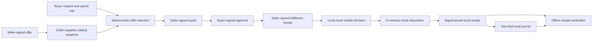

# HyperAI Compute Market Architecture

State slice: `hyperai.compute_market.local_acceptance.v1`, building on
`hyperai.compute_market.contracts.v1`. Assurance ceiling:
`INTERNAL_PASS` only for local, synthetic contract behavior after the scoped
gates pass. No external reviewer, seller, provider, verifier, oracle, or payment
authority participates in this vertical slice.

## Module ownership

- `hyperai-foundation` owns canonical JSON, SHA-256 digest representation, and
  canonical UTC timestamps shared by protocol domains. `outcomes-domain`
  re-exports these generic primitives so existing outcome wire contracts keep
  their current types and serialized forms.
- `hyperai-market` owns compute-offer, catalog, buyer-request, seller-quote,
  buyer-approval, fulfillment-receipt, verifier-decision, and mock-settlement
  contracts, advisory market observations, offline receipt verification, and
  a bounded local journal. It has no database, network client, wallet, outcome
  resolver, or HyperEVM dependency.
- `outcomes-cli` exposes `market demo`, `market verify`, and `market recover`
  beside `outcomes ...`. The established outcome commands and their settlement
  semantics remain unchanged.
- `products/simple-compute-market/` remains the separate Python buyer,
  registry, storefront, and seller-fulfillment implementation. Its hosted and
  chain integrations do not run through the local Rust demo.
- `products/hyperintel/` remains inference-native. The market uses its general
  offer provenance and authenticated receipt patterns as design input without
  depending on its routing or execution contracts.
- `products/justai/` remains the governed evidence and disclosure workspace.
  No JustAI projection or custody action runs in this slice.

## Local lifecycle

1. A seller signs an offer containing resource model, region, capacity, integer
   micro-USD rate, and validity interval.
2. The caller supplies offers with source labels. HyperAI validates each
   signature and time interval, collapses byte-identical repeated offers, and
   rejects conflicting reuse of an offer ID. Source labels are retained in the
   snapshot. This is a snapshot processor, not a registry client.
3. A buyer request carries its exact resource, quantity, duration, maximum
   rate, total spend cap, and quote deadline. Selection sorts by rate and then
   offer ID. Checked integer arithmetic prevents overflow.
4. The seller signs a quote binding its offer digest and request digest to the
   exact amount and spend cap. The buyer signs approval with the full request
   embedded, so later verification can re-check that the quote stayed within
   the buyer's limits.
5. The seller signs a fulfillment receipt bound to the approved deal, reported
   amount, completion time, and result digest. The digest does not reveal or
   transport private inputs or outputs.
6. A local mock verifier decision maps to a mock release, refund, or dispute
   hold. The in-memory ledger rejects a second disposition for the same deal.
7. The CLI can export the complete digest-bound receipt and one-deal journal to
   a caller-selected new directory, verify the receipt offline, and recover a
   missing export from the journal across process restarts. The journal is
   bounded and no-overwrite; this does not qualify power-loss safety, hostile
   filesystems, or concurrent writers.

## Trust and claim limits

The included public key is self-declared. A valid signature proves control of
that key for these bytes, not that the key belongs to a legal seller, that the
offered hardware exists, or that the seller can deliver it. Registry identity
and revocation are future contracts.

The receipt records seller-reported metering and a result digest. It does not
prove hardware telemetry, correct computation, private-result availability, or
the amount a real escrow should release. The verifier verdict is caller-supplied
and unsigned in this local mock. The mock disposition is not a payment receipt.

The demo is offline and synthetic. It does not contact Simple Compute Market,
HyperIntel, JustAI, The Compute Bazaar, a seller, a provider, a chain, or a
payment service. It moves no funds and emits no public evidence. The receipt
and journal contain synthetic data only; offline verification proves contract
integrity and signature consistency, not seller identity or computation
correctness. The applicable assurance label after scoped gates pass is
`INTERNAL_PASS`; external reviewer status is `NOT_REQUESTED`, reproducibility
status is `NOT_REPRODUCED`, and the next blocked authority gate is a separately
authorized, rights-cleared live registry/read-only adapter and verifier design
review.

## Simple Compute Market read-only capture

The HyperAI Market interface can separately verify a caller-selected signed
`GET /listings` request/response capture under caller-supplied buyer and
registry identity pins. `hyperai-scm-adapter` implements the pinned source v2
envelope in Rust; it does not load the source Python package at runtime. The
capture's original response-body text is checked for duplicate JSON keys
before RFC 8785 canonicalization. The UI retains source fields for inspection
and adds bounded summaries only for resource shapes supported by the pinned
source contract. Recognized compute and API-credit shapes expose selected
fields; token, malformed, and unknown shapes stay opaque, with the original
listing available to inspect. Search and status/resource filters run in
browser memory. The UI does not normalize the imported record into
`hyperai-market::Offer` or pass it into selection, buyer approval, or the
synthetic deal lifecycle. Source `updated_at` values are shown verbatim;
freshness remains unknown.

The result means only that the request proof and response proof match those
caller pins for the captured bytes and pass the source's 300-second timestamp
skew check. The v2 response signature does not cover the request query-body
hash, and the verifier has no replay store. Listing freshness, seller identity,
hardware, availability, fulfillment, computation correctness, payment, and
deal admissibility remain unproven. The adapter checks the page envelope and
object-list shape, not every source listing schema. An imported capture does not enable a
registry URL, credential, seller call, or external write. The capture and
Data-view boundaries and proof records are in
[`hyperai.bazaar_interface.scm_offline_capture.v1`](state-slices.md) and
[`hyperai.bazaar_interface.scm_domain_views.v1`](state-slices.md).
