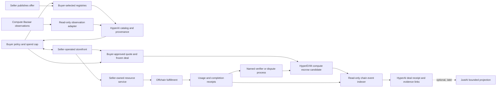

# HyperAI Compute Market: End-to-End Refactor Plan

Status: implementation in progress under the user's explicit monorepo request.
This document does not authorize provider calls, paid execution, external
publication, testnet/mainnet writes, or production deployment.

Documentation state slice: `hyperai-compute-market-plan-v1`.
Current implementation slices: `hyperai-monorepo-foundation-v1` for workspace
consolidation, `hyperai.compute_market.contracts.v1` for signed synthetic
market contracts, and `hyperai.compute_market.local_acceptance.v1` for the
offline-verifiable receipt and local recovery journal. The backend history
contract is implemented under
`hyperai.compute_market.local_deal_history.v1`; this adds owner-only durable
storage and a read API for the fixed synthetic market. Browser, CLI, and TUI
history projections are implemented and locally qualified under
`hyperai.compute_market.local_history_clients.v1`; MCP/ACP exposure needs its
own capability decision. The HyperAI interface
also has the separately scoped shell, HyperIntel offline-bundle verifier, and
Simple Compute Market offline-capture verifier slices; these do not enable
networked registry reads, providers, or settlement.

The Bazaar-inspired Data, Fleet, Eval, and Trade research implementation plan,
including their shared Rust CLI/TUI and local service, is in
[`compute-bazaar-rust-port-subplan.md`](compute-bazaar-rust-port-subplan.md).
Its bounded local surfaces are implemented under separate slices; Phase 7
Trade has `INTERNAL_PASS` with clean second-host reproduction still open. ACP,
rights-cleared source adapters, and external operations remain separately
gated. The work builds on the existing compute-market contracts without
duplicating or changing their authority boundaries.

The recommended first customer/workload wedge and cross-supply product thesis
are in [`compute-market-wedge-master-plan.md`](compute-market-wedge-master-plan.md).
That strategy selects an initial buyer and job type; this refactor plan remains
authoritative for compute-market contracts, delivery phases, and authority
gates.

Baseline: HyperAI `dcf41e31aa1f98438a6f8ec6cb253801e26dc0aa` on `main`.
The pre-existing untracked `docs/next-steps.md` remains preserved. The source
trees are now under `products/` with separate build graphs; Bazaar stays under
the ignored `references/` path and is not a build dependency.

## Product decision

Make **HyperAI** the product name and add a compute-market subsystem to this
repository. Keep it beside the current outcome-verification and settlement
protocol. HyperAI's intended end-to-end value is a buyer-controlled path from
compute discovery and seller negotiation to offchain fulfillment, verifiable
receipts, dispute-aware settlement, and bounded evidence.

The pre-existing untracked `docs/next-steps.md` sketches a broader intelligence
exchange where useful capabilities can be evaluated, reused, and made available
under owner-controlled terms. This compute market is infrastructure for that
direction: it lets buyers find and procure compute and inference capacity with
clear evidence and settlement rules. It does not implement capability
extraction, model training, capability admission, or a self-improvement loop;
those need separate product contracts, rights rules, and evaluation gates.

Treat the upstream projects as complementary layers inside one monorepo.
Monorepo membership means one Git root and shared orchestration; it does not
flatten product modules, trust roles, data custody, execution, settlement, or
authority into one runtime:

- **Simple Compute Market** informs buyer-selected discovery, federated listing
  registries, seller storefront negotiation, and seller-owned fulfillment.
  Its Alkahest escrow and hosted Stripe paths show why settlement belongs
  behind a separate adapter; neither settlement runtime is part of the first
  local slice.
- **The Compute Bazaar** informs market observations, price and availability
  analysis, fleet operations, and agent evaluation. Its Trade direction is
  exploratory market-risk work, not a ready-made compute-job settlement path.
  Its data is advisory. The first market does not depend on Bazaar's lake or
  operational runtime. The broader HyperAI interface direction is documented
  in [`bazaar-hyperai-interface-plan.md`](bazaar-hyperai-interface-plan.md);
  it defines how one HyperAI experience links local modules, offline source
  records, reference-only designs, optional projections, and separately
  authorized adapters. It does not expand this local market slice or its
  authority.
  The concrete Rust port subplan is in
  [`compute-bazaar-rust-port-subplan.md`](compute-bazaar-rust-port-subplan.md);
  its local Data, Fleet, Eval, and Trade research surfaces are implemented in
  separate slices; live sources and operations remain separately gated.
- **HyperIntel** informs inference-specific offer verification, buyer policy,
  authenticated execution lineage, durable replay, and receipt reconciliation.
  It remains a separate inference-native system; only selected, pinned,
  reviewed contracts or patterns may be adapted into HyperAI.
- **JustAI** informs metadata-only evidence receipts, provenance, disclosure,
  recovery references, and bounded public projections. It is not a market
  ledger, execution authority, payment authority, or current artifact custodian.

The compute market must not change the meaning or claim ceiling of existing
outcome records. A generic compute deal can use the outcome protocol only when
its completion claim has an explicit, frozen verifier and the verifier's
evidence maps to the existing outcome contract without weakening either
protocol. Otherwise the market records its own typed delivery and dispute
state.

## Current system and migration boundary

HyperAI is currently a Rust workspace for frozen computational claims,
candidate observation, pinned validation, evidence export, disputes, finality,
and settlement preparation. `outcomes-domain` owns claim and resolution
semantics; `outcomes-settlement` and `hyperliquid-hip4` are outcome-oriented.
HIP-4 publishing is `UNSUPPORTED_UNVERIFIED`, and mainnet mutation is disabled.
The local synthetic market verifies caller-supplied signed offers, creates a
deterministic catalog, carries separate advisory market observations, enforces
buyer selection and spend constraints, binds seller quotes to buyer-signed
deals, verifies seller-reported fulfillment receipts, and records mock
settlement dispositions. It can export a digest-bound receipt, verify it
offline, and recover a missing receipt export from a bounded one-deal local
journal across CLI processes. This is local file recovery, not qualification
for power loss, hostile filesystems, concurrent writers, or real settlement.
The local service persists its synthetic quote approval and mock
completion in a separate Market-owned SQLite history and exposes an owner-only
paged read route. The browser Deals surface, CLI history command, and TUI Deals
workspace now project and digest-check pages from that route under the
`hyperai.compute_market.local_history_clients.v1` slice. The database remains
outside the metadata backup; this local one-row fixture does not qualify
multi-row HTTP pagination. The repository still has no live registry adapter,
seller network negotiation, paid compute execution, or real compute
settlement.

The source imports and digests are recorded in
[`docs/provenance.md`](provenance.md) and
[`manifests/monorepo-imports.json`](../manifests/monorepo-imports.json). The
target is one Git monorepo with multiple build graphs and explicit module
ownership:

| Source | Pinned reference recorded by HyperIntel | Imported snapshot / rights | Plan treatment |
|---|---|---|---|
| Simple Compute Market | `a1c46d20b1b2f1aabe53e1b052921a87cf9d7360` | `products/simple-compute-market/` matches the pinned Git tree: 2,189 files, 0 missing, 0 extra, 0 different. MIT license retained. | Preserve as a separate Python workspace. Keep hosted Stripe, Alkahest, and chain effects out of HyperAI defaults. |
| The Compute Bazaar | `d1809e5cfa843c087ebc4de9f00561bf0be67d55` | `references/the-compute-bazaar-main/` is ignored and local-only; no root `LICENSE` recorded at the pin. | Use as a local design reference only. Implement owned observation and analysis contracts without copying source, schemas, datasets, fixtures, output, or assets. |
| HyperIntel | `d52111a07baa5fc4a7f6bfb4407731e2b9f609dc` | `products/hyperintel/` is the exact clean committed snapshot: 99 files. The dirty source checkout was not copied. | Preserve its nested Rust workspace and inference-native boundaries. Reimplement the untracked catalog candidate separately because it is absent from the pinned source. |
| JustAI | `9a0e56536b968cbb2cb7173e142068b53c4f9fe3` | `products/justai/` contains a 176-file local snapshot including the recorded `docs/local-quorum.md` edit. Generated build output and `.git` were excluded. | Preserve the independent nested workspace, charter, status, and authority limits. Any market projection needs its own state slice. |

The per-file import-tree digests are recorded in
[`manifests/monorepo-imports.json`](../manifests/monorepo-imports.json) and
checked by `corepack pnpm run verify:imports`. Do not copy the dirty HyperIntel
working tree. ESN-JustNet and Composed Platform are not
first-release dependencies; the former may inform a later buyer-owned consent
surface, while the latter may be considered later as an isolated qualification
harness.

## Monorepo layout

Keep one Git root and operator entrypoint while retaining project-specific
workspaces and authorities:

| Monorepo area | Role | Build ownership |
|---|---|---|
| Root `crates/outcomes-*` and `crates/hyperliquid-hip4` | Existing outcome verification and outcome settlement protocol | Root Cargo workspace and pinned Rust toolchain |
| Root `crates/hyperai-market/` | Compute-market contracts, buyer/deal lifecycle, observations, mock fulfillment, and later escrow adapters | Root Cargo workspace; outcomes domain does not depend on market vocabulary |
| `products/hyperintel/` | Inference-native offer policy, routing, execution lineage, and reconciliation | Nested Cargo workspace; root orchestration invokes its pinned commands |
| `products/justai/` | Public-interest governance, evidence contracts, disclosure, and observatory tooling | Nested Cargo and pnpm workspaces; authorization remains JustAI-owned |
| `products/simple-compute-market/` | MIT-licensed registry, buyer, storefront, and seller-role application | Nested Python workspace; hosted/paid paths are excluded from root defaults |
| `references/the-compute-bazaar-main/` | Local-only checkout while source and data rights remain unresolved | Excluded from root workspaces and distributable source; market data module is independently authored |

Retain each product's lockfile, toolchain pin, package tests, and local build
commands. Add root orchestration after the nested workspaces are relocated and
independently green. Exclude nested Cargo workspaces from the root Cargo
workspace rather than merging their domain vocabularies. Root verification
must name each workspace and report its result separately.

## Target architecture and deal flow



### Preferred settlement rail

For eventual paid compute deals, HyperEVM is the intended EVM escrow rail.
This is an architecture target only: the current product uses local mock
dispositions and has no configured contract, wallet, RPC endpoint, or chain
event source. Compute escrow remains separate from HyperAI Outcomes and HIP-4;
HyperCore price or availability markets are not the settlement mechanism for
a delivered job.

Alkahest is a candidate to evaluate, not an assumed ready deployment. Its
general EVM escrow design does not establish that a compatible contract,
dependencies, or verifier configuration are deployed on HyperEVM. The later
testnet phase must establish deployment availability or choose and review a
dedicated contract path before any testnet write is considered.

The frozen deal must bind the schema version, buyer-approved quote and job
specification digests, seller, settlement asset and chain, amount cap, expiry,
milestones, verifier or oracle, dispute and timeout rules, and privacy and
retention terms. Inputs and outputs remain encrypted offchain. Seller
signatures and hardware telemetry provide attribution or observations; they
do not establish correct computation or payment entitlement. Any offchain
verifier is an explicit trust assumption recorded with its decision and the
evidence it evaluated. Only the agreed, deal-bound verifier or dispute path
can request release, tranche release, refund, or hold. A read-only indexer
reconciles chain events and finality into an append-only settlement receipt
linked to the deal; asking prices and availability feeds never trigger
payment.

### Authority and data flow

1. The buyer selects registries and supplies requirements, privacy constraints,
   freshness rules, and a maximum spend. Registry choice is buyer policy.
2. Registry adapters return listings with publisher identity, source,
   observation time, schema version, and raw/source digest. A registry is a
   discovery surface; it does not become the seller or settlement authority.
3. Bazaar observations may add context about asking prices, supply, and
   availability. Keep source asks, modeled indices, availability observations,
   buyer-approved quotes, and completed fills as distinct record types. Bazaar
   analysis never silently changes seller terms, offer trust, eligibility, or
   payment entitlement.
4. The buyer negotiates with the seller's storefront. The seller owns pricing,
   policy, and fulfillment coordination. Any material quote change requires a
   new buyer authorization and deal digest.
5. Before escrow or workload launch, freeze a versioned deal record containing
   the buyer and seller identities, exact offer and quote digests, job
   specification digest, chain and settlement-asset identity when applicable,
   amount cap, expiry, milestones, timeout/refund behavior, verifier, dispute
   policy, and privacy/retention terms. Private input and output bytes stay
   encrypted offchain.
6. The seller-owned resource service fulfills offchain and emits signed start,
   usage, completion, or failure records bound to the deal and request
   commitments. A seller/provider signature establishes attribution under its
   key; it does not independently prove correct computation or metering.
7. A named verifier or dispute process evaluates only the objective rules
   frozen in the deal. Missing, stale, conflicting, or unsupported evidence
   produces an explicit unresolved/inconclusive result. It must not imply
   payment entitlement.
8. A compute-market-specific settlement adapter enforces capped payment,
   replay protection, expiry, and the agreed release/refund path. A read-only
   indexer reconstructs chain events and links them to the offchain receipt
   digests.
9. HyperAI produces a portable deal/evidence receipt. A JustAI metadata
   projection is a later, separately governed output; it is not on the payment
   path and does not transfer restricted evidence or custody authority.

### Separate module layers

The initial Rust-owned surface is `hyperai-market` behind the root `hyperai`
CLI. Split it into smaller `hyperai-market-*` crates only when a module has a
distinct contract and can be tested independently. The imported products stay
under `products/` as separately built workspaces. Keep dependencies one-way:

```text
market CLI / API composition
        ↓
buyer policy, catalog, negotiation, deal lifecycle
        ↓
source adapters, seller/fulfillment adapters, settlement adapter
        ↓
market-owned versioned records and persistence ports
```

The current package owns market records and canonical digests, caller-supplied
catalog snapshots, advisory observations, buyer policy, seller quote and buyer
approval, fulfillment receipt verification, mock settlement, and a bounded
single-deal receipt journal. It does not yet have network adapters,
database-backed or production-qualified persistence, an independent verifier,
or live settlement. Keep the existing `outcomes-*` crates independent. Generic
canonicalization, digest, and timestamp types now live in `hyperai-foundation`
and are re-exported by `outcomes-domain` to preserve existing public types and
serialized forms. Do not let market code import outcome resolution or HIP-4
settlement records.

Use product-facing names `hyperai market` and `hyperai outcomes` when the CLI
composition is introduced. Keep the current `hsai outcomes` invocation as a
compatibility alias until the migration has explicit compatibility coverage.
Do not rename stable schema IDs, persisted records, or Rust crates solely to
make the new brand visible.

## Versioned records and trust rules

The first contract design should cover these separate records, without
embedding private payloads:

The bounded procurement trace uses the market-owned `WorkloadIntentV1` and
request binding recorded in the [HyperAI interface plan](bazaar-hyperai-interface-plan.md)
and [workload-trace packet](compute-bazaar-workload-trace-packet.md). The
application facade exposes a read-only trace over owner-held references;
existing V1 market records remain unchanged. This decision does not establish
a general workload identity for non-market workflows, which remains open.

- **Offer observation:** publisher and source identity, source schema, offer
  identity, observation time, freshness, price basis/currency/units,
  availability status, provenance digest, and signature/trust reference when
  provided. Unknown or conflicting fields remain unknown or are rejected.
- **Buyer-approved quote:** seller identity, exact offer reference, resources,
  price, fees, expiry, and seller signature. This is not a funded escrow.
- **Frozen compute deal:** canonical schema version and digest; buyer/seller;
  job-specification commitment; quote/offer digests; maximum amount; chain,
  contract, and asset identities when applicable; allowed milestones; expiry;
  cancellation, timeout, refund, and dispute policy; verifier identity and
  version; and data handling terms.
- **Fulfillment receipt:** deal digest, request commitment, lifecycle status,
  bounded usage and metering basis, timestamps, seller/provider signing-key
  purpose, and output/evidence digest. Keep prompts, output, credentials, and
  raw traces out of public records and chain calldata.
- **Verifier/dispute decision:** exact deal and evidence digests, decision
  basis, uncertainty, exclusions, signer role, and supersession link. Provider
  telemetry alone must not be described as independent verification.
- **Settlement receipt:** exact deal digest, chain/contract/asset, transaction
  and event identity, amount, disposition, and reconciliation status. A local
  intent, transaction submission, or transport acknowledgement is not a
  settled payment.

Use the workspace's canonical JSON and digest discipline where the semantics
match; preserve its no-floating-point rule for resolution-critical values.
Market observation values still need explicit units and decimal/integer
representations. Create market-specific identifiers and digest domains rather
than reusing outcome identifiers. Keep keys purpose-separated for buyer
authorization, publisher offers, provider execution receipts, verifier
decisions, escrow administration, pause, and upgrades.

## Phased delivery and exit gates

All state-slice names below are proposed. Each implementation change must add
the accepted scope, files, allowed effects, data limits, claim ceiling,
nonclaims, and stop conditions to the authoritative state-slice and product
documents before code changes. Only the local workspace and synthetic slices
named at the top are currently authorized; external effects remain closed.

| Phase | Proposed slice | Deliverable | Exit gate |
|---|---|---|---|
| 0. Freeze scope and sources | `hyperai-compute-market-plan-v1` | **Complete locally:** product boundary, source pins, license/data-rights ledger, import digest manifest, and non-goals recorded. HyperIntel was imported from its clean commit; the absent uncommitted catalog candidate was not copied. | Import digests match; Bazaar remains ignored and unlicensed source is not imported. Broader product owner decisions remain open before either GPU/VM or inference network adapters. Current outcome/HIP-4 claim and write gates remain unchanged. |
| 1. Market contracts and local synthetic slice | `hyperai.compute_market.contracts.v1` | **Implemented locally:** signed caller-supplied offers, provenance-labelled deterministic catalog, buyer request and spend cap, seller quote, buyer-approved deal, signed fulfillment receipt, local mock-verifier verdict, and mock release/refund/hold mapping. | Focused Rust tests prove digest/signature checks, conflict rejection, cap non-widening, expiry, receipt binding, explicit dispositions, and in-memory replay refusal. This is a local contract result only; it does not authorize network, credentials, provider calls, funds, external writes, or claims of correct computation. |
| 1a. Offline receipt and local recovery | `hyperai.compute_market.local_acceptance.v1` | **Implemented locally:** advisory observation records; digest-bound metadata-minimized receipt; offline verifier; size-bounded, no-overwrite one-deal journal; explicit receipt export and recovery commands. | Focused unit and subprocess tests cover two source-labelled registry observations, deduplication, advisory data separation, buyer cap, receipt tampering, offline verification, journal recovery after export loss, duplicate destination refusal, oversized files, symlinks, and conflicting replay. Process restart is covered; power-loss, hostile filesystem, and concurrent-writer guarantees are not. No network, provider, wallet, real data, funds, public publication, or live settlement. |
| 1b. Local synthetic deal history | `hyperai.compute_market.local_deal_history.v1` | **Implemented locally:** Market-owned SQLite persistence for exact synthetic quote approvals and mock completion receipts, plus an owner-only bounded read API. The database is separate from metadata SQLite and its backup path. | Exact approval retries are idempotent; conflicting deal reuse and completion without persisted approval fail closed; receipt linkage and page digest are recomputed; store pagination, owner/session auth, scoped ACP capability denial, malformed-store handling, filesystem path protection, and process restart pass local tests. Multi-row HTTP cursor continuation is separately qualified under `hyperai.compute_market.local_history_pagination.v1`. Synthetic local service only; no Bazaar adapter, network, provider, funds, external writes, or production authority. |
| 1c. Shared local history surfaces | `hyperai.compute_market.local_history_clients.v1` | **Implemented and `INTERNAL_PASS` locally:** browser Deals, `hyperai market history`, and TUI Deals project the versioned Market page. Explicit local approval and mock-completion labels retain their non-execution and non-payment meaning. | Focused CLI and full TUI tests pass; the authenticated browser lifecycle observed three history reads and zero extra writes; root `lint:fast` passed. Rust clients recompute page digests and preserve the opaque cursor contract. The separate pagination slice exercised two service pages through browser Load more; CLI/TUI multi-page live-service traversal remains unqualified. MCP/ACP history exposure needs a separate capability decision. No external effects, independent review, or production authority. |
| 2. Catalog and read-only data adapters | `hyperai.compute_market.catalog.v1` plus `hyperai.bazaar_interface.scm_offline_capture.v1` | **Implemented local bridge:** verify caller-supplied Simple Compute Market v2 `/listings` request/response captures under caller pins and display the registry-attributed body in the Market UI. Next: opt-in read-only live registry access, plus rights-cleared Bazaar exports if allowed. Keep source freshness and authentication skew distinct. | Source-generated EIP-191 and Ed25519 vectors, strict duplicate-key parsing, request/response context and tamper cases, bounded loopback API, and browser import flow pass focused local checks. The capture verifier does not validate every listing schema, prove query application, freshness, replay resistance, seller identity, or deal admissibility. Live reads require their own endpoint, pin, credential, retention, and network-policy slice. No auto-publication, seller reservation, or execution. |
| 3. Buyer policy and seller negotiation | `hyperai.compute_market.deal.v1` | Buyer policy, spend cap, seller firm quote, bounded negotiation transcript commitment, quote revalidation, deal freeze, and idempotent local retry behavior. | Quote or job changes invalidate authorization; expiry, cancel, replay, cap-overflow, and changed-seller paths cannot create a positive intent. Seller negotiation remains seller-owned. No payment or real workload. |
| 4. Mock fulfillment and evidence | `hyperai.compute_market.fulfillment.v1` | Seller resource-service adapter with deterministic mock fulfillment; receipts and reconciliation; optional inference-specific adapter only after HyperIntel source recovery and pinned review. | Local vertical slice covers complete, failed, partial, cancelled, ambiguous-meter, tampered-receipt, missing-verifier, and contradictory-evidence paths. No external provider, production key, or private payload transport. |
| 5. Outcome-protocol evidence bridge | `hyperai.compute_market.outcome_bridge.v1` | Optional mapping from a deal's objectively verifiable completion claim to an existing HyperAI evidence bundle and resolution. Non-mappable or subjective quality stays outside the outcome protocol. | Contract tests prove the bridge cannot widen outcome claims, bypass frozen validators, change finality, or turn a provider signature into correctness proof. An independent review is required before this bridge is used to authorize external settlement. |
| 6. HyperEVM testnet escrow candidate | `hyperai.compute_market.hyperevm_testnet.v1` | Evaluate a dedicated compute escrow contract/adapter, Alkahest compatibility and deployment availability, the exact testnet asset, read-only event indexing, and local-to-chain receipt reconciliation. HyperEVM docs currently identify chain IDs 998 (testnet) and 999 (mainnet); reverify both at execution time. This is separate from HIP-4. | Establish whether a compatible Alkahest deployment, dependencies, and verifier configuration exist on the target network; generic EVM compatibility is not deployment evidence. If not, select and review a dedicated contract path. Then freshly verify chain/contract/asset behavior, replay and conservation invariants, expiry, pause/escape, gas/RPC failure, and dispute/timeout semantics. Verify the exact token contract and balances; do not infer fungibility from a shared symbol across HyperCore and HyperEVM. Freeze exact contract bytes and packet; obtain the required independent contract review and explicit operator authorization for that exact testnet write before submitting. Never infer mainnet permission. |
| 7. JustAI evidence projection | `hyperai.compute_market.justai_projection.v1` plus a separate JustAI-approved slice | Metadata-only digest handoff and bounded disclosure projection, if JustAI's charter and schemas allow this use. | Written scope/charter compatibility, disclosure policy, named data custodian, retention/deletion rules, and reviewer requirements are established. Where JustAI's publishable-core policy applies, retain its two non-publisher reviewer organizations requirement. No raw inputs/outputs, restricted bytes, custody-root selection, or payment authority moves through this adapter. |
| 8. Paid beta and production | New exact operational and production slices | Capped real workload and settlement operation with rollback, monitoring, support, and accounting. | Separate privacy/legal/security review, provider authorization, key custody, incident and recovery exercises, exact release binding, independent review where required, and a distinct deployment authority decision. `INDEPENDENT_ACCEPT` is not `PRODUCTION_AUTHORIZED`. |
| 9. Bazaar-inspired compute desk extensions | Detailed in [the Rust port subplan](compute-bazaar-rust-port-subplan.md). The local Data, Fleet, Eval, and Trade research slices are implemented; Trade is `INTERNAL_PASS` locally, with clean second-host reproduction open. | Continue the existing local Rust service and shared clients with the separately planned ACP surface. Add no duplicate SCM capture explorer, synthetic market lifecycle, or already implemented local Data/Fleet/Eval/Trade workspace. | ACP needs its own packet and slice. Rights-cleared source adapters, observation diversity, stale/revision treatment, evaluator/fixture custody, live Fleet/provider operations, legal review, and operation authority remain separate gates. Bazaar asks or availability feeds alone never qualify as executed-price data; fleet telemetry and agent scores do not prove delivery or payment. Any tradable compute-price/availability product needs its own plan and approvals. |

### Local synthetic end-to-end acceptance

The first local synthetic increment now meets the following bounded acceptance
criteria:

1. reads synthetic fixtures representing two registry sources and
   Bazaar-style market observations;
2. verifies signed offers and retains their source labels, validity interval,
   and integer price units while deduplicating them deterministically; market
   observations retain their source, observation time, and integer units but
   remain unsigned advisory inputs;
3. applies buyer constraints and a hard spend cap;
4. creates a seller-signed quote and freezes the buyer-approved deal digest;
5. creates a seller-signed completion receipt through the synthetic mock path;
6. verifies the seller-reported completion receipt against the exact deal;
7. maps mock verifier `Verified`, `Rejected`, and `Inconclusive` decisions to
   mock release, refund, and dispute hold dispositions; and
8. exports an offline-verifiable, metadata-minimized receipt with claim ceiling,
   nonclaims, source provenance, and no external effect, with recovery from a
   local journal after the export is removed.

The implemented slice tests digest and signature tampering, oversized artifacts,
symbolic links, duplicate destination refusal, conflicting replay, and receipt
recovery across separate CLI processes. Stale/future data, schema drift,
conflicting duplicate listings, quote inflation, seller substitution, cap
overflow, expiry, and base replay paths are covered by contract tests. Timeout,
cancellation, partial work, provider failure, verifier unavailability,
contradictory meters, and lost on-chain settlement receipt scenarios remain
future fulfillment or settlement-slice work. Every refusal or unknown remains
explicit; absent data is never converted to zero or success. This is a bounded
local acceptance result, not independent verifier qualification or
power-loss-safe storage.

## Assurance, release, and reporting

### Current local readiness snapshot

- Exact baseline: HyperAI `dcf41e31aa1f98438a6f8ec6cb253801e26dc0aa` on
  `main`, with the monorepo changes still uncommitted. Imported source
  revisions and byte digests are pinned in
  [`manifests/monorepo-imports.json`](../manifests/monorepo-imports.json).
- Implemented state slices: `hyperai-monorepo-foundation-v1`,
  `hyperai.compute_market.contracts.v1`,
  `hyperai.compute_market.local_acceptance.v1`, and
  `hyperai.compute_market.local_deal_history.v1`, and
  `hyperai.bazaar_interface.scm_offline_capture.v1`. The local deal-history
  slice is `INTERNAL_PASS` for its synthetic service/storage/API contract only;
  it does not qualify client projections, backup/recovery, multi-process
  concurrency, live sources, or production use. The root Rust workspace,
  imported HyperIntel and JustAI workspaces, source import manifest, bounded
  Simple Compute Market suites, and local market subprocess lifecycle have
  passed local validation in this environment. The SCM capture verifier also
  passed cross-language source vectors, focused Rust/Clippy checks, JavaScript
  syntax, loopback accepted/tampered requests, and the browser import flow.
- Assurance: `INTERNAL_PASS` for the named root, nested workspace, import
  digest, bounded Simple source, local synthetic market, and offline SCM
  capture gates only.
  Reviewer status: `NOT_REQUESTED`. Reproducibility: `NOT_REPRODUCED` (one local
  environment).
- Simple Compute Market validation runs its pinned local core, registry, and
  provisioning-IaC suites in a disposable copy so `uv sync` cannot rewrite
  imported lockfiles. The upstream aggregate `make dist test` is not a default
  gate: it enters hosted release verification. The hosted settlement release
  suite and `domains/apicredits` cross-language middleware suite are not
  included; the latter invokes npm in the imported upstream tree. These
  exclusions do not alter or qualify those upstream release contracts.
- Data custody: market fixtures and generated wheelhouses remain local and
  synthetic. HyperIntel and JustAI source snapshots are local-only pending
  rights confirmation. Bazaar remains ignored and contributes no tracked code
  or data. No private payloads, credentials, or provider artifacts were added.
- Claim ceiling: contract integrity, deterministic buyer constraints, seller
  attribution, receipt structure, local journal recovery, and mock disposition
  mapping only. The seller signature and mock verifier do not prove correct
  computation, independent metering, or payment entitlement. File recovery
  does not claim crash-safe or adversarial-filesystem persistence.
- Next blocked authority gate: live read-only registry/data connections and a
  qualified verifier/dispute contract, each with its own named slice and
  review. Testnet writes, paid execution, live providers, public redistribution,
  and production deployment remain closed.

For each implementation or experiment, report the exact revision and state
slice, assurance level, reviewer status, reproducibility status, data and
artifact custody, known limitations, claim ceiling, and next blocked authority
gate. Use the repository-wide assurance labels literally:

- `INTERNAL_PASS` for scoped local checks;
- `SEGREGATED_INTERNAL_REVIEW` for a separate internal review, not an
  independent authority;
- `REPRODUCED_LOCAL` for an exact procedure reproduced in a clean second
  environment with toolchain, dependency, fixture, and output digests;
- `EXTERNAL_REVIEW_UNAVAILABLE` when the exact configured reviewer is
  unavailable or has not returned a signed decision;
- `INDEPENDENT_ACCEPT` only for a signed decision binding the exact target,
  protocol, packet, state slice, claim ceiling, scope, and nonclaims; and
- `PRODUCTION_AUTHORIZED` only for a separate deployment/operational approval.

Below `INDEPENDENT_ACCEPT`, development remains local, synthetic, hermetic,
and without production traffic, real-user payloads, paid execution, remote
workers, federation, irreversible writes, or unrestricted security claims.
If external review is unavailable, continue lower-risk authorized work while
keeping the gated claim, write, deployment, and spend closed. Do not retry an
ambiguous external submission, self-sign, or relabel a local result.

The named candidate state slices above do not authorize network calls,
provider credentials, paid execution, testnet writes, public reporting, or
mainnet use. Each requires a fresh scope and the corresponding owner/operator
authority. The existing outcome protocol's `UNSUPPORTED_UNVERIFIED` testnet
status and disabled mainnet mutation remain untouched.

## Explicit non-goals

- Wholesale merge, vendor, or submodule of either upstream repository.
- Replacing HyperAI's outcome protocol with the marketplace, or making the
  marketplace depend on outcome-specific settlement and HIP-4 records.
- Treating Bazaar indexes, asking prices, availability, seller signatures,
  provider telemetry, local receipts, or an oracle's assertion as proof of
  correct computation.
- Putting prompts, outputs, credentials, restricted evidence, or raw traces on
  chain or in a public JustAI projection.
- Using JustAI for workload execution, provider routing, deal persistence,
  escrow decisions, or funds movement.
- Enabling HIP-3 compute price contracts or a tradable index in the first
  market increment.
- Renaming existing frozen schemas, Rust crates, or stored records before a
  compatibility migration is designed and reviewed.

## Source references

- [Simple Compute Market README at the recorded pin](https://github.com/arkhai-io/simple-compute-market/blob/a1c46d20b1b2f1aabe53e1b052921a87cf9d7360/README.md)
- [Simple Compute Market roles at the recorded pin](https://github.com/arkhai-io/simple-compute-market/blob/a1c46d20b1b2f1aabe53e1b052921a87cf9d7360/docs/roles.md)
- [Simple Compute Market MIT license at the recorded pin](https://github.com/arkhai-io/simple-compute-market/blob/a1c46d20b1b2f1aabe53e1b052921a87cf9d7360/LICENSE)
- [The Compute Bazaar README at the recorded pin](https://github.com/gustofied/the-compute-bazaar/blob/d1809e5cfa843c087ebc4de9f00561bf0be67d55/README.md)
- [The Compute Bazaar architecture at the recorded pin](https://github.com/gustofied/the-compute-bazaar/blob/d1809e5cfa843c087ebc4de9f00561bf0be67d55/docs/architecture.md)
- [Alkahest job-trading escrow example](https://github.com/arkhai-io/alkahest/blob/main/docs/website/Escrow%20Flow/Job%20Trading.mdx)
- [HyperEVM documentation](https://hyperliquid.gitbook.io/hyperliquid-docs/for-developers/hyperevm.md)
- [HyperCore to HyperEVM transfer documentation](https://hyperliquid.gitbook.io/hyperliquid-docs/for-developers/hyperevm/hypercore-less-than-greater-than-hyperevm-transfers.md)
- HyperAI current system: [outcome architecture](outcomes/architecture.md), [limitations](outcomes/limitations.md), [HIP-4 capability status](outcomes/hyperliquid-hip4.md), and [threat model](threat-model.md).
- HyperIntel and JustAI source pins, current checkout status, and reuse limits must be reverified from their local provenance and governing documents before implementation.
