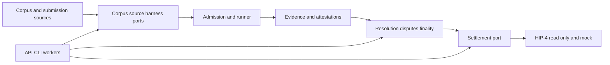

# Outcome protocol architecture

The workspace separates frozen semantics from operational projections and
keeps backend dependencies outside the domain core.

## Crate boundaries

- `outcomes-domain`: versioned value types, canonicalization, identifiers, and
  transition invariants. It imports no IO, database, HTTP, cloud, container, or
  challenge-specific code.
- `outcomes-registry`: immutable registries and persistence ports.
- `outcomes-corpus`, `outcomes-source`, `outcomes-harness`: deliberately
  separate adapter contracts sharing domain provenance primitives.
- `outcomes-runner`: admission-aware execution and replay contracts.
- `outcomes-evidence`: CAS manifests, signatures, and offline verification.
- `outcomes-resolution`: existential aggregation, quorum, disputes, pauses,
  and finality.
- `outcomes-settlement`: backend-neutral capabilities, bindings, intents,
  receipts, idempotency, and reconciliation.
- `hyperliquid-hip4`: network-scoped HIP-4 metadata and IDs, read-only access,
  mock backend, and fail-closed unsupported publishing.
- `outcomes-api`, `outcomes-cli`, `outcomes-worker`: outer composition layers.

## State-slice ownership

Each mutation declares one or more named slices: `outcomes.claim_registry.v1`,
`outcomes.corpus_registry.v1`, `outcomes.observation_ledger.v1`,
`hsai.admission.v1`, `outcomes.verification_ledger.v1`,
`outcomes.evidence_store.v1`, `outcomes.attestation_ledger.v1`,
`outcomes.resolution_ledger.v1`, `outcomes.dispute_finality.v1`,
`outcomes.market_binding.v1`, `outcomes.settlement_ledger.v1`,
`outcomes.delivery.v1`, `outcomes.access_control.v1`,
`outcomes.adapter_registry.v1`, `outcomes.operations.v1`, and
`outcomes.agent_runs.v1`.
