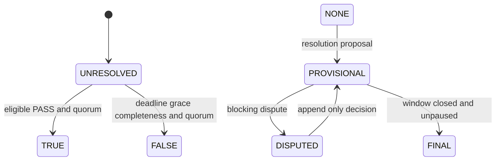

# Outcome lifecycle

Execution outcome, claim truth, resolution finality, and settlement lifecycle
are separate typed state machines.

`FAIL` rejects one candidate; it does not make an existential claim false.
`INCONCLUSIVE` and `ERROR` never map directly to `TRUE` or `FALSE`. A negative
resolution requires deadline and grace expiry, complete finalized observation,
no eligible PASS, and terminal processing for every pending eligible candidate.

A final resolution is immutable. A correction is a separately signed,
non-settling superseding record. Active disputes, pauses, stale bindings,
missing signatures, incomplete observation, and unsupported backend capability
block settlement readiness.

Settlement eligibility is evaluated before backend preflight. When no legal
resolution record exists, the typed assessment returns `RESOLUTION_REQUIRED`
and `FINAL_RESOLUTION_REQUIRED`; it never fabricates an unresolved resolution
only to call backend preflight. Claim or evidence mismatches also fail this gate.
Only an exact matching FINAL record can proceed to metadata and capability
preflight.

Settlement progresses through `UNBOUND`, `BOUND`, `NOT_READY`, `READY`,
`INTENT_BUILT`, `SUBMITTED`, and `CONFIRMED`, with explicit `PAUSED` and
`RECONCILIATION_FAILED` states. `CONFIRMED` is terminal. Unpausing returns to
`NOT_READY` so every readiness condition is re-evaluated.
