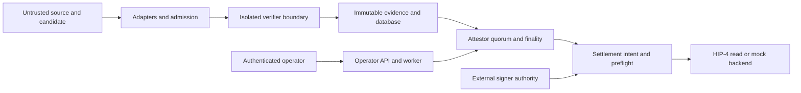

# HSAI Verifiable Outcome Protocol threat model

## Executive summary

HSAI freezes computational claim semantics, observes candidate artifacts, runs
pinned validators, publishes integrity-bound evidence, reaches quorum-backed
finality, and prepares backend settlement. The highest risks are hostile code
escaping the runner, incomplete or equivocated source observations incorrectly
supporting FALSE, signer/attestor compromise, evidence loss or privacy leakage,
and an incorrect or duplicated external settlement effect. The local MVP has
strong typed fail-closed semantics and mock-effect recovery, but production use
is blocked by the absence of a production sandbox, live-source completeness,
production key/storage controls, and a verified HIP-4 publisher authority.

## Scope and assumptions

In scope: Rust domain, registry, source/corpus/harness boundaries, scripted
runner and OCI policy contract, evidence/CAS, SQLite/PostgreSQL migrations,
attestation/finality, API/CLI/worker, settlement intent, HIP-4 read-only parser,
and mock backend. Out of scope: consumer trading, custody, authenticated hosted
CTF automation, live testnet/mainnet mutation, cloud/IAM configuration, and
Hyperliquid internals.

Assumptions: operators are authenticated in production; source timestamps and
pagination can be independently assessed before FALSE; validator and environment
digests refer to reviewed bytes; quorum keys are independently controlled;
content-addressed evidence remains available; and any external broadcaster has
authority not conferred by HSAI. These are deployment inputs, not established by
the local demo.

## System model

Components: frozen domain/registry, corpus and submission adapters, admission and
runner, evidence store, quorum/finality, API/CLI/worker, settlement core, HIP-4
adapter, database/outbox, and operator/signer systems.

Trust boundaries: untrusted sources/candidates enter adapters; executable bytes
cross into the runner; private evidence crosses into publication projection;
operator commands cross the API authorization boundary; signing crosses into an
external KMS/HSM; and settlement metadata/effects cross the external backend.

## Assets

| Asset | Security objective | Repository evidence |
|---|---|---|
| Frozen claim and binding | Integrity, immutability, explicit identity | `outcomes-domain`, `outcomes-registry`, `outcomes-settlement` |
| Candidate and private evidence | Integrity, confidentiality, availability | `outcomes-source`, `outcomes-evidence`, `outcomes-blobstore` |
| Validator/environment | Integrity and constrained execution | `outcomes-runner` |
| Attestor and operator authority | Non-forgeability, revocation, least privilege | `outcomes-evidence`, `outcomes-api` |
| Audit/outbox/database | Append-only accountability and recovery | `outcomes-persistence-sqlx` migrations/tests |
| Settlement intent/effect | Correct network/mapping, uniqueness, reconciliation | `outcomes-settlement`, `hyperliquid-hip4` |

## Attacker model

Attackers may author challenges or candidates, compromise a source/dependency,
forge or reorder submissions, exploit parsers or validators, attempt sandbox
escape/SSRF/resource exhaustion, steal one signer, replay requests, tamper with
evidence or database state, feed stale HIP-4 metadata, or abuse operator access.
They do not initially control a quorum of independent attestors, the production
database plus immutable evidence store plus audit system simultaneously, or the
external settlement authority. If those assumptions fail, automatic settlement
must pause.

## Entry points

| Entry point | Untrusted data | Existing control and evidence anchor |
|---|---|---|
| Claim/API JSON | schemas, sizes, actor requests | deny-unknown typed schemas; body limit and role tests in `outcomes-api` |
| Corpus/source/harness | Git metadata, cursors, candidates, traces | separate ports and profile validation in `outcomes-corpus`, `outcomes-source`, `outcomes-harness` |
| Runner inputs | candidate and validator code/output | structured argv, network/resource policy, typed outcome in `outcomes-runner` |
| Evidence retrieval | digests, locators, classifications | CAS verification and offline verifier in `outcomes-blobstore`, `outcomes-evidence` |
| Attestations/disputes | signatures, time, quorum, counterevidence | key registry/quorum and finality state in `outcomes-evidence`, `outcomes-resolution` |
| HIP-4 metadata/effects | JSON, IDs, network, mapping, responses | checked parser/IDs, digest preflight, mock idempotency in `hyperliquid-hip4` |

## Abuse paths

1. A source omits a page and an operator tries to finalize FALSE. Cursor and
   completeness requirements leave the claim unresolved.
2. A candidate exploits the validator or parser to escape. Admission and policy
   constrain it, but production remains blocked until a real sandbox is deployed.
3. A malicious validator emits misleading text. Structured typed normalization,
   pinned exit/result maps, and replay agreement prevent substring-based PASS.
4. One attestor signs conflicting resolutions. Unique signer quorum and retained
   attestations detect equivocation; pause and revoke the key.
5. An evidence blob is replaced or withheld. CAS/offline verification detects
   substitution; unavailable required evidence blocks finalization/readiness.
6. A recurring HIP-4 outcome rotates under the same display name. Network-scoped
   ID and metadata digest mismatch make preflight stale; no automatic rebinding.
7. A retry follows an ambiguous backend response. Persisted deterministic intent
   and authoritative reconciliation prevent blind duplicate submission.
8. An operator requests mainnet publication. The network type and backend reject
   it before any signing or network write.

## Threat model

| ID | Threat and trust assumption | Prevention | Detection and response | Residual risk / MVP gate |
|---|---|---|---|---|
| TM-001 | Malicious/compromised source; pinned bytes and reliable completeness are assumed | Immutable refs, digests, cursor/pagination model, rights/readiness gating | Gap/equivocation evidence; pause observation and negative finality | Live completeness absent; blocks production settlement |
| TM-002 | Forged/backdated/withdrawn/duplicate/oversized candidate; source identity/time is assumed | Identity/replacement policy, timestamps, size/type admission, dedupe | Admission and observation records; quarantine and recompute | External timestamp authenticity varies; blocks affected sources |
| TM-003 | Compromised validator/dependency or candidate RCE/sandbox escape; isolation is assumed | Digest-pinned structured runner policy plus tested Docker non-root/read-only/no-network/capability/resource controls | ERROR classification, manifests, heartbeat/lost-worker handling; quarantine tuple | Control-plane probe is not the full candidate verifier backend; blocks production |
| TM-004 | Path traversal, symlink/archive/parser exploit or bomb; importer safety is assumed | Solver-view exclusion plus tested pinned-checkout path, symlink, protected-content, race, count, and byte limits | Materialization failure and digest audit; quarantine artifact | Submodule/LFS/archive/image materializers are absent; blocks those inputs |
| TM-005 | Nondeterminism/time/randomness/architecture drift; replay tier is assumed achievable | Frozen environment/time/seed, semantic replay count, typed INCONCLUSIVE/ERROR | Divergent manifests; dispute/pause and new claim if policy changes | Cross-host determinism requires production qualification |
| TM-006 | Runner/attestor collusion, signer theft/misuse/replay; quorum independence is assumed | 2-of-3 policy support, duplicate signer rejection, key validity times, domain-separated signatures | Signature verification/equivocation records; revoke, rotate, pause | Local dev keys are ephemeral; production KMS/HSM separation blocks readiness |
| TM-007 | Evidence deletion/substitution/withholding/privacy leakage; durable private storage is assumed | CAS digests, classification, immutable bundle, separate public projection | Standalone verification and availability checks; halt finality, restore and reverify | Filesystem CAS lacks production retention/access controls |
| TM-008 | Database rollback/audit/outbox tampering; database controls are assumed | Tested PostgreSQL/SQLite immutable triggers, checksummed migrations, transactional event/audit/outbox | Sequence/checksum/outbox reconciliation; restore paired DB/object backup | Production HA and paired restore drills remain unverified |
| TM-009 | Stale/wrong HIP-4 network/side/outcome/mapping/authority | Checked IDs, explicit mapping, network-scoped binding, metadata digest, authority requirement | Preflight/reconciliation mismatch; invalidate binding and pause | External metadata/API correctness and authority remain external |
| TM-010 | Duplicate/ambiguous settlement response or API reorganization | Deterministic idempotency, persist-before-submit contract, status-before-retry, mainnet disabled | Receipt/status digest reconciliation; operator pause and escalation | Mock proves logic only; no verified live publisher exists |
| TM-011 | DoS and expensive-candidate griefing; capacity controls are assumed | Size/resource/time limits, bounded jobs/retries/dead letter, admission budgets | Queue/outcome/lag metrics; throttle/quarantine/raise manual review | Production rate limiter and telemetry backend are future work |
| TM-012 | Operator error, unauthorized action, or pause abuse; IAM is assumed | Role-gated operator API, idempotency/preconditions, structural mainnet refusal | Denied-request audit and pause events; independent review/unpause reason | Local auth model is not production IAM; blocks deployment |

## Criticality calibration

Critical: TM-003, TM-006, TM-009, TM-010 because failure can enable code escape,
forged finality, or wrong financial effects. High: TM-001, TM-002, TM-005,
TM-007, TM-008, TM-012 because they can corrupt truth, availability, or audit.
Medium: TM-004 and TM-011 in the current build because special-object
materialization and the public production service are not enabled; they become
high when enabled.

## Focus paths

Production promotion must close, in order: (1) deploy and adversarially validate
the hostile-code sandbox; (2) establish source completeness/time authority for
one real challenge source; (3) place independent attestor keys in KMS/HSM with
rotation/revocation drills; (4) execute paired PostgreSQL and immutable
object-store backup/restore drills; (5) verify an official HIP-4 testnet resolution action and
authorized broadcaster role, or retain manual handoff only; (6) run an authorized
end-to-end testnet incident/reconciliation exercise. Until then, the honest claim
ceiling is a tested hermetic protocol and mock settlement boundary.
