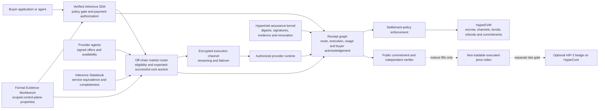
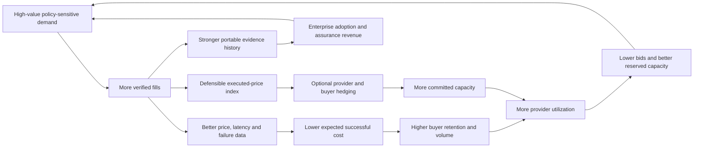

# HyperIntel Verified Inference Market

## Implementation ledger

This document is the end-to-end target architecture, not a completion claim.
The current repository completes the documented local, pure-data R0
implementation target. Its protocol fixtures are hermetic; its separate formal
process gate is environment-pinned to Z3 4.15.0. Its R1 work is limited to
authenticated records, a local replay database, one hermetic in-process
execution harness, authenticated reroute lineage, and a separate metadata-only
execution journal plus pure-data receipt reconciliation and strict local
runtime configuration, pure-data tenant authorization separation, and a local
injected operator-secret resolution seam; it has no HTTP gateway, external
provider runtime, ambient credential adapter, or external effect.

Implemented now:

- canonical inference-domain, assurance, routing, metering, settlement-intent,
  and portable evidence records;
- caller-controlled Ed25519 trust, validity, revocation, and tamper checks;
- provider-key signed-capacity-offer admission in the additive V2 evidence path;
- caller-trusted verifier signatures, typed provider/service bindings,
  observation and validity windows, source and methodology commitments, and
  exact floor-PPM count arithmetic in the additive V3 reliability path;
- deterministic expected-successful-cost routing, conservation, idempotency,
  V1/V2/V3 reconstruction, and offline verification;
- additive V4 reconstruction with one full typed eligibility report per
  candidate, selected-or-all-rejected outcomes, and optional fill artifacts
  whose presence must match the outcome; its causal profile distinguishes
  invalid assurance evidence, policy rejection, and invalid offer
  authentication without changing the legacy profiles;
- a deterministic replay transition over the exact caller-supplied buyer state
  for both selected and denied evaluations;
- caller-trusted authentication of an exact buyer policy, a non-authoritative
  admission bound to a reconstructed selected route and replay transition, a
  configured provider-receipt-key signature over one completed execution, and
  metering reconstruction from that signed receipt;
- a local SQLite replay store that verifies that authenticated admission,
  serializes writers, atomically advances the exact before-state, retains an
  immutable consumption record, and makes exact retry idempotent;
- a text-only OpenAI-shaped request and streaming-chunk subset that checks the
  exact prompt commitment, consumes one new admission before invoking only the
  selected injected provider, rejects exact retry without re-execution,
  applies deterministic cancellation and deadline boundaries, verifies a
  configured provider receipt signature, reconstructs metering, and derives a
  non-authoritative settlement intent;
- an authenticated reroute lineage from a verified zero-output
  provider-`UNAVAILABLE` attempt to a caller-supplied, buyer-signed next-nonce
  admission for the same buyer, service, and prompt and a different selected
  provider;
- a metadata-only SQLite execution journal with serialized exact starts and
  terminals, actual replay-store-bound restart classification, conflict and
  tamper rejection, no implicit resume, and explicit consumed-without-terminal
  recovery state;
- an identity-only receipt-reconciliation report that rechecks authenticated
  admission, durable consumption, journal lineage, completed or incomplete
  execution, stream shape and timing, provider receipt, metering, and
  non-authoritative settlement intent without retaining content;
- a strict 65,536-byte local-hermetic runtime configuration schema with a
  canonical digest, explicit distinct SQLite paths, bounded connection counts,
  and opaque immutable-version secret references without secret resolution;
- one-action, maximum-300-second tenant access grants bound to caller-owned
  policy, runtime, audience, resource ownership, and operation context, with
  dedicated IAM keys and signed rollback-pinned revocation snapshots;
- one atomic signed operator-secret authorization and injected local
  resolution call bound to the exact runtime, consumer, selected provider,
  immutable secret reference, purpose, operation, trust, and revocation
  checkpoint, returning only bounded redacted zeroize-on-drop material;
- provider-signed service-manifest and short-lived readiness assertions with
  purpose-separated trust, signed revocation, three-way rollback/fork
  checkpointing, and atomic preflight before one existing-harness call;
- committed V1–V4 fixtures exercised through the compiled CLI process,
  including caller-trust and fail-closed boundary cases; and
- a source-hash-bound Z3 4.15.0 two-candidate policy-non-widening check whose
  primary query is `unsat` and weakened-selector replay is `sat`.

Still absent: verification of the underlying reliability source observations,
rollback-resistant or independently anchored replay state, remote replication,
tenant isolation, production backup and database operations, HTTP gateway,
external provider runtime, network transport, live streaming or cancellation,
health and automatic route selection/failover, response-bearing execution-
session persistence, cross-database atomicity, contracts,
custody, funds, external settlement, independent reproduction, and production
authority. The implemented first R1 tracer is a
pure-data buyer-policy signature, selected-route admission, and provider-signed
completed-execution receipt that reconstructs metering without granting
execution authority. The separate local harness adds deterministic in-process
request release and partial-stream evidence only after a new durable consume;
it adds no external execution or settlement authority. Partial-output
economics, live cancellation, automatic reroute, response-bearing session
persistence, external/production reconciliation, and external settlement
remain outside the implemented slices.
V1, V2, and V3
are retained for compatibility, keep their narrower explicit nonclaims and
historical collapsed assurance-rejection profile, and are covered by exact
rejection/fallback report and bundle commitments.

Repository mutation authority comes only from [`docs/state-slices.md`](state-slices.md).
The product-object names below do not authorize implementation or external
effects.

## 1. Executive product decision

Build an OpenAI-compatible market for policy-compliant, SLA-backed, evidence-carrying inference.

> Buyers purchase the lowest expected-cost inference service that satisfies their explicit policy.\
> Providers earn more by supplying reliable capacity with stronger, independently checkable assurance.

The product is not a generic cheap-token router. It is a physical service market that makes inference offers economically comparable, routes only among policy-eligible providers, records what occurred, and settles actual usage against preauthorized funds and provider bonds.

The control-plane verification plan becomes part of the marketplace:

- The buyer SDK enforces model, provider, region, privacy, budget, tool, and assurance policies before releasing a request.
- The provider agent proves authorization, service configuration, availability, and—where supported—runtime measurements.
- The router produces a signed explanation of eligibility and selection.
- The metering service produces independently reconcilable usage records.
- The settlement system binds payment, refund, fees, and bond consequences to the receipt graph.
- Formal verification covers narrow control-plane and settlement invariants, never model truthfulness or output correctness.

Working product name: **HyperIntel Verified Inference Market**.

Category: **verifiable inference infrastructure and capacity clearing**.

Primary wedge: autonomous agents and regulated or financially sensitive systems that cannot route requests solely on advertised token price.

## 2. Product boundary

### Supported

- Canonical inference-service and model manifests.
- Authorized self-hosted providers, official providers, authorized resellers, and buyer-owned keys.
- OpenAI-compatible chat and streaming.
- Signed immediate-capacity and reserved-capacity offers.
- Policy-gated routing.
- Price, latency, availability, region, privacy, tool, and assurance constraints.
- Expected-successful-cost optimization.
- Buyer preauthorization and actual-cost settlement.
- Provider performance bonds.
- Signed route, execution, metering, refund, and settlement receipts.
- Runtime attestation where technically supported.
- Customer-runnable offline evidence verification.
- Formal checking of selected authorization, replay, arithmetic, and state-transition properties.
- HyperEVM escrow, bonds, commitments, refunds, and governance.
- A later non-tradable executed-price index.
- An optional later HIP-3 inference-price hedge.

### Explicitly unsupported claims

- AI alignment or truthfulness.
- Semantic correctness of an answer.
- Universal proof of model identity.
- Proof that a closed-model provider used a particular internal checkpoint unless that provider supplies a trustworthy signed statement.
- Whole-agent correctness.
- Confidentiality merely because a digest or blockchain commitment exists.
- Atomic exchange of irreversible inference delivery for payment.
- Portfolio-margin recognition for physical capacity, provider bonds, or marketplace escrow.
- Production readiness based on local tests, attestations, formal models, or testnet execution alone.

### Explicit exclusions

- Prediction markets.
- Binary-outcome products.
- HIP-4 integration.
- An inference token or capacity token.
- Governance tokens.
- Mainnet deployment before audit and capped-beta gates.
- Custody of seller API credentials as the normal supply model.
- Unlicensed resale of provider capacity.
- Subjective output-quality arbitration in the first release.

## 3. Competitive position

Surplus proves demand for aggregated inference supply and low-cost routing. The stronger differentiation is not another settlement chain.

| Dimension      | Conventional marketplace                        | HyperIntel market                                                        |
| -------------- | ----------------------------------------------- | ------------------------------------------------------------------------ |
| Supply         | Seller credentials or endpoints                 | Authorized provider agents, official supply, resellers, buyer-owned keys |
| Eligibility    | Model name and health                           | Canonical service equivalence plus buyer policy                          |
| Routing        | Lowest estimated request cost                   | Lowest expected successful cost among eligible offers                    |
| Assurance      | Domain reputation and health                    | Typed assurance facts with explicit assumptions and exclusions           |
| Model identity | Seller/provider assertion                       | Manifest identity, provider signature, optional runtime measurement      |
| Metering       | Operator record                                 | Reconciled provider, router, meter, and optional buyer receipts          |
| Payment risk   | Post-response charge or operator reconciliation | Preauthorized session balance, cumulative voucher, refund, provider bond |
| Audit          | Platform database and chain transaction         | Portable receipt bundle plus public commitment                           |
| Capacity       | Immediate inference                             | Immediate fills and reserved throughput windows                          |
| Enforcement    | Server-side routing rules                       | Buyer-local policy gateway plus server-side fail-closed admission        |
| Verification   | Operational tests                               | Kernel-checkable narrow properties and independent bundle replay         |

The economic unit is not “one million tokens.” It is:

`model/service manifest × region × latency tier × privacy profile × tool profile × assurance profile × availability window`

Only economically equivalent service units compete directly.

## 4. System architecture

### Plane separation

1. **Execution plane**

   Provider discovery, availability, scheduling, encrypted transport, streaming, cancellation, failover, and metering remain off-chain.

2. **Market plane**

   Signed offers, eligibility, equivalent-product classification, expected-successful-cost routing, capacity reservations, and provider performance statistics remain low-latency off-chain state.

3. **Assurance plane**

   Canonical manifests, evidence bundles, signature validation, runtime attestations, policy decisions, revocations, independent replay, and formal verdicts.

4. **Settlement plane**

   HyperEVM contracts hold buyer funds and provider bonds, verify authorized settlement summaries, process payouts and refunds, and publish commitments.

5. **Financial-risk plane**

   HyperCore enters only after the physical market generates a sufficiently robust executed-price index. HyperCore does not route prompts or deliver capacity.

## 5. Canonical state model

These names identify product-state objects. They are not repository mutation
authority; implementation mutations use the `hyperintel-*` slices in
[`docs/state-slices.md`](state-slices.md).

| State slice                   | Principal object                        |
| ----------------------------- | --------------------------------------- |
| `vim-service-registry-v1`     | `ServiceSpecV1`                         |
| `vim-provider-identity-v1`    | `ProviderIdentityV1`                    |
| `vim-capacity-offer-v1`       | `CapacityOfferV1`                       |
| `vim-buyer-policy-v1`         | `InferenceRequestPolicyV1`              |
| `vim-route-decision-v1`       | `RouteDecisionV1`                       |
| `vim-execution-session-v1`    | `ExecutionSessionV1`                    |
| `vim-execution-receipt-v1`    | `ExecutionReceiptV1`                    |
| `vim-metering-receipt-v1`     | `MeteringReceiptV1`                     |
| `vim-assurance-bundle-v1`     | `InferenceAssuranceBundleV1`            |
| `vim-payment-channel-v1`      | `CumulativePaymentVoucherV1`            |
| `vim-provider-bond-v1`        | `ProviderBondPositionV1`                |
| `vim-settlement-intent-v1`    | `PaymentSettlementIntentV1`             |
| `vim-dispute-v1`              | `ObjectiveDisputeRecordV1`              |
| `vim-receipt-commitment-v1`   | `ReceiptBatchCommitmentV1`              |
| `vim-capacity-reservation-v1` | `CapacityReservationV1`                 |
| `vim-index-publication-v1`    | `InferencePriceIndexObservationV1`      |
| `vim-hip3-hedge-v1`           | Separately governed hedge configuration |

Every object carries:

- Schema version.
- Domain-separated identity.
- Canonical serialization digest.
- Issuer and signing-key identity.
- Creation and validity times.
- Nonce or monotonic sequence.
- Parent-object digests.
- Assumptions and unsupported features.
- Revocation state where applicable.

## 6. Service specification

`ServiceSpecV1` defines the product being purchased:

- Canonical model family and release.
- Open-weight checkpoint digest or official provider service identifier.
- Tokenizer digest.
- Quantization and precision.
- Runtime and container-image digest.
- Prompt/template format.
- Context length.
- Supported tools and structured-output behavior.
- Streaming support.
- Region and data-egress boundary.
- Retention and logging declaration.
- Safety or content-policy profile.
- Latency and availability tier.
- Metering unit and rounding.
- Assurance facts and trust roots.

For open-weight supply, the manifest can bind weights, runtime, tokenizer, image, and attested measurements. This increases confidence in the declared execution environment but does not prove semantic correctness.

For closed providers, identity rests on official or reseller signatures and contractual authorization. Behavioral fingerprinting may detect anomalies but is never promoted to cryptographic proof.

## 7. Inference Statebook

Create an inference-native Statebook library. Reuse exact arithmetic, canonical identities, lineage separation, and independent completeness reporting from the existing Statebook work. Do not import terminal payoff, binary resolution, or outcome-market semantics.

Every candidate route receives separate reports:

- Service-spec completeness.
- Provider-authorization completeness.
- Execution completeness.
- Pricing and metering completeness.
- Capital and bond completeness.
- Settlement completeness.
- Assurance completeness.
- Recovery completeness.

There is no aggregate trust score. A lower price cannot compensate for an unmet privacy rule, unsupported model, invalid attestation, insufficient bond, missing settlement route, or stale offer.

The router first applies hard completeness and policy gates. It ranks only the surviving equivalent offers.

## 8. Routing algorithm

For eligible provider (i):

`ESCᵢ = quoted execution cost + expected retry cost + expected latency-violation cost + expected SLA-credit cost + settlement overhead`

Inputs include:

- Current signed offer.
- Requested input and maximum output.
- Measured success probability by failure class.
- Time-to-first-token and completion distributions.
- Capacity and queue depth.
- Failover probability.
- SLA credit exposure.
- Settlement and gas amortization.
- Provider and region concentration limits.

Assurance is not converted into a compensating scalar. The buyer specifies minimum acceptable assurance facts. The router optimizes only inside that eligible set.

Each `RouteDecisionV1` binds:

- Buyer-policy digest.
- Service-specification and buyer replay-snapshot digests.
- Canonically ordered candidate records and their eligibility-report digests.
- Selected provider, provider-identity, and offer digests.
- Exact selected cost decomposition, including maximum buyer debit.
- Routing algorithm and explicit evaluation time.
- An always-false authority field and a self-digest.

`RouteEvaluationRecordV1` retains the complete corresponding
`EligibilityReportV1` bodies, including typed failures and available cost, for
every candidate. It binds either the selected decision or a deterministic
`NoEligibleOffer` outcome. V4 reconstructs that full record from signed offers,
assurance evidence, reliability artifacts, and caller-controlled trust. Its
causal evaluation profile reports invalid assurance evidence separately from
policy rejection and invalid offer authentication. Legacy V1, V2, and V3
selectors deliberately retain the earlier collapsed rejection profile and its
wire commitments.

`ReplayStateTransitionV1` then binds the evaluation digest to the buyer's exact
policy, replay snapshot, next nonce, validity window, and deterministic
successor state. Selected and all-rejected evaluations both advance the supplied
cursor. This makes the local artifact independently reconstructable without
publishing prompt content. It does not authenticate the buyer, read or write a
database, prove the supplied cursor is current, perform atomic consumption, or
prevent rollback and concurrent reuse outside the artifact.

The separate local R1 store at `f5d3eff` supplies the missing database lookup
and atomic consumption step without changing V4. It verifies the authenticated
admission, uses a serialized SQLite transaction to compare the exact durable
before-state, advances to the deterministic after-state, and inserts one
immutable consumption record. It prevents concurrent reuse inside that
database, but not rollback by restoring an older database artifact, and it
does not release a prompt or contact a provider.

The hermetic R1 harness at `4c4b17f` supplies the next local step. It accepts a
text-only streaming request whose exact digest equals the authenticated prompt
commitment, verifies that the injected provider and receipt signer match the
selected provider, and requires `Applied` durable replay consumption before
invocation. `ExistingIdentical` is rejected, so retry cannot execute the same
admission twice. Provider substitution and cancellation at or before
consumption leave the nonce untouched.

The provider returns explicit in-memory text frames, token increments,
timestamps, and a runtime commitment. Completed execution must produce a
caller-trusted provider receipt signature before metering and the existing
non-authoritative settlement intent are reconstructed. Cancellation, deadline,
provider failure, and signer failure return typed non-completed evidence with
no metering or settlement artifacts. The contract runs separately selected
alpha and beta providers without a socket, external credential, wallet, chain,
fund, or value movement. Its request and chunk fields are a deliberate subset
of the official [Chat Completions API](https://developers.openai.com/api/reference/resources/chat),
not a deployed endpoint or full-compatibility claim.

Automatic provider substitution is prohibited. The authenticated admission
commits one provider and offer, so safe reroute requires a fresh route decision
and a buyer-authenticated next-nonce admission.

The local authenticated reroute slice at `379ee98` verifies that handoff after
one narrowly classified failure. The prior attempt and admission must verify as
provider `UNAVAILABLE` with zero chunks. The new admission must preserve buyer,
service, and prompt commitment; start from the prior durable after-state;
consume the next sequential nonce; select a different provider; and not regress
route-evaluation or admission time. Only then does the existing harness consume
and execute it. The contract advances one cursor from beta failure at nonce 1
to alpha completion at nonce 2.

Cancellation, deadline, partial output, signer failure, same-provider reuse,
prompt change, and stale lineage remain non-reroutable. The caller still owns
route selection and buyer signing; no health monitor, automatic failover, HTTP,
or external provider transport is added.

## 9. Provider lifecycle

1. Provider establishes organization and signing identity.
2. Provider proves control of its endpoint and payout address.
3. Marketplace verifies supply authorization and model redistribution rights.
4. Provider runs a local provider agent; the normal design does not surrender upstream API keys to the marketplace.
5. Provider publishes a signed service manifest.
6. Provider deposits a bond on HyperEVM.
7. Provider signs immediate and reserved-capacity offers.
8. Continuous passive and synthetic health measurements update eligibility.
9. Runtime attestations are refreshed where supported.
10. Revocation, key rotation, bond release, and provider exit follow explicit waiting and dispute rules.

Provider bonds cover objective obligations only:

- Accepted request not served.
- Availability-window breach.
- Signed capacity overcommitment.
- Metering fraud.
- Receipt equivocation.
- Invalid or stale attestation.
- Refusal to honor a valid refund or SLA credit.

Bonds do not guarantee that an answer is useful, truthful, safe, or correct.

## 10. Buyer lifecycle

1. Buyer creates a local `InferenceRequestPolicyV1`.
2. SDK validates policy, budget, nonce, and chain configuration.
3. Buyer funds a session escrow or signs a bounded payment authorization.
4. SDK sends request metadata to the router.
5. Router returns an eligible route ticket and provider channel details.
6. Prompt travels through the selected privacy mode.
7. Response streams to the buyer.
8. Provider, router, and meter emit receipts.
9. Buyer optionally signs acknowledgement or dispute notice.
10. Settlement engine calculates actual cost, platform fee, refund, and any SLA credit.
11. Cumulative payment state is settled periodically rather than forcing one on-chain transaction per token stream.
12. Buyer can verify the evidence bundle locally.

### Privacy modes

- **Standard:** TLS terminates at the marketplace edge; prompt and response bodies are not retained.
- **Direct sealed:** routing occurs on metadata, followed by a direct authenticated buyer-to-provider connection.
- **Attested confidential:** request termination occurs inside a measured confidential-compute boundary.

The UI must show which party can see plaintext in each mode. Hash commitments use salts or keyed commitments where low-entropy content could otherwise be guessed.

## 11. Receipt graph

A successful fill creates:

- `RouteReceiptV1`
- `ProviderExecutionReceiptV1`
- `MeteringReceiptV1`
- Optional `BuyerAcknowledgementV1`
- `SettlementCalculationV1`
- `PaymentSettlementReceiptV1`
- `ReceiptBatchCommitmentV1`

The provider receipt binds service manifest, request commitment, start/end times, completion status, runtime identity, usage, and output-stream commitment.

The metering receipt independently binds tokenizer or billing-unit version, input/output/cache units, rounding policy, and measured totals.

The settlement calculation proves:

`buyer debit = provider payout + platform fee - buyer refund - SLA credit`

A disconnected buyer cannot block payment merely by withholding acknowledgement. Higher-assurance tiers can require buyer acknowledgement, attested metering, or independent meter agreement before immediate finality.

## 12. HyperEVM contract suite

### `ProviderRegistry`

- Provider signing keys.
- Activation and revocation.
- Service-manifest commitments.
- Payout address.
- Bond requirements.
- Status and exit delay.

### `BuyerSessionEscrow`

- Allowlisted settlement assets.
- Session deposits.
- Per-session maximum exposure.
- Cumulative signed vouchers.
- Refund and escape paths.
- Nonce and expiry enforcement.

### `ProviderBondManager`

- Bond deposits.
- Service-specific required coverage.
- Pending liability.
- Objective penalty caps.
- Withdrawal delay.
- Dispute freeze.
- No penalty greater than posted bond.

### `SettlementHub`

- Idempotent settlement identity.
- Payout, refund, fee, and SLA-credit conservation.
- Receipt-root binding.
- Duplicate-settlement rejection.
- Batch settlement.
- Pause and recovery controls.

### `ReceiptCommitmentRegistry`

- Merkle-root commitments.
- Schema and verifier versions.
- Publication time.
- Revocation and supersession references.
- No prompt or response plaintext.

### `DisputeEscrow`

- Challenge windows.
- Typed objective disputes.
- Evidence submission.
- Deterministic adjudicator results.
- Human arbitration only for explicitly enumerated residual cases.

### `GovernanceController`

- Multisig ownership.
- Delayed upgrades and fee changes.
- Separate emergency-pause authority.
- Role separation between upgrades, settlement, treasury, and dispute administration.
- Public change announcements.
- Capped emergency powers and recovery procedure.

Use an explicitly verified, allowlisted HyperEVM token contract. Do not assume that Core USDC, an EVM token with the same symbol, and a linked Core asset are interchangeable.

HyperEVM is still documented as alpha. Mainnet deployment therefore requires capped balances, an escape hatch, external audits, independent RPC monitoring, and a no-CoreWriter dependency. [HyperEVM architecture](https://hyperliquid.gitbook.io/hyperliquid-docs/for-developers/hyperevm), [Core/EVM transfer caveats](https://hyperliquid.gitbook.io/hyperliquid-docs/for-developers/hyperevm/hypercore-less-than-greater-than-hyperevm-transfers).

## 13. Dispute policy

### Automatically adjudicable

- Expired or replayed request.
- Offer not active at routing time.
- Policy digest mismatch.
- Wrong service-manifest digest.
- Invalid provider or meter signature.
- Invalid attestation.
- Usage arithmetic mismatch.
- Actual charge above authorization.
- Duplicate payout.
- Late first token or completion against an objective clock.
- Reserved capacity unavailable.
- Payout/refund/fee conservation failure.

### Not automatically adjudicable in the first release

- Factual correctness.
- Usefulness.
- Style.
- Safety.
- Hidden reasoning.
- Subjective model degradation.
- Whether two semantically similar answers have equal quality.

Those cases receive operational support and reputation effects, not automatic slashing.

## 14. Formal verification and runtime enforcement

The formal workbench is an assurance component of the product, not a separate speculative business.

Initial properties:

- Unsupported service terms fail closed.
- Policy eligibility cannot widen during routing.
- Rejected or quarantined requests cannot reach execution.
- Route decisions bind the buyer policy, offer set, service manifest, and cost cap.
- Nonces and expired objects cannot be replayed.
- Actual settlement cannot exceed buyer authorization.
- Provider payout plus fee minus refund and credit conserves the escrow debit.
- Settlement identity is idempotent.
- Provider slashing cannot exceed the posted bond.
- Revoked keys cannot authorize new offers or receipts.
- Missing, stale, inconclusive, or unsupported proof verdicts cannot enable a privileged action.

Verdicts remain:

- `proved`
- `counterexample`
- `inconclusive`
- `unsupported`

R0 implements one bounded property in
[`formal-verification.md`](formal-verification.md). Its QF_LIA model abstracts
the canonical route order to two candidates with Boolean eligibility and
cost-presence flags plus a nonnegative total-order rank. Z3 4.15.0 returns
`unsat` for the claim that the implemented abstraction can select an ineligible
candidate. It then returns `sat` for a fixed replay in which a deliberately
weakened selector ignores eligibility and selects the cheaper ineligible
candidate.

The contract test pins the SHA-256 digest
`a0ea4bc9129b509692ac3d4b55e215ba3514056cb09c270cdbaf95142d1bb425`
for `crates/hyperintel-market/src/routing.rs`, the exact Z3 version string, and
the expected `unsat`/`sat` output. Source drift fails the test, but the SMT
model remains handwritten. It does not establish semantic correspondence to
Rust, serialization, networking, concurrency, Solidity, EVM behavior, or any
external state.

The current benchmark-OS checkout already supplies local claim envelopes, admission, digest checking, cost routing, audit bundles, attestation seams, and Statebook completeness patterns. It remains `Level1LocalReplayOrLower`; source-correspondent accepted evidence and runtime authority are not established. [Current repository ceiling](/Users/shaanp/Documents/GitHub/composed-zk-benchmark-os/README.md:22), [formal residual ceiling](/Users/shaanp/Documents/GitHub/composed-zk-benchmark-os/docs/615-phase-hsai-tiny-z3-post-campaign-residual-ceiling-report.md:112), [formal architecture boundary](/Users/shaanp/Documents/GitHub/composed-zk-benchmark-os/docs/265-hsai-formal-verification-evidence-architecture-boundary.md:74).

Product delivery and formal correspondence therefore advance in parallel:

- Marketplace functionality may ship under ordinary testing, audit, and capped-beta controls.
- “Machine-checked Rust-source property” claims remain blocked until source correspondence closes.
- Runtime proof enforcement activates only for the exact properties and versions with valid evidence bundles.

## 15. HyperCore strategy

HyperCore is a financial layer, not the physical market.

HyperCore’s order books match financial spot and perpetual instruments; they do not schedule GPUs, transmit encrypted prompts, meter tokens, or enforce inference SLAs. [HyperCore order book](https://hyperliquid.gitbook.io/hyperliquid-docs/hypercore/order-book).

### Phase 1: no HyperCore dependency

Use HyperEVM contracts and off-chain execution. Do not depend on CoreWriter or read precompiles for inference authorization, payment safety, or recovery. Official documentation remains inconsistent about the mainnet availability of some write-system features. [HyperEVM stage](https://hyperliquid.gitbook.io/hyperliquid-docs/hyperevm), [documented Core interaction](https://hyperliquid.gitbook.io/hyperliquid-docs/for-developers/hyperevm/interacting-with-hypercore).

### Phase 2: non-tradable reference index

After meaningful physical fills exist, publish:

`verified cost per one million accepted output tokens for manifest M, region R, latency tier L, and assurance profile A`

Index controls:

- Executed fills only.
- Unaffiliated provider and buyer minimums.
- Provider and buyer concentration caps.
- Self-trade exclusion.
- Robust outlier handling.
- Public calculation code.
- Reproducible source commitments.
- Stale-market flag.
- Publication suspension during insufficient activity.
- Independent monitoring.
- No use of seller-posted quotes as executed prices.

### Phase 3: optional HIP-3 hedge

A HIP-3 market is authorized only after the index survives manipulation, outage, staleness, and basis-risk studies.

Current HIP-3 obligations include a 500,000 HYPE mainnet deployer stake, continuous oracle operation, deployer responsibility for market definition and settlement, and possible validator slashing. Hyperliquid itself warns that many price indices are unsuitable for perpetuals. [HIP-3 specification](https://hyperliquid.gitbook.io/hyperliquid-docs/hyperliquid-improvement-proposals-hips/hip-3-builder-deployed-perpetuals), [deployer actions](https://hyperliquid.gitbook.io/hyperliquid-docs/for-developers/api/hip-3-deployer-actions).

The hedge manages index-price risk. It does not settle physical inference, collateralize provider obligations, or eliminate basis risk.

## 16. Business model

### Initial pricing hypothesis

| Revenue stream               | Initial model                                                                                    |
| ---------------------------- | ------------------------------------------------------------------------------------------------ |
| Execution                    | Transparent 4% buyer fee; volume tiers reduce toward 2%                                          |
| Enterprise assurance         | Monthly platform minimum for policy gateway, private deployment, evidence retention, and support |
| Reserved capacity            | 1–2% clearing fee on committed capacity notional                                                 |
| Premium verification         | Pass-through attestation/checker cost plus service margin                                        |
| Fast payout                  | Optional provider fee only where the marketplace advances funds                                  |
| Future HyperCore integration | User-approved builder fees or HIP-3 deployer fee share after separate approval                   |

Illustrative pricing must be validated during pilots. No hidden spread and no reliance on customer-fund yield.

### Unit economics

For a settlement period:

`gross revenue = execution fees + subscription revenue + reservation fees + verification fees`

`contribution profit = gross revenue - variable chain cost - verification compute - observability cost - SLA credits - guarantee losses - payment loss`

Track contribution profit by:

- Buyer.
- Provider.
- Service manifest.
- Region.
- Assurance profile.
- Payment rail.
- Immediate versus reserved capacity.

A provider discount that creates negative contribution margin is not “liquidity.” It is a subsidy and must be reported separately.

### Profit-generating flywheel

The flywheel has four compounding assets:

1. Verified demand.
2. High-quality authorized supply.
3. Proprietary executed-performance data.
4. Reproducible evidence and policy integrations.

The moat is the joint dataset connecting service identity, buyer policy, route selection, actual execution, SLA performance, and settlement—not the chain deployment alone.

## 17. Initial market

Launch one deliberately narrow product:

- One selected open-weight model manifest.
- One quantization and runtime profile.
- One region.
- One latency tier.
- Text chat and streaming only.
- Two providers in private alpha; three unaffiliated providers before mainnet.
- Buyer maximum-cost authorization.
- Signed immediate-capacity offers.
- Provider bonds.
- Route, execution, metering, and settlement receipts.
- HyperEVM testnet settlement.
- No token, derivatives, multi-model catalog, media generation, or subjective quality arbitration.

Ideal initial customers:

- Agentic developer tooling.
- Security automation.
- Research and data systems.
- Financial infrastructure requiring explicit model/provider policies.
- Enterprises needing regional, retention, and audit controls.

Avoid competing first for casual consumer prompts. The buyer must value reliability and evidence enough to support positive take-rate economics.

## 18. Release plan

| Release                      | Named state slices                                                      | Deliverable                                                                 | Hard gate                                                                                |
| ---------------------------- | ----------------------------------------------------------------------- | --------------------------------------------------------------------------- | ---------------------------------------------------------------------------------------- |
| R0 — Contracts and workbench (local implementation complete) | Service registry, buyer policy, signed offers, full route evaluation, pure replay transition, evidence bundle | Offline schemas, canonicalization, deterministic fixture simulation, V1–V4 verifier, one bounded formal property | Direct process fixture; unsupported inputs fail closed; no durable state or value movement |
| R1 — Private execution alpha | Execution session, receipts, provider identity                          | OpenAI-compatible streaming through two provider agents                     | Route replay; receipt reconciliation; fault-injection; no seller credentials held        |
| R2 — HyperEVM testnet        | Escrow, payment channel, bond, settlement intent, disputes              | Actual-cost testnet settlement and refund                                   | Contract invariants; zero duplicate settlement; token allowlist; role and upgrade review |
| R3 — Capped mainnet beta     | Receipt commitment, production operations                               | Limited paid market with capped balances and providers                      | External audits; four-week soak; incident drills; legal approval; escape path            |
| R4 — Reserved-capacity GA    | Capacity reservations, enterprise tenancy                               | Availability windows, enterprise policy gateway, on-prem verifier           | Tenant isolation; reservation stress tests; repeated customer proof-to-enforcement runs  |
| R5 — Reference index         | Index publication                                                       | Public non-tradable executed-price index                                    | Diversity, concentration, staleness, manipulation, and reproduction gates                |
| R6 — Optional HIP-3 hedge    | HIP-3 hedge                                                             | Testnet then separately approved mainnet perpetual                          | 500,000 HYPE approval; oracle operations; legal review; market makers; basis-risk limits |

The R0 implementation checklist is complete in the local lineage through
`6887ac1`. “Complete” is scoped to implemented local code and,
when the exact full gate passes, locally checked evidence. It does not mean
independently reproduced, private-alpha ready, production authorized, or able
to execute inference or move value. The V4 replay transition consumes no
external state, and the formal result proves only the stated handwritten
two-candidate abstraction.

R1 is the next MVP tranche: authenticated buyer admission, durable atomic
replay, an OpenAI-compatible gateway, two provider agents, deadlines,
streaming, cancellation, health and failover, signed execution and metering
receipts, tenant isolation, receipt reconciliation, fault injection, and a
synthetic no-funds soak.

The implemented first R1 tracer at `dbfbd48` is narrower: caller-trusted
buyer-policy authentication, admission bound to a reconstructed selected route
from V4-grade signed-offer, assurance, reliability, and replay inputs, a
caller-trusted provider receipt-key signature over one completed execution,
and metering reconstruction from that receipt. It remains pure data and does
not satisfy the private-alpha gate by itself.

The implemented local replay store at `f5d3eff` then consumes that admission's
exact transition with an atomic SQLite compare-and-swap. Its concurrency and
restart contract is locally checked. It is neither production persistence nor
request-release authority and does not satisfy the private-alpha gate by
itself.

The implemented hermetic execution harness at `4c4b17f` then binds the exact
text request to the prompt commitment, consumes the admission once, executes
only the selected injected provider, returns deterministic OpenAI-shaped
chunks, and reconstructs the signed receipt, metering, and non-authoritative
settlement intent on completion. It locally exercises alpha and beta plus
retry, substitution, cancellation, deadline, provider-failure, and
signer-failure cases. It has no HTTP, external provider, encrypted transport,
live cancellation, health, reroute, tenant isolation, credentials, funds, or
production acceptance and does not satisfy the private-alpha gate by itself.

The authenticated reroute slice at `379ee98` locally exercises the required
new-admission rule for a zero-output unavailable provider. It does not turn the
harness into a health system or automatic failover service and does not satisfy
the private-alpha gate by itself.

The metadata-only execution journal at `6a2d9d5` records canonical starts and
terminals around the harness and queries the durable replay store for restart
classification. Concurrent exact retries are idempotent; conflicting reuse,
false replay absence, cross-row/store mismatch, timestamp regression, and
implicit resume fail closed. A consumed admission with no terminal is
non-retriable. Because journal and replay writes remain separate SQLite
transactions, this adds crash inspection rather than atomic execution-session
commit or production recovery, and it does not satisfy the private-alpha gate
by itself.

The pure-data receipt reconciler at `f2b12a2` then produces a deterministic
identity-only report for valid completed and incomplete local executions. It
rejects record, stream, timing, economic, authority, and terminal-shape
mismatches and stores no prompt, response, signature, key, credential, or
arbitrary error text. It establishes local consistency only—not independent
metering, observation authenticity, payment, settlement finality, or
private-alpha acceptance.

The strict runtime configuration slice at `ec46411` validates one explicit
local-hermetic JSON document without defaults, environment merging,
interpolation, hot reload, path creation, database opening, socket binding, or
secret resolution. It provides configuration identity and deployment inputs,
not a deployed runtime or credential authority, and does not satisfy the
private-alpha gate by itself.

The tenant IAM slice at `f8a43dd`, hardened through `70a344b`, adds deterministic
local authorization separation. It verifies fixed-role one-action grants with
exact tenant, principal, audience, runtime, policy, resource, and operation
bindings and requires fresh signed revocation evidence under the current trust
record and rollback checkpoint. It issues no token, authenticates no real
person or organization, consumes no grant, and enforces no runtime or storage
isolation. It does not satisfy the private-alpha tenant-isolation or production-
IAM gate by itself.

The local secret-injection slice at `22ddd2c` verifies one short-lived signed
operator authorization and invokes one injected in-process resolver with exact
runtime, consumer, selected-provider, immutable-reference, purpose, operation,
trust-record, revocation-state, and checkpoint bindings. Preflight failures
invoke no resolver; success invokes it exactly once with no retry or fallback.
Returned bytes are bounded, non-cloneable, nonserializable, redacted, and
zeroize-on-drop. The slice includes no ambient source or real resolver adapter,
performs no network or provider call, and grants no deployment or production
credential authority; it does not satisfy the private-alpha provider-runtime
gate by itself.

The hermetic provider-agent control slice at `1944478` authenticates one exact
service manifest and `READY` assertion before entering the existing local
harness. It binds provider, agent, service, selected offer, runtime
configuration, model/tokenizer/runtime artifacts, capabilities, receipt key,
text-stream interface, secret-reference identity, evaluation/consumption time,
current trust, revocation state, and caller checkpoint. Invalid control leaves
replay and injected ports untouched; valid control enters the harness once
with no retry or fallback. The assertions are not observed health or capacity,
and the slice adds no socket, provider transport, real credential use, live
stream/cancellation propagation, deployment, or production authority.

## 19. First 12 weeks

### Weeks 1–2: freeze the market unit

- Select the first model/runtime profile.
- Freeze canonicalization and digest rules.
- Define service, offer, buyer-policy, route, receipt, and settlement schemas.
- Freeze assurance vocabulary and non-claims.
- Implement deterministic fixture corpus.
- Produce supplier and buyer legal term sheets.

### Weeks 3–4: provider and buyer edges

- Build provider agent.
- Build buyer SDK and OpenAI-compatible gateway.
- Implement streaming, cancellation, deadlines, and request commitments.
- Implement provider signing and key rotation.
- Add the standard privacy mode with explicit plaintext boundary.

### Weeks 5–6: Statebook and router

- Implement completeness reports.
- Implement hard eligibility gates.
- Implement expected-successful-cost routing.
- Add concentration limits and failover.
- Produce independently replayable route decisions.

### Weeks 7–8: receipts and HyperEVM testnet

- Implement execution and metering receipts.
- Implement cumulative payment vouchers.
- Deploy testnet registry, escrow, bond, settlement, and commitment contracts.
- Add refunds, duplicate protection, and objective dispute cases.

### Weeks 9–10: formal and adversarial gates

- Prove one narrow policy-non-widening property.
- Add counterexample replay.
- Add settlement conservation and replay property tests.
- Exercise provider equivocation, stale offers, bad signatures, usage inflation, chain reorg/retry, and client disconnects.
- Build the offline bundle verifier.

### Weeks 11–12: design-partner pilot

- Run sustained traffic through two providers.
- Measure expected successful cost against cheapest-price routing.
- Reconcile every fill from request authorization through settlement.
- Run provider failure, key compromise, upgrade, pause, refund, and recovery drills.
- Publish a bounded pilot report.
- Do not publish production-readiness or verified-model claims.

## 20. Operational and commercial gates

### Private-alpha exit

- Two authorized providers.
- Complete receipt graph on at least 99.9% of successful pilot requests.
- No unbounded replay or duplicate settlement.
- Every failover produces a replayable route explanation.
- Provider and router usage reconcile within the declared rounding policy.
- All unsupported policy combinations fail closed.

### Mainnet-beta entry

- Three unaffiliated providers.
- Two paying design partners.
- External contract audit.
- Independent application-security review.
- Four-week testnet soak.
- Practiced upgrade, pause, key-revocation, refund, dispute, and escape procedures.
- Fixed maximum buyer balance, provider bond, daily settlement, and total contract exposure.
- Verified settlement token and chain configuration.
- Legal approval for selected entities and jurisdictions.

### GA entry

- Positive contribution margin excluding one-time launch subsidies.
- Published support and assurance matrices.
- Tenant isolation and production IAM.
- KMS/HSM-backed production signing.
- Multi-region recovery.
- Independently runnable bundle verifier.
- Repeated customer proof-to-enforcement cycles.
- No unresolved high-severity audit findings.

### HIP-3 entry

- Positive physical-market contribution margin without trading revenue.
- Sufficient fill frequency and provider/buyer diversity.
- Public index code and methodology.
- Successful manipulation and outage studies.
- Continuous oracle-operation rehearsal.
- Independent oracle and legal reviews.
- Committed liquidity providers.
- Explicit acceptance of the 500,000 HYPE stake and slashing exposure.

## 21. Core metrics

### Market quality

- Eligible-fill rate.
- Expected successful cost.
- Realized buyer savings against equivalent direct service.
- Time to first token and completion percentiles.
- Failover rate and added latency.
- Provider concentration.
- Reserved-capacity utilization.

### Assurance

- Receipt-bundle completion.
- Independent replay success.
- Signature or digest disagreement.
- Attestation freshness.
- Policy-denial accuracy.
- Formal-verdict coverage by privileged state transition.
- Source-drift invalidations.

### Settlement and risk

- Authorized versus settled value.
- Refund latency.
- Failed settlement rate.
- Duplicate-settlement attempts rejected.
- Bond coverage against open liability.
- Dispute rate and loss.
- Contract and provider exposure.

### Profitability

- Gross marketplace volume.
- Net take rate.
- Revenue by stream.
- Contribution margin.
- Assurance cost per successful fill.
- Design-partner conversion.
- Buyer retention.
- Provider payback and utilization.

## 22. Security and governance

Required controls:

- Production KMS/HSM signing.
- Short-lived provider credentials.
- Separate router, settlement, upgrade, and treasury authorities.
- Multisig plus timelock for upgrades and fee changes.
- Emergency pause with bounded powers.
- Append-only audit records.
- Dependency and build provenance.
- SBOM and reproducible-release work.
- Independent contract and application audits.
- Continuous chain and settlement reconciliation.
- Provider, buyer, and index manipulation monitoring.
- Incident response with key revocation and bundle supersession.
- Data-retention and deletion controls.
- No prompt or response material in public commitments.

The first threat model must cover provider substitution, usage inflation, route manipulation, buyer non-payment, provider non-performance, signature compromise, replay, settlement duplication, contract upgrade abuse, chain instability, privacy leakage, collusion, and index manipulation.

## 23. Legal and organizational work

Before paid mainnet operation:

- Form the marketplace operating entity and separate treasury/signing authority.
- Execute provider agreements covering supply authorization, model rights, service levels, privacy, metering, payouts, bonds, and termination.
- Execute buyer terms covering policy limitations, refunds, acceptable use, data treatment, and unsupported correctness claims.
- Complete jurisdiction-specific payments, custody, money-transmission, sanctions, privacy, tax, and marketplace-liability analysis.
- Implement provider and enterprise onboarding controls appropriate to the resulting legal analysis.
- Obtain separate commodities, derivatives, market-operation, and oracle counsel before any HIP-3 launch.
- Keep physical marketplace operations and any later derivatives operations in separately governed risk books.
- Do not market bonds as insurance unless an actual regulated insurance arrangement exists.

Initial operating team:

- Product/market lead.
- Distributed-systems lead.
- Provider/GPU infrastructure engineers.
- Protocol and Solidity engineer.
- Formal-methods engineer.
- Security/reliability engineer.
- Enterprise integrations engineer.
- Supply and demand partnerships.
- Compliance and finance operations.

## 24. Repository architecture

The product repository is `HyperIntel`. The package list below is a target
modular architecture, not a claim that every package exists today.

Suggested packages:

- `inference-domain`
- `inference-canonical`
- `inference-statebook`
- `inference-policy`
- `inference-router`
- `inference-provider-agent`
- `inference-gateway`
- `inference-metering`
- `inference-evidence`
- `inference-settlement`
- `inference-hyperevm`
- `inference-index`
- `inference-operator`
- `inference-cli`
- `contracts/`

Reuse from HyperAI after generalization:

- Canonical JSON and domain-separated digests.
- Strict identifiers and timestamps.
- Content-addressed storage.
- Offline evidence verification.
- Signature activation and revocation.
- Deterministic intent identity.
- Persist-before-submit.
- Receipt binding.
- Authoritative reconciliation before retry.
- Durable job and audit patterns.

Do not import:

- `ClaimSpecV1`.
- `ClaimTruth`.
- `MarketBindingV1`.
- Binary resolution or finality.
- `hyperliquid-hip4`.
- Outcome-specific tables, APIs, and settlement types.

HyperAI’s current code remains a tested hermetic protocol and mock-settlement boundary, not a live marketplace. [HyperAI README](/Users/shaanp/Documents/GitHub/hyperAI/README.md:11), [current limitations](/Users/shaanp/Documents/GitHub/hyperAI/docs/outcomes/limitations.md:16).

Reuse from benchmark-OS and HSAI:

- Claim-envelope algebra.
- Typed admission.
- Digest and replay checks.
- Audit bundles.
- Model-lane provenance patterns.
- Attestation seams.
- Cost-escalation patterns for proof production.
- Statebook exact arithmetic and completeness reports.
- Formal evidence packaging.

Do not treat the existing HSAI cost router as an inference router. It routes review effort, not live service traffic.

## 25. Final product thesis

The defensible product is:

> A marketplace where inference is purchased as a precisely specified service, every route is policy-constrained, every fill produces an independently verifiable receipt graph, and payment and performance risk are enforced through HyperEVM escrow and bonds.

The business compounds through better verified supply, better routing data, deeper enterprise integration, reserved capacity, and eventually a defensible executed-price index.

Hyperliquid supplies settlement infrastructure and, later, financial risk transfer. It does not supply the physical market.

Formal methods prove selected control-plane properties. They do not prove model truthfulness.

The first build is one model, one region, three providers by mainnet, one policy gateway, one receipt format, and one capped HyperEVM settlement path. Everything broader waits behind measured demand, positive contribution margin, independent evidence, and explicit release gates.
